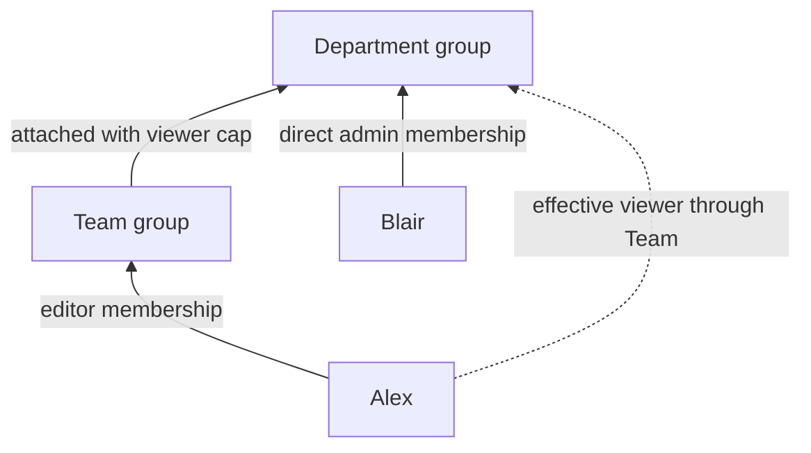
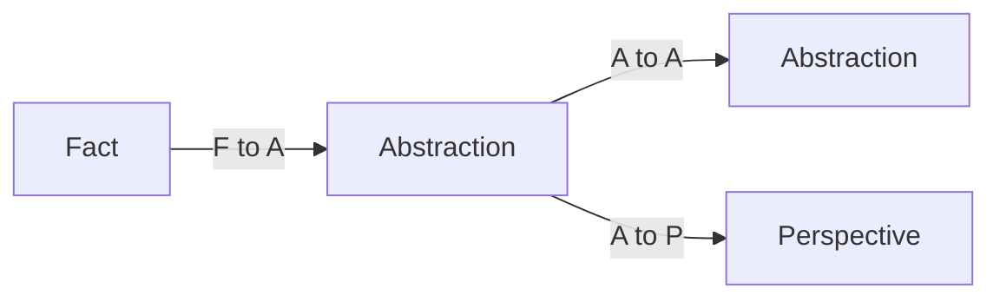
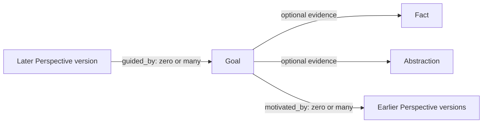
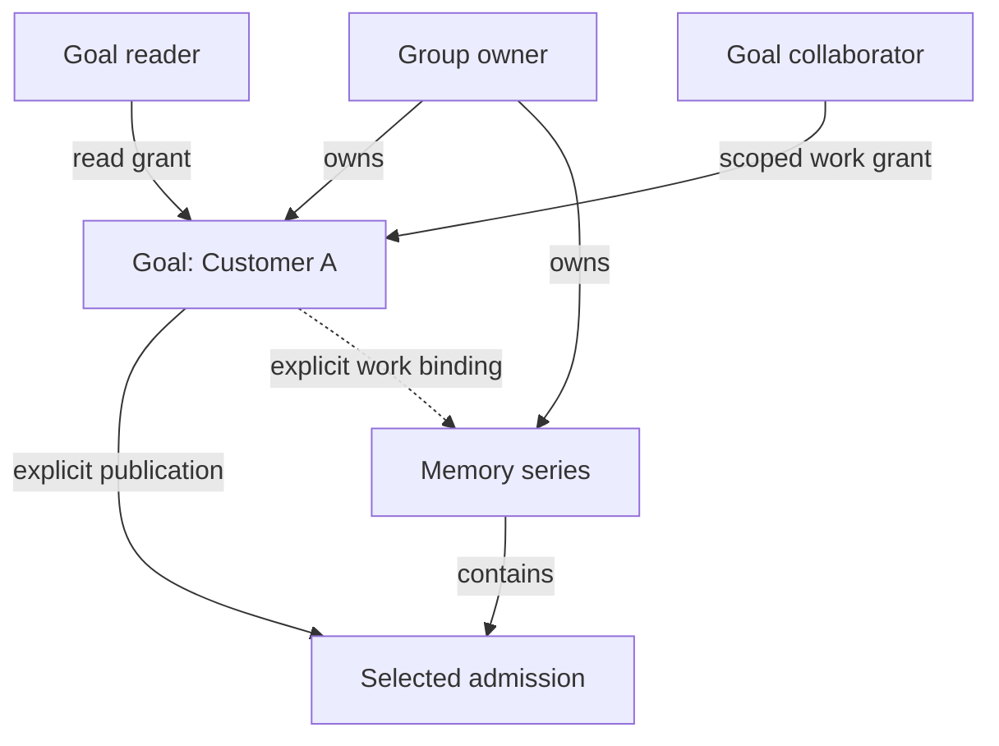
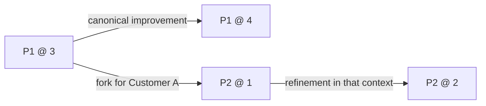

# Concepts

## The four kinds

| Kind | Meaning | Lifecycle |
|---|---|---|
| Fact | An admitted observation | Immutable row; later observations are new admissions |
| Abstraction | A typed, re-derivable pattern | Later `t` may advance its series |
| Perspective | A typed interpretation or stance | Later `t` may advance its series |
| Goal | A desired end-state and its dependencies | Lifecycle transitions append `t`; terminal states have no later transition |

Citation is provenance attached to a Fact or Abstraction. Self is a query over
cue-relevant Perspectives, never a stored entity. Actions and wake behavior
belong to the host integration; they are not a fifth memory kind.

## Identity and ownership

Every memory series and every Goal has exactly one owner, a person or a group.
The owner decides who reaches it. Access is a role resolved for the caller,
and that role is granted in one of two ways: by membership of the owner, or by
a grant on one Goal. Both produce the same role shape. Owner roles come from
memberships and Goal grants are read separately and joined with the owner role,
but a grant to a group is resolved through the same stored group roles that
membership uses.

Follow the [request flow](host-integration.md#authentication-and-owner-scope)
for integration and [Protocol](protocol.md#owner-scope) for transport behavior.
The [decisions](decisions.md#identity-and-ownership-have-separate-jobs) explain
why these boundaries exist.

A person, agent, or service is a principal (`UserId`). An owner is an `OwnerId`;
a group owner is also a `GroupId`. Writer attribution (`by`, `via`) records who
wrote a version and grants no access.

The host binds external credentials to principals and supplies the trusted
owner resolver. Proxiima carries the resulting authority through a sealed
`OwnerScope`, engine command ports, and PostgreSQL row-level security (RLS).
An owner UUID, a group name, a token claim an application interprets, or a
model label is no authorization proof. The stock OIDC adapter verifies the
credential and maps its issuer and subject before owner access is resolved.

### Owners

A principal's **personal owner** has the same UUID as the principal. It is the
principal's own space: its role is derived (`Role::personal`), nobody can edit
its membership, and that role does not manage. A group is the owner for shared
memory; an organization, department, project, or household maps onto one when it
needs shared memory. Business labels, account provisioning, and billing remain
host concerns. There is no universal-read owner.

Choose the owner to match the audience. A role applies to everything the owner
owns, never to one chosen note, so memory with a narrower audience needs its
own group.

### Roles

A role has five fields. The role representation and its constructors are in
[`Role`](https://github.com/Aquilo-Solution-S/proxiima/blob/main/crates/core/src/access.rs);
the kernel states it in
[Owner](https://github.com/Aquilo-Solution-S/proxiima/blob/main/docs/lean/Causa/Owner.lean).

| Field | Values | Governs |
|---|---|---|
| Read ceiling | none, Fact, Abstraction, Perspective | Which memory kinds may be read (`Fact < Abstraction < Perspective`) |
| Write ceiling | none, Fact, Abstraction, Perspective | Which memory kinds may be written; never above the read ceiling |
| Goals | none, reads, works | What the role may do with the owner's Goals |
| Administers | yes or no | Administering the owner |
| Manages | yes or no | Managing the group |

No capability follows from a ceiling. A memory ceiling grants no Goal access,
and Goal access grants no memory. Writing a kind implies reading it. The access
ladder is separate from the [derivation rules](#layering).

The four membership relations are presets of this role. Authorization reads
the role, never the relation name; the table is generated from `Relation::role()`.

| Relation | Reads | Writes | Goals | Administers | Manages |
|---|---|---|---|---|---|
| Personal (derived) | all kinds | all kinds | works | yes | no |
| Admin | all kinds | all kinds | works | yes | yes |
| Editor | all kinds | all kinds | works | no | no |
| Viewer | all kinds | none | works | no | no |
| Ingest | Facts | Facts | none | no | no |

An ingestion service therefore cannot read Perspectives. A role belongs to the
owner it is held in: an admin of one group holds a role in another group only
through a path that gives one, such as nesting, never because the relation is
called admin.

| Operation | Needs |
|---|---|
| Read or write a memory of kind *k* | Read or write ceiling covering *k* |
| Read an owner's Goals | Goals: reads or works |
| Set, modify, or transition a Goal | Goals: works |
| Achieve a Goal | Administers on the owner, or the Goal-specific route below |
| Decompose a Goal; transfer; erase one series; graph overview | Administers |
| Share a Goal (manage its audience) | Administers on a personal owner, or a Goal role that manages |
| Change membership; transfer from or to a group | Administers and manages |

Goal work follows the Goals field, not the write ceiling. A call declares Goal
work in the catalog (`OwnerNeed::GoalWork` on an action spec,
`HostTool::with_goal_work` on a host tool); the owner-role gate and every
listing read that declaration. This widens no memory write, with one bounded
exception: a host-state command declared Goal work (`GoalWorkCommand`) commits
on a `GoalWorkUnitOfWork` together with the Facts it declares, and those Facts
are admitted by the Goal-work gate, not the Fact write ceiling. A viewer
therefore sets a group Goal, and writes Facts only through such a command; every
other memory and host-state write keeps the write ceiling.

A Goal grant adds a second route to Goal edits. A caller whose owner role does
not work or administer the owner can still work a Goal, or achieve it, when the
current Goal role from its grants works Goals.

Erasing a whole owner is not a role question: explicit
[host authority](data-and-erasure.md#host-authority) decides it, and no role
authorizes it.

### Granting a role

**On the owner.** A principal holds a relation in a group, which grants the
relation's role in that group. A principal who holds several relations in one
group holds the join of their roles. Groups nest, as described next.

**On a smaller object.** A grant on one Goal names a subject and a role. The
subject is a person or a group. A member of an invited group holds the grant's
role capped by their own role in that group. Removing a person from the group
ends what the grant gave them at once, and the grant itself is untouched. A
grant to a group carries no audience management. Kernel:
[Audience](https://github.com/Aquilo-Solution-S/proxiima/blob/main/docs/lean/Causa/Audience.lean).
A grant adds access; it never takes away access the owner already gives. Goal
routes read live grants and live group roles, so removing a person from the
group, revoking the grant, or the grant's expiry ends the route at the next
statement. See
[Goal collaboration](#goal-collaboration).

### Nested groups: access travels upward

A group may be attached to a parent group with a relation, which caps the
authority its members inherit there. The groups form a forest with no fixed
depth limit. The shape is restricted:

| Structure | Behavior |
|---|---|
| Several levels, such as Team in Department in Company | Allowed; each step caps authority |
| Several children under one parent | Allowed |
| One subgroup under two parents | Refused: a group has at most one parent |
| A cycle, or a group attached to itself | Refused |
| One person in several unrelated groups | Allowed |



Alex is an editor of Team and, through it, a viewer of Department. Blair's
Department membership grants nothing in Team. Authority climbs from member to
parent and never descends to a parent's administrators.

Along one path, each edge takes the minimum of the two roles: the weaker
ceilings and Goals field, and administration or management only if both sides
have it. Across several paths into the same owner, the result takes the maximum
of each field. A viewer path therefore does not cancel an editor membership,
and removing a relation removes only its path. PostgreSQL stores the folded
result per person and group, so a read is one lookup.

Attaching a subgroup or changing its relation requires management of both
groups. Detaching requires management of either endpoint, and removing a person
requires management of the containing group. Membership edits serialize on the
group tree, recheck the caller's authority, and preserve a group's last manager
once one exists. Attaching a group elsewhere changes inherited access for its
whole subtree; it is not a way to share a few memories. The refusals and the
projection are exercised by the
[nested-group tests](https://github.com/Aquilo-Solution-S/proxiima/blob/main/crates/storage-pg/tests/nested_groups.rs)
and defined in the
[projection function](https://github.com/Aquilo-Solution-S/proxiima/blob/main/crates/storage-pg/definitions/functions.sql).

### Sharing a set of memories

A group is the audience for the memories it owns. Nesting composes people and
roles; it does not gather memories from several owners. A query, tag, list, or
pin creates no audience, and a pin to another owner's memory grants no access
to its target (an unreadable target is redacted).

To give a body of knowledge its own readers and maintainers, create a group for
that audience, add its members with roles, and write new series with the group
as owner. Reuse an existing group when membership and roles match. A panel that
brings people from two teams together is such a group, with direct person
memberships and no parent link to either team.

**Transfer** moves an existing series to another owner. It is the one way to
change a series' owner, and the rules are these:

- The unit is one memory series per call. All its versions move in place, the
  series keeps its identity and writer attribution, and the previous owner no
  longer owns it. Transfer is a move, not an additional share.
- The caller must administer the source owner (for a personal owner, its own
  principal; for a group, administers and manages) and must administer and
  manage the destination. The destination must therefore be a group.
- Goals do not transfer. A series that has a Goal or Perspective causal
  relation (a version guided by a Goal, or motivating one) does not transfer.
  A schema that declares `NotTransferable` is refused.
- Readers of the old owner lose access unless they hold a role in the
  destination. After the move, removing a member's last path to the group ends
  their future access; reads already made are not retracted. Destroying data is
  the separate [host-authorized erasure](data-and-erasure.md#host-authority).

The [transfer command](https://github.com/Aquilo-Solution-S/proxiima/blob/main/crates/core/src/engine/access_admin.rs)
owns these rules and
[owner_transfer.rs](https://github.com/Aquilo-Solution-S/proxiima/blob/main/crates/storage-pg/tests/owner_transfer.rs)
exercises them. See also [ownership and lifecycle](data-and-erasure.md#ownership-and-lifecycle).

Two other routes avoid moving a series. A [fork](#revision-shared-editing-and-fork)
starts an independent series from one exact version. [Goal collaboration](#goal-collaboration)
publishes exact versions to a Goal audience while the owner keeps the series.
Neither can hide information from people who already have owner access.

### Requests, sessions, and workers

A request carries its roles and its expiry once, in its owner scope. An expired
context reads, writes, and runs nothing; a token has no revocation before expiry
([decision](decisions.md#access-ends-at-token-expiry)). A membership change
applies to roles resolved after it. Open streams end at token expiry or the
maximum stream lifetime. Goal routes are the exception: they are read live (see
[granting a role](#granting-a-role)).

The owner scope bounds what a request can reach. `X-Proxiima-Owner` selects a
raw UUID, and a server-issued memory-space key selects an owner through the same
context. Selection chooses a default destination and does not confine the
request: reads stay within the context's readable owners and kind limits, and
each write targets one owner. Only a host that confines the context with
`narrowed_to_owner` limits it to one owner, and that cannot be undone. See
[owner scope](protocol.md#owner-scope).

A tool call passes three independent gates: the deployment serves the tool
(`ServedSurface`), the caller's scope permits the exact key (`ToolScope`), and
the role permits the effect on this owner and kind. Allowing a tool does not
make a viewer an editor, and an admin cannot call a command its scope excludes.
Listing and invocation read the same catalog declaration. Owner administration
is no read or write bypass in the row policies either: they derive access from
the memory ceilings and the Goal read and work settings, and none reads
administration.
See [capability admission](host-integration.md#capability-admission).

The store holds every role: the group role projection, Goal grants, and
delegated grants store the five fields in one shape
([the core baseline](https://github.com/Aquilo-Solution-S/proxiima/blob/main/crates/storage-pg/migrations/0069_baseline.sql),
[`role_columns.rs`](https://github.com/Aquilo-Solution-S/proxiima/blob/main/crates/storage-pg/src/access/role_columns.rs)).

| Mechanism | Purpose | Boundary |
|---|---|---|
| MCP transport session | Bind protocol requests to a principal and default owner | Later requests reauthenticate and must agree with the binding |
| Writer `via` | Keep caller or session provenance on a written version | Attested by authentication; not an access grant and not copied from the MCP session id |
| Delegation grant and redeemed phase | Let queued work run one bounded command | One owner and command, finite expiry, recorded role ceiling, fresh checks at redemption |

A delegated worker holds a `DelegationId` and redeems it when work starts; it
holds no broad bearer and no reusable authorization context. The
recorded ceiling never manages and works Goals only where it administers;
a promotion cannot widen it and a demotion below it refuses the next
redemption. Revocation blocks later redemption but does not cancel a phase
already redeemed; expiry still bounds it. See
[delegated work](host-integration.md#delegated-work).

A **trusted forwarder** is a host integration whose verified credential binds
one registered owner and the attested `by` and `via`. It stays the
authenticated subject, with writer attribution attested separately, and it
cannot issue delegation grants. It receives only the
configured viewer, ingest, or editor role at that owner, capped to read Goals at
most and never administering or managing. Ordinary memberships are not added.
See [forwarding](host-integration.md#forwarded-owner-access).

### Where the guarantees live

| Boundary | Evidence |
|---|---|
| One owner, role fields, personal membership, capped nesting | [Owner](https://github.com/Aquilo-Solution-S/proxiima/blob/main/docs/lean/Causa/Owner.lean), [Audience](https://github.com/Aquilo-Solution-S/proxiima/blob/main/docs/lean/Causa/Audience.lean), and [Authorization](https://github.com/Aquilo-Solution-S/proxiima/blob/main/docs/lean/Causa/Authorization.lean) |
| Verified identity and narrowing scope | [AuthzContext](https://github.com/Aquilo-Solution-S/proxiima/blob/main/crates/core/src/authz.rs) and [OwnerScope](https://github.com/Aquilo-Solution-S/proxiima/blob/main/crates/core/src/owner_scope.rs) |
| Effective memberships and transaction isolation | [Nested-group tests](https://github.com/Aquilo-Solution-S/proxiima/blob/main/crates/storage-pg/tests/nested_groups.rs) and [manager race tests](https://github.com/Aquilo-Solution-S/proxiima/blob/main/crates/storage-pg/src/access/group_manager_race_pg_tests.rs) |
| Per-owner database isolation | [Owner RLS](https://github.com/Aquilo-Solution-S/proxiima/blob/main/crates/storage-pg/definitions/policies.sql) and [multi-owner host tests](https://github.com/Aquilo-Solution-S/proxiima/blob/main/apps/proxiima-mcp/tests/multi_owner_e2e.rs) |

The Lean kernel states principles; it does not prove that Rust or SQL refines
them. Runtime types, database policies, and executable tests enforce the
implementation. An application still supplies its identity provider, business
membership policy, external effects, and lifecycle obligations.

## Memory identity and content

A memory series has a stable `handle`. Each admission has a unique `t` (the
row identity). The pair `(handle, t)` identifies a version; a head is a query
projection for the current version, not a replacement for version identity.
Facts remain immutable. Abstractions, Perspectives, and Goals append a later
version on the same handle rather than mutating an old row.

Every memory and Goal version also records `by`, the principal who wrote it,
and `via`, its caller session UUID or `null` for a direct principal call.
The sealed request context supplies this pair. It grants no authority and is
independent of ownership, payload authorship and grounding sources. Reads
return the stored pair; an exact replay retains it, a new version captures its
own writer, and transfer, forget and restore preserve it.

Typed payload is owner-scoped `Content`. Content may be shared by admissions
within its owner and schema, but shared content never collapses two `t` values.
Use the [core rustdoc source](https://github.com/Aquilo-Solution-S/proxiima/tree/main/crates/core/src)
for public types and constructors; use migrations for table shape.

## Layering

The epistemic layers are Fact, Abstraction, and Perspective. This diagram
shows **input to derived result**, not the direction of stored pins:



Derivation moves upward. A Fact cannot be produced from an Abstraction or
Perspective, and a Perspective cannot be used as the source of a lower-layer
write. An interpretation is a Perspective whose payload references what it
interprets. Similarity is a query result; it does not author a connection.

Stored origin pins point back from the result to its inputs: the Abstraction
derived from a Fact stores that Fact's version in its own `origins[]`.

**Goals express intent and sit outside these three layers.** A Perspective
can inform the decision to set a Goal, as the
[Spinning Wheel](index.md#the-spinning-wheel) illustrates. That conceptual
flow is not a persisted Perspective-to-Goal derivation rule.

The [operator vocabulary](https://github.com/Aquilo-Solution-S/proxiima/blob/main/docs/lean/Causa/Operators.lean)
also names `AtoGoal`: its Abstraction inputs are recorded as Goal evidence,
using references rather than memory-origin pins. There is no corresponding
`PtoGoal` operator. Ordinary Goal creation can have no evidence at all; when
supplied, evidence is a Fact or Abstraction. Perspectives and Goals can also
record explicit motivation and guidance. These are the distinct
[Goal relationships](#goals), not another step of the F/A/P ladder.

## Pins

There is no edge table. A pin array stores only target `t` values. The source
array and the write operation determine direction and mechanical role:

| Pin | Meaning | Stored on |
|---|---|---|
| Origin | What produced this derived row | `memory.origins[]` |
| Reference | What a typed payload or explicit causal declaration points at | `memory.refs[]`, `memory.goal_refs[]`, or `memory.guided_by[]`; Goal-owned reference fields |
| Read | What the writing session read before this write, as its host certified | `memory.reads[]` |

The operation determines the pin kind; no public verb writes an edge. Origins
and references are source-owned and rebuildable from node content. A source may
remain visible while an unreadable target is independently redacted. Pin kinds
are distinct from the meanings of motivation and guidance.
`guided_by[]` and `motivated_by[]` are explicit source-owned declarations;
their pins are ordinary References.

Read pins are context, not grounding. The host binds the read set to the
call (`AuthzContext::with_read_set`), never a tool argument, and every memory
that call writes keeps it. Each named memory must be live and readable by the
caller in the named space when the write commits, or the whole write is
refused. A read of another store's memory is read there as the caller first,
the way an other-store origin is; an unreadable one, or one with no
other-stores port configured, refuses the whole write. A memory named both as
an origin or reference and as a read is stored once, as the declared pin. A
read pin never counts as an origin or reference: a Fact may carry one, and it
may point at any layer. Neighbours and lineage walks return local read pins in
both directions; an other-store read is a leaf of ancestor walks only, since
descendant walks cannot see into another store. Erasing either end leaves no
dangling pin.

## Goals

A Goal states what is desired, whose direction it is, its lifecycle state, and
what it depends on. Goal decomposition, evidence, and motivation are fields of
the Goal version, so the Goal owns those references. Motivation and evidence
are optional: a Goal may contain only its title and words. Supplied evidence
must be a Fact or Abstraction. A Perspective can explain why a Goal was chosen
without being evidence for it.
A lifecycle transition is
an appended `t`; there is no supersession pointer and no in-place mutation.

Here the arrows show **stored references from each declaring version to its targets**:



`motivated_by` records the exact Perspective versions that motivated a Goal
version. `guided_by` records the exact Goal versions that actually guided a
new Perspective version. Both lists can name several targets, and every
target belongs to the same owner as the declaring version. Creating a Goal
does not change its motivating Perspectives or assign work to an actor.

Conceptually, the feedback is `Perspective@1` motivates `Goal@1`, which guides
`Perspective@2`. Stored references point backward from each declaration to
its inputs: `Goal@1.motivated_by = [Perspective@1]`, then
`Perspective@2.guided_by = [Goal@1]`. Later versions never retarget those pins.
Goal guidance is context for a Perspective; it does not replace its required
F/A/P grounding.

| Relationship | Targets per source version |
|---|---|
| Goal to owner | Exactly one |
| Goal to motivating Perspectives | Zero or many |
| Perspective to guiding Goals | Zero or many |
| Goal to evidence Facts or Abstractions | Zero or many |
| Goal to dependency Goals | Zero or many |
| Goal to parent Goal | Zero or one |

The former singular Perspective assignment remains historical metadata on
the Goal versions that stored it. New Goal writes do not accept an assignment
or copy it into a successor. An intended recipient is not relabelled as
motivation or actual guidance.

Goals form a plain tree. `decompose` creates child Goals under a parent; each
child records its parent's series once, at creation, and every later version
of the child keeps it (a Goal is never its own parent, and the parent exists
first, so there are no cycles). The parent still appears among the child's
dependencies. An open Goal (Active or Paused) never sits under a closed one
(Achieved or Abandoned): a parent is achieved or abandoned only once none of
its children's current versions is open, and achieving also needs one
Achieved child. Every Goal below a closed Goal is therefore closed, at any
depth. Pausing a parent is always allowed. Abandon does not cascade, and plain
dependencies between Goals do not make a tree.

Scheduling and execution are host decisions. See
[host integration](host-integration.md) for the boundary.

## Goal collaboration

A Goal organizes work and can carry explicitly delegated authority over that
work. Each Goal and memory series retains one durable owner, either personal
or a Group. Participation never makes the Goal an owner, changes a memory's owner, or adds its owner to a
participant's general owner scope.

| Relationship | Target | Effect |
|---|---|---|
| Context | A memory related to a Goal | Organizes work without granting access |
| Publication | An exact admission and a Goal audience | Grants access under the source owner's consent |
| Work binding | A series and a working Goal | Authorized collaborators share one revision history |

These relationships are N:M. One memory can be relevant to several Goals,
published to several audiences, and intentionally edited through several
working Goals. Motivation, evidence, guidance, and provenance retain their
existing meanings; they do not publish targets or mint permissions. Parent,
child, sibling, and dependency relationships grant no implicit access.



A publication delegates access to the Goal’s managed audience: members of
its owning Group participate through their existing Roles, alongside the
subjects of Goal grants. A grant names a person or a group and a role (see
[granting a role](#granting-a-role)), a group's members hold the grant as far as their own roles allow, and a
group subject includes people who join it later. The two routes combine; removing a Goal grant does not remove an
existing Group Role. A change of source owner (a
[transfer](#sharing-a-set-of-memories)) or of Goal controller invalidates
that delegation; changing back does not revive it. Forking a published
version into another owner requires explicit source-owner fork permission
and write permission at the destination.

Erasing a person removes the Goal grants that name them. Sharing decisions and issuer
attribution owned by a Group remain with that Group, alongside its Goals and
memories. Recreating the person's identity does not restore their removed grants.

### Facts and versioned knowledge

A Fact is one immutable admitted observation. A new or corrected observation
is another Fact. Abstractions and Perspectives append later versions to their
series; Goals are versioned separately as intent and progress change.

Publication means **publish a Fact, or a specific Abstraction or Perspective
version, to a Goal audience**. Publishing `P1@3` does not publish `P1@4`.
A private later version neither leaks to that audience nor hides its earlier
publication. Reads choose the latest authorized version after applying
visibility, rather than filtering only the series' global head.

### Revision, shared editing, and fork

A revision improves the same Perspective or Abstraction. A fork starts a new
series from a chosen exact version so an adaptation develops independently.
Fork once to establish that line; later refinements append within the new series.



Both series may retain the same Group owner. A different destination requires
authorized source use and destination writing; a Goal relationship alone
grants neither. The exact source stays identifiable in provenance, and attribution records the
writer of each new admission. A revision may retain its existing grounding
without granting access to hidden source payloads; newly declared sources
still require read permission. Withdrawing a publication removes that access
route. An independently authorized fork remains the destination owner's
knowledge, subject to its own erase and retention rules.

An Abstraction fork preserves its citation. Within one owner it reuses the
citation; across owners it creates or reuses destination-owned citation
metadata pointing to the same immutable attachment bytes. Forking does not
upload a second file or clone the referenced memory graph. Erasing the source
keeps the shared object while the destination still retains it; removing the
last reference allows the existing purge process to delete it. Perspectives
never carry citations.

For one company playbook, two teams may intentionally edit the same series
through their Goals. They share its drafts and history. For customer-specific
pricing, use independent series or forks. Two Goals linked to one editable
series do not create two isolated histories. A universal one-working-Goal
limit is therefore unnecessary.

### Work and sharing boundaries

| Operation | Authority boundary |
|---|---|
| Read a publication | Exact admission, source-owner consent, and an applicable owning-Group Role or Goal grant |
| Read a working draft | Explicit series work binding and applicable read ceiling |
| Create or revise Abstractions or Perspectives | Explicit work destination and applicable write ceiling |
| Edit a Goal's title or progress | Owning-Group Role or Goal grant whose role works Goals; ordinary lifecycle rules still apply |
| Publish or change an audience | Explicit authority for that sharing operation |
| Transfer or erase | Existing owner/lifecycle authority; Goal work grants do not provide it |

A narrow work grant never becomes an owner-wide write permit. Goal permissions
add access routes, so a private Goal cannot hide HR material from someone who
already reads the owning Group. Restricted owners remain necessary for durable
confidentiality boundaries.

Goal metadata is information too. Title, progress, participants, children, and
history need a deliberate audience; memory publication does not implicitly
disclose the surrounding Goal or provenance graph. Hiding source pins does not
remove sensitive claims or source identifiers from a published payload. Reading
a named target still requires its own permission.

Revoking one Goal route leaves other valid routes intact. Owner or controller
changes invalidate stale authorizations permanently: changing A to B and back
to A cannot revive them. Permission changes and writes have a defined atomic
ordering. Completing a Goal preserves explicitly granted publications.
Revocation and disabling/deleting an access route are separate actions; none
implicitly deletes the owner's memories.

For example, Sales owns the internal proposal and the Customer A Goal. Sales
publishes a selected version to Customer A while keeping pricing drafts
private. A collaborator edits only bound working series. Independent customer
adaptations fork; customer access does not reach Customer B, the parent sales
Goal, or undisclosed source material.

Types, mandatory row security, atomic command ports, and host round-trip tests
must enforce these boundaries. The Lean kernel states their principles;
diagrams and benchmarks are not runtime enforcement.

## Citations

`blob_id` is an optional citation on Facts and Abstractions. Perspectives do
not cite. A citation is bibliographic or artefact provenance, not a graph node,
pin, or proof that the cited material is true. Its storage and ownership
contract is part of the data and erasure surface.

A Goal publication of a Fact citing an uploaded object captures its completed
upload. The audience reads that object version through the exact publication;
a later upload does not silently change the shared file or its metadata.
Revoking the publication removes this route as well.

## Self

Self is cue-indexed:

```text
situatedSelf(owner, cue) = the owner's head Perspectives that touch cue
```

The query result changes with the owner and cue. It is not a row, an
authorization carrier, a parameterless global projection, or a cached causal
chain.

## Kernel boundary

The Lean kernel states these principles. Code and tests establish runtime
behavior; they are not inferred from prose. Start with
[Principles.lean](https://github.com/Aquilo-Solution-S/proxiima/blob/main/docs/lean/Causa/Principles.lean),
[Memory.lean](https://github.com/Aquilo-Solution-S/proxiima/blob/main/docs/lean/Causa/Memory.lean),
[Edges.lean](https://github.com/Aquilo-Solution-S/proxiima/blob/main/docs/lean/Causa/Edges.lean),
and [Goals.lean](https://github.com/Aquilo-Solution-S/proxiima/blob/main/docs/lean/Causa/Goals.lean).
