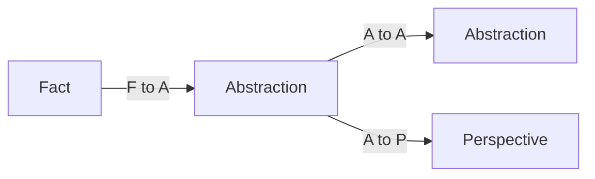
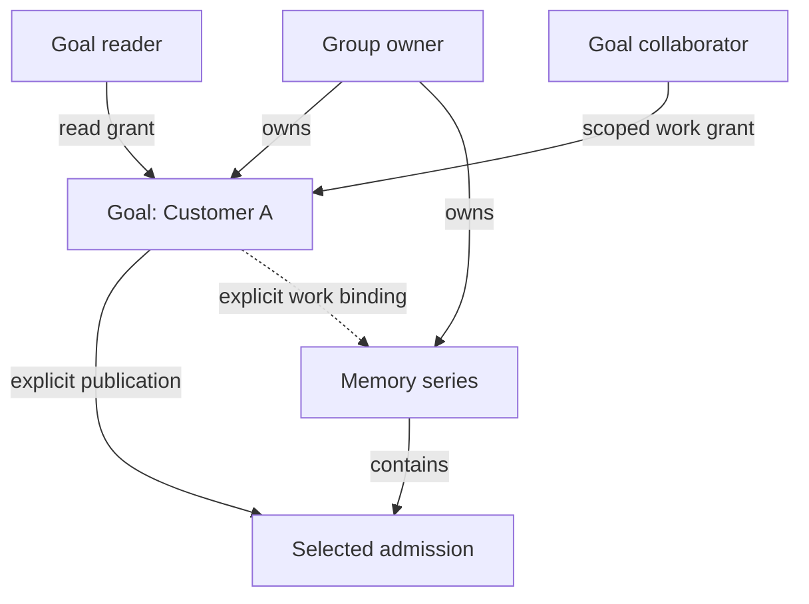
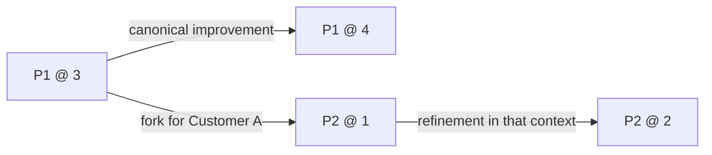

# Concepts

## The four kinds

| Kind | Meaning | Lifecycle |
|---|---|---|
| Fact | An admitted observation | Immutable row; later observations are new admissions |
| Abstraction | A typed, re-derivable pattern | Later `t` may advance its series |
| Perspective | A typed interpretation or stance | Later `t` may advance its series |
| Goal | A desired end-state | [`Proxiima.Goals`](ledger.md#goals) |

Citation is provenance attached to a Fact or Abstraction. Self is a query over
cue-relevant Perspectives, never a stored entity. Actions and wake behavior
belong to the host integration; they are not a fifth memory kind.

## Identity and ownership

The [`Proxiima.OwnerAuthority`](ledger.md#owner-authority) ledger defines durable ownership and owner roles.
For exact-version publications and grants, see [Goal collaboration](#goal-collaboration).

Follow the [request flow](host-integration.md#authentication-and-owner-scope)
for integration and [Protocol](protocol.md#owner-scope) for transport behavior.
The [decisions](decisions.md#identity-and-ownership-have-separate-jobs) explain
why these boundaries exist.

A person, agent, or service is a principal (`UserId`). An owner is an `OwnerId`;
a group owner is also a `GroupId`. See [`Proxiima.Identity`](ledger.md#identity).

The host binds external credentials to principals and supplies the trusted
owner resolver. Proxiima carries the resulting authority through a sealed
`OwnerScope`, engine command ports, and PostgreSQL row-level security (RLS).
An owner UUID, a group name, a token claim an application interprets, or a
model label is no authorization proof. The stock OIDC adapter verifies the
credential and maps its issuer and subject before owner access is resolved.

### Owners

Personal owners and shared groups follow [`Proxiima.OwnerAuthority`](ledger.md#owner-authority).
Business labels, account provisioning and billing belong to the host.

Choose the owner to match the intended audience. Use a separate group for a body of
knowledge that needs its own readers and maintainers.

### Roles

The role fields, memory and Goal capability axes, and all five presets are in [`Proxiima.OwnerAuthority`](ledger.md#owner-authority).
See [host authority](data-and-erasure.md#host-authority) for erasing a whole owner.

### Granting a role

**On the owner.** Direct relations and inherited roles follow [`Proxiima.OwnerAuthority`](ledger.md#owner-authority).

**On a smaller object.** A grant on one Goal names a subject and a role. The
subject is a person or a group. A member of an invited group holds the grant's
role capped by their own role in that group. Removing a person from the group
ends what the grant gave them at once, and the grant itself is untouched. A
grant to a group carries no audience management. Kernel:
[Audience](https://github.com/Aquilo-Solution-S/proxiima/blob/main/lean/Causa/Audience.lean).
A grant adds access; it never takes away access the owner already gives. Goal
routes read live grants and live group roles, so removing a person from the
group, revoking the grant, or the grant's expiry ends the route at the next
statement. See
[Goal collaboration](#goal-collaboration).

### Nested groups: access travels upward

Group containment and inherited authority follow [`Proxiima.OwnerAuthority`](ledger.md#owner-authority).
This lets a team read department-wide knowledge while keeping the team's own work within its membership.

### Sharing a set of memories

Whole-series transfers follow [`Proxiima.OwnerAuthority`](ledger.md#owner-authority).
See [ownership and lifecycle](data-and-erasure.md#ownership-and-lifecycle),
[revision and fork](#revision-shared-editing-and-fork), and [Goal collaboration](#goal-collaboration).

### Requests, sessions, and workers

Request confinement and owner selection follow [`Proxiima.OwnerAuthority`](ledger.md#owner-authority).
See [owner scope](protocol.md#owner-scope), [token expiry](decisions.md#access-ends-at-token-expiry),
and [granting a role](#granting-a-role) for live Goal routes.

A tool call passes three independent gates: the deployment serves the tool
(`ServedSurface`), the caller's scope permits the exact key (`ToolScope`), and
the role permits the effect on this owner and kind. Allowing a tool does not
make a viewer an editor, and an admin cannot call a command its scope excludes.
Listing and invocation read the same catalog declaration. See [capability admission](host-integration.md#capability-admission).

| Mechanism | Purpose | Boundary |
|---|---|---|
| MCP transport session | Bind protocol requests to a principal and default owner | Later requests reauthenticate and must agree with the binding |
| Writer `via` | [Writer attribution](ledger.md#identity) | The authenticator supplies it independently of the MCP transport session |
| Delegation grant and redeemed phase | Let queued work run one bounded command | One owner and command, finite expiry, recorded role ceiling, fresh checks at redemption |

A delegated worker holds a `DelegationId` and redeems it when work starts; it
holds no broad bearer and no reusable authorization context. The
recorded ceiling never manages and works Goals only where it administers;
a promotion cannot widen it and a demotion below it refuses the next
redemption. Revocation blocks later redemption but does not cancel a phase
already redeemed; expiry still bounds it. See
[delegated work](host-integration.md#delegated-work).

A **trusted forwarder** is a host integration whose verified credential binds
one registered owner and the attested `by` and `via`. It stays the
authenticated subject, with writer attribution attested separately, and it
cannot issue delegation grants. It receives only the
configured viewer, ingest, or editor role at that owner, capped to read Goals at
most and never administering or managing. Ordinary memberships are not added.
See [forwarding](host-integration.md#forwarded-owner-access).

### Where the guarantees live

| Boundary | Evidence |
|---|---|
| Owner roles, personal membership, and capped nesting | [`Proxiima.OwnerAuthority`](ledger.md#owner-authority) and the [Causa proofs](https://github.com/Aquilo-Solution-S/proxiima/blob/main/lean/Causa/Owner.lean) |
| Verified identity and narrowing scope | [AuthzContext](https://github.com/Aquilo-Solution-S/proxiima/blob/main/crates/core/src/authz.rs) and [OwnerScope](https://github.com/Aquilo-Solution-S/proxiima/blob/main/crates/core/src/owner_scope.rs) |
| Effective memberships and transaction isolation | [Nested-group tests](https://github.com/Aquilo-Solution-S/proxiima/blob/main/crates/storage-pg/tests/nested_groups.rs) and [manager race tests](https://github.com/Aquilo-Solution-S/proxiima/blob/main/crates/storage-pg/src/access/group_manager_race_pg_tests.rs) |
| Per-owner database isolation | [Owner RLS](https://github.com/Aquilo-Solution-S/proxiima/blob/main/crates/storage-pg/definitions/policies.sql) and [multi-owner host tests](https://github.com/Aquilo-Solution-S/proxiima/blob/main/apps/proxiima-mcp/tests/multi_owner_e2e.rs) |

The Lean kernel states principles; it does not prove that Rust or SQL refines
them. Runtime types, database policies, and executable tests enforce the
implementation. An application still supplies its identity provider, business
membership policy, external effects, and lifecycle obligations.

## Memory identity and content

Facts remain immutable. See [`Proxiima.Identity`](ledger.md#identity).

Use the [core rustdoc source](https://github.com/Aquilo-Solution-S/proxiima/tree/main/crates/core/src)
for public types and constructors. Use migrations for table shape.

## Layering

The epistemic layers are Fact, Abstraction, and Perspective. This diagram
shows **input to derived result**, not the direction of stored pins:



Derivation moves upward. A Fact cannot be produced from an Abstraction or
Perspective, and a Perspective cannot be used as the source of a lower-layer
write. An interpretation is a Perspective whose payload references what it
interprets. Similarity is a query result; it does not author a connection.

Stored origin pins point back from the result to its inputs: the Abstraction
derived from a Fact stores that Fact's version in its own `origins[]`.

[`Proxiima.Goals`](ledger.md#goals) and `Causa.principle_8_a_goal_never_grounds`.

## Pins

There is no edge table. A pin array stores only target `t` values. The source
array and the write operation determine direction and mechanical role:

| Pin | Meaning | Stored on |
|---|---|---|
| Origin | What produced this derived row | `memory.origins[]` |
| Reference | What a typed payload or explicit causal declaration points at | `memory.refs[]`, `memory.goal_refs[]`, or `memory.guided_by[]`; Goal-owned reference fields |
| Read | What the writing session read before this write, as its host certified | `memory.reads[]` |

The operation determines the pin kind; no public verb writes an edge. Origins
and references are source-owned and rebuildable from node content. A source may
remain visible while an unreadable target is independently redacted. Pin kinds
are distinct from the meanings of motivation and guidance.
`guided_by[]` and `motivated_by[]` are explicit source-owned declarations;
their pins are ordinary References.

Read pins are context, not grounding. The host binds the read set to the
call (`AuthzContext::with_read_set`), never a tool argument, and every memory
that call writes keeps it. Each named memory must be live and readable by the
caller in the named space when the write commits, or the whole write is
refused. A read of another store's memory is read there as the caller first,
the way an other-store origin is; an unreadable one, or one with no
other-stores port configured, refuses the whole write. A memory named both as
an origin or reference and as a read is stored once, as the declared pin. A
read pin never counts as an origin or reference: a Fact may carry one, and it
may point at any layer. Neighbours and lineage walks return local read pins in
both directions; an other-store read is a leaf of ancestor walks only, since
descendant walks cannot see into another store. Erasing either end leaves no
dangling pin.

## Goals

[`Proxiima.Goals`](ledger.md#goals).

## Goal collaboration

A Goal organizes work and can carry explicitly delegated authority over that
work. Each Goal and memory series retains one durable owner, either personal
or a Group. Participation never makes the Goal an owner, changes a memory's owner, or adds its owner to a
participant's general owner scope.

| Relationship | Target | Effect |
|---|---|---|
| Context | A memory related to a Goal | Organizes work without granting access |
| Publication | An exact admission and a Goal audience | Grants access under the source owner's consent |
| Work binding | A series and a working Goal | Authorized collaborators share one revision history |

These relationships are N:M. One memory can be relevant to several Goals,
published to several audiences, and intentionally edited through several
working Goals. Motivation, evidence, guidance, and provenance retain their
existing meanings; they do not publish targets or mint permissions. Parent,
child, sibling, and dependency relationships grant no implicit access.



A publication delegates access to the Goal’s managed audience: members of
its owning Group participate through their existing Roles, alongside the
subjects of Goal grants. A grant names a person or a group and a role (see
[granting a role](#granting-a-role)), a group's members hold the grant as far as their own roles allow, and a
group subject includes people who join it later. The two routes combine; removing a Goal grant does not remove an
existing Group Role. A change of source owner (a
[transfer](#sharing-a-set-of-memories)) or of Goal controller invalidates
that delegation; changing back does not revive it. Forking a published
version into another owner requires explicit source-owner fork permission
and write permission at the destination.

Erasing a person removes the Goal grants that name them. Sharing decisions and issuer
attribution owned by a Group remain with that Group, alongside its Goals and
memories. Recreating the person's identity does not restore their removed grants.

### Facts and versioned knowledge

A Fact is one immutable admitted observation. A new or corrected observation
is another Fact. Abstractions and Perspectives append later versions to their
series; Goals are versioned separately as intent and progress change.

Publication means **publish a Fact, or a specific Abstraction or Perspective
version, to a Goal audience**. Publishing `P1@3` does not publish `P1@4`.
A private later version neither leaks to that audience nor hides its earlier
publication. Reads choose the latest authorized version after applying
visibility, rather than filtering only the series' global head.

### Revision, shared editing, and fork

A revision improves the same Perspective or Abstraction. A fork starts a new
series from a chosen exact version so an adaptation develops independently.
Fork once to establish that line; later refinements append within the new series.



Both series may retain the same Group owner. A different destination requires
authorized source use and destination writing; a Goal relationship alone
grants neither. The exact source stays identifiable in provenance, and attribution records the
writer of each new admission. A revision may retain its existing grounding
without granting access to hidden source payloads; newly declared sources
still require read permission. Withdrawing a publication removes that access
route. An independently authorized fork remains the destination owner's
knowledge, subject to its own erase and retention rules.

An Abstraction fork preserves its citation. Within one owner it reuses the
citation; across owners it creates or reuses destination-owned citation
metadata pointing to the same immutable attachment bytes. Forking does not
upload a second file or clone the referenced memory graph. Erasing the source
keeps the shared object while the destination still retains it; removing the
last reference allows the existing purge process to delete it. Perspectives
never carry citations.

For one company playbook, two teams may intentionally edit the same series
through their Goals. They share its drafts and history. For customer-specific
pricing, use independent series or forks. Two Goals linked to one editable
series do not create two isolated histories. A universal one-working-Goal
limit is therefore unnecessary.

### Work and sharing boundaries

| Operation | Authority boundary |
|---|---|
| Read a publication | Exact admission, source-owner consent, and an applicable owning-Group Role or Goal grant |
| Read a working draft | Explicit series work binding and applicable read ceiling |
| Create or revise Abstractions or Perspectives | Explicit work destination and applicable write ceiling |
| Edit a Goal's title or progress | Owning-Group Role or Goal grant whose role works Goals; ordinary lifecycle rules still apply |
| Publish or change an audience | Explicit authority for that sharing operation |
| Transfer or erase | Existing owner/lifecycle authority; Goal work grants do not provide it |

A narrow work grant never becomes an owner-wide write permit. Goal permissions
add access routes, so a private Goal cannot hide HR material from someone who
already reads the owning Group. Restricted owners remain necessary for durable
confidentiality boundaries.

Goal metadata is information too. Title, progress, participants, children, and
history need a deliberate audience; memory publication does not implicitly
disclose the surrounding Goal or provenance graph. Hiding source pins does not
remove sensitive claims or source identifiers from a published payload. Reading
a named target still requires its own permission.

Revoking one Goal route leaves other valid routes intact. Owner or controller
changes invalidate stale authorizations permanently: changing A to B and back
to A cannot revive them. Permission changes and writes have a defined atomic
ordering. Completing a Goal preserves explicitly granted publications.
Revocation and disabling/deleting an access route are separate actions; none
implicitly deletes the owner's memories.

For example, Sales owns the internal proposal and the Customer A Goal. Sales
publishes a selected version to Customer A while keeping pricing drafts
private. A collaborator edits only bound working series. Independent customer
adaptations fork; customer access does not reach Customer B, the parent sales
Goal, or undisclosed source material.

Types, mandatory row security, atomic command ports, and host round-trip tests
must enforce these boundaries. The Lean kernel states their principles;
diagrams and benchmarks are not runtime enforcement.

## Citations

`blob_id` is an optional citation on Facts and Abstractions. Perspectives do
not cite. A citation is bibliographic or artefact provenance, not a graph node,
pin, or proof that the cited material is true. Its storage and ownership
contract is part of the data and erasure surface.

A Goal publication of a Fact citing an uploaded object captures its completed
upload. The audience reads that object version through the exact publication;
a later upload does not silently change the shared file or its metadata.
Revoking the publication removes this route as well.

## Self

Self is cue-indexed:

```text
situatedSelf(owner, cue) = the owner's head Perspectives that touch cue
```

The query result changes with the owner and cue. It is not a row, an
authorization carrier, a parameterless global projection, or a cached causal
chain.

## Kernel boundary

The Lean kernel states these principles. Code and tests establish runtime
behavior; they are not inferred from prose. Start with
[Principles.lean](https://github.com/Aquilo-Solution-S/proxiima/blob/main/lean/Causa/Principles.lean),
[Memory.lean](https://github.com/Aquilo-Solution-S/proxiima/blob/main/lean/Causa/Memory.lean),
[Edges.lean](https://github.com/Aquilo-Solution-S/proxiima/blob/main/lean/Causa/Edges.lean),
and [Goals.lean](https://github.com/Aquilo-Solution-S/proxiima/blob/main/lean/Causa/Goals.lean).
