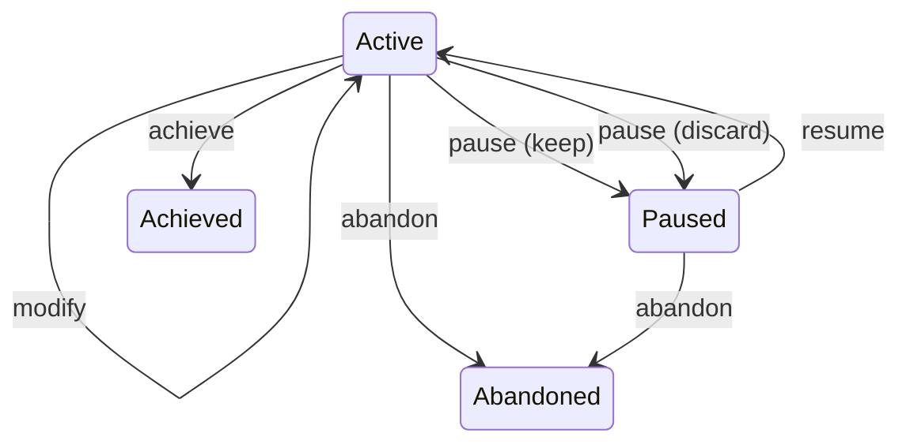

# The ledger

## Configuration

**Presence**: Whether a configuration layer supplies the slot being resolved.

- omitted
- supplied

**Layer**: Which layer provides a resolved configuration slot.

- builtIn
- application
- environment
- host

**Lookup profile**: The available configuration lookup profiles.

- serving
- storageOnly

**Setting group**: The groups of settings used by the facade's lookup.

- storage
- embeddingRuntime
- serving
- objectStore

**Publication block**: The independently configurable settings for capturing and maintaining publication.

- capture
- retention
- objectPurge

**Lookup text**: The lexical outcomes of trimming a setting's lookup result.

- missing
- blank
- nonblank

**Read setting**: The process reader accepts a setting value rather than a bare name.

- declaredSetting
- bareName

**Environment name**: Configured names distinguished by the unknown-name diagnostic.

- declared
- unknownProductName
- unrelated

**Pair position**: The two positions of repeated entries in an injected environment.

- earlier
- later

**Storage policy source**: The possible sources of storage policy during facade boot.

- resolvedConfiguration
- processEnvironment

**Setting source**: The registered sources that supply operator documentation and host help.

- facade
- core
- postgres
- objectStore
- host

**Default input**: The inputs compared against each declared default's effective reader.

- omitted
- statedDefault
- differentValue

**storage policy source** = resolvedConfiguration: Facade storage boot consumes its resolved pool and query policy without a second environment lookup.

**true words** = ["1", "true", "yes", "on"]: The case-insensitive boolean words that read as true after trimming.

**false words** = ["0", "false", "no", "off"]: The case-insensitive boolean words that read as false after trimming.

**documentation sources** = [facade, core, postgres, objectStore, host]: The composition order for settings documentation and help, with development tools outside the composition.

| presence | presence | presence | layer precedence |
| --- | --- | --- | --- |
| omitted | omitted | omitted | builtIn |
| omitted | omitted | supplied | application |
| omitted | supplied | omitted | environment |
| omitted | supplied | supplied | environment |
| supplied | omitted | omitted | host |
| supplied | omitted | supplied | host |
| supplied | supplied | omitted | host |
| supplied | supplied | supplied | host |

- layer precedence: In host, environment, application order, the first supplied value wins, then built-in defaults; authenticators supplied in code take precedence over environment OIDC.

| presence | use environment authenticator | read environment |
| --- | --- | --- |
| omitted | yes | yes |
| supplied | no | no |

- use environment authenticator: An authenticator supplied by either the host or application prevents using environment OIDC.
- read environment: Only a slot or block left unset by the host is looked up and parsed from the environment.

| lookup profile | setting group | reads group |
| --- | --- | --- |
| serving | storage | yes |
| serving | embeddingRuntime | yes |
| serving | serving | yes |
| serving | objectStore | yes |
| storageOnly | storage | yes |
| storageOnly | embeddingRuntime | yes |
| storageOnly | serving | no |
| storageOnly | objectStore | no |

- reads group: Storage commands read storage and its embedding runtime policy, with object configuration acquired separately by commands that need it.

| publication block | presence | presence | presence | read publication block |
| --- | --- | --- | --- | --- |
| capture | omitted | omitted | omitted | yes |
| capture | omitted | omitted | supplied | yes |
| capture | omitted | supplied | omitted | yes |
| capture | omitted | supplied | supplied | yes |
| capture | supplied | omitted | omitted | no |
| capture | supplied | omitted | supplied | no |
| capture | supplied | supplied | omitted | no |
| capture | supplied | supplied | supplied | no |
| retention | omitted | omitted | omitted | yes |
| retention | omitted | omitted | supplied | yes |
| retention | omitted | supplied | omitted | no |
| retention | omitted | supplied | supplied | no |
| retention | supplied | omitted | omitted | yes |
| retention | supplied | omitted | supplied | yes |
| retention | supplied | supplied | omitted | no |
| retention | supplied | supplied | supplied | no |
| objectPurge | omitted | omitted | omitted | yes |
| objectPurge | omitted | omitted | supplied | no |
| objectPurge | omitted | supplied | omitted | yes |
| objectPurge | omitted | supplied | supplied | no |
| objectPurge | supplied | omitted | omitted | yes |
| objectPurge | supplied | omitted | supplied | no |
| objectPurge | supplied | supplied | omitted | yes |
| objectPurge | supplied | supplied | supplied | no |

- read publication block: Given the block and the presence of capture, retention and object purge overrides in that order, only an override for that block suppresses its lookup.

| lookup text | lookup presence |
| --- | --- |
| missing | omitted |
| blank | omitted |
| nonblank | supplied |

- lookup presence: A missing or blank setting is omitted, and nonblank text is passed to the reader trimmed.

| read setting | may read process setting |
| --- | --- |
| declaredSetting | yes |
| bareName | no |

- may read process setting: By the `settings!` convention, process settings are read through declared settings.

| environment name | warn for name |
| --- | --- |
| declared | no |
| unknownProductName | yes |
| unrelated | no |

- warn for name: Warn once per unknown product name without exposing its value or refusing startup.

| pair position | wins repeated pair |
| --- | --- |
| earlier | no |
| later | yes |

- wins repeated pair: The last supplied pair wins when injected configuration repeats a name.

| presence | presence | last configured slot |
| --- | --- | --- |
| omitted | omitted | — |
| omitted | supplied | later |
| supplied | omitted | earlier |
| supplied | supplied | later |

- last configured slot: Given the earlier and later values in that order, tuple entries and repeated host configuration calls retain the last supplied slot value.

| default input | matches omission |
| --- | --- |
| omitted | yes |
| statedDefault | yes |
| differentValue | no |

- matches omission: The stated default must behave like omission, and the different value must reach the reader.

## Goals

**Goal state**: The lifecycle state of a Goal version.

- Active
- Paused
- Achieved
- Abandoned

**Pending work**: The host's pause disposition for queued work, with running work allowed to finish.

- keep: Hold queued work for resume.
- discard: Drop queued and retryable work.

**Event**: The operation that writes a Goal version.

- set
- decompose
- modify
- pause
- resume
- achieve
- abandon

**Lifecycle refusal**: Why an operation cannot use the named series head.

- wrongState

**Pin edit**: Whether an edit omits its pin list or supplies its replacement, including an empty list.

- omitted
- supplied

**Revision field**: Whether a revision retains or replaces a declaration.

- carry
- replace

**Evidence source**: Source classes considered when admitting Goal evidence.

- local
- otherStore

**Evidence check**: Where a Goal evidence target's live kind is checked.

- ownerTransaction
- callerReadAtSource

**Request match**: The durable request comparison made under the owner and request key.

- fresh
- exact
- different
- missingDeclaration

**Replay action**: Whether the replay may be returned, must be refused, or needs fresh admission.

- freshAdmission
- returnOriginal
- conflict

**Decompose replay**: The replay status across a decomposition's complete request set.

- allFresh
- allExact
- mixed
- conflicting

**Replay field**: The durable parts compared for replay, separate from an episode's write-act binding.

- command
- expectedHead
- authorCategory
- sessionSelf
- writeAct

**Head comparison**: The outcomes of comparing the predecessor under the locked Goal head.

- unchanged
- namedStale
- unnamedDrift

**Commit decision**: The commit decision after comparing the predecessor.

- proceed
- conflict
- retry

**Transaction outcome**: Outcomes classified by the pool-scoped storage retry loop. Retryable includes SQLSTATE 40001, 40P01 and 55P03 and application conflicts such as head or authority footprint drift.

- retryable
- memoryIdCollision
- other

**Retry budget**: Whether the applicable retry budget is still available.

- available
- exhausted

**Retry action**: What the retry loop does with the outcome of one transaction attempt.

- retry
- returnOutcome
- refuseCollision

**Admission step**: The steps of Goal revision persistence, from owner fencing to target revalidation.

- fenceOwners
- reserveFactIdentity
- lockMemoryHandles
- lockLifecycleUnion
- lockGoalHeads
- revalidateTargets

**Fact admission**: The only Fact admission path allowed to use a reserved Goal-change identity.

- goalTransaction
- ordinaryFact

**Change fact admission**: The publication admission for a fresh Goal revision.

- skip
- publish
- missingStamp

**Change fields**: The variant-specific payload fields of a Goal change.

- plain
- parent
- pending

**Trimmed display length**: The title or prompt’s length after trimming surrounding Unicode White_Space.

- blank
- withinBound
- oversized

**Goal clock**: The two clocks projected by a Goal version read.

- setAt
- changedAt

**Goal version time**: Which revision identity supplies a projected time.

- firstVersion
- selectedVersion

**birth state** = Active: Set and decomposition start each new series here.

**title max** = 240: The largest trimmed Goal title in characters.

**text max** = 20000: The largest trimmed Goal prompt in characters.

**decompose child max** = 50: The largest number of children in one decompose request.

**decompose root key max** = 162: The root key character ceiling that leaves room for the child prefix, separators and largest index.

**decompose child prefix** = "goal_decompose": The prefix of each child request key, followed by the root key and zero-based index.

**evidence declaration** = "goal.evidence_t": Goal evidence is read from the exact declaration whose pins are projected by `Causa.goalDeclaredTargetIds`.

**motivation declaration** = "goal.motivated_by": The authoritative field behind the reverse index, with targets governed by `Causa.goal_motivations_valid`.

**operator authorship** = "system_operator": Operators use their authorship category in the durable command and its replay identity.

**admission order** = [fenceOwners, reserveFactIdentity, lockMemoryHandles, lockLifecycleUnion, lockGoalHeads, revalidateTargets]: Goal revision persistence reserves lifecycle Facts before locking the sorted Memory and lifecycle sets and comparing the prepared head.

**transfer goal** = no: A Goal remains owned by its original owner throughout its series.

| goal state | is open | terminal | state label | blocks close |
| --- | --- | --- | --- | --- |
| Active | yes | no | "Active" | yes |
| Paused | yes | no | "Paused" | yes |
| Achieved | no | yes | "Achieved" | no |
| Abandoned | no | yes | "Abandoned" | no |

- is open: Whether the series can take another version.
- terminal: Whether a Goal version requires a close Fact and ends its series.
- state label: The label projected on Goal reads.
- blocks close: Whether a sub-goal in this state keeps its parent from closing, achieved or abandoned alike.

**lifecycle**: Admission by existing head state, returning the new version state or the new child state for decomposition.

| goal state | event | answer |
| --- | --- | --- |
| Active | set | refused: wrongState |
| Active | resume | refused: wrongState |
| Paused | set | refused: wrongState |
| Paused | decompose | refused: wrongState |
| Paused | modify | refused: wrongState |
| Paused | pause (keep) | refused: wrongState |
| Paused | pause (discard) | refused: wrongState |
| Paused | achieve | refused: wrongState |
| Achieved | set | refused: wrongState |
| Achieved | decompose | refused: wrongState |
| Achieved | modify | refused: wrongState |
| Achieved | pause (keep) | refused: wrongState |
| Achieved | pause (discard) | refused: wrongState |
| Achieved | resume | refused: wrongState |
| Achieved | achieve | refused: wrongState |
| Achieved | abandon | refused: wrongState |
| Abandoned | set | refused: wrongState |
| Abandoned | decompose | refused: wrongState |
| Abandoned | modify | refused: wrongState |
| Abandoned | pause (keep) | refused: wrongState |
| Abandoned | pause (discard) | refused: wrongState |
| Abandoned | resume | refused: wrongState |
| Abandoned | achieve | refused: wrongState |
| Abandoned | abandon | refused: wrongState |

| goal state | bool | close fact presence |
| --- | --- | --- |
| Active | yes | no |
| Active | no | yes |
| Paused | yes | no |
| Paused | no | yes |
| Achieved | yes | yes |
| Achieved | no | no |
| Abandoned | yes | yes |
| Abandoned | no | no |

- close fact presence: Whether close-Fact presence agrees exactly with terminal state.

| pin edit | edit pins |
| --- | --- |
| omitted | carry |
| supplied | replace |

- edit pins: Omitted motivation and evidence carry forward and supplied lists replace them.

| event | prompt revision | parent revision | may declare evidence | change fields |
| --- | --- | --- | --- | --- |
| set | replace | replace | yes | plain |
| decompose | replace | replace | yes | parent |
| modify | replace | carry | yes | plain |
| pause (keep) | carry | carry | no | pending |
| pause (discard) | carry | carry | no | pending |
| resume | carry | carry | no | plain |
| achieve | carry | carry | yes | plain |
| abandon | carry | carry | no | plain |

- prompt revision: Declaring writes supply a prompt and lifecycle changes carry the stored prompt byte for byte.
- parent revision: A child keeps the parent series chosen at birth alongside its exact parent dependency under `Causa.GoalStep`.
- may declare evidence: Which Goal operations can supply an evidence statement, always optional.
- change fields: Decomposition alone carries the parent revision and pause alone carries a pending disposition.

| evidence source | evidence admission |
| --- | --- |
| local | ownerTransaction |
| otherStore | callerReadAtSource |

- evidence admission: Exact live Facts and Abstractions are eligible as Goal evidence under `Causa.RetainedGoalEvidenceValid`.

| request match | request replay |
| --- | --- |
| fresh | freshAdmission |
| exact | returnOriginal |
| different | conflict |
| missingDeclaration | conflict |

- request replay: After authority, exact replay returns the original before mutable targets and creates no second write.

| decompose replay | decompose replay |
| --- | --- |
| allFresh | freshAdmission |
| allExact | returnOriginal |
| mixed | conflict |
| conflicting | conflict |

- decompose replay: Decomposition admits the whole request set or answers its whole replay.

| replay field | replay identity |
| --- | --- |
| command | yes |
| expectedHead | yes |
| authorCategory | yes |
| sessionSelf | no |
| writeAct | no |

- replay identity: Replay seals the command, including any pause disposition, and excludes attempt attribution.

| head comparison | predecessor arbitration |
| --- | --- |
| unchanged | proceed |
| namedStale | conflict |
| unnamedDrift | retry |

- predecessor arbitration: A stale named predecessor conflicts and unnamed prediction drift retries the complete transaction.

| transaction outcome | retry budget | retry transaction |
| --- | --- | --- |
| retryable | available | retry |
| retryable | exhausted | returnOutcome |
| memoryIdCollision | available | retry |
| memoryIdCollision | exhausted | refuseCollision |
| other | available | returnOutcome |
| other | exhausted | returnOutcome |

- retry transaction: Transient outcomes have a three-attempt budget. A memory ID collision can retry once independently, even after the last transient retry. A second collision becomes a constraint violation.

| fact admission | reserve change fact |
| --- | --- |
| goalTransaction | yes |
| ordinaryFact | no |

- reserve change fact: A Goal-change Fact uses its reserved identity under the pre-held lock union, with no declared scope or read set.

| bool | bool | publish change fact | edit space matches | state filter | recall active goal |
| --- | --- | --- | --- | --- | --- |
| yes | yes | publish | yes | yes | yes |
| yes | no | missingStamp | no | yes | no |
| no | yes | skip | yes | yes | yes |
| no | no | skip | yes | no | yes |

- publish change fact: A listenable fresh revision requires a stamp and emits its change Fact after the Goal in the same transaction.
- edit space matches: An edit uses the named Goal's owner and an explicit space can only narrow that selection.
- state filter: Goal queries select all states when the filter is omitted and otherwise select the union of supplied labels. The resource accepts comma-separated case-insensitive labels, refuses empty members and binds the canonical set into its cursor. Other streams ignore the filter.
- recall active goal: Recall includes unmotivated Active Goals and Active Goals motivated by a recalled Perspective head.

| trimmed display length | display admitted |
| --- | --- |
| blank | no |
| withinBound | yes |
| oversized | no |

- display admitted: The Rust input boundary uses str::trim, counts the remaining Unicode scalar values and admits a title or prompt with length from one through its field limit.

| goal clock | clock source |
| --- | --- |
| setAt | firstVersion |
| changedAt | selectedVersion |

- clock source: A Goal reports its series birth and the selected version's own write time.

✗ **achieve needs an achieved child**, rejected: An abandoned child leaves the parent free to close.

## Identity

**Series and version**: A series keeps its handle as later admissions append with immutable, time-ordered IDs.

- handle
- t

**Memory kind**: A Memory admission's layer.

- Fact
- Abstraction
- Perspective

**Embeddable entity**: An embedding uses a Memory ID with its layer, or a Goal ID.

- memory
- goal

**Read target**: Which identity a read names.

- series
- version

**Read revision**: The revision selected by an authorized read.

- readableHead
- exact

**Series kind**: The kind of series whose versions align with its head.

- memory
- goal

**Head field**: The catalog fields shared by all versions of a series.

- handle
- owner
- kind
- schema

**Schema record**: Records whose stored schema selects the typed shape.

- memoryVersion
- goalVersion
- blob

**Schema authority**: The source of a record's schema tag.

- memoryCatalog
- goalCatalog
- blob

**Writer attribution**: An admission stores the attested writer separately from its owner and credential subject.

- by: The attested principal UUID.
- via: An attested caller UUID or null for a direct write, always present on serialized reads.

**Writer event**: Events that capture or retain writer attribution.

- admission
- revision
- replay
- transfer
- forget
- restore

**Writer source**: Whether an event takes its writer from the request or the version.

- attested
- stored

**Owner scoped content**: Owner, schema and hash key immutable Content inserted or reused under admission-scoped visibility. Admissions can share Content while retaining distinct admission identities.

- owner
- schema
- hash

**Content reference**: Which admissions still name a Content row.

- live
- forgottenOnly
- absent

**Receipt field**: The ordered components of a Fact receipt digest.

- source
- owner
- payload

**Json collection**: JSON values whose order is relevant to canonical payload bytes.

- object
- array

**Mint clock**: The clock relative to the greater of the last mint and the supplied revision floor.

- aheadOrUnbound
- atOrBehind

**Counter space**: Whether another counter fits in the chosen logical millisecond.

- available
- exhausted

**Mint step**: Where the shared generator mints the next admission.

- reseedAtClock
- incrementCounter
- reseedNextMillisecond

**Mint range**: Range of the clock or the logical millisecond selected for admission.

- fits
- overflow

**Mint refusal**: A mint that exceeds the timestamp range leaves the generator unchanged.

- timestampOverflow

**Store number state**: The persisted store number relative to the configured number.

- absent
- matching
- different

**Store number event**: Operations that open a numbered store.

- migrate
- validate

**Store number action**: The result of applying the configured number.

- persist
- useExisting
- requireMigration
- refuseMismatch

**Object store source**: Whether S3 store identity comes from the operator or the configured target.

- operator
- endpointAndBucket

**receipt fields** = [source, owner, payload]: A Fact receipt is a 32-byte BLAKE3 digest of source, owner UUID bytes and schema receipt payload separated by zero bytes.

**uuid timestamp bits** = 48: Timestamp width in the time-ordered UUIDv8 layout, in milliseconds since the Unix epoch.

**uuid counter bits** = 12: Counter width in the time-ordered UUIDv8 layout.

**store number min** = 0: Smallest host-assigned store number in an admission UUID.

**store number max** = 65535: Largest 16-bit host-assigned store number in an admission UUID.

**store number mutable** = no: Direct mutation or deletion of a persisted store number is refused.

| read target | read revision |
| --- | --- |
| series | readableHead |
| version | exact |

- read revision: A series read selects the newest readable revision and a version read or pin keeps its exact admission.

| bool | bool | bool | admission id available |
| --- | --- | --- | --- |
| yes | yes | yes | no |
| yes | yes | no | no |
| yes | no | yes | no |
| yes | no | no | no |
| no | yes | yes | no |
| no | yes | no | no |
| no | no | yes | no |
| no | no | no | yes |

- admission id available: An admission ID is available only when absent from both spines and the retained erase witnesses.

| series kind | series contract |
| --- | --- |
| memory | \[handle, owner, schema, kind] |
| goal | \[handle, owner, schema] |

- series contract: Versions align with their series head via `goal_schema_head_alignment` for Goals. Memory accepts intermediate images allowed by `schema_evolution_intermediate_memory_image_permits`.

| schema record | schema authority |
| --- | --- |
| memoryVersion | memoryCatalog |
| goalVersion | goalCatalog |
| blob | blob |

- schema authority: Memory validates its version's schema against the catalog, Goal stamps or validates it there, and Blob carries its own schema.

| writer event | version writer |
| --- | --- |
| admission | attested |
| revision | attested |
| replay | stored |
| transfer | stored |
| forget | stored |
| restore | stored |

- version writer: Each new version captures its own writer, and replay, transfer, forget and restore keep stored authorship.

| content reference | collect content |
| --- | --- |
| live | no |
| forgottenOnly | no |
| absent | yes |

- collect content: Collect Content only once no live or forgotten admission names it.

| json collection | sort json keys |
| --- | --- |
| object | yes |
| array | no |

- sort json keys: Canonical JSON sorts object keys recursively and preserves array order.

| mint clock | counter space | mint range | monotonic mint |
| --- | --- | --- | --- |
| aheadOrUnbound | available | fits | reseedAtClock |
| aheadOrUnbound | available | overflow | refused: timestampOverflow |
| aheadOrUnbound | exhausted | fits | reseedAtClock |
| aheadOrUnbound | exhausted | overflow | refused: timestampOverflow |
| atOrBehind | available | fits | incrementCounter |
| atOrBehind | available | overflow | refused: timestampOverflow |
| atOrBehind | exhausted | fits | reseedNextMillisecond |
| atOrBehind | exhausted | overflow | refused: timestampOverflow |

- monotonic mint: A mint advances past the revision floor and the last mint, even when the clock stalls.

| store number state | store number event | store number lifecycle |
| --- | --- | --- |
| absent | migrate | persist |
| absent | validate | requireMigration |
| matching | migrate | useExisting |
| matching | validate | useExisting |
| different | migrate | refuseMismatch |
| different | validate | refuseMismatch |

- store number lifecycle: The first migration persists the number and subsequent migrations, serving and maintenance require agreement.

| bool | bool | publication counter update |
| --- | --- | --- |
| yes | yes | yes |
| yes | no | no |
| no | yes | no |
| no | no | no |

- publication counter update: Publication counters retain their series handle and never regress.

| bool | object store source |
| --- | --- |
| yes | operator |
| no | endpointAndBucket |

- object store source: An explicit validated identity takes precedence over derivation from endpoint and bucket.

## Repository

**Cla event**: An outside contribution uses the CLA assistant on a new, reopened or updated main pull request, subject to its configured exemptions.

- opened
- reopened
- synchronize

**Changed paths**: Evidence used to decide which validation lanes run.

- relevant
- unrelated
- unknown

**Validation run**: Source of the revision to validate.

- pullRequest
- verify

**Path source**: How CI obtains the paths under review.

- pullRequestApi
- verifiedToCandidate

**Validation grant**: The validation job's token permissions.

- contentsRead
- pullRequestsRead

**Rust lane**: Rust validation checks format, both feature lanes for Clippy, warning-free Rustdoc and workspace doctests.

- format
- allFeaturesClippy
- defaultClippy
- rustdoc
- doctest

**Test feature lane**: Rust tests exercise the all-feature workspace and the default substrate host, running both lanes with `--run-ignored all`.

- allFeaturesWorkspace
- defaultSubstrateHost

**Public documentation**: The public guide publishes the configured navigation and Mermaid diagrams and excludes local planning pages.

- configuredNavigation
- mermaidFences
- excludePlanningPages

**Issue entry point**: The repository offers a blank issue and routes contribution and security reports to the documented entry points.

- blankIssue
- securityPolicy
- contributionGuide

**Documentation lane**: The docs jobs and when they run.

- markdownLinks
- mkdocs
- leanLedger

**Markdown link refusal**: A local Markdown target must exist, a heading reference must resolve and a site link must stay within the docs directory.

- missingTarget
- missingHeading
- escapesDocs
- siteDirectoryTarget

**Image evidence**: Validation builds the production-shaped image without publishing it and compares both OCI labels with the version and commit it tested.

- build
- workspaceVersion
- testedRevision

**Workflow pin**: The immutable references for third-party code selected by CI.

- actionCommit
- serviceImageDigest

**Postgres fixture**: PostgreSQL tests use a disposable pgvector server with reduced durability and an explicit admin endpoint.

- pgvector
- explicitAdmin
- disposableDurability

**Object fixture**: Object integration tests use a versioned fixture bucket and separately probe the HTTP listener.

- httpListenerResponds
- versionedBucket
- selectedObjectTests

**Postgres fixture client**: What uses the test pooler when it is configured.

- serving
- migration
- admin

**Pooler verification**: The pooler lane checks its package signing key and version floor and exercises SCRAM and startup settings.

- packageKey
- versionFloor
- scram
- startupSettings
- dedicatedSuites
- hostBoot

**Verification target**: Verify uses the selected main event's commit and serializes runs without cancelling work already in flight.

- mainPush
- mainDispatch

**Review address**: Review and co-author records use a final angle-bracket address compared case-insensitively.

- trailingAddress
- malformed

**Verified ref**: The references that move together to the tested commit after CI and review pass.

- verifiedFastForward
- nightlyLightweightTag

**Release action**: The numbered-release action after a candidate reaches verified.

- refuseUnverified
- skip
- tagAndPublish

**Version source**: Cargo workspace members inherit the workspace version, which the server reports from its build metadata.

- workspaceManifest
- cargoPackageVersion

**Version step**: The candidate's stable SemVer relationship to the canonical released tags fetched by CI.

- initial
- unchanged
- nextPatch
- nextMinor
- nextMajor
- invalid

**Release notes**: Release notes are rendered by git-cliff from Conventional Commits and are previewable offline.

- groupConventionalCommits
- omitConfiguredCategories
- renderOfflineLinks
- publishGitHubRelease

**Workspace lint**: Build-time workspace lint policy inherited by its Rust member crates.

- denyWarnings
- denyUnsafe
- denyMissingDebug
- denyPedantic
- allowNamedExceptions

**Test dependency**: Test-only schema and manifest helpers are dev dependencies, and the example dependency graph checks the SDK boundary.

- boon
- toml
- exampleSdkBoundary

**Crypto provider**: The selected TLS and JWT provider is AWS-LC and the object backend uses regional SigV4.

- awsLcTls
- awsLcJwt
- regionalSigV4

**Release profile**: The release Cargo profile uses thin LTO, one codegen unit, stripping and optimized build scripts.

- thinLto
- singleCodegenUnit
- strip
- optimizeBuildScripts

**Image build**: The image builds the default substrate binary under the workspace compiler and lockfile, using matching Debian libraries and a non-root runtime.

- substrateBinary
- workspaceCompiler
- lockedDependencies
- httpsPackageSources
- matchingDebianLibraries
- nonrootUser

**Dependency check**: Dependency policies run on dependency changes, with a separate scheduled and manual advisory check.

- advisories
- licenses
- bans
- sources

**Dependency input**: Dependency input selected for the repository's allow or refuse decision.

- vulnerability
- yank
- unmaintainedWorkspaceDependency
- disallowedLicense
- unknownLicense
- registryWildcard
- repeatedVersion
- workspacePath
- cratesIo
- undeclaredRegistry
- undeclaredGit

**Dependency disposition**: Cargo-deny rejects forbidden inputs subject to its reviewed exceptions and warns about repeated versions.

- allow
- warn
- deny

**Loopback fixture**: The disposable development services expose configurable ports on loopback.

- postgres
- objectStore

**Core fixture**: Shared core test fixtures are exported only in tests or with the testkit feature and use the public authentication and tool-context entry points.

- sealedAuthentication
- ordinaryToolContext

**Admin configuration**: What the test database harness does when its only admin URL setting is present or absent.

- connect
- skip
- refuse

**Clone name part**: Each clone name carries a UUIDv7, with the prefix truncated to fit PostgreSQL's identifier limit.

- boundedPrefix
- uuidV7

**Clone disposition**: The guard's decision on an isolated tracked test clone.

- drop
- keep
- keepWithRedactedDiagnostic

**Clone registration**: Failed registration attempts cleanup and reports a cleanup failure. Fixture-named survivors can be swept without a record.

- track
- cleanUpAfterFailure
- reportCleanupFailure

**Template family rule**: A custom template uses a valid bounded prefix disjoint from built-in and staging families and owns only names with its exact hexadecimal suffix.

- boundedPrefix
- noReservedOverlap
- exactHashSuffix

**Template lifecycle**: A validated test template is staged under a build lock, published only on success and leased until its clone exists.

- lockBuild
- buildStaging
- publishSuccess
- cleanUpFailure
- leaseThroughClone
- collectIdlePrevious

**Template fingerprint input**: The validated host lineup and its length-framed inputs define its template fingerprint.

- hostFingerprint
- vectorStorageKind
- definitions
- release
- storeNumber
- searchDefinitions
- migrationSources
- spiiceSchemas
- followsTables

**Clone role**: A split-role clone runs migrations as platform and serves through a non-owning runtime role subject to owner row security.

- platformMigration
- scopedRuntime

**Fixture owner context**: Single-owner fixture contexts seal a fresh subject with the admin role scoped to the supplied owner.

- freshSubject
- scopedAdmin
- sealedAuthentication

**Trigger fixture refusal**: The spiice trigger test refuses a failed registration, an empty artifact set or a generated artifact absent from its migrations.

- invalidRegistration
- emptyArtifacts
- missingArtifact

**Connection diagnostic**: Connection exhaustion diagnostics use the admin connection to describe the server's connection budget.

- exhaustionClassification
- adminConnectionBudget

**Dev issuer input**: The development issuer admits a loopback bind and nonblank normalized subject and audience.

- loopbackBind
- fixedPort
- nonblankSubject
- nonblankAudience
- subjectDerivedUser

**Dev signer**: The development issuer loads a persisted signer, creates a missing file exclusively, reads the winning file after a creation conflict, or uses an in-memory signer in ephemeral mode.

- loadExisting
- createExclusively
- loadConcurrentWinner
- ephemeral

**Dev claims**: The development issuer publishes one RSA JWK and signs timed RS256 claims, refusing clocks before the Unix epoch.

- rsaJwk
- rs256
- issuer
- audience
- subject
- expiry
- validEpoch

**clone grace seconds** = 300: Minimum age in seconds for stale test clones considered by the sweeper.

**database attempts** = 25: Attempt budget for test database operations retried because of connected clients.

**database retry millis** = 200: Delay in milliseconds between retryable test database attempts.

**template hash digits** = 16: Hex digits in a test template's fingerprint suffix.

**template store** = 0: The store number initialized in a migrated host template.

**example fixture pool size** = 4: Serving connections in the example engine fixture.

**mcp default database url** = "postgres://postgres@localhost/proxiima_dev": The local development database URL used by the canonical CLI without explicit configuration.

| changed paths | validate lane |
| --- | --- |
| relevant | yes |
| unrelated | no |
| unknown | yes |

- validate lane: Stable required job names are present on main pull requests, and an unknown diff runs the affected lanes.

| validation run | path source | cancel superseded validation | save rust cache |
| --- | --- | --- | --- |
| pullRequest | pullRequestApi | yes | no |
| verify | verifiedToCandidate | no | yes |

- path source: Pull requests use the GitHub API and Verify diffs its tested commit against the last verified commit.
- cancel superseded validation: A newer PR revision supersedes the previous validation run.
- save rust cache: Only main verification saves Rust caches.

| bool | validation grants | publish prerelease | bootstrap preflight |
| --- | --- | --- | --- |
| yes | \[contentsRead, pullRequestsRead] | yes | no |
| no | \[contentsRead] | no | yes |

- validation grants: Only change detection needs pull-request reads and every validation token has read-only permissions.
- publish prerelease: GitHub publishes v0 tags as pre-releases.
- bootstrap preflight: Existing-volume bootstrap refuses while a development serving or platform client is connected to the target database.

| documentation lane | changed paths | validate docs |
| --- | --- | --- |
| markdownLinks | relevant | yes |
| markdownLinks | unrelated | yes |
| markdownLinks | unknown | yes |
| mkdocs | relevant | yes |
| mkdocs | unrelated | no |
| mkdocs | unknown | yes |
| leanLedger | relevant | yes |
| leanLedger | unrelated | yes |
| leanLedger | unknown | yes |

- validate docs: Every uncancelled validation checks Markdown links and audits the Lean ledger, while MkDocs builds on relevant changes or an unknown diff.

| postgres fixture client | uses test pooler |
| --- | --- |
| serving | yes |
| migration | no |
| admin | no |

- uses test pooler: Only serving clients are retargeted to the transaction pooler, preserving database and role.

| bool | bool | bool | verify range | admin configuration |
| --- | --- | --- | --- | --- |
| yes | yes | yes | no | connect |
| yes | yes | no | yes | connect |
| yes | no | yes | no | connect |
| yes | no | no | no | connect |
| no | yes | yes | no | refuse |
| no | yes | no | no | skip |
| no | no | yes | no | refuse |
| no | no | no | no | refuse |

- verify range: Verify accepts a candidate from main only after checking that it extends the previously verified history without merge commits.
- admin configuration: A blank or absent admin URL is a visible skip only in a local test that opts into skipping.

| bool | bool | review covers | advance verified | numbered release | recover release | render upgrade | clone guard | stale clone collectible | collect template |
| --- | --- | --- | --- | --- | --- | --- | --- | --- | --- |
| yes | yes | yes | \[verifiedFastForward, nightlyLightweightTag] | skip | yes | yes | keep | no | no |
| yes | no | no | \[] | tagAndPublish | no | no | keep | yes | yes |
| no | yes | no | \[] | refuseUnverified | no | no | keepWithRedactedDiagnostic | no | no |
| no | no | no | \[] | refuseUnverified | no | no | drop | no | no |

- review covers: Each commit since verified needs a reviewer address outside its Git author and co-author addresses, on that commit or a later one in the candidate range.
- advance verified: Failed CI or missing review leaves both references in place.
- numbered release: A new workspace version cuts one immutable matching tag and GitHub Release when Verify reaches that candidate.
- recover release: A matching verified tag can publish its notes through the same workflow for backfill or recovery.
- render upgrade: Breaking commits in the candidate range require one nonempty Upgrade footer whose continuation is retained in the rendered notes.
- clone guard: Explicit retention preserves a clone, as does panic, which otherwise reports its redacted URL.
- stale clone collectible: The sweeper considers stale tracked and fixture-named untracked clones and lets PostgreSQL recheck for live clients at deletion.
- collect template: Template collection takes an exclusive lease and retains a database that has gained a client.

| version step | version accepted |
| --- | --- |
| initial | yes |
| unchanged | yes |
| nextPatch | yes |
| nextMinor | yes |
| nextMajor | yes |
| invalid | no |

- version accepted: Stable versions use canonical ASCII components and stay at the latest release or take one valid SemVer step.

| dependency input | dependency policy |
| --- | --- |
| vulnerability | deny |
| yank | deny |
| unmaintainedWorkspaceDependency | deny |
| disallowedLicense | deny |
| unknownLicense | deny |
| registryWildcard | deny |
| repeatedVersion | warn |
| workspacePath | allow |
| cratesIo | allow |
| undeclaredRegistry | deny |
| undeclaredGit | deny |

- dependency policy: Cargo-deny's configured enforcement for dependency inputs.

## Causa

Causa — Audience

✓ **has meet**: Capability intersection for a role cap.

✓ **has join**: Capability union across roles.

✓ **has write read**: Read access follows from write access at the same memory kind.

✓ **admin has**: The capabilities of the unrestricted group role.

✓ **gives mono**: Lifting capability implication from roles to groups.

✓ **gives mount**: Capability resolution under a subgroup cap.

✓ **gives union**: Capability resolution across group memberships.

✓ **gives iff**: The two conditions for a grant to convey a capability.

✓ **flattened gives**: Equivalence of flattened lookup and per-grant authorization.

✓ **mount mount**: Composition of nested subgroup caps.

✓ **mount union**: Distribution of a subgroup cap over a group union.

✓ **grant to person**: Capability resolution for a grant addressed directly to a person.

✓ **drop gives self**: Revocation of the removed member's group capabilities.

✓ **drop gives other**: Preservation of other members' capabilities on removal.

✓ **drop ends grant**: Revocation through a group grant after membership removal.

✓ **drop keeps others**: Preservation of other recipients' grant capabilities after membership removal.

✓ **may manage iff gives**: Group management expressed as a resolved capability.

Causa — Authorization

✓ **may write implies read**: Owner-scoped writes imply reads at the same memory kind.

✓ **forwarding role capped**: A forwarded role is bounded by `Causa.Role.forwardingCap`.

✓ **forwarding role no management**

✓ **forwarding role no administration**

✓ **forwarding role no goal work**

Causa — Citations

✓ **inst immutable blob**

✓ **inst append only blob**

✓ **citation owner match**

Causa — Compliance

✓ **authorized**

✓ **own schema**

✓ **in owner**: Ownership of every stored version in the erase selection.

✓ **pin render live not forgotten**

✓ **target in memories**

✓ **memory ids unique**

✓ **witness ids unique**

✓ **witness memory disjoint**

✓ **witness goal disjoint**

✓ **target witness compatible**

✓ **target not goal**

✓ **memories eq**

✓ **targets eq**

✓ **hard erase memory records kind**

✓ **hard erase memory result well formed**

✓ **target in goals**

✓ **witness ids unique**

✓ **witness memory disjoint**

✓ **witness goal disjoint**

✓ **target witness compatible**

✓ **target not memory**

✓ **memories eq**

✓ **goals eq**

✓ **targets eq**

✓ **hard erase goal records kind**

✓ **hard erase goal result well formed**

Causa — Goal collaboration authority

✓ **goal edit implies read**: Goal read authorization follows from edit authorization.

✓ **goal route is flattened**: Goal audience resolution agrees with `Causa.flattened` for grants in force.

✓ **goal work write implies read**

Causa — Pins

✓ **unreadable goal reference resolves like a memory reference**: Indistinguishability of unreadable Goal and Memory references after projection.

Causa — Goals

✓ **terminal close fact**: `Proxiima.Goals.closeFactPresence`.

✓ **text nonblank**

✓ **inst append only goal**

✓ **no open under closed**

✓ **parents exist**

✓ **parent older**

✓ **born below clock**

✓ **fresh**

✓ **state x**

✓ **parent x**

✓ **born x**

✓ **clock**

✓ **state eq**

✓ **parent eq**

✓ **born eq**

✓ **state old**

✓ **state x**

✓ **state eq**

✓ **parent**

✓ **born**

✓ **clock**

✓ **relabel is some**

✓ **relabel keeps shape**: The forest shape conditions preserved by relabeling.

✓ **open relabel preserves**: Preservation of forest validity by relabeling to an open state from an open state.

✓ **closing relabel preserves**: Preservation of forest validity by closing a series with no open child.

✓ **birth preserves**: Preservation of forest validity by creating a root or a child of an Active series.

✓ **set preserves**

✓ **decompose preserves**

✓ **pause preserves**

✓ **resume preserves**

✓ **modify preserves**

✓ **achieve preserves**

✓ **abandon preserves**

✓ **goal step preserves inv**

✓ **empty forest inv**

✓ **reachable inv**

✓ **closed ancestor closes descendant**: Closure of all descendants of a closed Goal.

✓ **descends born lt**

✓ **goal tree acyclic**: Acyclicity of the Goal tree.

Causa — Identity

✓ **personal resolves**: The personal-owner resolution law.

Causa — Memory

✓ **erased pin target ext**

✓ **inst append only content**

✓ **inst immutable content**

✓ **guided by only perspective**: Restriction of Goal guidance to Perspectives.

✓ **fact origins empty**: Exclusion of grounding origins from Facts.

✓ **perspective never cites**: Exclusion of blob citations from Perspectives.

✓ **blob fa only**: The kinds eligible to cite a blob.

✓ **inst append only memory**

✓ **forget in keeps row**: Preservation of the admission's identity, kind and owner through forgetting.

✓ **pin kind is forget in**: Preservation of target kind across forgetting.

✓ **fact empty**

✓ **abs fact or abs**

✓ **persp abs or empty**

✓ **fact empty**

✓ **abs fact or abs**

✓ **persp abs or empty**

Causa — Operators

✓ **inputs shape**

✓ **output memories shape**

✓ **output goals shape**

✓ **memory inputs**

✓ **goal inputs**

✓ **operator memory output not fact**

Causa — Owner

✓ **write le read**

✓ **works goals reads goals**: Goal work includes Goal read access.

✓ **meet capped**: Preservation of capability bounds under a role cap.

✓ **meet comm**: Commutativity of the Goal capability meet.

✓ **meet assoc**

✓ **meet join distrib**

✓ **ext**: Role equality determined by capability fields.

✓ **meet comm**

✓ **meet assoc**

✓ **meet join distrib**: Distributivity of a role cap over a membership join.

Causa — Prelude

Causa — Principles

✓ **principle 1 fact has no origins**: Principle 1 — Facts are primitive observations.

✓ **principle 2 derivation goes up and grounds in facts**: Principle 2 — The layering and grounding of derived Memory.

✓ **principle access is one resolved role**: Principle 3 — Owner and audience access through one resolved role.

✓ **principle 4 the field fixes the kind**: Principle 4 — Relationship typing by the declaring field.

✓ **principle 5 no transition retargets a pin**: Principle 5 — Stability of pin targets through forgetting and erasure.

✓ **principle 6 erasure leaves no dangling pin**: Principle 6 — Preservation of pin resolution through hard erasure.

✓ **principle 7 a read pin never grounds**: Principle 7 — Read context is independent of grounding.

✓ **principle 8 a goal never grounds**: Principle 8 — Goal intent is outside Memory grounding.

Causa — Provenance grounding

✓ **memory id unique**

✓ **goal id unique**

✓ **head aligned**

✓ **fork anchor aligned**

✓ **pin targets exist**: Target existence for the graph's typed pins.

✓ **motivations valid**

✓ **guidance valid**

✓ **origin kind**

✓ **memory goal ids disjoint**: Memory and Goal version IDs are disjoint, per `Proxiima.Identity.admissionIdAvailable`.

✓ **abstraction has origins**: The origin requirement for an Abstraction.

✓ **derived provenance**: The provenance requirement for derived Memory.

✓ **grounding support**: Stored support for grounding derived Memory.

✓ **pin time strict**: The insertion order of stored pin targets.

✓ **memory id unique**

✓ **goal id unique**

✓ **erased pin id unique**

✓ **head aligned**

✓ **fork anchor aligned**

✓ **pin targets exist**

✓ **motivations valid**

✓ **guidance valid**

✓ **origin kind**

✓ **memory goal ids disjoint**: Retained Memory and Goal version IDs are disjoint, per `Proxiima.Identity.admissionIdAvailable`.

✓ **erased memory disjoint**

✓ **erased goal disjoint**

✓ **abstraction has origins**: The origin requirement for a retained Abstraction.

✓ **derived provenance**: The provenance requirement for retained derived Memory.

✓ **pin time strict**: The insertion order of retained stored pin targets.

✓ **graph**

✓ **assignments**

✓ **evidence**

✓ **terminal close**

✓ **grounding wf**

✓ **memory grounds in facts**

✓ **perspective has provenance**

✓ **guidance does not ground**

Causa — Schema evolution

✓ **source memory coverage**: Coverage of source Memory admissions by the migration relation.

✓ **source goal coverage**

✓ **target memory declaration**

✓ **target goal declaration**

✓ **mapped memory owner**

✓ **mapped goal owner**

✓ **mapped memory pins**

✓ **mapped goal pins**

✓ **new memory id unique**

✓ **new goal id unique**

✓ **retained target id unique**

✓ **new head aligned**

✓ **new fork anchor aligned**

✓ **retained pin targets exist**

✓ **retained motivations valid**

✓ **retained guidance valid**

✓ **retained origin kind**

✓ **memory goal ids disjoint**

✓ **erased memory disjoint**

✓ **erased goal disjoint**

✓ **abstraction has origins**

✓ **derived provenance**

✓ **pin time strict**

✓ **assignments valid**

✓ **evidence valid**

✓ **terminal close valid**

✓ **schema migration validates retained store**
