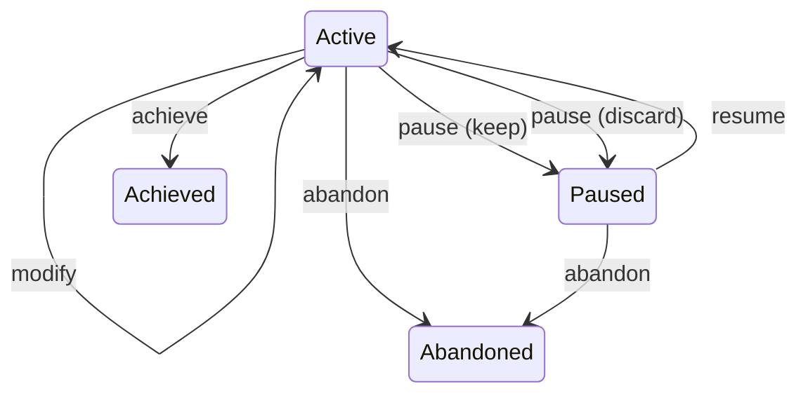

# The ledger

## Goals

**Goal state**: The lifecycle state of a Goal version.

- Active
- Paused
- Achieved
- Abandoned

**Pending work**: The host's pause disposition for queued work, with running work allowed to finish.

- keep: Hold queued work for resume.
- discard: Drop queued and retryable work.

**Event**: The operation that writes a Goal version.

- set
- decompose
- modify
- pause
- resume
- achieve
- abandon

**Lifecycle refusal**: Why an operation cannot use the named series head.

- wrongState

**Pin edit**: Whether an edit omits its pin list or supplies its replacement, including an empty list.

- omitted
- supplied

**Revision field**: Whether a revision retains or replaces a declaration.

- carry
- replace

**Evidence source**: Source classes considered when admitting Goal evidence.

- local
- otherStore

**Evidence check**: Where a Goal evidence target's live kind is checked.

- ownerTransaction
- callerReadAtSource

**Read goal**: Which Goal identity a read surface selects.

- read
- list
- declaredReference

**Read revision**: The revision selected by an authorized read.

- readableHead
- exact

**Request match**: The durable request comparison made under the owner and request key.

- fresh
- exact
- different
- missingDeclaration

**Replay action**: Whether the replay may be returned, must be refused, or needs fresh admission.

- freshAdmission
- returnOriginal
- conflict

**Decompose replay**: The replay status across a decomposition's complete request set.

- allFresh
- allExact
- mixed
- conflicting

**Replay field**: The durable parts compared for replay, separate from an episode's write-act binding.

- command
- expectedHead
- authorCategory
- sessionSelf
- writeAct

**Head comparison**: The outcomes of comparing the predecessor under the locked Goal head.

- unchanged
- namedStale
- unnamedDrift

**Commit decision**: The commit decision after comparing the predecessor.

- proceed
- conflict
- retry

**Transaction outcome**: Outcomes classified by the pool-scoped storage retry loop. Retryable includes SQLSTATE 40001, 40P01 and 55P03 and application conflicts such as head or authority footprint drift.

- retryable
- memoryIdCollision
- other

**Retry budget**: Whether the applicable retry budget is still available.

- available
- exhausted

**Retry action**: What the retry loop does with the outcome of one transaction attempt.

- retry
- returnOutcome
- refuseCollision

**Admission step**: The steps of Goal revision persistence, from owner fencing to target revalidation.

- fenceOwners
- reserveFactIdentity
- lockMemoryHandles
- lockLifecycleUnion
- lockGoalHeads
- revalidateTargets

**Fact admission**: The only Fact admission path allowed to use a reserved Goal-change identity.

- goalTransaction
- ordinaryFact

**Change fact admission**: The publication admission for a fresh Goal revision.

- skip
- publish
- missingStamp

**Change fields**: The variant-specific payload fields of a Goal change.

- plain
- parent
- pending

**Trimmed display length**: The title or prompt’s length after trimming surrounding Unicode White_Space.

- blank
- withinBound
- oversized

**Goal clock**: The two clocks projected by a Goal version read.

- setAt
- changedAt

**Goal version time**: Which revision identity supplies a projected time.

- firstVersion
- selectedVersion

**birth state** = Active: Set and decomposition start each new series here.

**title max** = 240: The largest trimmed Goal title in characters.

**text max** = 20000: The largest trimmed Goal prompt in characters.

**decompose child max** = 50: The largest number of children in one decompose request.

**decompose root key max** = 162: The root key character ceiling that leaves room for the child prefix, separators and largest index.

**decompose child prefix** = "goal_decompose": The prefix of each child request key, followed by the root key and zero-based index.

**evidence declaration** = "goal.evidence_t": Goal evidence is read from the exact declaration whose pins are projected by `Causa.goalDeclaredTargetIds`.

**motivation declaration** = "goal.motivated_by": The authoritative field behind the reverse index, with targets governed by `Causa.goal_motivations_valid`.

**operator authorship** = "system_operator": Operators use their authorship category in the durable command and its replay identity.

**admission order** = [fenceOwners, reserveFactIdentity, lockMemoryHandles, lockLifecycleUnion, lockGoalHeads, revalidateTargets]: Goal revision persistence reserves lifecycle Facts before locking the sorted Memory and lifecycle sets and comparing the prepared head.

**transfer goal** = no: A Goal remains owned by its original owner throughout its series.

| goal state | is open | terminal | state label | blocks close |
| --- | --- | --- | --- | --- |
| Active | yes | no | "Active" | yes |
| Paused | yes | no | "Paused" | yes |
| Achieved | no | yes | "Achieved" | no |
| Abandoned | no | yes | "Abandoned" | no |

- is open: Whether the series can take another version.
- terminal: Whether a Goal version requires a close Fact and ends its series.
- state label: The label projected on Goal reads.
- blocks close: Whether a sub-goal in this state keeps its parent from closing, achieved or abandoned alike.

**lifecycle**: Admission by existing head state, returning the new version state or the new child state for decomposition.

| goal state | event | answer |
| --- | --- | --- |
| Active | set | refused: wrongState |
| Active | resume | refused: wrongState |
| Paused | set | refused: wrongState |
| Paused | decompose | refused: wrongState |
| Paused | modify | refused: wrongState |
| Paused | pause (keep) | refused: wrongState |
| Paused | pause (discard) | refused: wrongState |
| Paused | achieve | refused: wrongState |
| Achieved | set | refused: wrongState |
| Achieved | decompose | refused: wrongState |
| Achieved | modify | refused: wrongState |
| Achieved | pause (keep) | refused: wrongState |
| Achieved | pause (discard) | refused: wrongState |
| Achieved | resume | refused: wrongState |
| Achieved | achieve | refused: wrongState |
| Achieved | abandon | refused: wrongState |
| Abandoned | set | refused: wrongState |
| Abandoned | decompose | refused: wrongState |
| Abandoned | modify | refused: wrongState |
| Abandoned | pause (keep) | refused: wrongState |
| Abandoned | pause (discard) | refused: wrongState |
| Abandoned | resume | refused: wrongState |
| Abandoned | achieve | refused: wrongState |
| Abandoned | abandon | refused: wrongState |

| goal state | bool | close fact presence |
| --- | --- | --- |
| Active | yes | no |
| Active | no | yes |
| Paused | yes | no |
| Paused | no | yes |
| Achieved | yes | yes |
| Achieved | no | no |
| Abandoned | yes | yes |
| Abandoned | no | no |

- close fact presence: Whether close-Fact presence agrees exactly with terminal state.

| pin edit | edit pins |
| --- | --- |
| omitted | carry |
| supplied | replace |

- edit pins: Omitted motivation and evidence carry forward and supplied lists replace them.

| event | prompt revision | parent revision | may declare evidence | change fields |
| --- | --- | --- | --- | --- |
| set | replace | replace | yes | plain |
| decompose | replace | replace | yes | parent |
| modify | replace | carry | yes | plain |
| pause (keep) | carry | carry | no | pending |
| pause (discard) | carry | carry | no | pending |
| resume | carry | carry | no | plain |
| achieve | carry | carry | yes | plain |
| abandon | carry | carry | no | plain |

- prompt revision: Declaring writes supply a prompt and lifecycle changes carry the stored prompt byte for byte.
- parent revision: A child keeps the parent series chosen at birth alongside its exact parent dependency under `Causa.GoalStep`.
- may declare evidence: Which Goal operations can supply an evidence statement, always optional.
- change fields: Decomposition alone carries the parent revision and pause alone carries a pending disposition.

| evidence source | evidence admission |
| --- | --- |
| local | ownerTransaction |
| otherStore | callerReadAtSource |

- evidence admission: Exact live Facts and Abstractions are eligible as Goal evidence under `Causa.RetainedGoalEvidenceValid`.

| read goal | read revision |
| --- | --- |
| read | readableHead |
| list | readableHead |
| declaredReference | exact |

- read revision: Goal reads and lists select readable heads while declared references keep their exact revision.

| request match | request replay |
| --- | --- |
| fresh | freshAdmission |
| exact | returnOriginal |
| different | conflict |
| missingDeclaration | conflict |

- request replay: After authority, exact replay returns the original before mutable targets and creates no second write.

| decompose replay | decompose replay |
| --- | --- |
| allFresh | freshAdmission |
| allExact | returnOriginal |
| mixed | conflict |
| conflicting | conflict |

- decompose replay: Decomposition admits the whole request set or answers its whole replay.

| replay field | replay identity |
| --- | --- |
| command | yes |
| expectedHead | yes |
| authorCategory | yes |
| sessionSelf | no |
| writeAct | no |

- replay identity: Replay seals the command, including any pause disposition, and excludes attempt attribution.

| head comparison | predecessor arbitration |
| --- | --- |
| unchanged | proceed |
| namedStale | conflict |
| unnamedDrift | retry |

- predecessor arbitration: A stale named predecessor conflicts and unnamed prediction drift retries the complete transaction.

| transaction outcome | retry budget | retry transaction |
| --- | --- | --- |
| retryable | available | retry |
| retryable | exhausted | returnOutcome |
| memoryIdCollision | available | retry |
| memoryIdCollision | exhausted | refuseCollision |
| other | available | returnOutcome |
| other | exhausted | returnOutcome |

- retry transaction: Transient outcomes have a three-attempt budget. A memory ID collision can retry once independently, even after the last transient retry. A second collision becomes a constraint violation.

| fact admission | reserve change fact |
| --- | --- |
| goalTransaction | yes |
| ordinaryFact | no |

- reserve change fact: A Goal-change Fact uses its reserved identity under the pre-held lock union, with no declared scope or read set.

| bool | bool | publish change fact | edit space matches | state filter | recall active goal |
| --- | --- | --- | --- | --- | --- |
| yes | yes | publish | yes | yes | yes |
| yes | no | missingStamp | no | yes | no |
| no | yes | skip | yes | yes | yes |
| no | no | skip | yes | no | yes |

- publish change fact: A listenable fresh revision requires a stamp and emits its change Fact after the Goal in the same transaction.
- edit space matches: An edit uses the named Goal's owner and an explicit space can only narrow that selection.
- state filter: Goal queries select all states when the filter is omitted and otherwise select the union of supplied labels. The resource accepts comma-separated case-insensitive labels, refuses empty members and binds the canonical set into its cursor. Other streams ignore the filter.
- recall active goal: Recall includes unmotivated Active Goals and Active Goals motivated by a recalled Perspective head.

| trimmed display length | display admitted |
| --- | --- |
| blank | no |
| withinBound | yes |
| oversized | no |

- display admitted: The Rust input boundary uses str::trim, counts the remaining Unicode scalar values and admits a title or prompt with length from one through its field limit.

| goal clock | clock source |
| --- | --- |
| setAt | firstVersion |
| changedAt | selectedVersion |

- clock source: A Goal reports its series birth and the selected version's own write time.

✗ **achieve needs an achieved child**, rejected: An abandoned child leaves the parent free to close.

## Causa

Causa — Audience

✓ **has meet**: Capability intersection for a role cap.

✓ **has join**: Capability union across roles.

✓ **has write read**: Read access follows from write access at the same memory kind.

✓ **admin has**: The capabilities of the unrestricted group role.

✓ **gives mono**: Lifting capability implication from roles to groups.

✓ **gives mount**: Capability resolution under a subgroup cap.

✓ **gives union**: Capability resolution across group memberships.

✓ **gives iff**: The two conditions for a grant to convey a capability.

✓ **flattened gives**: Equivalence of flattened lookup and per-grant authorization.

✓ **mount mount**: Composition of nested subgroup caps.

✓ **mount union**: Distribution of a subgroup cap over a group union.

✓ **grant to person**: Capability resolution for a grant addressed directly to a person.

✓ **drop gives self**: Revocation of the removed member's group capabilities.

✓ **drop gives other**: Preservation of other members' capabilities on removal.

✓ **drop ends grant**: Revocation through a group grant after membership removal.

✓ **drop keeps others**: Preservation of other recipients' grant capabilities after membership removal.

✓ **may manage iff gives**: Group management expressed as a resolved capability.

Causa — Authorization

✓ **may write implies read**: Owner-scoped writes imply reads at the same memory kind.

✓ **forwarding role capped**: A forwarded role is bounded by `Causa.Role.forwardingCap`.

✓ **forwarding role no management**

✓ **forwarding role no administration**

✓ **forwarding role no goal work**

Causa — Citations

✓ **inst immutable blob**

✓ **inst append only blob**

✓ **citation owner match**

Causa — Compliance

✓ **authorized**

✓ **own schema**

✓ **in owner**: Ownership of every stored version in the erase selection.

✓ **pin render live not forgotten**

✓ **target in memories**

✓ **memory ids unique**

✓ **witness ids unique**

✓ **witness memory disjoint**

✓ **witness goal disjoint**

✓ **target witness compatible**

✓ **target not goal**

✓ **memories eq**

✓ **targets eq**

✓ **hard erase memory records kind**

✓ **hard erase memory result well formed**

✓ **target in goals**

✓ **witness ids unique**

✓ **witness memory disjoint**

✓ **witness goal disjoint**

✓ **target witness compatible**

✓ **target not memory**

✓ **memories eq**

✓ **goals eq**

✓ **targets eq**

✓ **hard erase goal records kind**

✓ **hard erase goal result well formed**

Causa — Goal collaboration authority

✓ **goal edit implies read**: Goal read authorization follows from edit authorization.

✓ **goal route is flattened**: Goal audience resolution agrees with `Causa.flattened` for grants in force.

✓ **goal work write implies read**

Causa — Pins

✓ **unreadable goal reference resolves like a memory reference**: Indistinguishability of unreadable Goal and Memory references after projection.

Causa — Goals

✓ **terminal close fact**: `Proxiima.Goals.closeFactPresence`.

✓ **text nonblank**

✓ **inst append only goal**

✓ **no open under closed**

✓ **parents exist**

✓ **parent older**

✓ **born below clock**

✓ **fresh**

✓ **state x**

✓ **parent x**

✓ **born x**

✓ **clock**

✓ **state eq**

✓ **parent eq**

✓ **born eq**

✓ **state old**

✓ **state x**

✓ **state eq**

✓ **parent**

✓ **born**

✓ **clock**

✓ **relabel is some**

✓ **relabel keeps shape**: The forest shape conditions preserved by relabeling.

✓ **open relabel preserves**: Preservation of forest validity by relabeling to an open state from an open state.

✓ **closing relabel preserves**: Preservation of forest validity by closing a series with no open child.

✓ **birth preserves**: Preservation of forest validity by creating a root or a child of an Active series.

✓ **set preserves**

✓ **decompose preserves**

✓ **pause preserves**

✓ **resume preserves**

✓ **modify preserves**

✓ **achieve preserves**

✓ **abandon preserves**

✓ **goal step preserves inv**

✓ **empty forest inv**

✓ **reachable inv**

✓ **closed ancestor closes descendant**: Closure of all descendants of a closed Goal.

✓ **descends born lt**

✓ **goal tree acyclic**: Acyclicity of the Goal tree.

Causa — Identity

✓ **personal resolves**: The personal-owner resolution law.

Causa — Memory

✓ **erased pin target ext**

✓ **inst append only content**

✓ **inst immutable content**

✓ **guided by only perspective**: Restriction of Goal guidance to Perspectives.

✓ **fact origins empty**: Exclusion of grounding origins from Facts.

✓ **perspective never cites**: Exclusion of blob citations from Perspectives.

✓ **blob fa only**: The kinds eligible to cite a blob.

✓ **inst append only memory**

✓ **forget in keeps row**: Preservation of the admission's identity, kind and owner through forgetting.

✓ **pin kind is forget in**: Preservation of target kind across forgetting.

✓ **fact empty**

✓ **abs fact or abs**

✓ **persp abs or empty**

✓ **fact empty**

✓ **abs fact or abs**

✓ **persp abs or empty**

Causa — Operators

✓ **inputs shape**

✓ **output memories shape**

✓ **output goals shape**

✓ **memory inputs**

✓ **goal inputs**

✓ **operator memory output not fact**

Causa — Owner

✓ **write le read**

✓ **works goals reads goals**: Goal work includes Goal read access.

✓ **meet capped**: Preservation of capability bounds under a role cap.

✓ **meet comm**: Commutativity of the Goal capability meet.

✓ **meet assoc**

✓ **meet join distrib**

✓ **ext**: Role equality determined by capability fields.

✓ **meet comm**

✓ **meet assoc**

✓ **meet join distrib**: Distributivity of a role cap over a membership join.

Causa — Prelude

Causa — Principles

✓ **principle 1 fact has no origins**: Principle 1 — Facts are primitive observations.

✓ **principle 2 derivation goes up and grounds in facts**: Principle 2 — The layering and grounding of derived Memory.

✓ **principle access is one resolved role**: Principle 3 — Owner and audience access through one resolved role.

✓ **principle 4 the field fixes the kind**: Principle 4 — Relationship typing by the declaring field.

✓ **principle 5 no transition retargets a pin**: Principle 5 — Stability of pin targets through forgetting and erasure.

✓ **principle 6 erasure leaves no dangling pin**: Principle 6 — Preservation of pin resolution through hard erasure.

✓ **principle 7 a read pin never grounds**: Principle 7 — Read context is independent of grounding.

✓ **principle 8 a goal never grounds**: Principle 8 — Goal intent is outside Memory grounding.

Causa — Provenance grounding

✓ **memory id unique**

✓ **goal id unique**

✓ **head aligned**

✓ **fork anchor aligned**

✓ **pin targets exist**: Target existence for the graph's typed pins.

✓ **motivations valid**

✓ **guidance valid**

✓ **origin kind**

✓ **memory goal ids disjoint**: Disjointness of Memory and Goal version identities.

✓ **abstraction has origins**: The origin requirement for an Abstraction.

✓ **derived provenance**: The provenance requirement for derived Memory.

✓ **grounding support**: Stored support for grounding derived Memory.

✓ **pin time strict**: The insertion order of stored pin targets.

✓ **memory id unique**

✓ **goal id unique**

✓ **erased pin id unique**

✓ **head aligned**

✓ **fork anchor aligned**

✓ **pin targets exist**

✓ **motivations valid**

✓ **guidance valid**

✓ **origin kind**

✓ **memory goal ids disjoint**: Disjointness of retained Memory and Goal version identities.

✓ **erased memory disjoint**

✓ **erased goal disjoint**

✓ **abstraction has origins**: The origin requirement for a retained Abstraction.

✓ **derived provenance**: The provenance requirement for retained derived Memory.

✓ **pin time strict**: The insertion order of retained stored pin targets.

✓ **graph**

✓ **assignments**

✓ **evidence**

✓ **terminal close**

✓ **grounding wf**

✓ **memory grounds in facts**

✓ **perspective has provenance**

✓ **guidance does not ground**

Causa — Schema evolution

✓ **source memory coverage**: Coverage of source Memory admissions by the migration relation.

✓ **source goal coverage**

✓ **target memory declaration**

✓ **target goal declaration**

✓ **mapped memory owner**

✓ **mapped goal owner**

✓ **mapped memory pins**

✓ **mapped goal pins**

✓ **new memory id unique**

✓ **new goal id unique**

✓ **retained target id unique**

✓ **new head aligned**

✓ **new fork anchor aligned**

✓ **retained pin targets exist**

✓ **retained motivations valid**

✓ **retained guidance valid**

✓ **retained origin kind**

✓ **memory goal ids disjoint**

✓ **erased memory disjoint**

✓ **erased goal disjoint**

✓ **abstraction has origins**

✓ **derived provenance**

✓ **pin time strict**

✓ **assignments valid**

✓ **evidence valid**

✓ **terminal close valid**

✓ **schema migration validates retained store**
