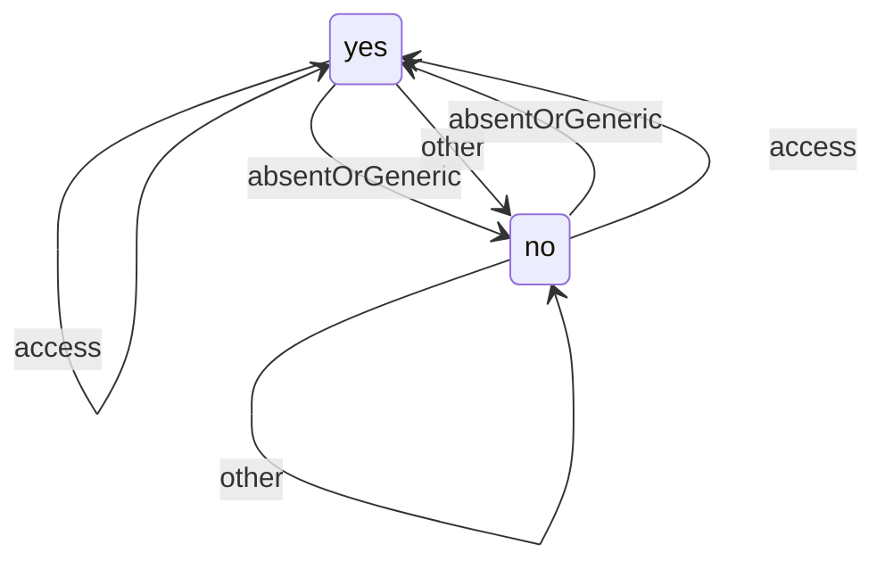
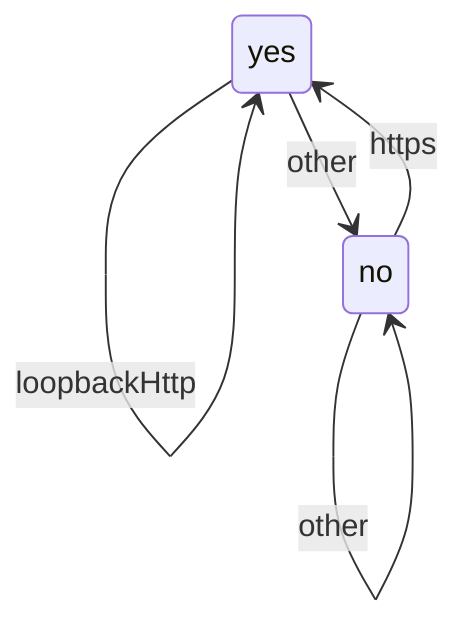
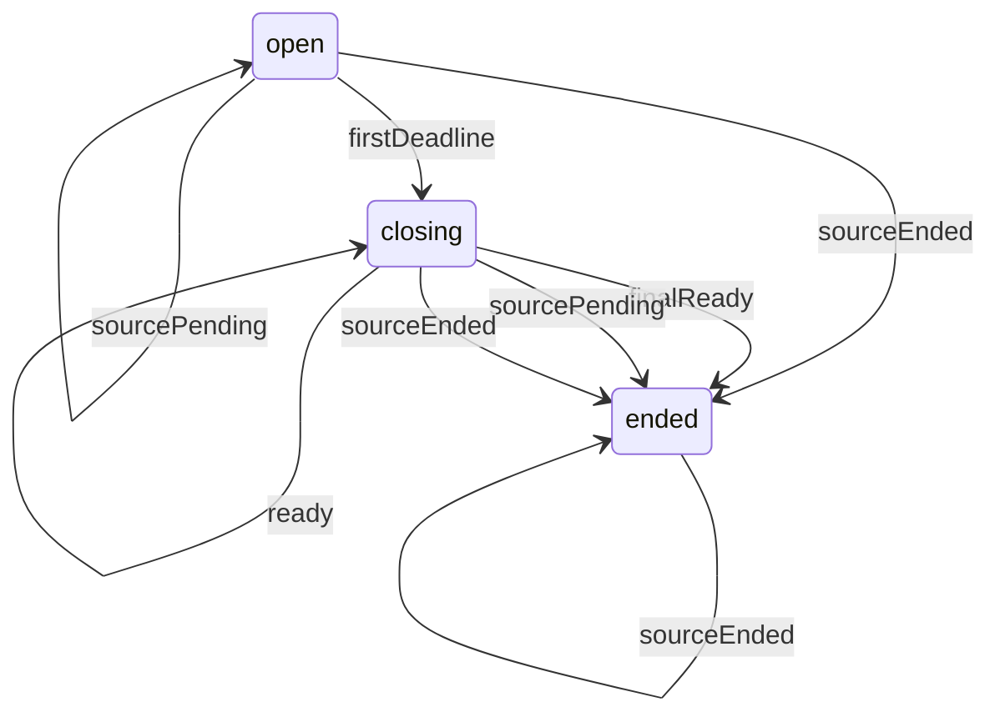
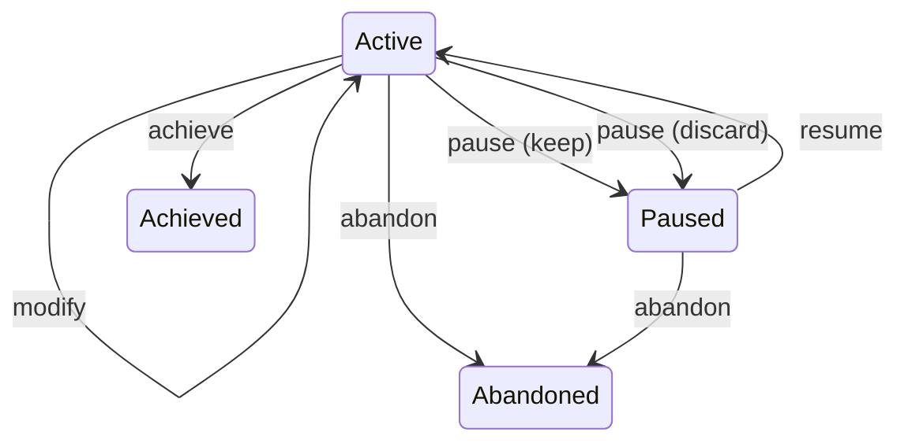
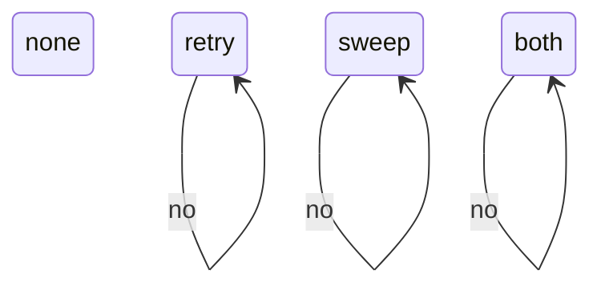
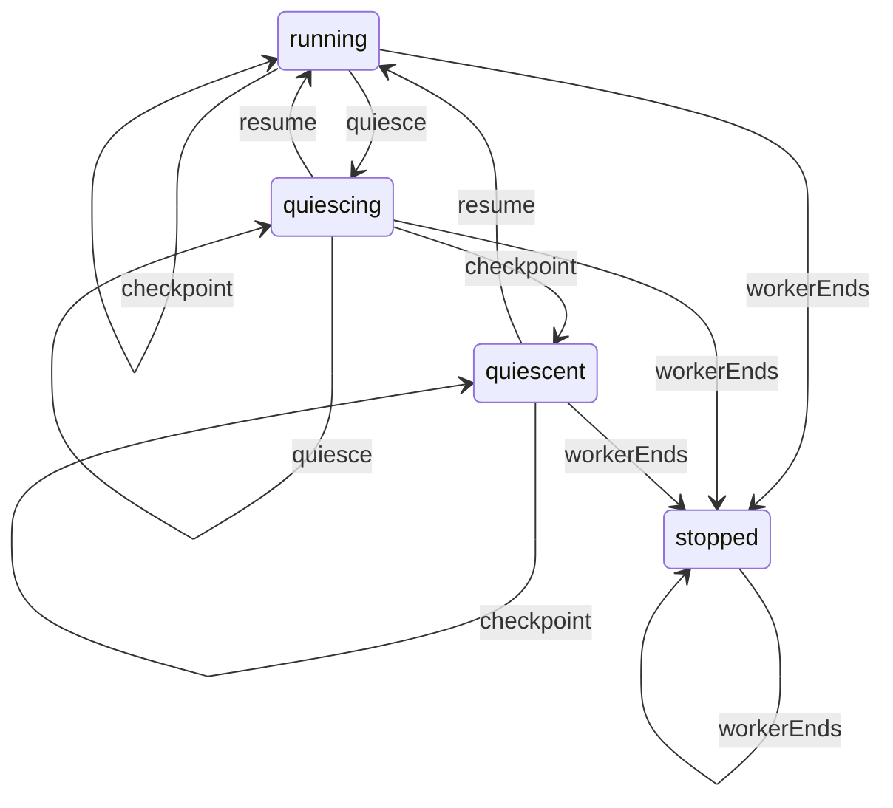
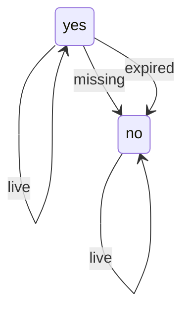

# The ledger

## Authentication

**Token check**: The required checks before returning claims from an OIDC token.

- keyFamilySignature
- exactIssuer
- audienceMembership
- expiry
- subjectString
- presentNotBefore

**Key family**: Verification key families considered by the JWT validator.

- rsa
- p256
- ed25519
- sharedSecret

**Token type**: The token type classified before key resolution.

- absentOrGeneric
- access
- other

**Transport**: URL classes used to validate issuer and key endpoints.

- https
- loopbackHttp
- other

**Bootstrap url**: The URL boundary checked before reading the subject map or opening storage.

- publicUrl
- issuer
- explicitKeyEndpoint

**Issuer companion**: The setting categories an operator may supply with an issuer.

- audience
- publicUrl
- subjectMap
- keyUri
- inlineKeys
- timeout
- subjects
- strictType

**Key source**: The source of the public verification keys.

- discovery
- endpoint
- inlineDocument
- conflict

**Cached key**: A resolver's view of a requested key before a refresh attempt.

- fresh
- aging
- absent

**Cache action**: What a lookup does at the refresh gate.

- returnCached
- tryRefresh
- waitForRefresh

**Subject binding**: A configured issuer and subject map to a principal and optional runner, with empty keys, duplicate bindings and malformed records refused.

- issuer
- subject
- principal
- runner

**Subject admission**: The possible admission results for a verified subject.

- allow
- refuse

**Subject allowlist setting**: The configured subject allowlist at settings intake.

- omitted
- empty
- populated

**Party check**: The presented authorized party after reading the validated token's audience and exact nonempty route allowset.

- missingSingleAudience
- missingMultipleAudiences
- listed
- unlisted
- malformed

**Shaper action**: What a policy may do to a credential-bound authorization field.

- preserve
- narrow

**Shaped field**: Fields a host role shaper receives after verification and initial resolution.

- identity
- writer
- path
- runner
- requiredOwner
- roles
- tools
- expiry

**Claims carry**: When optional verified payload context is preserved.

- clone
- narrowToOwner

**Session authority check**: Each transport request verifies its own credential and any session must agree with the current principal and owner.

- authenticateRequest
- agreeWithPrincipal
- agreeWithOwner

**Owner resolver consumer**: The consumers that resolve roles through the runtime's once-bound owner access port.

- mcpEdge
- environmentOidc
- delegation
- platformFactory

**Authenticator forms**: A layer may set neither, either or both authenticator forms.

- neither
- direct
- factory
- both

**Authenticator slot**: Resolution keeps each layer's supplied form, rejects a selected layer with both forms and runs a selected factory after platform admission.

- inherit
- useDirect
- buildWithPlatform
- conflict

**Forwarding role**: The non-managing role names admitted by forwarding policy.

- viewer
- ingest
- editor

**Forwarding check**: A forwarded request keeps its subject, verifies owner agreement and resolves only the claim's registered personal or group owner at the configured capped role.

- verifiedIdentityAndWriter
- exactOwner
- liveCredential
- configuredCeiling
- registeredOwner

**Scope source**: The sources that may seal owner authority.

- verifiedCredential
- singleOwnerBoot

**Engine permit**: Only engine gates construct read and write permits from their checked authority.

- entryRead
- write

**Model claim**: The caller's normalized model label relative to any attestation.

- absent
- matching
- supplied

**Model label source**: The effective provenance label or a refusal.

- credential
- caller
- unknown
- conflict

**Stream observation**: Observations of the first deadline and source polls, with a ready item counting toward the closing budget if its poll reaches the deadline.

- firstDeadline
- ready
- finalReady
- sourcePending
- sourceEnded

**Stream state**: Stream states before the first deadline, while draining up to finalReadyFrames, and after termination.

- open
- closing
- ended

**Protected resource**: The OAuth metadata selected by a request path, with the resource URL independent of token audience.

- origin
- mcp

**Facade route**: Requests published only in public-client facade deployments.

- authorizationMetadata
- registration

**Registration check**: Registration takes at least one absolute redirect URL and public token endpoint authentication. The provider admits redirects.

- nonemptyAbsoluteRedirects
- publicAuthentication

**Delegated command**: A registered delegated command is a flat tool or a dispatcher leaf, with serialized scope derived from the typed command.

- flat
- dispatcherLeaf

**Grant handle**: A queued job stores an opaque redacted UUIDv7 grant handle and no bearer.

- id

**Grant issue check**: Issuance checks recorded before minting a grant for a finite verified host bearer.

- finiteVerifiedBearer
- currentMembership
- sourceRole
- nonManagingCeiling
- registeredCommand
- callerScope
- deployment
- sourceExpiry
- attestedWriter

**Grant redemption check**: Admission checks performed anew at each delegated phase.

- exactOwnerAndCommand
- expiry
- revocation
- callerProfile
- currentMembership

**Grant revoker**: Who may revoke a grant after proving current bearer membership in its owner.

- issuer
- ownerManager

**Phase check**: A noncloneable phase is checked at the engine against its originating runtime, finite expiry, exact purpose and target.

- runtime
- expiry
- purpose
- target

**Blob operation**: Admission of a cited-blob maintenance operation under delegation.

- delivery
- verifiedCollection
- ownerReconciliation

**token checks** = \[keyFamilySignature, exactIssuer, audienceMembership, expiry, subjectString, presentNotBefore]: The OIDC checks required before verified claims are returned.

**short access token type** = "at+jwt": The short RFC 9068 access-token media type.

**full access token type** = "application/at+jwt": The full RFC 9068 access-token media type.

**access token types** = \["at+jwt", "application/at+jwt"]: Access-token media types, matched without ASCII case distinctions.

**generic token type** = "JWT": The generic JWT media type, matched without ASCII case distinctions.

**require access token type** = no: Whether strict access-token type checking is enabled by default.

**issuer url excluded delimiters** = \["?", "\#"]: Raw query and fragment delimiters excluded from issuer URLs.

**bootstrap url checks** = \[publicUrl, issuer, explicitKeyEndpoint]: The URL checks performed before subject-map and storage intake.

**required issuer companions** = \[audience, publicUrl, subjectMap]: An environment issuer requires a resource audience, a public URL and an issuer-aware subject map.

**optional issuer companions** = \[keyUri, inlineKeys, timeout, subjects, strictType]: The remaining issuer settings may be omitted.

**refresh cooldown seconds** = 60: Minimum seconds between JWKS fetch attempts, including failed attempts.

**fresh key seconds** = 3600: Age in seconds of a successful JWKS fetch at which cached keys become refreshable.

**trusted key seconds** = 14400: Age in seconds of a successful JWKS fetch beyond which cached keys are no longer trusted.

**default key request seconds** = 10: Default complete-request timeout in seconds for each discovery or JWKS request.

**max key request seconds** = 300: Maximum complete-request timeout in seconds for each discovery or JWKS request.

**max key response bytes** = 1048576: Maximum bytes read from each discovery or JWKS response.

**key coordinate bytes** = 32: Byte width of P-256 coordinates and Ed25519 public keys.

**clock skew seconds** = 60: The stock validator's JWT clock tolerance in seconds.

**verified context** = \[clone, narrowToOwner]: The context operations that preserve the optional verified payload.

**session checks** = \[authenticateRequest, agreeWithPrincipal, agreeWithOwner]: The credential and session agreement checks on each request.

**owner resolver consumers** = \[mcpEdge, environmentOidc, delegation, platformFactory]: The consumers of the owner access port bound during serving.

**forwarding cap** = read: perspective, write: perspective, goals: reads, administers: no, manages: no: Forwarded roles may read Goals and have neither Goal work, owner administration nor group management.

**forwarding checks** = \[verifiedIdentityAndWriter, exactOwner, liveCredential, configuredCeiling, registeredOwner]: The identity, owner, time, role and registry checks for a forwarded request.

**scope sources** = \[verifiedCredential, singleOwnerBoot]: The verified-credential and personal-owner boot paths that seal owner authority.

**engine permits** = \[entryRead, write]: The engine permit families subject to `Proxiima.OwnerAuthority.ScopeRestriction.expiry`.

**max trusted model chars** = 120: The Unicode character limit for credential-attested and caller-supplied model labels and for the retained portion of an echoed label.

**max host run extensions** = 8: Maximum validated host run attributes carried with Fact capture.

**default stream lifetime seconds** = 3600: Default seconds before the lifetime limit starts the final drain of an authenticated stream.

**final ready frames** = 16: Maximum frames delivered without waiting after the first authorization deadline.

**scope token byte bounds** = \[33, 126]: Inclusive ASCII byte bounds for each byte of a nonempty OAuth scope token.

**scope token excluded bytes** = \[34, 92]: The quote and backslash bytes excluded from an OAuth scope token.

**default scopes** = \["openid", "offline\_access"]: The built-in sign-in and refresh scopes, in advertisement order.

**public grant types** = \["authorization\_code", "refresh\_token"]: Flows advertised for the stateless public client, which uses the upstream sign-in and token endpoints.

**public client routes** = \[authorizationMetadata, registration]: Facade metadata and registration return the same configured public client; other deployments publish neither.

**registration checks** = \[nonemptyAbsoluteRedirects, publicAuthentication]: The redirect and token endpoint authentication checks on public-client registration.

**public registration auth method** = "none": The public token endpoint authentication method used when registration omits the method and required when it supplies one.

**delegated commands** = \[flat, dispatcherLeaf]: The two command kinds admitted for delegation, excluding resources and bare dispatchers.

**max delegated command chars** = 200: Maximum delegated tool identifier length in characters.

**grant issue checks** = \[finiteVerifiedBearer, sourceRole, sourceExpiry, nonManagingCeiling, currentMembership, registeredCommand, callerScope, deployment, attestedWriter]: The credential, membership, command and policy checks before issuing a delegation grant.

**grant redemption checks** = \[exactOwnerAndCommand, revocation, expiry, callerProfile, currentMembership]: The owner, command, validity and membership checks before admitting each delegated phase.

**grant revokers** = \[issuer, ownerManager]: The issuer and current owner managers who may revoke a grant.

**phase checks** = \[runtime, expiry, purpose, target]: Checks on each use of sealed delegated authority before a backend operation.

| key family | signature algorithms |
| --- | --- |
| rsa | \["RS256", "RS384", "RS512"] |
| p256 | \["ES256"] |
| ed25519 | \["EdDSA"] |
| sharedSecret | \[] |

- signature algorithms: The resolved key family determines the accepted signature algorithms.

**admit token type**: Strict mode accepts access-token types alone, while compatibility mode also accepts absent and generic types.

| transport | issuer transport |
| --- | --- |
| https | yes |
| loopbackHttp | yes |
| other | no |

- issuer transport: Issuer transport admits HTTPS and loopback HTTP.

**key transport**: Configured, discovered and redirected key endpoints use HTTPS, or loopback HTTP when their issuer is also loopback.

| uri | document | key source |
| --- | --- | --- |
| yes | yes | conflict |
| yes | no | endpoint |
| no | yes | inlineDocument |
| no | no | discovery |

- key source: A pinned document requires no fetch; explicit endpoints skip discovery, and the two overrides exclude each other.

| cached key | cached key lookup |
| --- | --- |
| fresh | returnCached |
| aging | tryRefresh |
| absent | waitForRefresh |

- cached key lookup: Aging hits may use an incumbent during refresh; absent or untrusted keys wait for the gate.

| allowlist present | subject listed | subject admission |
| --- | --- | --- |
| yes | yes | allow |
| yes | no | refuse |
| no | yes | allow |
| no | no | allow |

- subject admission: Which verified subjects are admitted with or without a configured subject allowlist.

| subject allowlist setting | admit subject allowlist |
| --- | --- |
| omitted | yes |
| empty | no |
| populated | yes |

- admit subject allowlist: An omitted or populated subject allowlist is accepted, while an explicitly empty list is refused.

| party check | admit authorized party |
| --- | --- |
| missingSingleAudience | yes |
| missingMultipleAudiences | no |
| listed | yes |
| unlisted | no |
| malformed | no |

- admit authorized party: A set route policy accepts a listed party or an omitted party with a single distinct audience.

| shaped field | host shape |
| --- | --- |
| identity | preserve |
| writer | preserve |
| path | preserve |
| runner | preserve |
| requiredOwner | preserve |
| roles | narrow |
| tools | narrow |
| expiry | narrow |

- host shape: Host shaping preserves attribution and owner confinement, and can only reduce rights, tool scope and time.

| authenticator forms | authenticator slot |
| --- | --- |
| neither | inherit |
| direct | useDirect |
| factory | buildWithPlatform |
| both | conflict |

- authenticator slot: How the selected layer supplies authentication.

| attested | model claim | model label source |
| --- | --- | --- |
| yes | absent | credential |
| yes | matching | credential |
| yes | supplied | conflict |
| no | absent | unknown |
| no | matching | caller |
| no | supplied | caller |

- model label source: Verified model attestation survives narrowing; a different explicit label is refused and a blank label is omitted.

**stream lifetime**: The first deadline starts closing, every pulled item is delivered, and closing ends at the budget, a pending poll or source EOF.

| protected resource | metadata path |
| --- | --- |
| origin | "/.well-known/oauth-protected-resource" |
| mcp | "/.well-known/oauth-protected-resource/mcp" |

- metadata path: The resource metadata URL used by an origin or MCP authentication challenge.

| blob operation | delegate blob operation |
| --- | --- |
| delivery | yes |
| verifiedCollection | yes |
| ownerReconciliation | no |

- delegate blob operation: Verified collection needs a positive bound and owner reconciliation requires owner authority.

## Composition

**Header supplier**: The supplier of a request header service.

- boot
- requestExtension
- allowlistProjection

**Header use**: Operations on the request header service.

- storeName
- lookupName
- debug

**Header name**: Which form of a header name a request header operation uses.

- lowercase
- namesOnly

**Registered name**: The macro registration inputs that name a schema or tool.

- typedSchema
- opaqueCitation
- tool

**Prefix syntax**: What a registration accepts after the spiice prefix.

- slash
- underscore

**Prefix check**: Where registration checks a declared name's prefix.

- compileTime
- registration

**Schema identity part**: Which identity components distinguish registered schemas and persisted Memory selectors.

- id
- version
- kind

**Schema identity use**: Which use of a schema identity freeze checks for uniqueness.

- registration
- persistedMemory

**Contract check**: Contract checks whose relative order determines the first refusal.

- registrationAgreement
- projectionUniformity
- projectionReachability
- bespokeLegAuthority
- surfaceReachability
- lifecycleLegs

**Core declaration refusal**: Refusals for substrate-only declarations.

- resources
- kernelSurfaces

**Tag position**: The two character positions of a capability tag.

- first
- subsequent

**Tag character**: Character classes distinguished by the capability tag grammar.

- asciiLowercase
- asciiDigit
- hyphen
- other

**Core command**: Ways the canonical app composes the core.

- serve
- maintenance
- migrate

**Core startup**: How a core command reaches storage.

- listenerWithValidation
- headlessWithValidation
- headlessMigration

**Agreement check**: The agreement checks between a linked registry and a declared contract.

- declaredSchemaHasRegistration
- registeredSchemaHasDeclaration
- declaredToolHasRegistration

**Natural key check**: Conditions that match a natural key declaration to its registration.

- matchingSchemaIdWhenPresent
- uniqueColumns
- matchesTypedRegistration

**Bundle schema**: Schema declarations the bundle macro may carry.

- entity
- typedCitation
- opaqueCitation

**contract check order** = \[registrationAgreement, projectionUniformity, projectionReachability, bespokeLegAuthority, surfaceReachability, lifecycleLegs]: Check registration before projection and bespoke-leg authority before lifecycle coverage.

**contract agreement** = \[declaredSchemaHasRegistration, registeredSchemaHasDeclaration, declaredToolHasRegistration]: Each contract covers its schema registrations in both directions and every declared tool is registered.

**natural key agreement** = \[matchingSchemaIdWhenPresent, uniqueColumns, matchesTypedRegistration]: Natural key agreement requires unique columns and the registered typed declaration.

| header supplier | may supply request headers |
| --- | --- |
| boot | no |
| requestExtension | no |
| allowlistProjection | yes |

- may supply request headers: Only the transport's per-request allowlist projection may supply request headers.

| header use | request header names |
| --- | --- |
| storeName | lowercase |
| lookupName | lowercase |
| debug | namesOnly |

- request header names: Header storage and lookup normalize names and debug shows only names.

| registered | matching name | host tool eligible |
| --- | --- | --- |
| yes | yes | no |
| yes | no | no |
| no | yes | yes |
| no | no | no |

- host tool eligible: Whether the host declaration can supply the requested tool's behavior.

| registered name | prefix syntax | prefix check |
| --- | --- | --- |
| typedSchema | slash | compileTime |
| opaqueCitation | slash | registration |
| tool | underscore | compileTime |

- prefix syntax: Declared schema names are slash-prefixed and declared tools are underscore-prefixed.
- prefix check: Typed schemas and tool names are checked at compile time, and opaque IDs at registration.

| schema identity use | schema identity |
| --- | --- |
| registration | \[id, version, kind] |
| persistedMemory | \[kind, id] |

- schema identity: Registrations are unique by full identity and persisted Memory selectors omit version.

| core | resources | kernel surfaces | core declarations |
| --- | --- | --- | --- |
| yes | yes | yes | yes |
| yes | yes | no | yes |
| yes | no | yes | yes |
| yes | no | no | yes |
| no | yes | yes | refused: resources |
| no | yes | no | refused: resources |
| no | no | yes | refused: kernelSurfaces |
| no | no | no | yes |

- core declarations: Only core admits resource and kernel-surface declarations, with resource refusal taking precedence.

| tag position | tag character | capability tag character |
| --- | --- | --- |
| first | asciiLowercase | yes |
| first | asciiDigit | no |
| first | hyphen | no |
| first | other | no |
| subsequent | asciiLowercase | yes |
| subsequent | asciiDigit | yes |
| subsequent | hyphen | yes |
| subsequent | other | no |

- capability tag character: A tag starts with a lowercase ASCII letter and may continue with those letters, digits or hyphens.

| core command | core startup |
| --- | --- |
| serve | listenerWithValidation |
| maintenance | headlessWithValidation |
| migrate | headlessMigration |

- core startup: The canonical core app starts a listener only for serving and migrates only on explicit request.

| registered | mandatory | profile denial |
| --- | --- | --- |
| yes | yes | no |
| yes | no | yes |
| no | yes | no |
| no | no | no |

- profile denial: The caller may deny a registered command while mandatory reads and unknown keys are refused.

| ingress shape | ingress parser count |
| --- | --- |
| typed | 1 |
| opaqueCitedObject | 0 |

- ingress parser count: A typed schema has one matching protocol parser and an opaque citation has none.

| bundle schema | registers bundle sidecar |
| --- | --- |
| entity (Fact) | yes |
| entity (Abstraction) | yes |
| entity (Perspective) | yes |
| entity (Goal) | yes |
| typedCitation | no |
| opaqueCitation | no |

- registers bundle sidecar: The bundle macro generates sidecar registrations from the entity schema lists.

## Configuration

**Presence**: Whether a configuration layer supplies the slot being resolved.

- omitted
- supplied

**Layer**: Which layer provides a resolved configuration slot.

- builtIn
- application
- environment
- host

**Lookup profile**: The available configuration lookup profiles.

- serving
- storageOnly

**Setting group**: The groups of settings used by the facade's lookup.

- storage
- embeddingRuntime
- serving
- objectStore

**Lookup text**: The lexical outcomes of trimming a setting's lookup result.

- missing
- blank
- nonblank

**Environment name**: Configured names distinguished by the unknown-name diagnostic.

- declared
- unknownProductName
- unrelated

**Pair position**: The two positions of repeated entries in an injected environment.

- earlier
- later

**Storage policy source**: The possible sources of storage policy during facade boot.

- resolvedConfiguration
- processEnvironment

**Setting source**: The registered sources that supply operator documentation and host help.

- facade
- core
- postgres
- objectStore
- host

**Default input**: The inputs compared against each declared default's effective reader.

- omitted
- statedDefault
- differentValue

**storage policy source** = resolvedConfiguration: Facade storage boot consumes its resolved pool and query policy without a second environment lookup.

**true words** = \["1", "true", "yes", "on"]: The case-insensitive boolean words that read as true after trimming.

**false words** = \["0", "false", "no", "off"]: The case-insensitive boolean words that read as false after trimming.

**documentation sources** = \[facade, core, postgres, objectStore, host]: The composition order for settings documentation and help, with development tools outside the composition.

| presence | presence | presence | layer precedence |
| --- | --- | --- | --- |
| omitted | omitted | omitted | builtIn |
| omitted | omitted | supplied | application |
| omitted | supplied | omitted | environment |
| omitted | supplied | supplied | environment |
| supplied | omitted | omitted | host |
| supplied | omitted | supplied | host |
| supplied | supplied | omitted | host |
| supplied | supplied | supplied | host |

- layer precedence: In host, environment, application order, the first supplied value wins, then built-in defaults; authenticators supplied in code take precedence over environment OIDC.

| lookup profile | setting group | reads group |
| --- | --- | --- |
| serving | storage | yes |
| serving | embeddingRuntime | yes |
| serving | serving | yes |
| serving | objectStore | yes |
| storageOnly | storage | yes |
| storageOnly | embeddingRuntime | yes |
| storageOnly | serving | no |
| storageOnly | objectStore | no |

- reads group: Storage commands read storage and its embedding runtime policy, with object configuration acquired separately by commands that need it.

| lookup text | lookup presence |
| --- | --- |
| missing | omitted |
| blank | omitted |
| nonblank | supplied |

- lookup presence: A missing or blank setting is omitted, and nonblank text is passed to the reader trimmed.

| environment name | warn for name |
| --- | --- |
| declared | no |
| unknownProductName | yes |
| unrelated | no |

- warn for name: Warn once per unknown product name without exposing its value or refusing startup.

| presence | presence | last configured slot |
| --- | --- | --- |
| omitted | omitted | — |
| omitted | supplied | later |
| supplied | omitted | earlier |
| supplied | supplied | later |

- last configured slot: Given the earlier and later values in that order, tuple entries and repeated host configuration calls retain the last supplied slot value.

| default input | matches omission |
| --- | --- |
| omitted | yes |
| statedDefault | yes |
| differentValue | no |

- matches omission: The stated default must behave like omission, and the different value must reach the reader.

## Database authority

**Database role**: The platform role owns relations, while the serving role uses owner-scoped access under RLS.

- platform
- runtime

**Serving admission**: Serving admission checks the role split and the live relation and definer inventory after schema validation.

- validateSchema
- validatePlatform
- validateRuntime

**Platform binding check**: Platform transactions must match the validated database and effective role and retain their restricted role attributes.

- database
- effectiveRole
- roleAttributes

**System write authority**: System writes require a witness minted by consuming the engine and bound to that engine's boot.

- consumeEngine
- matchBootWitness

**Owner transaction scope**: An owner transaction sets its sealed subject's memory ceilings and Goal access for that transaction only.

- data
- goalSubject
- ownerManagement

**Scoped read**: Scoped SPIICE reads reuse the caller's transaction; version and receipt locks last through it, and a shared memory lock requires write authority.

- readInOwnerTransaction
- lockReceiptAdmission
- lockVersionWithWriteAuthority

**Core view rule**: Core views invoke caller RLS and receive SELECT-only serving grants.

- invokerSecurity
- runtimeSelectOnly

**Memory sql route**: Core Memory SQL declares whether it includes forgotten rows; direct reads are reserved for row locks and policy or view definitions.

- liveView: The live route uses proxiima_core.live_memory.
- includingForgottenView: The inclusive route uses proxiima_core.memory_including_forgotten.
- spineWrite
- spineRowLock
- spineDefinition

**Memory scan region**: The production Rust SQL guardrail scans outside file-level and inline-module test code.

- productionItems
- excludeTestFiles
- excludeTestModules

**Sql composition**: The SQL composition boundary uses checked identifiers and program literals, binds request data, and confines raw SQLx composition to one module.

- checkedIdentifier
- programLiteral
- boundRequestData
- trustedFragment
- confinedSqlxEscape

**Sql identifier form**: Tables take one or two unquoted parts, other unquoted identifiers take one, and quoted catalog names escape quotes and refuse empty, NUL or oversized values.

- unquotedTable
- unquotedName
- quotedCatalogName

**Sql literal form**: Program literals double quotes, use escape strings for backslashes, refuse NUL and nonfinite floats, and preserve backslashes in composed statement literals.

- text
- escapeText
- finiteFloat
- composedStatement

**Sql template fill**: Template replacement scans the original left to right, prefers the longest matching key at a position, and refuses empty keys.

- leftmost
- longestAtEqualPosition
- skipReplacementText
- refuseEmptyKeys

**Owner policy check**: Migration installs and refreshes classified, forced owner RLS; the serving census rejects missing, unclassified or drifted policy state.

- relationClassification
- enabledAndForced
- recordedPolicyShape

**Follows policy**: Follows sidecars stamp the owning Memory's owner and require a recorded policy, live-memory check and leading owner index.

- stampOwner
- checkLiveMemoryAndOwner
- requirePolicyAndIndex

**Scoped reader**: Scoped database reader functions have dedicated read-only owners with execution granted explicitly and withheld from PUBLIC; candidate results are admitted under ordinary visibility.

- searchCandidates
- goalVisibility

**Platform write definer**: For a table with definer-only writes, the owner-write policy admits no rows and a platform-owned `SECURITY DEFINER` function is the sole writer.

- denyOwnerWrites
- writeThroughPlatformDefiner

**Pooler compatibility**: Serving transactions keep settings and locks transaction-local; connection startup omits the float-format parameter.

- localSettings
- transactionLocks
- noSessionCommands
- omitFloatFormat

**Database operation**: The connection chosen by the database operation.

- serve
- operateAsPlatform
- migrate
- validateSchema

**Connection purpose**: The runtime, platform and migration pools use their resolved per-pool settings at startup.

- runtime
- platform
- migration

**Statement timeout policy**: The statement timeout policy depends on the work the connection performs.

- poolStartup: Pool startup applies the resolved statement timeout when configured to send it.
- migrationSession: A migration session disables the statement timeout for that session.
- ownerEraseTransaction: Bulk owner erase disables the statement timeout for its transaction only.

**Required storage setting**: Migration, boot and maintenance require the runtime URL, platform URL and store number.

- runtimeUrl
- platformUrl
- storeNumber

**Migration connection**: The migration URL defaults to the platform URL; an override must keep its database and role.

- platformDefault
- sameDatabaseAndRoleOverride

**Connection diagnostic**: Connection diagnostics omit the URL.

- invalidUrl
- migrationIdentityMismatch
- redactedConfig

**Preconnection check**: Boot freezes the registry and validates configuration and the embedding route before connecting storage.

- configurationAndListenerAllowlists
- freezeRegistry
- embeddingRoute

**Storage overlay**: The storage block being overlaid.

- pool
- tuning

**Overlay input**: The source's contribution after parsing, relative to the shipped defaults.

- unset
- explicitDefault
- nonDefault

**Grant phase step**: The opt-in grant phase starts after schema migration and store-number initialization and applies grants in one locked platform transaction.

- migrateSchema
- initializeStore
- grantInLockedTransaction

**Grant role check**: Runtime grants target the runtime URL role only after confirming it differs from the platform URL role.

- runtimeUrlRole
- distinctPlatformUrlRole

**Schema grant**: Existing composed schemas grant usage, table DML and sequence access with schema-scoped defaults; the phase grants neither ownership nor role membership and revokes runtime and public CREATE.

- schemaUsage
- tableDml: SELECT, INSERT, UPDATE and DELETE.
- sequenceAccess: USAGE, SELECT and UPDATE.
- scopedDefaults
- revokeCreate

**Read only grant**: Core views end SELECT-only after broad table grants, and migration ledgers grant runtime SELECT with schema usage only as needed.

- coreViews
- migrationLedgers

**Scoped reader grant step**: Reader grants cover the composed schemas and switch to the function owner only for the grant before restoring the platform role.

- selectComposedReader
- assumeOwnerLocally
- grantExecution
- restorePlatformRole

**Bootstrap ownership step**: Bootstrap transfers table ownership before dependent sequence ownership.

- relations
- sequences

**Engine storage**: Engine storage is required at construction; the shipped backend is PostgreSQL, and refuse-all storage is test-only.

- requiredPorts
- postgresBackend
- testOnlyRefusal

**Storage port requirement**: Storage assembly reports all missing required ports together; erase authority and personal-drop proof are optional.

- collectMissingRequired
- optionalEraseAuthority
- optionalPersonalDropProof

**Storage outcome**: The external storage outcomes whose protocol category differs by operation.

- conflictOrConstraint
- exhaustedTransient

**Storage verb**: A read or write returning a storage failure.

- read
- write

**Protocol failure**: Public categories for the classified storage failures.

- invalidArgument
- internal

**Sql failure route**: Database fault classes have different storage routes.

- typedRule
- retryWholeTransaction
- internalBackstop

**serving admission order** = \[validateSchema, validatePlatform, validateRuntime]: Validation precedes handing out the serving storage.

**max identifier bytes** = 63: The PostgreSQL byte limit for each identifier part.

**min pool connections** = 1: The lowest usable pool size.

**default pool connections** = 5: The default number of connections per pool.

**default statement timeout ms** = 300000: The default statement timeout in milliseconds.

**omit statement timeout ms** = 0: The statement timeout value that omits the pool's startup option.

**default acquire timeout secs** = 5: The default acquisition timeout in seconds.

**default idle timeout secs** = 600: The default idle timeout in seconds.

**default max lifetime secs** = 1800: The default connection lifetime in seconds.

**runtime grant lock key** = 8102661242515254900: The advisory lock key serializing the platform grant phase is ASCII `proxgrnt` interpreted as a big-endian integer.

**default runtime grants** = no: Runtime grants are opt-in on the migration path.

**grant phase order** = \[migrateSchema, initializeStore, grantInLockedTransaction]: The platform applies opt-in grants after both database preparation steps succeed.

**scoped reader grant order** = \[selectComposedReader, assumeOwnerLocally, grantExecution, restorePlatformRole]: The order of one isolated reader grant.

**bootstrap ownership order** = \[relations, sequences]: The PostgreSQL object-ownership replay order.

**rule sqlstate** = "PX001": A SQLSTATE reporting a caller-facing storage refusal with a rule in the constraint field.

**backstop sqlstate** = "PX002": A SQLSTATE reporting an internal storage backstop without a caller-facing rule.

**transient sqlstates** = \["40P01", "40001", "55P03"]: PostgreSQL SQLSTATEs that allow the transaction to be replayed after rollback.

| database operation | connection purpose |
| --- | --- |
| serve | runtime |
| operateAsPlatform | platform |
| migrate | migration |
| validateSchema | migration |

- connection purpose: Migration and schema validation share the direct or session-mode migration connection policy.

| storage overlay | overlay input | overlay supplied |
| --- | --- | --- |
| pool | unset | no |
| pool | explicitDefault | yes |
| pool | nonDefault | yes |
| tuning | unset | no |
| tuning | explicitDefault | no |
| tuning | nonDefault | yes |

- overlay supplied: Pool overrides use setting presence; tuning overrides use a resolved value different from the default.

| storage verb | storage outcome | storage error category |
| --- | --- | --- |
| read | conflictOrConstraint | internal |
| read | exhaustedTransient | internal |
| write | conflictOrConstraint | invalidArgument |
| write | exhaustedTransient | internal |

- storage error category: Reads collapse storage failures to internal; writes distinguish caller-fixable conflicts and constraints from exhausted retries.

## Edges

**Pin kind**: The kinds of pins, in projection order.

- origin
- reference
- read

**Pin field**: The relationship fields of a Memory admission.

- origins
- refs
- goalRefs
- guidedBy
- reads
- forkedFrom

**Pin shape**: How a pin field stores its targets.

- array
- scalar

**Pin field spec**: The role, storage shape and target layers of a pin field.

- column
- kind
- shape
- fact
- abstraction
- perspective

**Target projection**: The precedence of exact target states when a pin's source is readable.

- visible
- forgotten
- erased
- redacted

**Erased target**: A historical witness stores only the exact version identity and its kind.

- version
- kind

**Provenance**: The origin or subject declaration a schema contributes to ancestor traversal.

- undeclared
- originEdges
- payloadOnly
- none

**Page key**: The continuation key for a pin page, compared newest first and exclusive of the cursor.

- sourceTime
- sourceId
- targetId
- kind

**Admission**: How a pin is presented at admission.

- fresh
- forkRevision
- schemaEvolution

**Admission witness**: What witnesses an exact pin during admission.

- liveReadableTarget
- capturedSourcePin

**grounding fields** = \[origins, refs]: Local storage fields that can ground a derived Memory, per `Causa.GroundsInFact`.

**pin order** = \[origin, reference, read]: Pin projection groups kinds in this order and preserves field order within each kind.

**local descendant kinds** = \[origin, read]: Local descendant traversal follows origins and read context.

**page key** = \[sourceTime, sourceId, targetId, kind]: The pin page key in comparison order.

**default neighbor expansion** = no: Whether neighbor edges are expanded when the request omits the flag.

**external replay kinds** = \[origin, reference]: The pin kinds compared for external-edge replay.

**max read pins** = 1024: The largest host read set, counted in distinct exact versions.

**max derive sources** = 256: The maximum number of raw sources in one derive declaration.

**max think seeds** = 8: The maximum number of seeds in a Think request.

**default walk depth** = 3: The default number of hops in a walk.

**max walk depth** = 8: The maximum number of hops in a walk.

**max remote leaves** = 64: The maximum number of distinct remote leaves read per lineage page.

**max remote sketch chars** = 200: The character ceiling for a remote walk sketch.

**max neighbor pins** = 200: The maximum number of hydrated pins per neighbor read.

**inbound source floor** = 256: The minimum number of candidate source rows in an inbound page read.

**single pin probe rows** = 2: The source limit for an inbound probe requesting just one edge.

**max snapshot edges** = 50000: The edge ceiling of a query snapshot, independent of its node window.

**fine pin lock budget** = 256: Pin target requests attempted before coarse locking is considered.

| pin kind | pin label |
| --- | --- |
| origin | "origin" |
| reference | "reference" |
| read | "read" |

- pin label: The wire and cross-store storage label of a pin kind.

| pin field | pin field |
| --- | --- |
| origins | column: "origins", kind: origin, shape: array, fact: \[], abstraction: \[Fact, Abstraction], perspective: \[Abstraction] |
| refs | column: "refs", kind: reference, shape: array, fact: \[Fact, Abstraction, Perspective], abstraction: \[Fact, Abstraction, Perspective], perspective: \[Fact, Abstraction, Perspective] |
| goalRefs | column: "goal\_refs", kind: reference, shape: array, fact: \[Goal], abstraction: \[Goal], perspective: \[Goal] |
| guidedBy | column: "guided\_by", kind: reference, shape: array, fact: \[], abstraction: \[], perspective: \[Goal] |
| reads | column: "reads", kind: read, shape: array, fact: \[Fact, Abstraction, Perspective], abstraction: \[Fact, Abstraction, Perspective], perspective: \[Fact, Abstraction, Perspective] |
| forkedFrom | column: "forked\_from", kind: reference, shape: scalar, fact: \[Fact, Abstraction, Perspective], abstraction: \[Fact, Abstraction, Perspective], perspective: \[Fact, Abstraction, Perspective] |

- pin field: Each pin field's role, storage shape and admitted target kinds.

| live | forgotten | erased | project target |
| --- | --- | --- | --- |
| yes | yes | yes | visible |
| yes | yes | no | visible |
| yes | no | yes | visible |
| yes | no | no | visible |
| no | yes | yes | forgotten |
| no | yes | no | forgotten |
| no | no | yes | erased |
| no | no | no | redacted |

- project target: Live wins over readable forgotten or erased witnesses, and other targets are redacted.

| provenance | local ancestor kinds |
| --- | --- |
| undeclared | \[origin, read] |
| originEdges | \[origin, read] |
| payloadOnly | \[reference, read] |
| none | \[read] |

- local ancestor kinds: Local ancestor edge kinds by schema provenance; payload references are limited to declared subject fields.

| origin | reference | fork anchor | keep read pin |
| --- | --- | --- | --- |
| yes | yes | yes | no |
| yes | yes | no | no |
| yes | no | yes | no |
| yes | no | no | no |
| no | yes | yes | no |
| no | yes | no | no |
| no | no | yes | no |
| no | no | no | yes |

- keep read pin: Read pins yield to an origin, reference or fork anchor to the same target.

| admission | pin admission witness |
| --- | --- |
| fresh | liveReadableTarget |
| forkRevision | capturedSourcePin |
| schemaEvolution | capturedSourcePin |

- pin admission witness: Fresh pins require a live readable target, while a retained pin requires an exact captured source pin.

## Forget and restore

**Retained part**: The parts retained when a Memory is forgotten.

- admission
- stampedSidecars
- sketch
- requestReceipt
- externalOrigins
- citedObjects

**Restore refusal**: Restore refuses a retired Fact schema.

- retiredSchema

**Restore action**: The effect of restore on an admission that passed the schema check.

- unchanged
- rebuild

**Restore step**: The steps of restoring a forgotten admission after admission checks.

- clearMark
- rebuildStampedProjectionsInStoredLanguage
- enqueueRoutedEmbeddings: Queue embedding work for routed spaces.
- repairHead

**Head choice**: Which surviving version is the head after a lifecycle change.

- newestLive
- newestForgotten

**Footprint step**: The lock footprint stages, shared by forget and restore.

- lockSourceAndNonFactDependerHandles
- lockSourceAndNonFactDependerVersions
- revalidateFootprint

**Derived delete**: The order of derived-state deletes during forget.

- searchProjections
- embeddingJobs
- otherGeneratedLegs

**Surface rule**: Surface declarations as classified by their Memory key and cascade evidence.

- keep
- retain
- retainCascadedDetail
- delete

**Surface leg**: The leg resolved from a declared forget rule.

- kept
- marked
- cascaded
- deleted
- unreachable

**retained on forget** = \[admission, stampedSidecars, sketch, requestReceipt, externalOrigins, citedObjects]: Forget leaves the original admission and the data needed to restore or replay it in place.

**restore steps** = \[clearMark, rebuildStampedProjectionsInStoredLanguage, enqueueRoutedEmbeddings, repairHead]: The mark, projection, embedding and head steps of restoring a forgotten admission.

**footprint order** = \[lockSourceAndNonFactDependerHandles, lockSourceAndNonFactDependerVersions, revalidateFootprint]: The handle locks, version locks and revalidation of the dependent footprint.

**derived delete order** = \[searchProjections, embeddingJobs, otherGeneratedLegs]: Forget deletes linked search projections and takes embedding jobs before the other generated deletes.

| lifecycle | forgotten | visible in scope |
| --- | --- | --- |
| yes | yes | yes |
| yes | no | yes |
| no | yes | no |
| no | no | yes |

- visible in scope: Whether a Memory is visible in the selected owner scope given its forgotten mark.

| retired | forgotten | restore admission |
| --- | --- | --- |
| yes | yes | refused: retiredSchema |
| yes | no | refused: retiredSchema |
| no | yes | rebuild |
| no | no | unchanged |

- restore admission: Schema retirement refuses restore before the live-row no-op or the forgotten-row rebuild.

| has live | has forgotten | repair head |
| --- | --- | --- |
| yes | yes | newestLive |
| yes | no | newestLive |
| no | yes | newestForgotten |
| no | no | — |

- repair head: Prefer the newest live head, keep a forgotten head while only forgotten versions remain, and remove an empty series head.

| surface rule | classify surface |
| --- | --- |
| keep | kept |
| retain (yes) | marked |
| retain (no) | unreachable |
| retainCascadedDetail (yes) | marked |
| retainCascadedDetail (no) | unreachable |
| delete (yes, yes) | cascaded |
| delete (yes, no) | cascaded |
| delete (no, yes) | deleted |
| delete (no, no) | unreachable |

- classify surface: Retained surfaces require a reachable key or matching Memory cascade. A declared delete with cascade evidence is classified as cascaded, with no generated delete.

## Goal collaboration

**Relationship**: A relationship with a Goal, classified by the scope of access it conveys.

- context
- publication
- workBinding

**Audience read target**: The identity at which a Goal audience can read Memory.

- admission
- series

**Grant refusal**: Why an audience grant's role is refused.

- ownerAdministration

**Grant subject kind**: The registered kind of an audience grant's subject.

- person
- group

**Consent change**: A request to add or withdraw exact publication or series binding consent.

- admit
- withdraw

**Bound work access**: Whether the request reads through a work binding or writes into the bound series.

- read
- write

**Publication use**: The source owner's permission recorded on one exact publication.

- Read
- Fork

**Fork destination**: The destination path of a fork.

- sameOwner
- differentOwner
- workingGoal

| relationship | audience read target |
| --- | --- |
| context | — |
| publication | admission |
| workBinding | series |

- audience read target: Context conveys no read; publication selects one admission and a work binding selects a series.

| administers | goal access | stored guest goal access | owner goal access on audience route |
| --- | --- | --- | --- |
| yes | none | refused: ownerAdministration | none |
| yes | reads | refused: ownerAdministration | reads |
| yes | works | refused: ownerAdministration | works |
| no | none | reads | none |
| no | reads | reads | reads |
| no | works | works | reads |

- stored guest goal access: An audience grant raises absent Goal access to read and refuses owner administration.
- owner goal access on audience route: An owner role contributes at most Goal read to the audience route unless it administers.

| grant subject kind | manages | grant subject admitted |
| --- | --- | --- |
| person | yes | yes |
| person | no | yes |
| group | yes | no |
| group | no | yes |

- grant subject admitted: A group audience grant cannot convey Goal management.

| current epoch | unexpired | grant in force |
| --- | --- | --- |
| yes | yes | yes |
| yes | no | no |
| no | yes | no |
| no | no | no |

- grant in force: A grant is in force while it is unexpired and of the current Goal controller epoch.

| newer | independently readable | prefer owner head |
| --- | --- | --- |
| yes | yes | yes |
| yes | no | no |
| no | yes | no |
| no | no | no |

- prefer owner head: A newer independently readable owner head takes precedence over the latest audience-visible version.

| consent change | goal manager | source administrator | sharing consent admitted |
| --- | --- | --- | --- |
| admit | yes | yes | yes |
| admit | yes | no | no |
| admit | no | yes | no |
| admit | no | no | no |
| withdraw | yes | yes | yes |
| withdraw | yes | no | yes |
| withdraw | no | yes | yes |
| withdraw | no | no | no |

- sharing consent admitted: Adding consent requires Goal management and source administration; either may withdraw it.

| goal state | bound work access | bound work state admitted |
| --- | --- | --- |
| Active | read | yes |
| Active | write | yes |
| Paused | read | yes |
| Paused | write | no |
| Achieved | read | yes |
| Achieved | write | no |
| Abandoned | read | yes |
| Abandoned | write | no |

- bound work state admitted: A binding can be read in any Goal state, and the series can be worked while the Goal is active.

| fork destination | source administrator | fork needs publication |
| --- | --- | --- |
| sameOwner | yes | no |
| sameOwner | no | no |
| differentOwner | yes | no |
| differentOwner | no | yes |
| workingGoal | yes | no |
| workingGoal | no | yes |

- fork needs publication: Source administration or a direct same-owner destination suffices without publication consent.

| command permitted | has pins | has citation | companion facts admitted |
| --- | --- | --- | --- |
| yes | yes | yes | no |
| yes | yes | no | no |
| yes | no | yes | no |
| yes | no | no | yes |
| no | yes | yes | no |
| no | yes | no | no |
| no | no | yes | no |
| no | no | no | no |

- companion facts admitted: A permitted Goal work unit command may write its declared Facts without pins or citations.

## Goals

**Goal state**: The lifecycle state of a Goal version.

- Active
- Paused
- Achieved
- Abandoned

**Pending work**: The host's pause disposition for queued work, with running work allowed to finish.

- keep: Hold queued work for resume.
- discard: Drop queued and retryable work.

**Event**: The operation that writes a Goal version.

- set
- decompose
- modify
- pause
- resume
- achieve
- abandon

**Lifecycle refusal**: Why an operation cannot use the named series head.

- wrongState

**Revision field**: Whether a revision retains or replaces a declaration.

- carry
- replace

**Request match**: The durable request comparison made under the owner and request key.

- fresh
- exact
- different
- missingDeclaration

**Replay action**: Whether the replay may be returned, must be refused, or needs fresh admission.

- freshAdmission
- returnOriginal
- conflict

**Decompose replay**: The replay status across a decomposition's complete request set.

- allFresh
- allExact
- mixed
- conflicting

**Replay field**: The durable parts compared for replay, separate from an episode's write-act binding.

- command
- expectedHead
- authorCategory
- sessionSelf
- writeAct

**Head comparison**: The outcomes of comparing the predecessor under the locked Goal head.

- unchanged
- namedStale
- unnamedDrift

**Commit decision**: The commit decision after comparing the predecessor.

- proceed
- conflict
- retry

**Transaction outcome**: Outcomes classified by the pool-scoped storage retry loop. Retryable includes SQLSTATE 40001, 40P01 and 55P03 and application conflicts such as head or authority footprint drift.

- retryable
- memoryIdCollision
- other

**Retry budget**: Whether the applicable retry budget is still available.

- available
- exhausted

**Retry action**: What the retry loop does with the outcome of one transaction attempt.

- retry
- returnOutcome
- refuseCollision

**Admission step**: The steps of Goal revision persistence, from owner fencing to target revalidation.

- fenceOwners
- reserveFactIdentity
- lockMemoryHandles
- lockLifecycleUnion
- lockGoalHeads
- revalidateTargets

**Change fact admission**: The publication admission for a fresh Goal revision.

- skip
- publish
- missingStamp

**Change fields**: The variant-specific payload fields of a Goal change.

- plain
- parent
- pending

**Trimmed display length**: The title or prompt’s length after trimming surrounding Unicode White_Space.

- blank
- withinBound
- oversized

**birth state** = Active: Set and decomposition start each new series here.

**title max** = 240: The largest trimmed Goal title in characters.

**text max** = 20000: The largest trimmed Goal prompt in characters.

**decompose child max** = 50: The largest number of children in one decompose request.

**decompose root key max** = 162: The root key character ceiling that leaves room for the child prefix, separators and largest index.

**decompose child prefix** = "goal\_decompose": The prefix of each child request key, followed by the root key and zero-based index.

**evidence declaration** = "goal.evidence\_t": Goal evidence is read from the exact declaration whose pins are projected by `Causa.goalDeclaredTargetIds`.

**motivation declaration** = "goal.motivated\_by": The authoritative field behind the reverse index, with targets governed by `Causa.goal_motivations_valid`.

**operator authorship** = "system\_operator": Operators use their authorship category in the durable command and its replay identity.

**admission order** = \[fenceOwners, reserveFactIdentity, lockMemoryHandles, lockLifecycleUnion, lockGoalHeads, revalidateTargets]: Goal revision persistence reserves lifecycle Facts before locking the sorted Memory and lifecycle sets and comparing the prepared head.

**transfer goal** = no: A Goal remains owned by its original owner throughout its series.

| goal state | is open | terminal | state label | blocks close |
| --- | --- | --- | --- | --- |
| Active | yes | no | "Active" | yes |
| Paused | yes | no | "Paused" | yes |
| Achieved | no | yes | "Achieved" | no |
| Abandoned | no | yes | "Abandoned" | no |

- is open: Whether the series can take another version.
- terminal: Whether a Goal version requires a close Fact and ends its series.
- state label: The label projected on Goal reads.
- blocks close: Whether a sub-goal in this state keeps its parent from closing, achieved or abandoned alike.

**lifecycle**: Admission by existing head state, returning the new version state or the new child state for decomposition.

| goal state | event | answer |
| --- | --- | --- |
| Active | set | refused: wrongState |
| Active | resume | refused: wrongState |
| Paused | set | refused: wrongState |
| Paused | decompose | refused: wrongState |
| Paused | modify | refused: wrongState |
| Paused | pause (keep) | refused: wrongState |
| Paused | pause (discard) | refused: wrongState |
| Paused | achieve | refused: wrongState |
| Achieved | set | refused: wrongState |
| Achieved | decompose | refused: wrongState |
| Achieved | modify | refused: wrongState |
| Achieved | pause (keep) | refused: wrongState |
| Achieved | pause (discard) | refused: wrongState |
| Achieved | resume | refused: wrongState |
| Achieved | achieve | refused: wrongState |
| Achieved | abandon | refused: wrongState |
| Abandoned | set | refused: wrongState |
| Abandoned | decompose | refused: wrongState |
| Abandoned | modify | refused: wrongState |
| Abandoned | pause (keep) | refused: wrongState |
| Abandoned | pause (discard) | refused: wrongState |
| Abandoned | resume | refused: wrongState |
| Abandoned | achieve | refused: wrongState |
| Abandoned | abandon | refused: wrongState |

| goal state | bool | close fact presence |
| --- | --- | --- |
| Active | yes | no |
| Active | no | yes |
| Paused | yes | no |
| Paused | no | yes |
| Achieved | yes | yes |
| Achieved | no | no |
| Abandoned | yes | yes |
| Abandoned | no | no |

- close fact presence: Whether close-Fact presence agrees exactly with terminal state.

| event | prompt revision | parent revision | may declare evidence | change fields |
| --- | --- | --- | --- | --- |
| set | replace | replace | yes | plain |
| decompose | replace | replace | yes | parent |
| modify | replace | carry | yes | plain |
| pause (keep) | carry | carry | no | pending |
| pause (discard) | carry | carry | no | pending |
| resume | carry | carry | no | plain |
| achieve | carry | carry | yes | plain |
| abandon | carry | carry | no | plain |

- prompt revision: Declaring writes supply a prompt and lifecycle changes carry the stored prompt byte for byte.
- parent revision: A child keeps the parent series chosen at birth alongside its exact parent dependency under `Causa.GoalStep`.
- may declare evidence: Which Goal operations can supply an evidence statement, always optional.
- change fields: Decomposition alone carries the parent revision and pause alone carries a pending disposition.

| request match | request replay |
| --- | --- |
| fresh | freshAdmission |
| exact | returnOriginal |
| different | conflict |
| missingDeclaration | conflict |

- request replay: After authority, exact replay returns the original before mutable targets and creates no second write.

| decompose replay | decompose replay |
| --- | --- |
| allFresh | freshAdmission |
| allExact | returnOriginal |
| mixed | conflict |
| conflicting | conflict |

- decompose replay: Decomposition admits the whole request set or answers its whole replay.

| replay field | replay identity |
| --- | --- |
| command | yes |
| expectedHead | yes |
| authorCategory | yes |
| sessionSelf | no |
| writeAct | no |

- replay identity: Replay seals the command, including any pause disposition, and excludes attempt attribution.

| head comparison | predecessor arbitration |
| --- | --- |
| unchanged | proceed |
| namedStale | conflict |
| unnamedDrift | retry |

- predecessor arbitration: A stale named predecessor conflicts and unnamed prediction drift retries the complete transaction.

| transaction outcome | retry budget | retry transaction |
| --- | --- | --- |
| retryable | available | retry |
| retryable | exhausted | returnOutcome |
| memoryIdCollision | available | retry |
| memoryIdCollision | exhausted | refuseCollision |
| other | available | returnOutcome |
| other | exhausted | returnOutcome |

- retry transaction: Transient outcomes have a three-attempt budget. A memory ID collision can retry once independently, even after the last transient retry. A second collision becomes a constraint violation.

| listenable | stamped | publish change fact |
| --- | --- | --- |
| yes | yes | publish |
| yes | no | missingStamp |
| no | yes | skip |
| no | no | skip |

- publish change fact: A listenable fresh revision requires a stamp and emits its change Fact after the Goal in the same transaction.

| trimmed display length | display admitted |
| --- | --- |
| blank | no |
| withinBound | yes |
| oversized | no |

- display admitted: The Rust input boundary uses str::trim, counts the remaining Unicode scalar values and admits a title or prompt with length from one through its field limit.

| explicit space | same owner | edit space matches |
| --- | --- | --- |
| yes | yes | yes |
| yes | no | no |
| no | yes | yes |
| no | no | yes |

- edit space matches: An edit uses the named Goal's owner and an explicit space can only narrow that selection.

| filter omitted | in canonical set | state filter |
| --- | --- | --- |
| yes | yes | yes |
| yes | no | yes |
| no | yes | yes |
| no | no | no |

- state filter: Goal queries select all states when the filter is omitted and otherwise select the union of supplied labels. The resource accepts comma-separated case-insensitive labels, refuses empty members and binds the canonical set into its cursor. Other streams ignore the filter.

| has motivation | perspective matches | recall active goal |
| --- | --- | --- |
| yes | yes | yes |
| yes | no | no |
| no | yes | yes |
| no | no | yes |

- recall active goal: Recall includes unmotivated Active Goals and Active Goals motivated by a recalled Perspective head.

✗ **achieve needs an achieved child**, rejected: An abandoned child leaves the parent free to close.

## Host state

**Registration**: Participant registration accumulated across runtime configuration layers.

- absent
- single
- duplicate

**Participant requirement**: The frozen participant has a nonempty identity and a nonempty set of distinct declared state surfaces.

- namedParticipant
- atLeastOneSurface
- namedSurfaces
- distinctSurfaces
- declaredStateSurfaces

**Command requirement**: A command names the frozen participant and a nonempty, duplicate-free subset of its registered state surfaces.

- sameParticipant
- atLeastOneSurface
- distinctSurfaces
- registeredSurfaces

**Request binding**: A dispatched request agrees exactly with the stamped participant and command table list.

- participant
- commandTables

**Unit kind**: The unit's authority at the ordinary host-state entry point.

- ordinary
- maintenance
- goalWork
- system

**Admission**: The gate used by the ordinary host-state entry point.

- factWrite
- fixedOwner
- refuse

**Maintenance binding**: Maintenance authority belongs to one engine boot and its frozen participant, and each opened unit fixes one owner.

- boot
- participant
- owner

**Maintenance operation**: A maintenance unit exposes only host-state commands and commit.

- applyHostState
- commit

**Dispatch result**: Results of dispatch after the write session has opened.

- permitted
- alreadyApplied
- refused
- storageFault
- invalidReply
- cancelled

**Shared write session**: Host-state work and cognitive writes share the unit's transaction and its completion.

- liveDispatch
- commitTogether
- rollbackTogether

**Lifecycle registration**: Lifecycle callback registration binds the participant and exactly its frozen managed surfaces.

- sameParticipant
- exactManagedSurfaceSet
- subsetOfParticipantSurfaces

**Erase receipt check**: The checks on a host erase receipt before the shared erase can commit.

- sameParticipant
- sameOwner
- sameScope
- samePhysicalFacts
- sameOriginalCopies
- uniqueExactTables
- zeroCountsForRetainedTables
- countsFitBigint

**Export receipt rule**: The checks and count source for a host export receipt.

- sameParticipant
- sameOwner
- uniqueExactTables
- declaredRowShape
- countReturnedRows

| registration | registration | merge registration |
| --- | --- | --- |
| absent | absent | absent |
| absent | single | single |
| absent | duplicate | duplicate |
| single | absent | single |
| single | single | duplicate |
| single | duplicate | duplicate |
| duplicate | absent | duplicate |
| duplicate | single | duplicate |
| duplicate | duplicate | duplicate |

- merge registration: A participant is optional, and a second registration anywhere is a duplicate.

| unit kind | command admission |
| --- | --- |
| ordinary | factWrite |
| maintenance | fixedOwner |
| goalWork | refuse |
| system | refuse |

- command admission: Ordinary commands require Fact-write authority, maintenance commands require the fixed owner, and other units use their own verbs.

| dispatch result | dispatch leaves unit usable |
| --- | --- |
| permitted | yes |
| alreadyApplied | yes |
| refused | yes |
| storageFault | no |
| invalidReply | no |
| cancelled | no |

- dispatch leaves unit usable: Business outcomes leave the shared unit usable; storage faults, a malformed reply or cancellation poison it.

## Identity

**Series and version**: A series keeps its handle as later admissions append with immutable, time-ordered IDs.

- handle
- t

**Embeddable entity**: An embedding uses a Memory ID with its layer, or a Goal ID.

- memory
- goal

**Series kind**: The kind of series whose versions align with its head.

- memory
- goal

**Head field**: The catalog fields shared by all versions of a series.

- handle
- owner
- kind
- schema

**Schema record**: Records whose stored schema selects the typed shape.

- memoryVersion
- goalVersion
- blob

**Schema authority**: The source of a record's schema tag.

- memoryCatalog
- goalCatalog
- blob

**Writer attribution**: An admission stores the attested writer separately from its owner and credential subject.

- by: The attested principal UUID.
- via: An attested caller UUID or null for a direct write, always present on serialized reads.

**Writer event**: Events that capture or retain writer attribution.

- admission
- revision
- replay
- transfer
- forget
- restore

**Writer source**: Whether an event takes its writer from the request or the version.

- attested
- stored

**Owner scoped content**: Owner, schema and hash key immutable Content inserted or reused under admission-scoped visibility. Admissions can share Content while retaining distinct admission identities.

- owner
- schema
- hash

**Content reference**: Which admissions still name a Content row.

- live
- forgottenOnly
- absent

**Receipt field**: The ordered components of a Fact receipt digest.

- source
- owner
- payload

**Mint clock**: The clock relative to the greater of the last mint and the supplied revision floor.

- aheadOrUnbound
- atOrBehind

**Counter space**: Whether another counter fits in the chosen logical millisecond.

- available
- exhausted

**Mint step**: Where the shared generator mints the next admission.

- reseedAtClock
- incrementCounter
- reseedNextMillisecond

**Mint range**: Range of the clock or the logical millisecond selected for admission.

- fits
- overflow

**Mint refusal**: A mint that exceeds the timestamp range leaves the generator unchanged.

- timestampOverflow

**Store number state**: The persisted store number relative to the configured number.

- absent
- matching
- different

**Store number event**: Operations that open a numbered store.

- migrate
- validate

**Store number action**: The result of applying the configured number.

- persist
- useExisting
- requireMigration
- refuseMismatch

**receipt fields** = \[source, owner, payload]: A Fact receipt is a 32-byte BLAKE3 digest of source, owner UUID bytes and schema receipt payload separated by zero bytes.

**uuid timestamp bits** = 48: Timestamp width in the time-ordered UUIDv8 layout, in milliseconds since the Unix epoch.

**uuid counter bits** = 12: Counter width in the time-ordered UUIDv8 layout.

**store number min** = 0: Smallest host-assigned store number in an admission UUID.

**store number max** = 65535: Largest 16-bit host-assigned store number in an admission UUID.

| memory | goal | erased | admission id available |
| --- | --- | --- | --- |
| yes | yes | yes | no |
| yes | yes | no | no |
| yes | no | yes | no |
| yes | no | no | no |
| no | yes | yes | no |
| no | yes | no | no |
| no | no | yes | no |
| no | no | no | yes |

- admission id available: An admission ID is available only when absent from both spines and the retained erase witnesses.

| series kind | series contract |
| --- | --- |
| memory | \[handle, owner, schema, kind] |
| goal | \[handle, owner, schema] |

- series contract: Versions align with their series head via `goal_schema_head_alignment` for Goals. Memory accepts intermediate images allowed by `schema_evolution_intermediate_memory_image_permits`.

| schema record | schema authority |
| --- | --- |
| memoryVersion | memoryCatalog |
| goalVersion | goalCatalog |
| blob | blob |

- schema authority: Memory validates its version's schema against the catalog, Goal stamps or validates it there, and Blob carries its own schema.

| writer event | version writer |
| --- | --- |
| admission | attested |
| revision | attested |
| replay | stored |
| transfer | stored |
| forget | stored |
| restore | stored |

- version writer: Each new version captures its own writer, and replay, transfer, forget and restore keep stored authorship.

| content reference | collect content |
| --- | --- |
| live | no |
| forgottenOnly | no |
| absent | yes |

- collect content: Collect Content only once no live or forgotten admission names it.

| mint clock | counter space | mint range | monotonic mint |
| --- | --- | --- | --- |
| aheadOrUnbound | available | fits | reseedAtClock |
| aheadOrUnbound | available | overflow | refused: timestampOverflow |
| aheadOrUnbound | exhausted | fits | reseedAtClock |
| aheadOrUnbound | exhausted | overflow | refused: timestampOverflow |
| atOrBehind | available | fits | incrementCounter |
| atOrBehind | available | overflow | refused: timestampOverflow |
| atOrBehind | exhausted | fits | reseedNextMillisecond |
| atOrBehind | exhausted | overflow | refused: timestampOverflow |

- monotonic mint: A mint advances past the revision floor and the last mint, even when the clock stalls.

| store number state | store number event | store number lifecycle |
| --- | --- | --- |
| absent | migrate | persist |
| absent | validate | requireMigration |
| matching | migrate | useExisting |
| matching | validate | useExisting |
| different | migrate | refuseMismatch |
| different | validate | refuseMismatch |

- store number lifecycle: The first migration persists the number and subsequent migrations, serving and maintenance require agreement.

| same handle | nondecreasing | publication counter update |
| --- | --- | --- |
| yes | yes | yes |
| yes | no | no |
| no | yes | no |
| no | no | no |

- publication counter update: Publication counters retain their series handle and never regress.

## Memory

**Kind**: The three layers of the Memory spine.

- Fact: An admitted observation.
- Abstraction: A typed pattern derived from admitted inputs.
- Perspective: A derived stance or an interpretation.

**Entity kind**: The layers of Memory and the separate Goal spine.

- Fact
- Abstraction
- Perspective
- Goal

**Version change**: The lifecycle surfaces that can change a stored admission or its equivalent storage pointers.

- observationOrRevision
- forgetOrRestore
- ownerTransfer
- capturedSchemaEvolution

**Version action**: How each operation acts on the stored admission.

- appendVersion
- updateLifecycle
- updateOwnerAndEquivalentPointers
- applyCapturedMapping

**Derived head action**: The action for a deterministic derived-series head probe.

- replayStoredVersion
- refuseReferenceDrift
- appendVersion
- probeForgotten

**Occurrence source**: Where an admission's occurrence time comes from when it has one.

- supplied
- admissionTime

**Stateful version**: Version states in the caller's readable view of a series.

- latestReadable
- latestReadableTombstone
- forgotten
- olderReadable

**Interpretation key field**: The ordered components of the deterministic interpretation handle.

- destinationNamespace
- operatorLabel
- claim
- confidence
- localSubjectVersions
- sortedRemoteSubjectHandles

**Operator phase**: Stages that derive a Memory or a Goal from admitted inputs.

- ToA
- AtoP
- AtoGoal

**future occurrence minutes** = 5: The greatest allowed future occurrence offset, in minutes relative to the admission clock.

**occurrence quantum nanoseconds** = 1000: The UTC occurrence precision in nanoseconds per stored tick.

**title max** = 240: The largest trimmed title in characters for remembered notes and core derivations.

**body max** = 20000: The largest trimmed body in characters for remembered notes, core derivations and recorded utterances.

**claim max** = 1000: The largest trimmed interpretation claim in characters.

**subject max** = 64: The largest raw interpretation subject list.

**confidence max** = 100: The highest admitted confidence on the inclusive interpretation scale.

**confidence default** = 80: The interpretation confidence used when the tool receives no score.

**interpretation key** = \[destinationNamespace, operatorLabel, claim, confidence, localSubjectVersions, sortedRemoteSubjectHandles]: The handle hashes the local key and folds in sorted remote handles when present, so reasserting the same interpretation lands on one memory.

| entity kind | memory kind |
| --- | --- |
| Fact | Fact |
| Abstraction | Abstraction |
| Perspective | Perspective |
| Goal | — |

- memory kind: The Memory layer of an entity, with Goals on their own spine.

| version change | version action |
| --- | --- |
| observationOrRevision | appendVersion |
| forgetOrRestore | updateLifecycle |
| ownerTransfer | updateOwnerAndEquivalentPointers |
| capturedSchemaEvolution | applyCapturedMapping |

- version action: Observations and revisions append, and in-place changes are limited to the lifecycle, transfer and captured-evolution paths.

| origins match | references match | guidance matches | derived head action |
| --- | --- | --- | --- |
| yes | yes | yes | replayStoredVersion |
| yes | yes | no | appendVersion |
| yes | no | yes | refuseReferenceDrift |
| yes | no | no | refuseReferenceDrift |
| no | yes | yes | probeForgotten |
| no | yes | no | probeForgotten |
| no | no | yes | probeForgotten |
| no | no | no | probeForgotten |

- derived head action: Equal origins and references replay the stored version when guidance agrees, while changed origins permit a new revision after the forgotten-version probe.

| kind | supplied | occurrence source |
| --- | --- | --- |
| Fact | yes | supplied |
| Fact | no | admissionTime |
| Abstraction | yes | — |
| Abstraction | no | — |
| Perspective | yes | — |
| Perspective | no | — |

- occurrence source: Facts use the supplied occurrence or the write time encoded by their admission ID, and derived Memory has no occurrence time.

| stateful version | stateful head visible |
| --- | --- |
| latestReadable | yes |
| latestReadableTombstone | yes |
| forgotten | no |
| olderReadable | no |

- stateful head visible: Natural-key prefix reads page the newest readable Fact per series, including a visible Goal publication or spiice tombstone.

| operator phase | entity kind | operator admits input |
| --- | --- | --- |
| ToA | Fact | yes |
| ToA | Abstraction | yes |
| ToA | Perspective | no |
| ToA | Goal | no |
| AtoP | Fact | no |
| AtoP | Abstraction | yes |
| AtoP | Perspective | no |
| AtoP | Goal | no |
| AtoGoal | Fact | no |
| AtoGoal | Abstraction | yes |
| AtoGoal | Perspective | no |
| AtoGoal | Goal | no |

- operator admits input: The admissible input layers for an operator invocation.

| operator phase | operator output |
| --- | --- |
| ToA | Abstraction |
| AtoP | Perspective |
| AtoGoal | Goal |

- operator output: The layer or spine of each operator phase's output.

## Migrations

**Schema entry**: Which entry points can apply migration DDL.

- explicitMigrate
- serving
- maintenance
- pendingPlan

**Schema work**: The schema operation performed by each entry point.

- apply
- validate
- plan

**Preflight check**: The checks required before a validating preflight succeeds.

- ledgerIntegrity
- coreBaselineAndDefinitions
- allNonCoreMigrationsApplied
- sidecarOwnerRls
- candidateDefinitions
- schemaEvolutions

**Core history**: The possible identities of the core ledger at admission.

- blankWithoutSchema
- baselineWithoutEarlierRows
- exactPreviousHead
- unreconciled

**Core admission**: How core proceeds after classifying its ledger.

- install
- continueFromBaseline
- adoptInMigrationTransaction
- requireReset

**Missing version policy**: How the host handles a recorded version missing from its composed sources.

- reject
- allow

**Ledger integrity check**: Checks retained under either missing-version policy.

- successfulRows
- shippedChecksums
- ledgerAssignment

**Private lane history**: The private lane's relationship to unknown history when work is pending.

- pendingRootBesideUnknown
- laterPendingBeforeUnknown
- compatible

**Lineage conflict**: A private lane conflict that admitting unknown versions cannot waive.

- replaced
- diverged

**Definition record**: The relation of the recorded definitions to the running binary.

- missingOrChangedChecksum
- matchingChecksum
- newerRelease
- malformedRelease

**Definition work**: How the definitions pass treats its recorded state.

- reinstall
- keep
- refuse

**Vector lane**: The two core schema lanes selected by where a store keeps its vectors.

- local
- hostIndex

**Source order**: The order and direction of a composed migration run.

- coreFirst
- linkedSourcesInCompositionOrder
- upMigrationsInMigratorOrder

**Source conflict**: Conflicts checked before connecting to a composed database.

- duplicateUpVersionAcrossComposition
- duplicateResolvedPrivateLedger

**Ledger selection**: Placement of migration ledgers.

- coreDefault
- spiiceDefault
- explicitlyConfigured

**Ledger placement**: The table selected by a migration source's configuration.

- publicCoreLedger
- publicIdDerivedLedger
- configuredLedger

**Identifier rule**: Normalization used to compare migration ledger names.

- quotedPartsPreserveCaseAndUnescapeQuotes
- unquotedPartsFoldAscii
- truncateOnCharacterBoundary
- unqualifiedLedgerResolvesToPublic

**Lock holder**: Migration work that shares the same advisory lock.

- fullRunSession
- planSnapshotSession
- preflightSnapshotSession
- sourceTransaction

**Session disposal**: How migrations dispose of session state on completion or cancellation.

- markCloseOnDropBeforeChangingState
- closeAndReleaseSessionState

**Migration transaction**: The transaction boundaries of source migration and final schema installation.

- requireTransactionalSource
- sourceSqlAndLedger
- finalCandidateDefinitionsAndPolicies

**Ledger protection**: The steps that prepare a private ledger in the migration transaction.

- createFromCoreTrackingShape
- revokeNonOwnerWrites
- refuseResidualWriteGrants

**History check**: What the repository migration check requires of a lane.

- preserveReleasedBlobsInActiveLanes
- retireOnlyEmptySpiiceLanes
- requireVersionedSqlFilenames
- newVersionsAboveReleasedLaneHead
- distinctVersionsWithinLane
- excludeMutableDefinitions
- pendingEpochOnlyForNextRelease

**Inspection step**: What the schema inspection tool does with its temporary database and output.

- createDisposableDatabase
- replayEmbeddedSources
- dumpSeparatedSchemasWithoutLedgers
- normalizeDumpPreamble
- dropDisposableDatabaseOnExit

**Dev database source**: Sources in order for the development CLI's database URL.

- databaseUrlFlag
- databaseUrlSetting

**Reset check**: Required checks for the development database reset.

- exactConfirmation
- localConnection
- unprotectedDatabase
- censusForeignDependents
- deletePermissionForDependentLedgersOnOptIn

**Reset work**: Work committed together by the development database reset.

- dropProxiimaSchemas
- dropCompiledSpiiceLedgers
- deleteUnattributedAndDependentRowsOnOptIn
- deleteAttributableSharedVersions

**Retirement check**: Database and registry requirements of a retired Fact schema.

- inactiveSchemaWithByKeyInverse
- unrestorable
- drainBeforeDestructiveDdl

**Readiness failure**: Decisions on preflight failures requiring operator action.

- unreconciledCoreHistory
- pendingCoreOrLinkedMigration
- missingRequiredSidecarState

**Readiness refusal**: Admission errors that distinguish reset from migration.

- requireReset
- requireMigration

**Catalog failure**: Shared-catalog retry classifications.

- concurrentTupleChange
- uniqueViolationOnRoleCatalog
- other

**preflight checks** = \[ledgerIntegrity, coreBaselineAndDefinitions, allNonCoreMigrationsApplied, sidecarOwnerRls, candidateDefinitions, schemaEvolutions]: Schema readiness checks.

**core version ceiling** = 9999: The largest sequential version attributable to the core lane.

**missing version default** = "reject": The declared environment default for missing recorded versions.

**source order** = \[coreFirst, linkedSourcesInCompositionOrder, upMigrationsInMigratorOrder]: Core precedes linked sources and each source applies only up migrations in migrator order.

**max ledger id bytes** = 40: Maximum byte length of a spiice id in a derived ledger name.

**lock key** = 8102661242615326578: The advisory lock key shared by migration sessions and source transactions.

**lock wait millis** = 5000: The default wait for migration locks in milliseconds.

**session disposal** = \[markCloseOnDropBeforeChangingState, closeAndReleaseSessionState]: Mark the connection for close before it can retain session state.

**migration transactions** = \[requireTransactionalSource, sourceSqlAndLedger, finalCandidateDefinitionsAndPolicies]: Refuse nontransactional source work, and commit the final catalog installation with its policies.

**catalog retry attempts** = 5: The maximum attempts for a source transaction encountering shared-catalog contention.

**catalog retry delay millis** = 100: The per-attempt multiplier of the shared-catalog retry delay, in milliseconds.

**ledger protection** = \[createFromCoreTrackingShape, revokeNonOwnerWrites, refuseResidualWriteGrants]: Private ledgers are prepared with writes confined to their owner.

**history checks** = \[preserveReleasedBlobsInActiveLanes, retireOnlyEmptySpiiceLanes, requireVersionedSqlFilenames, newVersionsAboveReleasedLaneHead, distinctVersionsWithinLane, excludeMutableDefinitions, pendingEpochOnlyForNextRelease]: Released migration history, filenames and numbering are checked per lane.

**inspection steps** = \[createDisposableDatabase, replayEmbeddedSources, dumpSeparatedSchemasWithoutLedgers, normalizeDumpPreamble, dropDisposableDatabaseOnExit]: Inspection replays into an isolated database and drops that database when finished.

**dev database sources** = \[databaseUrlFlag, databaseUrlSetting]: The development migration CLI prefers its URL flag over the environment.

**reset checks** = \[exactConfirmation, localConnection, unprotectedDatabase, censusForeignDependents, deletePermissionForDependentLedgersOnOptIn]: The development reset inspects dependencies and requires opt-in before clearing other lanes.

**reset commit** = \[dropProxiimaSchemas, dropCompiledSpiiceLedgers, deleteUnattributedAndDependentRowsOnOptIn, deleteAttributableSharedVersions]: The reset drops schemas and compiled ledgers, then clears opted-in dependent rows before attributable shared versions.

| schema entry | schema work |
| --- | --- |
| explicitMigrate | apply |
| serving | validate |
| maintenance | validate |
| pendingPlan | plan |

- schema work: Only the explicit migration entry point applies schema changes.

| core history | core admission |
| --- | --- |
| blankWithoutSchema | install |
| baselineWithoutEarlierRows | continueFromBaseline |
| exactPreviousHead | adoptInMigrationTransaction |
| unreconciled | requireReset |

- core admission: Only a blank store, the baseline or the exact previous head can enter core migration.

| missing version policy | shipped | recorded version admitted |
| --- | --- | --- |
| reject | yes | yes |
| reject | no | no |
| allow | yes | yes |
| allow | no | yes |

- recorded version admitted: Whether a recorded version is admitted by the source union's missing-version check.

| private lane history | private lineage |
| --- | --- |
| pendingRootBesideUnknown | replaced |
| laterPendingBeforeUnknown | diverged |
| compatible | — |

- private lineage: A pending root beside unknown history means replacement and later pending work before unknown history means divergence.

| definition record | missing version policy | definition work |
| --- | --- | --- |
| missingOrChangedChecksum | reject | reinstall |
| missingOrChangedChecksum | allow | reinstall |
| matchingChecksum | reject | keep |
| matchingChecksum | allow | keep |
| newerRelease | reject | refuse |
| newerRelease | allow | keep |
| malformedRelease | reject | refuse |
| malformedRelease | allow | refuse |

- definition work: Newer definitions stay in place only under Allow, and an absent or changed checksum calls for reinstallation.

| vector lane | pgvector only | applies core migration |
| --- | --- | --- |
| local | yes | yes |
| local | no | yes |
| hostIndex | yes | no |
| hostIndex | no | yes |

- applies core migration: Whether the lane applies a core migration given its pgvector requirement.

| ledger selection | ledger placement |
| --- | --- |
| coreDefault | publicCoreLedger |
| spiiceDefault | publicIdDerivedLedger |
| explicitlyConfigured | configuredLedger |

- ledger placement: Spiices derive a durable public ledger unless they configure their own.

| readiness failure | readiness refusal |
| --- | --- |
| unreconciledCoreHistory | requireReset |
| pendingCoreOrLinkedMigration | requireMigration |
| missingRequiredSidecarState | requireMigration |

- readiness refusal: Boot preserves typed migration and reset refusals.

| catalog failure | retry catalog |
| --- | --- |
| concurrentTupleChange | yes |
| uniqueViolationOnRoleCatalog | yes |
| other | no |

- retry catalog: Only shared-catalog contention is eligible for the migration retry budget.

## ObjectMaintenance

**Pass step**: Steps of a leased object-maintenance pass.

- sweep
- drain

**Storage actions**: Which maintenance command action flags were selected.

- none
- retry
- sweep
- both

**Action refusal**: Why the selected action flags are refused.

- missingAction
- sweepDryRun

**Upload cadence**: The state of the configured cadence when S3 is wired.

- disabled
- withinTtl
- exceedsTtl

**Purge step**: The ordered boundaries of object debt discharge.

- persistUnclaimedDebt
- commit
- readCurrentVersion
- deleteExactKey
- settleObservedVersion

**Provider result**: The outcome of deleting the exact key and its versions.

- removed
- absent
- failed

**Settlement**: Whether to retire the observed debt or schedule its retry.

- clear
- backOff

**Upload key**: Which provider keys an unstaged upload can imply.

- transfer
- canonical

**Version delete step**: The phases of checking and deleting a provider page.

- checkCursor
- collectExactVersionIds
- deleteVersions
- checkAcknowledgements

**Canonical claim**: Whether a listed key is owed, unclaimed or still claimed by a live upload.

- existingDebt
- endedOnly
- unclaimed
- live

**Canonical finding**: How reconciliation classifies a listed canonical key.

- owed
- recordDebt
- orphan
- retained

**Drain step**: Steps taken by a leased debt drain.

- renewLease
- selectDueForStore
- tryBatch
- reportCounts

**Claim phase**: Whether an upload row claims a listed object of each key class.

- inFlight
- expiredPending
- completed
- ended

**S3 admission**: The outcome of consuming the S3 settings block.

- disabled
- configured
- refuse

**Locator finding**: The finding made when comparing the ordinary read winner with this store.

- foreign
- present
- missing

**Expiry state**: The state of one upload at the expiry decision.

- pendingUnstaged
- pendingStaged
- terminal

**Cited object transfer**: Transfer's disposition of the cited object's metadata.

- reuseDestination
- moveRows
- mountSource

**Worker step**: The boundary at which the purge worker checks for quiesce.

- checkpoint
- pass
- wait

**Persisted store form**: Classification of a stored object identity at the read boundary.

- knownCanonical
- knownMalformed
- externalScheme
- malformedEnvelope

**Missing sample sort key**: Deterministic ordering keys for samples of missing live uploads.

- completionNewestFirst
- uploadIdDescending

**Endpoint transport**: Transport and host classes distinguished by S3 endpoint validation.

- https
- loopbackHttp
- admittedHttp
- otherHttp
- invalidOrUnsupported

**Command completion**: Completion of an operator maintenance command.

- completed
- leaseContended
- foreignDebtLeft
- failed

**store id max bytes** = 512: Maximum bytes in a stored object-store identity.

**operator id max bytes** = 64: Maximum ASCII bytes in an operator-selected object-store name.

**memory store id** = "memory:": The persisted sentinel for the in-process purge store.

**purge error max bytes** = 1024: Maximum UTF-8 bytes in a stored purge diagnostic.

**stuck sample max** = 32: Maximum stuck debts included in a maintenance sample.

**foreign store sample max** = 8: Maximum foreign stores included in a maintenance sample.

**purge batch default** = 100: Default maximum due debts selected by one drain batch.

**purge dry run default** = no: Whether a default drain is a preview.

**purge backoff base seconds** = 30: Default delay in seconds after the first failed delete.

**purge backoff max seconds** = 21600: Default ceiling in seconds on a failed delete's retry delay.

**purge stuck after** = 8: Default failure count at which a debt is reported as stuck.

**purge backoff exponent max** = 40: Maximum exponent applied to the initial delay.

**purge interval seconds** = 60: Default worker cadence in seconds when an object store is configured.

**runtime sweep batch** = 500: Expired uploads one runtime sweep batch can decide.

**runtime sweep batches** = 20: Maximum sweep batches in one runtime maintenance pass.

**runtime purge batches** = 100: Maximum drain batches in one runtime maintenance pass.

**cli batch default** = 1000: Default batch size for the one-shot storage command.

**stages per store** = 8: Maximum concurrent stages for one store instance and its clones.

**force path style default** = no: Default S3 path style setting.

**upload ttl default seconds** = 900: Default upload URL lifetime in seconds.

**upload ttl max seconds** = 604800: Maximum upload URL lifetime in seconds supported by signing.

**blob max bytes default** = 104857600: Default ceiling in bytes for a cited object.

**reconcile sample max** = 100: Maximum examples per reconciliation divergence class.

**reconcile row page** = 1000: Maximum reconciliation rows fetched per page.

**maintenance order** = \[sweep, drain]: When a pass does both, expired uploads are swept before due debt is drained.

**purge order** = \[persistUnclaimedDebt, commit, readCurrentVersion, deleteExactKey, settleObservedVersion]: Liveness and debt commit together before provider I/O, with settlement limited to the observed debt version.

**terminal upload debt** = \[transfer, canonical]: Abort and expiry owe both implied keys in the status transaction.

**exact version deletion** = \[checkCursor, collectExactVersionIds, deleteVersions, checkAcknowledgements]: Check the cursor, collect exact version IDs, delete those versions, then check acknowledgements.

**drain order** = \[renewLease, selectDueForStore, tryBatch, reportCounts]: Renew the lease, select due rows of the wired store, try the batch, then report counts.

**worker cycle** = \[checkpoint, pass, wait]: The worker starts with a checkpoint and pass, then waits between passes.

**missing sample order** = \[completionNewestFirst, uploadIdDescending]: Missing samples are newest first, breaking completion ties by descending upload identity.

**secret debug marker** = "\[REDACTED]": Text substituted for the private S3 secret in debug output.

**storage actions**: The command requires an action and forbids a dry run of the expiry sweep.

| storage actions | dry run | answer |
| --- | --- | --- |
| none | yes | refused: missingAction |
| none | no | refused: missingAction |
| sweep | yes | refused: sweepDryRun |
| both | yes | refused: sweepDryRun |

| upload cadence | cadence admitted |
| --- | --- |
| disabled | yes |
| withinTtl | yes |
| exceedsTtl | no |

- cadence admitted: A configured worker interval at or below the upload TTL is admissible, as is a disabled worker.

| provider result | settle purge |
| --- | --- |
| removed | clear |
| absent | clear |
| failed | backOff |

- settle purge: Absence discharges debt like deletion, and failure retains it with backoff.

| canonical claim | reconcile canonical |
| --- | --- |
| existingDebt | owed |
| endedOnly | recordDebt |
| unclaimed | orphan |
| live | retained |

- reconcile canonical: Only a key implied solely by an ended upload acquires new debt.

| claim phase | upload key | claims key |
| --- | --- | --- |
| inFlight | transfer | yes |
| inFlight | canonical | yes |
| expiredPending | transfer | no |
| expiredPending | canonical | yes |
| completed | transfer | no |
| completed | canonical | yes |
| ended | transfer | no |
| ended | canonical | no |

- claims key: Pending and completed rows claim canonical objects, and only in-flight rows claim transfer objects.

| host policy valid | bucket set | companions valid | optional s3 |
| --- | --- | --- | --- |
| yes | yes | yes | configured |
| yes | yes | no | refuse |
| yes | no | yes | disabled |
| yes | no | no | disabled |
| no | yes | yes | refuse |
| no | yes | no | refuse |
| no | no | yes | refuse |
| no | no | no | refuse |

- optional s3: Plaintext host policy is parsed even without a bucket, which otherwise opts in and requires its companion settings.

| local locator | present | reconcile locator |
| --- | --- | --- |
| yes | yes | present |
| yes | no | missing |
| no | yes | foreign |
| no | no | foreign |

- reconcile locator: A foreign locator is counted separately from a missing local object.

| expiry state | past ttl | may expire |
| --- | --- | --- |
| pendingUnstaged | yes | yes |
| pendingUnstaged | no | no |
| pendingStaged | yes | no |
| pendingStaged | no | no |
| terminal | yes | no |
| terminal | no | no |

- may expire: Only an unstaged pending upload past its TTL may be expired by the sweep.

| destination has bytes | shared | cited object transfer |
| --- | --- | --- |
| yes | yes | reuseDestination |
| yes | no | reuseDestination |
| no | yes | mountSource |
| no | no | moveRows |

- cited object transfer: Reuse identical destination metadata first, move unshared rows in place, or mount shared bytes with independent metadata.

| changed | nonzero | warn stuck |
| --- | --- | --- |
| yes | yes | yes |
| yes | no | no |
| no | yes | no |
| no | no | no |

- warn stuck: Inputs that determine whether a stuck-debt warning is emitted.

| persisted store form | persisted store admitted |
| --- | --- |
| knownCanonical | yes |
| knownMalformed | no |
| externalScheme | yes |
| malformedEnvelope | no |

- persisted store admitted: Built-in scheme bodies must reconstruct canonically and external schemes retain their bounded syntax.

| endpoint transport | endpoint admitted |
| --- | --- |
| https | yes |
| loopbackHttp | yes |
| admittedHttp | yes |
| otherHttp | no |
| invalidOrUnsupported | no |

- endpoint admitted: Allow HTTPS and plaintext HTTP to a loopback or explicitly named host.

| command completion | command succeeded |
| --- | --- |
| completed | yes |
| leaseContended | yes |
| foreignDebtLeft | no |
| failed | no |

- command succeeded: Reconciliation findings and lease contention preserve a successful exit, while a drain that leaves foreign debt fails.

## Operations

**Commit outcome**: Whether a storage transaction has finished successfully.

- committed
- failed
- pending

**Gate status**: The statuses of a claim gate.

- running
- quiescing
- quiescent
- stopped

**Gate event**: The gate events a host or its sole worker can initiate.

- quiesce
- resume
- checkpoint
- workerEnds

**Pause epoch**: What a pause observes about the epoch it joined.

- closing
- parked
- overtaken
- reopened
- stopped

**Pause action**: What a waiting pause returns or does next.

- wait
- complete
- refuseResumed
- refuseStopped

**Claim boundary**: Whether a worker may proceed at a claim boundary.

- opened
- closed
- cancelled

**Pass**: The outcome of a background pass.

- worked
- idle
- failed

**Pass wait**: How the next worker pass is scheduled.

- immediate
- idleBackoff
- failureBackoff

**Backoff case**: Whether the bounds are reversed or where the doubled interval fits between them.

- reversedBounds
- belowFloor
- withinBounds
- aboveCeiling

**Backoff interval**: Which interval survives the backoff bounds.

- floor
- doubled
- ceiling

**Lease state**: Maintenance lease state at the instant another holder tries to acquire it.

- missing
- expired
- live

**Lease holder**: Who holds the lease a caller is releasing.

- caller
- other
- missing

**Feature**: Runtime features in the vocabulary shared by startup and control.

- mcp
- spiiceWorkers
- embeddingWorker
- outboxPublisher
- publishedRecordPrune
- objectPurge

**Start requirement**: The configuration or contribution needed to start a feature.

- bindAddress
- linkedWorker
- embeddingRouter
- outboxConsumer
- retention
- objectStore
- positivePurgeInterval

**Serve mode**: The listener choice for a runtime with MCP configured.

- build
- run

**Worker exit report**: How an observed worker exit is reported.

- degraded
- joinDiagnostic
- normal

**Ended worker field**: Fields projected for an ended worker in anonymous readiness.

- labelInFirstExitOrder
- multiplicity

**Shutdown step**: Ordered responsibilities when a runtime explicitly shuts down.

- cancel
- drainListener
- joinWorkers

**Meter step**: Stages of the stock host's metric provider lifetime.

- installProvider
- serveRuntime
- shutdownProvider

**Service name source**: The order in which the stock host chooses its service name.

- explicit
- resourceAttributes
- stock

**Sample outcome**: Possible outcomes of an in-flight metric read.

- success
- failure
- shutdown

**Sample action**: The action taken on the in-flight metric read.

- store
- clear
- cancelRead

**Tool profile**: The tool profiles the stock host accepts.

- memory
- full

**Stage event**: The stage events recorded when stage timing is enabled.

- start
- finish
- cancel

**Stage end**: The possible results of dropping a timed future's guard.

- finished
- cancelled

**backoff multiplier** = 2: A worker's backoff multiplies the previous interval by this factor before applying its bounds.

**maintenance lease seconds** = 60: Seconds a maintenance lease lasts since the last database renewal.

**maintenance renew seconds** = 20: Seconds between renewals of a maintenance lease.

**boot report order** = \[mcp, spiiceWorkers, embeddingWorker, outboxPublisher, publishedRecordPrune, objectPurge]: The fixed order of the feature decisions reported per boot.

**ended worker projection** = \[labelInFirstExitOrder, multiplicity]: The fields anonymous readiness projects for ended workers.

**shutdown order** = \[cancel, drainListener, joinWorkers]: Cancellation propagates to child workers and listener before explicit shutdown finishes joining workers.

**worker shutdown grace seconds** = 5: Seconds a contributed worker has to finish after runtime cancellation.

**meter lifecycle** = \[installProvider, serveRuntime, shutdownProvider]: A configured OTLP provider wraps the runtime lifetime.

**service name precedence** = \[explicit, resourceAttributes, stock]: An explicit service name takes precedence over resource attributes and then the stock name.

**default service name** = "proxiima-mcp": The stock host's service name when the environment supplies none.

**stage timing target** = "proxiima::stage\_timing": The tracing target for opt-in stage timing.

| commit outcome | wake after commit |
| --- | --- |
| committed | yes |
| failed | no |
| pending | no |

- wake after commit: Wake local drains only once a transaction commits.

**gate transition**: A pause closes the gate, the worker parks at a checkpoint, resume opens it and worker exit stops it.

| pause epoch | pause outcome |
| --- | --- |
| closing | wait |
| parked | complete |
| overtaken | refuseResumed |
| reopened | refuseResumed |
| stopped | refuseStopped |

- pause outcome: A pending pause waits for its own epoch and distinguishes a resumed gate from a stopped one.

| claim boundary | proceed with claim |
| --- | --- |
| opened | yes |
| closed | no |
| cancelled | no |

- proceed with claim: A worker proceeds only through an open gate while it is active.

| pass | pass wait |
| --- | --- |
| worked | immediate |
| idle | idleBackoff |
| failed | failureBackoff |

- pass wait: Progress retries immediately, while idle and failed passes back off.

| pass | subscribed | commit ends wait |
| --- | --- | --- |
| worked | yes | no |
| worked | no | no |
| idle | yes | yes |
| idle | no | no |
| failed | yes | no |
| failed | no | no |

- commit ends wait: A commit interrupts only an idle wait of a worker subscribed to local writes.

| backoff case | backoff bound |
| --- | --- |
| reversedBounds | floor |
| belowFloor | floor |
| withinBounds | doubled |
| aboveCeiling | ceiling |

- backoff bound: The floor takes precedence over the ceiling when the bounds are reversed.

| lease state | acquire lease |
| --- | --- |
| missing | yes |
| expired | yes |
| live | no |

- acquire lease: A maintenance family permits one live lease and can replace an expired lease.

**renew lease**: Renewal requires a live lease owned by the caller.

| lease holder | release lease |
| --- | --- |
| caller | yes |
| other | no |
| missing | no |

- release lease: Release deletes a lease only when it belongs to the caller.

| feature | feature requirements |
| --- | --- |
| mcp | \[bindAddress] |
| spiiceWorkers | \[linkedWorker] |
| embeddingWorker | \[embeddingRouter] |
| outboxPublisher | \[outboxConsumer] |
| publishedRecordPrune | \[outboxConsumer, retention] |
| objectPurge | \[objectStore, positivePurgeInterval] |

- feature requirements: The inputs each runtime feature requires to start.

| feature | started | claim control |
| --- | --- | --- |
| mcp | yes | no |
| mcp | no | no |
| spiiceWorkers | yes | no |
| spiiceWorkers | no | no |
| embeddingWorker | yes | yes |
| embeddingWorker | no | no |
| outboxPublisher | yes | yes |
| outboxPublisher | no | no |
| publishedRecordPrune | yes | no |
| publishedRecordPrune | no | no |
| objectPurge | yes | yes |
| objectPurge | no | no |

- claim control: Only started embedding, outbox and object purge features hand out a pause control.

| gate status | gate status | joint gate status |
| --- | --- | --- |
| running | running | running |
| running | quiescing | quiescing |
| running | quiescent | quiescing |
| running | stopped | stopped |
| quiescing | running | quiescing |
| quiescing | quiescing | quiescing |
| quiescing | quiescent | quiescing |
| quiescing | stopped | stopped |
| quiescent | running | quiescing |
| quiescent | quiescing | quiescing |
| quiescent | quiescent | quiescent |
| quiescent | stopped | stopped |
| stopped | running | stopped |
| stopped | quiescing | stopped |
| stopped | quiescent | stopped |
| stopped | stopped | stopped |

- joint gate status: A stopped drain dominates, uniform running or parked drains agree and other combinations are quiescing.

| serve mode | configured | binds listener |
| --- | --- | --- |
| build | yes | no |
| build | no | no |
| run | yes | yes |
| run | no | no |

- binds listener: Build hands out a router and run binds a listener when MCP is configured.

| shutting down | database available | ready |
| --- | --- | --- |
| yes | yes | no |
| yes | no | no |
| no | yes | yes |
| no | no | no |

- ready: A running listener is ready while its runtime is active and the database answers.

| shutting down | failed join | report worker exit |
| --- | --- | --- |
| yes | yes | joinDiagnostic |
| yes | no | normal |
| no | yes | degraded |
| no | no | degraded |

- report worker exit: Premature exit is degraded and a failed join during shutdown is diagnostic.

| collected | outstanding | request sample |
| --- | --- | --- |
| yes | yes | no |
| yes | no | yes |
| no | yes | no |
| no | no | no |

- request sample: A collection starts a sample only if no read is outstanding.

| sample outcome | finish sample |
| --- | --- |
| success | store |
| failure | clear |
| shutdown | cancelRead |

- finish sample: A successful metrics read stores the new sample, failure clears it and shutdown cancels the read.

| mandatory | selected | served read |
| --- | --- | --- |
| yes | yes | yes |
| yes | no | yes |
| no | yes | yes |
| no | no | no |

- served read: A declared read or a selected key is served.

| stage end | stage timing |
| --- | --- |
| finished | \[start, finish] |
| cancelled | \[start, cancel] |

- stage timing: Dropping the timing guard ends the trace whether the awaited future finished or was cancelled.

## Owner authority

**Access ceiling**: The highest memory kind a role can read or write.

- none
- fact
- abstraction
- perspective

**Goal access**: Goal access is independent of memory access.

- none
- reads
- works

**Role preset**: The role's memory ceilings, Goal access and independent administration and management bits.

- read
- write
- goals
- administers
- manages
- ok

**Relation**: The names accepted for direct membership relations.

- admin
- editor
- viewer
- ingest

**Member add relation**: Whether member-add supplies a relation.

- omitted
- supplied

**Preset**: How a personal role or one of the group presets is acquired.

- personal
- member

**Space key**: A space key labels the actual row owner, with the current key reserved for the session's bound owner.

- current
- ownerUuid

**Space default**: The owner selected when a tool omits its space argument.

- current: The session-bound owner.
- identity: The request's authenticated principal owner.

**Space write step**: Write selection resolves the space and narrows to its owner before the concrete verb checks its own authority.

- resolve
- narrow
- authorizeVerb

**Owner kind**: A stored owner reference is classified by the owner registry.

- personal
- group

**Registration**: Ordinary admission registers unknown owners as personal, and groups require explicit registration.

- admit
- createGroup

**Registration state**: The registration state of an owner ID.

- unregistered
- registered

**Owner spine**: The spine selected for a stored entity's owner probe.

- memory
- goal

**Group forest invariant**: The invariants checked when an edge is written to the group forest.

- singleParent: A subgroup has at most one parent.
- distinctEndpoints: A group cannot contain itself.
- acyclic: A parent cannot be a descendant of its own child.

**Authority fact**: Authorization facts obtained without changing the caller's transaction or treating the facts as permits.

- currentPersonRole
- directRelations
- registeredOwnerKind
- containment

**Membership read**: The available membership read shapes.

- direct: Written relations and the parent edge, from the caller's snapshot.
- fencedEffective: Current roles compose upward under `Causa.Group.mount` and `Causa.Group.union`. Fenced person reads require a person.
- unitSubject: A host-state unit reads and fences only its own authenticated subject, who must be a person.

**Authority fence step**: The steps that protect a declared membership authority footprint in a caller-owned read-committed transaction.

- lockGroupTrees
- verifyRoots: Verify that the captured roots still match after locking the trees.
- lockOwnerKinds
- lockPersonProjections
- verifyDirectGroupRoots: Re-read direct groups and refuse any root outside the locked footprint.

**Membership endpoint**: Engine group edits carry authority for both endpoints while storage resolves member kind under the tree fence.

- parent: Recheck a named caller's management after locking when the parent has stored managers.
- member: Detach under the subgroup's admission when the request is authorized on that endpoint.

**Membership change**: The closed effects of group membership administration.

- bootstrapFirstAdmin: Host-only bootstrap with an atomic refusal when an Admin already exists.
- add: Insert the requested person relation or attach a subgroup under its cap.
- removeAll: Remove all direct relations for the member.
- removeOne: Remove only the named relation, succeeding on absence.
- replace: Require the old relation and run remove then add vetoes before replacing it atomically.

**Membership consent**: The role gates for a membership change once the member kind is resolved.

- hostBootstrap
- parent
- bothGroups: Administration and management on the parent, and management on the subgroup.
- eitherGroup: Administration and management on the selected endpoint, with the parent tried first.

**Member page key**: A membership cursor orders by member ID then relation and resumes strictly after that pair.

- memberId
- relation

**Owner gate step**: A resolved owner gate checks the effect before running ordered host vetoes and observing the decision.

- resolve
- checkEffect
- hostVeto
- observe

**Owner access rule**: Owner roles give ordinary access to the whole owning scope, and the owner resolver is separate from Goal audience grants.

- roleOfOwner: Every Memory series and Goal has one durable owner, resolved to the caller's role for that owner.
- memoryCeilings: Direction-specific ceilings bound memory reads and writes, including in storage, independently of Goal work and administration.
- exactWriteCeiling: A write by exact ID cannot reveal a row above the write ceiling.
- sidecarScan: Readable owners can prefilter a sidecar scan. No authority yields a refusal, and an all-vetoed set is empty.

**Goal work path**: The request paths with different owner Goal-work requirements.

- hostBearer
- delegated
- system

**Owner read**: The read gate's treatment of a candidate owner's stored identity.

- set: Veto each candidate once at Fact-read standing and let storage apply the actual kind ceiling.
- exact: Veto the stored owner for the actual kind. Absent, unreadable and vetoed targets have the same public absence.

**Owner resolution**: The authority used to interpret an entity's bare owner reference.

- personal: The principal's own ID has a derived singleton role and refuses a resolver override.
- group: A fresh full group membership resolution replaces the prior role.
- eagerGroupLookup: The default single-group lookup uses the host's eager map, where an absent role grants no access.

**Owner list key**: Owner lists put the subject's owner first and then sort by owner ID.

- personalFirst
- ownerId

**Default owner rule**: A selected default must already be in scope and explicit narrowing clears the default.

- selectAccessibleOwner
- clearOnNarrow

**Scope restriction**: Restrictions that keep a scoped role grant from widening.

- expiry: Expired grants authorize nothing and expiry can only move earlier.
- confinement: Explicit confinement admits only one owner and cannot add raw group roles.
- sealed: A verified, sealed scope cannot add raw group roles.

**Transfer endpoint**: The endpoint whose role gives consent to an owner transfer.

- source
- destination

**Transfer role source**: The source of the role offered for transfer consent.

- personalRole
- groupRole

**Transfer consent**: Consent needed at one endpoint of an owner transfer.

- administer
- administerAndManage
- refuse

**Destination authority**: Request authority considered when a transfer looks up destination consent.

- rolePresent
- eligibleSubjectWithoutRole
- ineligibleSubjectWithoutRole: Delegated and verified forwarded requests cannot use stored destination membership.

**Destination route**: The role route used for destination consent.

- requestRole
- storedMembership
- refuse

**Transfer step**: A memory transfer may reach these admission checks in order.

- checkEntityKind
- refuseOwnPersonalDestination
- findVisibleSource: Find the source among the caller's readable owners, including a selected forgotten version.
- authorizeSource
- authorizeDestination
- checkSchema
- refuseSameOwner
- applyVetoes
- resolveDestinationEmbeddings
- moveSeries: Ensure the destination owner row and move the series in the same transaction.

**Transfer class**: The Memory series eligibility checked by transfer admission.

- schemaRefuses
- linkedToGoal
- eligibleMemory

**Transfer fence**: The storage checks that keep a captured transfer bound to its original series.

- lockBothOwners
- lockSeriesVersions
- requireSelectedVersion
- compareHeadOwner

**Sidecar transfer**: The ownership outcomes of declared transfer surfaces.

- follows: Move keyed data with its series under the destination owner.
- retainAtSource: Export and erasure follow the row's own owner. Transfer and forget/restore skip the row.

**memory ceiling ranks** = \[0, 1, 2, 3]: Memory ceiling ranks in declaration order for Rust.

**goal access ranks** = \[0, 1, 2]: Goal capability ranks in declaration order for Rust.

**owner id bytes** = 36: The hyphenated owner UUID's length in bytes.

**current space key** = "current": The key selecting the session's current memory space.

**space write order** = \[resolve, narrow, authorizeVerb]: The admission order of a write into a selected space.

**group forest** = \[singleParent, distinctEndpoints, acyclic]: Multiple children and arbitrary nesting depth are allowed under these group edge invariants.

**authority facts** = \[currentPersonRole, directRelations, registeredOwnerKind, containment]: An authority session fences the declared targets before returning role, registry and topology facts.

**authority fence order** = \[lockGroupTrees, verifyRoots, lockOwnerKinds, lockPersonProjections, verifyDirectGroupRoots]: The group authority locks persist through transaction completion and footprint drift requires retrying the transaction.

**member page order** = \[memberId, relation]: The ordered key of a member page, with one excess row read to detect continuation.

**owner gate order** = \[resolve, checkEffect, hostVeto, observe]: One optional resolver precedes the role gate. Hooks veto in registration order and observers receive the outcome.

**owner list order** = \[personalFirst, ownerId]: Ordering across read, write and Goal owner lists.

**transfer order** = \[checkEntityKind, refuseOwnPersonalDestination, findVisibleSource, authorizeSource, authorizeDestination, checkSchema, refuseSameOwner, applyVetoes, resolveDestinationEmbeddings, moveSeries]: An authorized transfer changes all versions and the head in place, preserving identities, writer attribution and forgotten status.

**captured transfer** = \[lockBothOwners, lockSeriesVersions, requireSelectedVersion, compareHeadOwner]: A stale capture cannot transfer a replacement series at the same handle.

| access ceiling | rank |
| --- | --- |
| none | 0 |
| fact | 1 |
| abstraction | 2 |
| perspective | 3 |

- rank: The ordinal of a ceiling, with zero covering no memory.

| kind | covering ceiling |
| --- | --- |
| Fact | fact |
| Abstraction | abstraction |
| Perspective | perspective |

- covering ceiling: The lowest ceiling covering each of the three memory kinds.

| access ceiling | kind | covers |
| --- | --- | --- |
| none | Fact | no |
| none | Abstraction | no |
| none | Perspective | no |
| fact | Fact | yes |
| fact | Abstraction | no |
| fact | Perspective | no |
| abstraction | Fact | yes |
| abstraction | Abstraction | yes |
| abstraction | Perspective | no |
| perspective | Fact | yes |
| perspective | Abstraction | yes |
| perspective | Perspective | yes |

- covers: A direction-specific ceiling covers the selected memory kind and every lower kind.

| goal access | rank | can read | can work |
| --- | --- | --- | --- |
| none | 0 | no | no |
| reads | 1 | yes | no |
| works | 2 | yes | yes |

- rank: The ordering used to cap or join Goal access.
- can read: An owner role with Goal access reads the owner's Goals.
- can work: Only the work capability admits owner Goal work.

| read | write | ceiling admitted |
| --- | --- | --- |
| none | none | yes |
| none | fact | no |
| none | abstraction | no |
| none | perspective | no |
| fact | none | yes |
| fact | fact | yes |
| fact | abstraction | no |
| fact | perspective | no |
| abstraction | none | yes |
| abstraction | fact | yes |
| abstraction | abstraction | yes |
| abstraction | perspective | no |
| perspective | none | yes |
| perspective | fact | yes |
| perspective | abstraction | yes |
| perspective | perspective | yes |

- ceiling admitted: An owner role cannot write above its read ceiling.

| relation | relation label |
| --- | --- |
| admin | "admin" |
| editor | "editor" |
| viewer | "viewer" |
| ingest | "ingest" |

- relation label: Relation labels are stored lowercase and parsed without ASCII case distinctions.

| member add relation | member add relation |
| --- | --- |
| omitted | viewer |
| supplied (admin) | admin |
| supplied (editor) | editor |
| supplied (viewer) | viewer |
| supplied (ingest) | ingest |

- member add relation: Member-add uses the supplied relation and defaults an omitted relation to Viewer.

| preset | role presets |
| --- | --- |
| personal | read: perspective, write: perspective, goals: works, administers: yes, manages: no |
| member (admin) | read: perspective, write: perspective, goals: works, administers: yes, manages: yes |
| member (editor) | read: perspective, write: perspective, goals: works, administers: no, manages: no |
| member (viewer) | read: perspective, write: none, goals: works, administers: no, manages: no |
| member (ingest) | read: fact, write: fact, goals: none, administers: no, manages: no |

- role presets: The derived personal role and the available group membership presets.

| registration state | registration | register owner |
| --- | --- | --- |
| unregistered | admit | personal |
| unregistered | createGroup | group |
| registered (personal) | admit | personal |
| registered (personal) | createGroup | — |
| registered (group) | admit | group |
| registered (group) | createGroup | group |

- register owner: The first owner registration fixes the kind. Explicit group creation refuses a personal ID.

| embeddable entity | owner spine |
| --- | --- |
| memory (Fact) | memory |
| memory (Abstraction) | memory |
| memory (Perspective) | memory |
| goal | goal |

- owner spine: A typed owner probe searches only the spine for its entity kind.

| membership change | owner kind | membership consent |
| --- | --- | --- |
| bootstrapFirstAdmin | personal | hostBootstrap |
| bootstrapFirstAdmin | group | hostBootstrap |
| add | personal | parent |
| add | group | bothGroups |
| removeAll | personal | parent |
| removeAll | group | eitherGroup |
| removeOne | personal | parent |
| removeOne | group | eitherGroup |
| replace | personal | parent |
| replace | group | bothGroups |

- membership consent: Adding or changing a group edge needs both groups. Detaching needs either group, and person edits need the parent.

| had manager | has manager | preserves manager |
| --- | --- | --- |
| yes | yes | yes |
| yes | no | no |
| no | yes | yes |
| no | no | yes |

- preserves manager: An engine membership removal or replacement preserves a previously managed group.

| goal work path | works | administers | goal work admitted |
| --- | --- | --- | --- |
| hostBearer | yes | yes | yes |
| hostBearer | yes | no | yes |
| hostBearer | no | yes | no |
| hostBearer | no | no | no |
| delegated | yes | yes | yes |
| delegated | yes | no | no |
| delegated | no | yes | no |
| delegated | no | no | no |
| system | yes | yes | yes |
| system | yes | no | no |
| system | no | yes | no |
| system | no | no | no |

- goal work admitted: Goal work requires its own capability, with administration also required for delegated and system work.

| transfer endpoint | transfer role source | transfer consent |
| --- | --- | --- |
| source | personalRole | administer |
| source | groupRole | administerAndManage |
| destination | personalRole | refuse |
| destination | groupRole | administerAndManage |

- transfer consent: A source administers and group endpoints must also manage. Receiving consent requires the group role.

| destination authority | destination route |
| --- | --- |
| rolePresent | requestRole |
| eligibleSubjectWithoutRole | storedMembership |
| ineligibleSubjectWithoutRole | refuse |

- destination route: Stored membership supplies destination consent only for an eligible subject whose request carries no destination role.

| transfer class | transfer admitted |
| --- | --- |
| schemaRefuses | no |
| linkedToGoal | no |
| eligibleMemory | yes |

- transfer admitted: A Memory series with Goal causality or a refusal in its schema cannot transfer.

## Payloads

**Display source**: The sources for a projected Memory body.

- typedProjection
- readFallback

**Reference target**: The node kinds a payload reference can target.

- memoryVersion
- goalVersion

**Receipt field part**: The parts of a declared receipt field in byte order.

- nameLength
- nameBytes
- tag
- value

**Receipt presence**: An optional receipt field distinguishes omission, explicit absence and each present value.

- omitted
- absent
- present

**Content hash part**: The components of the durable Content hash input.

- domainLabel
- utf8SchemaId
- zeroByte
- durableLengthU64Le
- canonicalDurableBytes

**Content hash frame**: The opening frame and the frame repeated for each durable payload.

- header
- per payload

**Key text**: The text kinds available to a typed natural key.

- text
- paddedText

**Key scalar**: The registered scalar shapes projected into a natural key in field declaration order.

- uuid
- text
- i16
- i32
- i64
- bool

**Ingress shape**: The registered payload ingress shapes.

- typed
- opaqueCitedObject

**Schema name part**: The components of a schema contract's rendered ID.

- spiice
- name
- version

**Inventory filter**: How the schema catalog filters the registered payload inventory.

- allKinds
- selectedKind

**Inventory source**: Payload and resource sources of the schema inventory.

- allPayloadKinds
- selectedPayloadKind
- resourceAnswers

**Surface export**: Whether a surface export carries rows, obtains them from a declared source, or excludes them.

- rows
- allowlist
- derivedFromCarried
- unresolvedDerivation
- excluded

**Surface owner**: How a carried surface reaches its owner.

- ownColumn
- keyHome
- unreachable

**Sidecar owner mode**: The owner relation of a Memory sidecar.

- none
- pinned
- follows

**Pinned traversal**: The inverse scope affecting a pinned Memory sidecar.

- memoryFollowing
- wholeOwner
- sourceErase

**Pinned inverse target**: How an inverse targets a pinned row.

- skip
- stampedOwner
- stampedOwnerAndSource

**Stamp check**: The timing and direction of the inverse check for a stamped sidecar.

- sidecarInsert
- sidecarRepoint
- sidecarDelete
- memoryCommit

**Installation part**: What the installer records for a Memory sidecar.

- memoryForeignKey
- declaredSurface
- integrityTriggers
- ownerPolicy

**Existing reference**: How a reference installation resolves an existing key.

- none
- compatible
- incompatible
- secondCascadingMemoryParent

**Reference installation**: The result of installing a declared reference.

- add
- reuse
- refuse

**Loader primitive**: The ways a sidecar loader can provide a primitive.

- batch
- single
- neither

**Loader dispatch**: The three dispatch outcomes for sidecar loads.

- callBatch
- fanOutSingle
- internalError

**Stored key**: The source of decoded sidecar key values.

- supportedScalar
- paddedText
- null
- unsupported

**Stored key decode**: How a stored sidecar key is decoded.

- preserveType
- trimPadding
- refuse

**Schema spelling**: Text shape checked by the repository schema ID gate.

- lowercaseWithoutWhitespace
- notLowercase
- containsWhitespace

**Head request step**: The checks that resolve a typed sidecar head request before storage.

- positiveLimit
- registeredFact
- declaredNaturalKey
- declaredMemoryKey
- typedPrefixInContractOrder

**Storage schema source**: The sources of schema names in the composed database census.

- core
- activeSurface
- registeredSidecar
- retiredSurface

**Payload column consumer**: The search and embedding consumers of a payload column.

- search
- embedding

**Transfer refusal part**: The contract checks required before a pending transfer refusal can be used.

- reason
- enforcementSite

**Registration check**: The identifiers and behavior reconciled against core when binding a storage registration.

- schemaKind
- typedPayload
- naturalKey
- sidecarTable
- memoryKey
- ownerMode
- writeCapabilities

**Sidecar session filter**: A scoped sidecar session derives the owner from its permit and admits only narrower declared-table predicates.

- ownerFromPermit
- additionalPredicate

**Scope admission step**: The held prerequisites of a scoped payload admission.

- canonicalDistinctScopes
- fenceAndProbeEachScope
- lockSeries

**Sidecar write leg**: The writes coordinated by a permitted typed sidecar insertion.

- typedRow
- derivedProjection

**Export projection**: The data a surface contributes to an owner export.

- allFields
- declaredFields
- noRows

**Owned head column**: The columns available from the owned current sidecar head.

- handle
- exactVersion

**Fork copy check**: The checks on a typed fork copy.

- abstractionOrPerspective
- explicitCopyPolicy
- unpinnedSidecar
- sourceUse
- destinationWrite

**display sources** = \[typedProjection, readFallback]: The sources for a Memory display body in priority order.

**receipt marker** = \[80, 75, 69, 89, 49, 0]: The opening marker of a receipt key.

**receipt string tag** = 115: Tag for a UTF-8 string.

**receipt bool tag** = 98: Tag for a one-byte Boolean.

**receipt u8 tag** = 49: Tag for an unsigned byte.

**receipt u32 tag** = 52: Tag for a big-endian unsigned 32-bit integer.

**receipt i32 tag** = 73: Tag for a big-endian signed 32-bit integer.

**receipt i64 tag** = 76: Tag for a big-endian signed 64-bit integer.

**receipt u64 tag** = 56: Tag for a big-endian unsigned 64-bit integer, also used by platform-sized counts.

**receipt uuid tag** = 117: Tag for 16 raw UUID bytes.

**receipt bytes tag** = 66: Tag for a length-framed byte sequence.

**receipt time tag** = 116: Tag for signed, big-endian, 128-bit epoch nanoseconds.

**receipt optional string tag** = 83: Tag for an optional UTF-8 string.

**receipt optional bool tag** = 79: Tag for an optional Boolean.

**receipt optional u8 tag** = 50: Tag for an optional unsigned byte.

**receipt optional u32 tag** = 53: Tag for an optional unsigned 32-bit integer.

**receipt optional i32 tag** = 105: Tag for an optional signed 32-bit integer.

**receipt optional i64 tag** = 108: Tag for an optional signed 64-bit integer.

**receipt optional u64 tag** = 57: Tag for an optional unsigned 64-bit integer or platform-sized count.

**receipt optional uuid tag** = 85: Tag for an optional UUID.

**receipt optional bytes tag** = 67: Tag for an optional byte sequence.

**receipt optional time tag** = 84: Tag for optional epoch nanoseconds.

**receipt list tag** = 91: Tag for a list preceded by its element count.

**receipt field order** = \[nameLength, nameBytes, tag, value]: A receipt field frames its UTF-8 name before its type tag and value.

**content hash bytes** = 32: The byte width of durable and kind-scoped Content digests.

**durable hash domain** = "proxiima-content-v1": The domain label of a durable Content hash input.

**durable hash order** = header: \[domainLabel, zeroByte], per payload: \[utf8SchemaId, zeroByte, durableLengthU64Le, canonicalDurableBytes, zeroByte]: The bytes hashed for the header and for each durable payload, in frame order.

**natural key scalars** = \[uuid, text (text), text (paddedText), i16, i32, i64, bool]: The scalar kinds available to a stateful Fact natural key.

**schema name order** = \[spiice, name, version]: A rendered schema ID places the spiice before the schema name and its version.

**core ordinal** = 0: The ordinal reserved for the core contract.

**projection table** = "projection": Projection relation name.

**projection memory column** = "memory\_id": Projection's Memory key column.

**projection memory foreign key** = "projection\_memory\_id\_fkey": Projection's Memory foreign key name.

**sidecar head page max** = 1000: The largest authorized page of typed sidecar heads.

**install memory sidecar** = \[memoryForeignKey, declaredSurface, integrityTriggers, ownerPolicy]: The Memory sidecar installer installs the key, declaration, integrity and owner policy together.

**resolve head request** = \[positiveLimit, registeredFact, declaredNaturalKey, declaredMemoryKey, typedPrefixInContractOrder]: A head page resolves SQL identifiers and prefix types from the frozen Fact contract.

**storage schema census** = \[core, activeSurface, registeredSidecar, retiredSurface]: The sorted storage schema census includes every schema reached from these sources.

**transfer refusal parts** = \[reason, enforcementSite]: A schema-declared transfer refusal carries its reason and at least one enforcement site.

**sidecar agreement** = \[schemaKind, typedPayload, naturalKey, sidecarTable, memoryKey, ownerMode, writeCapabilities]: PostgreSQL-side registration must agree with the frozen core registration and contract.

**session read filters** = \[ownerFromPermit, additionalPredicate]: The mandatory leading filter and optional narrowing inputs of a session read.

**scope admission order** = \[canonicalDistinctScopes, fenceAndProbeEachScope, lockSeries]: A scoped admission checks liveness under the shared scope fence before the series locks.

**sidecar write** = \[typedRow, derivedProjection]: A sidecar write uses one frozen entry and one transaction for both legs.

**owned head columns** = \[handle, exactVersion]: The declared sidecar Memory key joins the current head under the current owner.

**fork copy checks** = \[abstractionOrPerspective, explicitCopyPolicy, unpinnedSidecar]: The sidecar loader requires an opted-in unpinned Abstraction or Perspective schema.

| declared | has scope id | scope selection |
| --- | --- | --- |
| yes | yes | yes |
| yes | no | no |
| no | yes | no |
| no | no | no |

- scope selection: The scope is present only when its kind is declared and its row ID is supplied.

| receipt presence | receipt presence |
| --- | --- |
| omitted | — |
| absent | 0 |
| present | 1 |

- receipt presence: The presence byte written after a declared optional field's tag.

| inventory filter | list schema inventory |
| --- | --- |
| allKinds | \[allPayloadKinds, resourceAnswers] |
| selectedKind | \[selectedPayloadKind, resourceAnswers] |

- list schema inventory: The kind filter controls payload entries while the resource schema inventory is independent.

| registered | has json schema | versioned schema available |
| --- | --- | --- |
| yes | yes | yes |
| yes | no | no |
| no | yes | no |
| no | no | no |

- versioned schema available: The schema resource replies only for a registered exact version with published JSON Schema.

| surface export | erase exportable | export projection |
| --- | --- | --- |
| rows | yes | allFields |
| allowlist | yes | declaredFields |
| derivedFromCarried | yes | noRows |
| unresolvedDerivation | no | noRows |
| excluded | no | noRows |

- erase exportable: The export policy of an erased surface must end at rows or an allowlist.
- export projection: The direct bundle projection follows the surface's declared export policy.

| surface owner | export owner |
| --- | --- |
| ownColumn | yes |
| keyHome | yes |
| unreachable | no |

- export owner: A carried surface serves an owner through its own column or its key's single home.

| sidecar owner mode | stamps owner |
| --- | --- |
| none | no |
| pinned | yes |
| follows | yes |

- stamps owner: Pinned and Follows sidecars stamp the row's own owner at insertion.

| pinned traversal | pinned inverse |
| --- | --- |
| memoryFollowing | skip |
| wholeOwner | stampedOwner |
| sourceErase | stampedOwnerAndSource |

- pinned inverse: Memory-following traversal skips pinned rows; owner inverses select by stamped owner.

| sidecar owner mode | retired retain at source | enforce stamp |
| --- | --- | --- |
| none | yes | \[sidecarInsert, sidecarRepoint] |
| none | no | \[sidecarInsert, sidecarRepoint, sidecarDelete, memoryCommit] |
| pinned | yes | \[sidecarInsert, sidecarRepoint] |
| pinned | no | \[sidecarInsert, sidecarRepoint] |
| follows | yes | \[sidecarInsert, sidecarRepoint] |
| follows | no | \[sidecarInsert, sidecarRepoint, sidecarDelete, memoryCommit] |

- enforce stamp: Inserts and repoints require a declaration; reverse checks exempt pinned and retired retain-at-source sidecars.

| declared field | memory target | payload subjects |
| --- | --- | --- |
| yes | yes | yes |
| yes | no | no |
| no | yes | no |
| no | no | no |

- payload subjects: An emitted reference can ground payload-only provenance when its field and target are eligible.

| existing reference | install reference |
| --- | --- |
| none | add |
| compatible | reuse |
| incompatible | refuse |
| secondCascadingMemoryParent | refuse |

- install reference: Identical keys are reusable; conflicting keys and a second cascading Memory parent are refused.

| loader primitive | dispatch loader |
| --- | --- |
| batch | callBatch |
| single | fanOutSingle |
| neither | internalError |

- dispatch loader: A batch override serves directly; the default calls a single override or reports the missing primitive.

| stored key | decode stored key |
| --- | --- |
| supportedScalar | preserveType |
| paddedText | trimPadding |
| null | refuse |
| unsupported | refuse |

- decode stored key: PostgreSQL type identity drives decoding and null or unsupported keys are refused.

| schema spelling | schema id spelling |
| --- | --- |
| lowercaseWithoutWhitespace | yes |
| notLowercase | no |
| containsWhitespace | no |

- schema id spelling: A declared schema ID must be lowercase without whitespace.

## Repository

**Cla event**: An outside contribution uses the CLA assistant on a new, reopened or updated main pull request, subject to its configured exemptions.

- opened
- reopened
- synchronize

**Changed paths**: Evidence used to decide which validation lanes run.

- relevant
- unrelated
- unknown

**Validation grant**: The validation job's token permissions.

- contentsRead
- pullRequestsRead

**Rust lane**: Rust validation checks format, both feature lanes for Clippy, warning-free Rustdoc and workspace doctests.

- format
- allFeaturesClippy
- defaultClippy
- rustdoc
- doctest

**Test feature lane**: Rust tests exercise the all-feature workspace and the default substrate host, running both lanes with `--run-ignored all`.

- allFeaturesWorkspace
- defaultSubstrateHost

**Public documentation**: The public guide publishes the configured navigation and Mermaid diagrams and excludes local planning pages.

- configuredNavigation
- mermaidFences
- excludePlanningPages

**Issue entry point**: The repository offers a blank issue and routes contribution and security reports to the documented entry points.

- blankIssue
- securityPolicy
- contributionGuide

**Documentation lane**: The docs jobs and when they run.

- markdownLinks
- mkdocs
- leanLedger

**Markdown link refusal**: A local Markdown target must exist, a heading reference must resolve and a site link must stay within the docs directory.

- missingTarget
- missingHeading
- escapesDocs
- siteDirectoryTarget

**Image evidence**: Validation builds the production-shaped image without publishing it and compares both OCI labels with the version and commit it tested.

- build
- workspaceVersion
- testedRevision

**Workflow pin**: The immutable references for third-party code selected by CI.

- actionCommit
- serviceImageDigest

**Postgres fixture**: PostgreSQL tests use a disposable pgvector server with reduced durability and an explicit admin endpoint.

- pgvector
- explicitAdmin
- disposableDurability

**Object fixture**: Object integration tests use a versioned fixture bucket and separately probe the HTTP listener.

- httpListenerResponds
- versionedBucket
- selectedObjectTests

**Postgres fixture client**: What uses the test pooler when it is configured.

- serving
- migration
- admin

**Pooler verification**: The pooler lane checks its package signing key and version floor, exercises SCRAM and startup settings, and requires every selected test binary to log in through the pooler.

- packageKey
- versionFloor
- scram
- startupSettings
- dedicatedSuites
- hostBoot

**Verification target**: Verify uses the selected main event's commit and serializes runs without cancelling work already in flight.

- mainPush
- mainDispatch

**Review address**: Review and co-author records use a final angle-bracket address compared case-insensitively.

- trailingAddress
- malformed

**Verified ref**: The references that move together to the tested commit after CI and review pass.

- verifiedFastForward
- nightlyLightweightTag

**Release action**: The numbered-release action after a candidate reaches verified.

- refuseUnverified
- skip
- tagAndPublish

**Version source**: Cargo workspace members inherit the workspace version, which the server reports from its build metadata.

- workspaceManifest
- cargoPackageVersion

**Version step**: The candidate's stable SemVer relationship to the canonical released tags fetched by CI.

- initial
- unchanged
- nextPatch
- nextMinor
- nextMajor
- invalid

**Release notes**: Release notes are rendered by git-cliff from Conventional Commits and are previewable offline.

- groupConventionalCommits
- omitConfiguredCategories
- renderOfflineLinks
- publishGitHubRelease

**Workspace lint**: Build-time workspace lint policy inherited by its Rust member crates.

- denyWarnings
- denyUnsafe
- denyMissingDebug
- denyPedantic
- allowNamedExceptions

**Test dependency**: Test-only schema and manifest helpers are dev dependencies, and the example dependency graph checks the SDK boundary.

- boon
- toml
- exampleSdkBoundary

**Crypto provider**: The selected TLS and JWT provider is AWS-LC and the object backend uses regional SigV4.

- awsLcTls
- awsLcJwt
- regionalSigV4

**Release profile**: The release Cargo profile uses thin LTO, one codegen unit, stripping and optimized build scripts.

- thinLto
- singleCodegenUnit
- strip
- optimizeBuildScripts

**Image build**: The image builds the default substrate binary under the workspace compiler and lockfile, using matching Debian libraries and a non-root runtime.

- substrateBinary
- workspaceCompiler
- lockedDependencies
- httpsPackageSources
- matchingDebianLibraries
- nonrootUser

**Dependency check**: Dependency policies run on dependency changes, with a separate scheduled and manual advisory check.

- advisories
- licenses
- bans
- sources

**Dependency input**: Dependency input selected for the repository's allow or refuse decision.

- vulnerability
- yank
- unmaintainedWorkspaceDependency
- disallowedLicense
- unknownLicense
- registryWildcard
- repeatedVersion
- workspacePath
- cratesIo
- undeclaredRegistry
- undeclaredGit

**Dependency disposition**: Cargo-deny rejects forbidden inputs subject to its reviewed exceptions and warns about repeated versions.

- allow
- warn
- deny

**Loopback fixture**: The disposable development services expose configurable ports on loopback.

- postgres
- objectStore

**Core fixture**: Shared core test fixtures are exported only in tests or with the testkit feature and use the public authentication and tool-context entry points.

- sealedAuthentication
- ordinaryToolContext

**Admin configuration**: What the test database harness does when its only admin URL setting is present or absent.

- connect
- skip
- refuse

**Clone name part**: Each clone name carries a UUIDv7, with the prefix truncated to fit PostgreSQL's identifier limit.

- boundedPrefix
- uuidV7

**Clone disposition**: The guard's decision on an isolated tracked test clone.

- drop
- keep
- keepWithRedactedDiagnostic

**Clone registration**: Failed registration attempts cleanup and reports a cleanup failure. Fixture-named survivors can be swept without a record.

- track
- cleanUpAfterFailure
- reportCleanupFailure

**Template family rule**: A custom template uses a valid bounded prefix disjoint from built-in and staging families and owns only names with its exact hexadecimal suffix.

- boundedPrefix
- noReservedOverlap
- exactHashSuffix

**Template lifecycle**: A validated test template is staged under a build lock, published only on success and leased until its clone exists.

- lockBuild
- buildStaging
- publishSuccess
- cleanUpFailure
- leaseThroughClone
- collectIdlePrevious

**Template fingerprint input**: The validated host lineup and its length-framed inputs define its template fingerprint.

- hostFingerprint
- vectorStorageKind
- definitions
- release
- storeNumber
- searchDefinitions
- migrationSources
- spiiceSchemas
- followsTables

**Clone role**: A split-role clone runs migrations as platform and serves through a non-owning runtime role subject to owner row security.

- platformMigration
- scopedRuntime

**Trigger fixture refusal**: The spiice trigger test refuses a failed registration, an empty artifact set or a generated artifact absent from its migrations.

- invalidRegistration
- emptyArtifacts
- missingArtifact

**Connection diagnostic**: Connection exhaustion diagnostics use the admin connection to describe the server's connection budget.

- exhaustionClassification
- adminConnectionBudget

**Dev issuer input**: The development issuer admits a loopback bind and nonblank normalized subject and audience.

- loopbackBind
- fixedPort
- nonblankSubject
- nonblankAudience
- subjectDerivedUser

**Dev signer**: The development issuer loads a persisted signer, links a whole private key into place when the file is missing, reads the winning file after a link conflict, or uses an in-memory signer in ephemeral mode.

- loadExisting
- createExclusively
- loadConcurrentWinner
- ephemeral

**Dev claims**: The development issuer publishes one RSA JWK and signs timed RS256 claims, refusing clocks before the Unix epoch.

- rsaJwk
- rs256
- issuer
- audience
- subject
- expiry
- validEpoch

**clone grace seconds** = 300: Minimum age in seconds for stale test clones considered by the sweeper.

**database attempts** = 25: Attempt budget for test database operations retried because of connected clients.

**database retry millis** = 200: Delay in milliseconds between retryable test database attempts.

**template hash digits** = 16: Hex digits in a test template's fingerprint suffix.

**template store** = 0: The store number initialized in a migrated host template.

**example fixture pool size** = 4: Serving connections in the example engine fixture.

**mcp default database url** = "postgres://postgres@localhost/proxiima\_dev": The local development database URL used by the canonical CLI without explicit configuration.

| changed paths | validate lane |
| --- | --- |
| relevant | yes |
| unrelated | no |
| unknown | yes |

- validate lane: Stable required job names are present on main pull requests, and an unknown diff runs the affected lanes.

| detect changes | validation grants |
| --- | --- |
| yes | \[contentsRead, pullRequestsRead] |
| no | \[contentsRead] |

- validation grants: Only change detection needs pull-request reads and every validation token has read-only permissions.

| documentation lane | changed paths | validate docs |
| --- | --- | --- |
| markdownLinks | relevant | yes |
| markdownLinks | unrelated | yes |
| markdownLinks | unknown | yes |
| mkdocs | relevant | yes |
| mkdocs | unrelated | no |
| mkdocs | unknown | yes |
| leanLedger | relevant | yes |
| leanLedger | unrelated | yes |
| leanLedger | unknown | yes |

- validate docs: Every uncancelled validation checks Markdown links and audits the Lean ledger, while MkDocs builds on relevant changes or an unknown diff.

| postgres fixture client | uses test pooler |
| --- | --- |
| serving | yes |
| migration | no |
| admin | no |

- uses test pooler: Only serving clients are retargeted to the transaction pooler, preserving database and role.

| main | extends verified | has merge | verify range |
| --- | --- | --- | --- |
| yes | yes | yes | no |
| yes | yes | no | yes |
| yes | no | yes | no |
| yes | no | no | no |
| no | yes | yes | no |
| no | yes | no | no |
| no | no | yes | no |
| no | no | no | no |

- verify range: Verify accepts a candidate from main only after checking that it extends the previously verified history without merge commits.

| record in suffix | different address | review covers |
| --- | --- | --- |
| yes | yes | yes |
| yes | no | no |
| no | yes | no |
| no | no | no |

- review covers: Each commit since verified needs a reviewer address outside its Git author and co-author addresses, on that commit or a later one in the candidate range.

| ci passed | review covered | advance verified |
| --- | --- | --- |
| yes | yes | \[verifiedFastForward, nightlyLightweightTag] |
| yes | no | \[] |
| no | yes | \[] |
| no | no | \[] |

- advance verified: Failed CI or missing review leaves both references in place.

| verified | tag exists | numbered release |
| --- | --- | --- |
| yes | yes | skip |
| yes | no | tagAndPublish |
| no | yes | refuseUnverified |
| no | no | refuseUnverified |

- numbered release: A new workspace version cuts one immutable matching tag and GitHub Release when Verify reaches that candidate.

| verified | tag matches workspace | recover release |
| --- | --- | --- |
| yes | yes | yes |
| yes | no | no |
| no | yes | no |
| no | no | no |

- recover release: A matching verified tag can publish its notes through the same workflow for backfill or recovery.

| version step | version accepted |
| --- | --- |
| initial | yes |
| unchanged | yes |
| nextPatch | yes |
| nextMinor | yes |
| nextMajor | yes |
| invalid | no |

- version accepted: Stable versions use canonical ASCII components and stay at the latest release or take one valid SemVer step.

| breaking | one nonempty footer | render upgrade |
| --- | --- | --- |
| yes | yes | yes |
| yes | no | no |
| no | yes | no |
| no | no | no |

- render upgrade: Breaking commits in the candidate range require one nonempty Upgrade footer whose continuation is retained in the rendered notes.

| dependency input | dependency policy |
| --- | --- |
| vulnerability | deny |
| yank | deny |
| unmaintainedWorkspaceDependency | deny |
| disallowedLicense | deny |
| unknownLicense | deny |
| registryWildcard | deny |
| repeatedVersion | warn |
| workspacePath | allow |
| cratesIo | allow |
| undeclaredRegistry | deny |
| undeclaredGit | deny |

- dependency policy: Cargo-deny's configured enforcement for dependency inputs.

| configured | skippable | ci | admin configuration |
| --- | --- | --- | --- |
| yes | yes | yes | connect |
| yes | yes | no | connect |
| yes | no | yes | connect |
| yes | no | no | connect |
| no | yes | yes | refuse |
| no | yes | no | skip |
| no | no | yes | refuse |
| no | no | no | refuse |

- admin configuration: A blank or absent admin URL is a visible skip only in a local test that opts into skipping.

| keep | panics | clone guard |
| --- | --- | --- |
| yes | yes | keep |
| yes | no | keep |
| no | yes | keepWithRedactedDiagnostic |
| no | no | drop |

- clone guard: Explicit retention preserves a clone, as does panic, which otherwise reports its redacted URL.

| stale | live client | stale clone collectible |
| --- | --- | --- |
| yes | yes | no |
| yes | no | yes |
| no | yes | no |
| no | no | no |

- stale clone collectible: The sweeper considers stale tracked and fixture-named untracked clones and lets PostgreSQL recheck for live clients at deletion.

| lease available | live client | collect template |
| --- | --- | --- |
| yes | yes | no |
| yes | no | yes |
| no | yes | no |
| no | no | no |

- collect template: Template collection takes an exclusive lease and retains a database that has gained a client.

## Schema evolution

**Schedule input**: The inputs checked before ordering the executable steps.

- owningMigrationAnchors
- explicitDependencies
- crossSchemaProducers
- earlierAnchorsInOwningLane

**Conversion input**: The inputs of an owner-scoped conversion.

- ownedSourceAdmissionsIncludingForgotten
- earlierMappingsForOwner
- earlierForeignMappingsForReferencedTargets

**Mapping check**: The obligations of the declared source-to-target relation.

- everySourceMapped
- everyTargetDeclaredAndMapped
- sameOwner
- sameAdmissionKind
- compatibleRetainedState

**Goal pin role**: Goal fields carrying exact version targets during cutover.

- assignment
- dependency
- evidence
- motivation
- closeFact
- writeAct

**Identity route**: How retained identities are routed after transformation.

- retainAdmissionAndSeries
- primaryForHistoricalReplay
- everySuccessorForCaptureErase

**Collaboration check**: The Goal collaboration obligations of successor admissions.

- sameAuthorityOnEveryMergeContributor
- sameAuthorityOnEachSplitSuccessor
- compatibleGeneration

**Source fence**: The source lock sequence used before transformation.

- admissionTables
- sortedSourceSchemaKeys

**Erase fence**: The fences acquired by erase where it serializes with evolution.

- evolutionTables
- ownerFence

**Cutover stage**: The cutover order from anchored SQL through the remaining lane SQL.

- runSqlThroughAnchor
- transformOwnerInputs
- checkpointStepConstraints
- retireSourcesAndFinishClosure
- runTrailingSql

**Closure stage**: Final actions of the cutover transaction after all conversions.

- rejectUnresolvedIncomingPins
- validateTargetsAndGraph
- enforceDeferredDataConstraints
- removePermits

**Rebuild part**: Which state a payload rewrite rebuilds or replaces.

- projections
- sketches
- embeddingJobsForMappedSpaces
- discardObsoleteVectorsAndClaims

**Retired drain step**: Steps in the boot-time inverse for a retired Fact.

- inventoryRawAdmissionsByAscendingOwnerPages
- commitEachOwnerPage
- resumeFromRemainingAdmissions

**schedule inputs** = \[owningMigrationAnchors, explicitDependencies, crossSchemaProducers, earlierAnchorsInOwningLane]: These inputs determine the acyclic schedule before writes.

**conversion inputs** = \[ownedSourceAdmissionsIncludingForgotten, earlierMappingsForOwner, earlierForeignMappingsForReferencedTargets]: The transform receives one owner's historical admissions and only the earlier mappings it may inspect.

**mapping checks** = \[everySourceMapped, everyTargetDeclaredAndMapped, sameOwner, sameAdmissionKind, compatibleRetainedState]: Every source and target participates in an owner-preserving relation, including splits and merges.

**goal pin roles** = \[assignment, dependency, evidence, motivation, closeFact, writeAct]: The exact Goal pins checked at cutover.

**identity routes** = \[retainAdmissionAndSeries, primaryForHistoricalReplay, everySuccessorForCaptureErase]: A target can retain its admission and series identity, replay follows the primary target, and capture erase follows every successor.

**collaboration checks** = \[sameAuthorityOnEveryMergeContributor, sameAuthorityOnEachSplitSuccessor, compatibleGeneration]: A cutover carries exact collaboration authority with its generation.

**source fence order** = \[admissionTables, sortedSourceSchemaKeys]: Evolution locks the admission tables before the ordered source schema keys.

**erase fence order** = \[evolutionTables, ownerFence]: Erase waits on the evolution tables before taking its owner fence.

**cutover order** = \[runSqlThroughAnchor, transformOwnerInputs, checkpointStepConstraints, retireSourcesAndFinishClosure, runTrailingSql]: Trailing SQL follows closure and source retirement.

**closure checks** = \[rejectUnresolvedIncomingPins, validateTargetsAndGraph, enforceDeferredDataConstraints, removePermits]: Final validation holds the conversion permits through deferred constraint checks.

**rebuild parts** = \[projections, sketches, embeddingJobsForMappedSpaces, discardObsoleteVectorsAndClaims]: Generated payload state is rebuilt and embedding spaces follow the mapping without carrying old vectors or claims.

**retired drain** = \[inventoryRawAdmissionsByAscendingOwnerPages, commitEachOwnerPage, resumeFromRemainingAdmissions]: Retired Fact drain uses raw admissions and resumes at committed page boundaries.

## Transport

**Listener requirement**: Requirements for a configured serving address.

- hostAuthenticator
- noInsecureSingleOwnerMode
- loopbackWithoutExposure
- resolvedHostsWithExposure
- concreteOriginWithExposure
- noWildcardHosts
- noWildcardOriginsWithExposure

**Authority source**: The inbound authority sources in order of precedence.

- host
- requestAuthority

**Public host source**: Inputs used to choose public hosts.

- explicit
- publicUrl
- allowedOrigins

**Origin part**: Parts of a browser origin matched against a pattern.

- concreteScheme
- concreteHost
- exactOrAnyPort

**Origin scheme**: Schemes distinguished when a request Origin omits its port.

- http
- https
- other

**Guard**: Listener layers, in request execution order.

- bodyLimit
- host
- origin
- routeAuthentication

**Declared length**: What the request reveals about its body size before the body is read.

- aboveLimit
- withinLimit
- unavailable

**Body action**: The action of the outer body guard.

- refuseEarly
- limitReads

**Browser request**: Browser request classes distinguished by the Origin guard.

- noOrigin
- invalidOrigin: An Origin outside the allowlist, malformed or repeated.
- actual
- validPreflight
- malformedPreflight

**Origin action**: Whether to continue to the route or answer at the Origin guard.

- continueToRoute
- originForbidden
- preflightNoContent
- preflightBadRequest

**Route group**: Listener routes grouped by their guard placement.

- probe
- publicRoute
- protectedRoute

**Rest exposure**: What the compile feature and runtime setting can expose.

- disabled
- unavailable
- served

**Action method**: HTTP methods recognized for actions on the REST tool surface.

- post
- query
- other

**Narrowed action check**: Where an action key can be supplied on a narrowed REST route.

- pathSuppliesAction
- bodyMustOmitAction

**Owner source**: The sources of an ordinary request's owner, in selection order.

- session
- header
- trustedDefault

**Credential failure**: Transport refusal classes following credential and owner resolution.

- invalidBearer
- unavailableSession
- ownerSelectionRefused

**Binding operation**: Session binding operations at admission and observation.

- pruneIdle
- evictOldestOfPrincipal
- refuseRatherThanEvictAnotherPrincipal
- closeRemovedOrRefusedTransport
- refreshLiveBinding

**Mcp entry**: Protocol entry modes that distinguish session support.

- initialize
- perRequest

**Header requirement**: Admission requirements at request-header projection.

- allowlistedNameOrPrefix
- singleValue
- visibleAscii

**Outbound endpoint**: Transport categories distinguished by outbound endpoint validation.

- https
- plaintextEligibleHost
- plaintextOtherHost
- unsupportedScheme

**Plaintext host exclusion**: Components excluded from an exact plaintext host name.

- wildcards
- addresses
- ranges
- ports
- schemes

**canonical bind** = "127.0.0.1:31415": The loopback address supplied by the canonical MCP host.

**default expose network** = no: Network exposure is opt-in.

**default rest enabled** = no: The REST runtime switch starts off.

**default health endpoints** = no: The health route switch starts off.

**listener requirements** = \[hostAuthenticator, noInsecureSingleOwnerMode, loopbackWithoutExposure, resolvedHostsWithExposure, concreteOriginWithExposure, noWildcardHosts, noWildcardOriginsWithExposure]: The requirements for serving on the configured listener.

**authority source** = \[host, requestAuthority]: The listener checks Host when present and otherwise checks the request URI authority.

**loopback hosts** = \["localhost", "127.0.0.1", "::1"]: Hosts present in every listener's authority allowlist.

**loopback origins** = \["http://localhost", "http://127.0.0.1", "http://\[::1]"]: Loopback browser origins used when none are configured for the listener.

**webview origins** = \["tauri://localhost", "https://tauri.localhost"]: Desktop webview origins used when none are configured for the listener.

**public host sources** = \[explicit, publicUrl, allowedOrigins]: Public hosts come from the explicit list when present, or are derived from both the public URL and the allowed origins.

**origin match** = \[concreteScheme, concreteHost, exactOrAnyPort]: Match a concrete scheme, a concrete host and either an exact port or any port.

**http port** = 80: Default port of an HTTP request Origin.

**https port** = 443: Default port of an HTTPS request Origin.

**guard order** = \[bodyLimit, host, origin, routeAuthentication]: The composed router checks the body, Host and Origin before route authentication.

**default body bytes** = 4194304: The default listener and MCP request body budget in bytes.

**min body bytes** = 1: Smallest configured listener request body budget in bytes.

**readiness database seconds** = 2: The database check's readiness timeout in seconds.

**narrowed action** = \[pathSuppliesAction, bodyMustOmitAction]: A narrowed REST route injects the path action and refuses any action field in the body.

**owner header** = "X-Proxiima-Owner": The owner selector's HTTP header name.

**owner selection** = \[session, header, trustedDefault]: A live binding selects the owner and a supplied header must name the same owner. Without a binding the header takes precedence over a trusted default.

**session binding operations** = \[pruneIdle, evictOldestOfPrincipal, refuseRatherThanEvictAnotherPrincipal, closeRemovedOrRefusedTransport, refreshLiveBinding]: Binding admission prunes idle entries and evicts only its principal's oldest entries; observation refreshes a live binding.

**binding idle seconds** = 3600: Idle lifetime in seconds of an in-process owner binding.

**max bindings** = 4096: Largest number of local owner bindings.

**max principal bindings** = 64: Largest number of local owner bindings for one principal.

**default legacy sessions** = yes: Legacy MCP sessions are enabled by default.

**default json response** = no: Stateless MCP calls do not prefer JSON by default.

**default sse ping seconds** = 15: The default SSE ping interval in seconds.

**default session idle seconds** = 300: The default transport session idle timeout in seconds.

**default sse retry seconds** = 3: The default SSE retry hint in seconds.

**disable timer seconds** = 0: A zero in any of the three transport duration settings disables its timer.

**default heartbeat seconds** = 30: The normal progress notification interval in seconds.

**min heartbeat milliseconds** = 100: Minimum progress notification interval in milliseconds.

**max mcp revision** = "2026-07-28": Newest MCP revision the handler implements.

**list ttl milliseconds** = 0: Freshness of MCP list results in milliseconds.

**credential headers** = \["authorization", "proxy-authorization", "cookie"]: Headers excluded from forwarding by exact name and by prefix.

**projected header** = \[allowlistedNameOrPrefix, singleValue, visibleAscii]: A projected header must match the allowlist, have one value and be visible ASCII.

**plaintext host exclusions** = \[wildcards, addresses, ranges, ports, schemes]: The exclusions for exact plaintext host names.

| origin scheme | origin default port |
| --- | --- |
| http | 80 |
| https | 443 |
| other | — |

- origin default port: The implicit port of a request Origin for schemes with an HTTP port convention.

| declared length | body budget |
| --- | --- |
| aboveLimit | refuseEarly |
| withinLimit | limitReads |
| unavailable | limitReads |

- body budget: Refuse an over-cap declared length immediately and limit streaming reads for every other body.

| browser request | browser admission |
| --- | --- |
| noOrigin | continueToRoute |
| invalidOrigin | originForbidden |
| actual | continueToRoute |
| validPreflight | preflightNoContent |
| malformedPreflight | preflightBadRequest |

- browser admission: The Origin guard refuses invalid origins, answers preflight, and continues for native and allowed actual requests.

| route group | route guards |
| --- | --- |
| probe | \[] |
| publicRoute | \[bodyLimit, host, origin] |
| protectedRoute | \[bodyLimit, host, origin, routeAuthentication] |

- route guards: Guard placement for probes, public routes and protected routes.

| compiled | enabled | rest exposure |
| --- | --- | --- |
| yes | yes | served |
| yes | no | disabled |
| no | yes | unavailable |
| no | no | disabled |

- rest exposure: REST serves only with both switches on, and an enabled setting without REST support is reported as unavailable.

| action method | read only | rest action method |
| --- | --- | --- |
| post | yes | yes |
| post | no | yes |
| query | yes | yes |
| query | no | no |
| other | yes | no |
| other | no | no |

- rest action method: Actions accept POST, and QUERY is available for read-only actions.

| credential failure | credential failure status |
| --- | --- |
| invalidBearer | 401 |
| unavailableSession | 404 |
| ownerSelectionRefused | 403 |

- credential failure status: Invalid bearer is 401, unavailable session is opaque 404, and refused owner selection is 403.

| mcp entry | legacy enabled | mcp sessions |
| --- | --- | --- |
| initialize | yes | yes |
| initialize | no | no |
| perRequest | yes | no |
| perRequest | no | no |

- mcp sessions: Only legacy initialize can use a server-side session, and only when enabled.

| outbound endpoint | plaintext enabled | outbound transport |
| --- | --- | --- |
| https | yes | yes |
| https | no | yes |
| plaintextEligibleHost | yes | yes |
| plaintextEligibleHost | no | no |
| plaintextOtherHost | yes | no |
| plaintextOtherHost | no | no |
| unsupportedScheme | yes | no |
| unsupportedScheme | no | no |

- outbound transport: HTTPS is admitted; HTTP requires both a permissive policy and a loopback or explicitly named host.

## Causa

Causa — Audience

✓ **has meet** (axioms: `propext`, `Classical.choice`, `Quot.sound`): Capability intersection for a role cap.

✓ **has join** (axioms: `propext`, `Classical.choice`, `Quot.sound`): Capability union across roles.

✓ **has write read** (axioms: none): Read access follows from write access at the same memory kind.

✓ **admin has** (axioms: none): The capabilities of the unrestricted group role.

✓ **gives mono** (axioms: none): Lifting capability implication from roles to groups.

✓ **gives mount** (axioms: `propext`, `Classical.choice`, `Quot.sound`): Capability resolution under a subgroup cap.

✓ **gives union** (axioms: `propext`, `Classical.choice`, `Quot.sound`): Capability resolution across group memberships.

✓ **gives iff** (axioms: `propext`, `Classical.choice`, `Quot.sound`): The two conditions for a grant to convey a capability.

✓ **flattened gives** (axioms: `propext`, `Classical.choice`, `Quot.sound`): Equivalence of flattened lookup and per-grant authorization.

✓ **mount mount** (axioms: `propext`, `Quot.sound`): Composition of nested subgroup caps.

✓ **mount union** (axioms: `propext`, `Quot.sound`): Distribution of a subgroup cap over a group union.

✓ **grant to person** (axioms: `propext`, `Classical.choice`, `Quot.sound`): Capability resolution for a grant addressed directly to a person.

✓ **drop gives self** (axioms: `propext`): Revocation of the removed member's group capabilities.

✓ **drop gives other** (axioms: `propext`, `Quot.sound`): Preservation of other members' capabilities on removal.

✓ **drop ends grant** (axioms: `propext`, `Classical.choice`, `Quot.sound`): Revocation through a group grant after membership removal.

✓ **drop keeps others** (axioms: `propext`, `Classical.choice`, `Quot.sound`): Preservation of other recipients' grant capabilities after membership removal.

✓ **may manage iff gives** (axioms: `propext`): Group management expressed as a resolved capability.

Causa — Authorization

✓ **may write implies read** (axioms: none): Owner-scoped writes imply reads at the same memory kind.

✓ **forwarding role capped** (axioms: `propext`, `Quot.sound`): A forwarded role is bounded by `Causa.Role.forwardingCap`.

✓ **forwarding role no management** (axioms: `propext`, `Quot.sound`)

✓ **forwarding role no administration** (axioms: `propext`, `Quot.sound`)

✓ **forwarding role no goal work** (axioms: `propext`, `Quot.sound`)

Causa — Citations

✓ **citation owner match** (axioms: none)

Causa — Compliance

**Spiice scoped erase**: An authorized selection of series for spiice-scoped erasure.

- Premise **authorized**: authority.admits owner
- Premise **own schema**: ∀ (h : Causa.Handle), h ∈ handles → ownSchemas (seriesSchema h)
- Premise **in owner**: Ownership of every stored version in the erase selection.

✓ **pin render live not forgotten** (axioms: `propext`)

**Hard erase memory transition**: The committed-state relation for erasing one Memory admission.

- Premise **target in memories**: target ∈ memories
- Premise **memory ids unique**: Causa.MemoryIdUnique memories
- Premise **witness ids unique**: Causa.ErasedPinTargetIdUnique targets
- Premise **witness memory disjoint**: Causa.ErasedTargetsDisjointMemories targets (Causa.hardEraseMemoryRows memories target)
- Premise **witness goal disjoint**: Causa.ErasedTargetsDisjointGoals targets goals
- Premise **target witness compatible**: Causa.ErasedPinTargetKindCompatible targets (Causa.memory\_t target) (Causa.memory\_kind target).pinTargetKind
- Premise **target not goal**: ∀ (g : Causa.Goal), g ∈ goals → Causa.memory\_t target ≠ Causa.goal\_t g
- Premise **memories eq**: memories' = Causa.hardEraseMemoryRows memories target
- Premise **targets eq**: targets' = Causa.hardEraseMemoryWitnesses targets target

✓ **hard erase memory records kind** (axioms: `propext`)

✓ **hard erase memory result well formed** (axioms: `propext`)

**Hard erase goal transition**

- Premise **target in goals**: target ∈ goals
- Premise **witness ids unique**: Causa.ErasedPinTargetIdUnique targets
- Premise **witness memory disjoint**: Causa.ErasedTargetsDisjointMemories targets memories
- Premise **witness goal disjoint**: Causa.ErasedTargetsDisjointGoals targets (Causa.hardEraseGoalRows goals target)
- Premise **target witness compatible**: Causa.ErasedPinTargetKindCompatible targets (Causa.goal\_t target) Proxiima.Memory.EntityKind.Goal
- Premise **target not memory**: ∀ (m : Causa.Memory), m ∈ memories → Causa.goal\_t target ≠ Causa.memory\_t m
- Premise **memories eq**: memories' = memories
- Premise **goals eq**: goals' = Causa.hardEraseGoalRows goals target
- Premise **targets eq**: targets' = Causa.hardEraseGoalWitnesses targets target

✓ **hard erase goal records kind** (axioms: `propext`)

✓ **hard erase goal result well formed** (axioms: `propext`)

Causa — Goal collaboration authority

**Goal audience grant**: An audience grant scoped to a Goal controller epoch.

- Premise **no owner administration**: toGrant.role.administer = false
- Premise **subject admitted**: Proxiima.GoalCollaboration.grantSubjectAdmitted (match toGrant.subject with \| Causa.Subject.person u =\> Proxiima.GoalCollaboration.GrantSubjectKind.person \| Causa.Subject.group o =\> Proxiima.GoalCollaboration.GrantSubjectKind.group) toGrant.role.manage = true

✓ **goal edit implies read** (axioms: `propext`, `Classical.choice`, `Quot.sound`): Goal read authorization follows from edit authorization.

✓ **goal route is flattened** (axioms: `propext`, `Classical.choice`, `Quot.sound`): Goal audience resolution agrees with `Causa.flattened` for grants in force.

✓ **goal work write implies read** (axioms: `propext`, `Classical.choice`, `Quot.sound`)

Causa — Pins

✓ **unreadable goal reference resolves like a memory reference** (axioms: `propext`): Indistinguishability of unreadable Goal and Memory references after projection.

Causa — Goals

**Goal**

- Premise **terminal close fact**: `Proxiima.Goals.closeFactPresence`.
- Premise **text nonblank**: ∀ (s : Causa.Text), text = some s → Causa.GoalTextNonblank s

**Goal forest inv**

- Premise **no open under closed**: Causa.NoOpenUnderClosed F
- Premise **parents exist**: Causa.ParentsExist F
- Premise **parent older**: Causa.ParentOlder F
- Premise **born below clock**: Causa.BornBelowClock F

**Forest birth**: Creation of a Goal series.

- Premise **fresh**: F.state x = none
- Premise **state x**: F'.state x = some Proxiima.Goals.GoalState.Active
- Premise **parent x**: F'.parent x = parent
- Premise **born x**: F'.born x = F.clock
- Premise **clock**: F'.clock = F.clock + 1
- Premise **state eq**: ∀ (h : Causa.Handle), h ≠ x → F'.state h = F.state h
- Premise **parent eq**: ∀ (h : Causa.Handle), h ≠ x → F'.parent h = F.parent h
- Premise **born eq**: ∀ (h : Causa.Handle), h ≠ x → F'.born h = F.born h

**Forest relabel**: A state change on an existing Goal series.

- Premise **state old**: F.state x = some old
- Premise **state x**: F'.state x = some new
- Premise **state eq**: ∀ (h : Causa.Handle), h ≠ x → F'.state h = F.state h
- Premise **parent**: F'.parent = F.parent
- Premise **born**: F'.born = F.born
- Premise **clock**: F'.clock = F.clock

✓ **relabel is some** (axioms: `propext`, `Classical.choice`, `Quot.sound`)

✓ **relabel keeps shape** (axioms: `propext`, `Classical.choice`, `Quot.sound`): The forest shape conditions preserved by relabeling.

✓ **open relabel preserves** (axioms: `propext`, `Classical.choice`, `Quot.sound`): Preservation of forest validity by relabeling to an open state from an open state.

✓ **closing relabel preserves** (axioms: `propext`, `Classical.choice`, `Quot.sound`): Preservation of forest validity by closing a series with no open child.

✓ **birth preserves** (axioms: `propext`, `Classical.choice`, `Quot.sound`): Preservation of forest validity by creating a root or a child of an Active series.

✓ **set preserves** (axioms: `propext`, `Classical.choice`, `Quot.sound`)

✓ **decompose preserves** (axioms: `propext`, `Classical.choice`, `Quot.sound`)

✓ **pause preserves** (axioms: `propext`, `Classical.choice`, `Quot.sound`)

✓ **resume preserves** (axioms: `propext`, `Classical.choice`, `Quot.sound`)

✓ **modify preserves** (axioms: `propext`, `Classical.choice`, `Quot.sound`)

✓ **achieve preserves** (axioms: `propext`, `Classical.choice`, `Quot.sound`)

✓ **abandon preserves** (axioms: `propext`, `Classical.choice`, `Quot.sound`)

✓ **goal step preserves inv** (axioms: `propext`, `Classical.choice`, `Quot.sound`)

✓ **empty forest inv** (axioms: none)

✓ **reachable inv** (axioms: `propext`, `Classical.choice`, `Quot.sound`)

✓ **closed ancestor closes descendant** (axioms: none): Closure of all descendants of a closed Goal.

✓ **descends born lt** (axioms: none)

✓ **goal tree acyclic** (axioms: none): Acyclicity of the Goal tree.

Causa — Identity

**Owner state**: Trusted owner resolution supplied by the host.

- Premise **personal resolves**: Resolution of the singleton under `Causa.Owner.ofUser`.

Causa — Memory

✓ **erased pin target ext** (axioms: none)

**Memory**: One admission in a Memory series.

- Premise **guided by only perspective**: Restriction of Goal guidance to Perspectives.
- Premise **fact origins empty**: Exclusion of grounding origins from Facts.
- Premise **perspective never cites**: Exclusion of blob citations from Perspectives.
- Premise **blob fa only**: The kinds eligible to cite a blob.

✓ **restore forget** (axioms: `propext`): Forget followed by an admitted restore recovers the original live Memory row.

✓ **forget in keeps row** (axioms: `propext`, `Classical.choice`, `Quot.sound`): Preservation of the admission's identity, kind and owner through forgetting.

✓ **pin kind is forget in** (axioms: `propext`, `Classical.choice`, `Quot.sound`): Preservation of target kind across forgetting.

**Retained origin kind valid**

- Premise **fact empty**: Causa.memory\_kind m = Proxiima.Memory.Kind.Fact → Causa.memory\_origins m = \[]
- Premise **abs fact or abs**: Causa.memory\_kind m = Proxiima.Memory.Kind.Abstraction → ∀ (id : Causa.MemoryId), id ∈ Causa.memory\_origins m → Causa.recordedPinKindFactOrAbstraction memories targets id
- Premise **persp abs or empty**: Causa.memory\_kind m = Proxiima.Memory.Kind.Perspective → Causa.memory\_origins m = \[] ∨ ∀ (id : Causa.MemoryId), id ∈ Causa.memory\_origins m → Causa.recordedPinKindIs memories targets id Proxiima.Memory.Kind.Abstraction

**Origin kind valid**

- Premise **fact empty**: Causa.memory\_kind m = Proxiima.Memory.Kind.Fact → Causa.memory\_origins m = \[]
- Premise **abs fact or abs**: Causa.memory\_kind m = Proxiima.Memory.Kind.Abstraction → ∀ (id : Causa.MemoryId), id ∈ Causa.memory\_origins m → Causa.pinKindFactOrAbstraction memories id
- Premise **persp abs or empty**: Causa.memory\_kind m = Proxiima.Memory.Kind.Perspective → Causa.memory\_origins m = \[] ∨ ∀ (id : Causa.MemoryId), id ∈ Causa.memory\_origins m → Causa.pinKindIs memories id Proxiima.Memory.Kind.Abstraction

## Object maintenance retry arithmetic

✓ **purge retry delay saturates** (axioms: `propext`, `Quot.sound`): Additional failures past the exponent cap do not increase the delay.

Causa — Operators

**Invocation shape valid**

- Premise **inputs shape**: ∀ (m : Causa.Memory), m ∈ inv.inputs → Causa.OperatorPhase.inputKind inv.phase (Causa.memory\_kind m)
- Premise **output memories shape**: ∀ (m : Causa.Memory), m ∈ inv.outputMemories → Causa.OperatorPhase.outputMemoryKind inv.phase (Causa.memory\_kind m)
- Premise **output goals shape**: ∀ (g : Causa.Goal), g ∈ inv.outputGoals → Causa.OperatorPhase.outputGoalAllowed inv.phase

**Invocation provenance complete**: Input coverage by the provenance pins of an operator's outputs.

- Premise **memory inputs**: ∀ (out : Causa.Memory), out ∈ inv.outputMemories → ∀ (inp : Causa.Memory), inp ∈ inv.inputs → Causa.memory\_t inp ∈ Causa.memory\_origins out
- Premise **goal inputs**: ∀ (g : Causa.Goal), g ∈ inv.outputGoals → ∀ (inp : Causa.Memory), inp ∈ inv.inputs → Causa.memory\_t inp ∈ Causa.goal\_evidence g

✓ **operator memory output not fact** (axioms: `propext`)

Causa — Owner

**Role**: The capabilities supplied by a resolved membership.

- Premise **write le read**: write ≤ read

✓ **works goals reads goals** (axioms: `propext`): Goal work includes Goal read access.

✓ **meet capped** (axioms: `propext`, `Quot.sound`): Preservation of capability bounds under a role cap.

✓ **meet comm** (axioms: none): Commutativity of the Goal capability meet.

✓ **meet assoc** (axioms: none)

✓ **meet join distrib** (axioms: none)

✓ **ext** (axioms: none): Role equality determined by capability fields.

✓ **meet comm** (axioms: `propext`, `Quot.sound`)

✓ **meet assoc** (axioms: `propext`, `Quot.sound`)

✓ **meet join distrib** (axioms: `propext`, `Quot.sound`): Distributivity of a role cap over a membership join.

Causa — Prelude

Causa — Principles

✓ **principle 1 fact has no origins** (axioms: none): Principle 1 — Facts are primitive observations.

✓ **principle 2 derivation goes up and grounds in facts** (axioms: `propext`): Principle 2 — The layering and grounding of derived Memory.

✓ **principle access is one resolved role** (axioms: `propext`, `Classical.choice`, `Quot.sound`): Principle 3 — Owner and audience access through one resolved role.

✓ **principle 4 the field fixes the kind** (axioms: `propext`): Relationship typing for the Memory and Goal targets in `Proxiima.Payloads.ReferenceTarget`.

✓ **principle 5 no transition retargets a pin** (axioms: `propext`): Principle 5 — Stability of pin targets through forgetting and erasure.

✓ **principle 6 erasure leaves no dangling pin** (axioms: `propext`, `Classical.choice`, `Quot.sound`): Principle 6 — Preservation of pin resolution through hard erasure.

✓ **principle 7 a read pin never grounds** (axioms: none): Principle 7 — Read context is independent of grounding.

✓ **principle 8 a goal never grounds** (axioms: `propext`): Principle 8 — Goal intent is outside Memory grounding.

Causa — Provenance grounding

**Memory graph valid**: Validity of the admitted Memory graph.

- Premise **memory id unique**: Causa.MemoryIdUnique memories
- Premise **goal id unique**: Causa.GoalIdUnique goals
- Premise **head aligned**: Causa.MemoryHeadAligned memories heads
- Premise **fork anchor aligned**: Causa.ForkAnchorAligned memories
- Premise **pin targets exist**: Target existence for the graph's typed pins.
- Premise **motivations valid**: ∀ (g : Causa.Goal), g ∈ goals → Causa.goal\_motivations\_valid memories g
- Premise **guidance valid**: ∀ (m : Causa.Memory), m ∈ memories → Causa.perspective\_guidance\_valid memories goals m
- Premise **origin kind**: ∀ (m : Causa.Memory), m ∈ memories → Causa.OriginKindValid memories m
- Premise **memory goal ids disjoint**: Memory and Goal version IDs are disjoint, per `Proxiima.Identity.admissionIdAvailable`.
- Premise **abstraction has origins**: The origin requirement for an Abstraction.
- Premise **derived provenance**: The provenance requirement for derived Memory.
- Premise **grounding support**: Stored support under `Proxiima.Edges.groundingFields`.
- Premise **pin time strict**: The insertion order of stored pin targets.

**Retained memory graph valid**: Validity of the retained Memory graph after hard erasure.

- Premise **memory id unique**: Causa.MemoryIdUnique memories
- Premise **goal id unique**: Causa.GoalIdUnique goals
- Premise **erased pin id unique**: Causa.ErasedPinTargetIdUnique targets
- Premise **head aligned**: Causa.MemoryHeadAligned memories heads
- Premise **fork anchor aligned**: Causa.ForkAnchorAligned memories
- Premise **pin targets exist**: ∀ (m : Causa.Memory), m ∈ memories → (∀ (id : Causa.MemoryId), id ∈ Causa.memory\_origins m → Causa.retainedOriginTargetExists memories targets id) ∧ (∀ (id : Causa.MemoryId), id ∈ Causa.memory\_refs m → Causa.retainedMemoryReferenceTargetExists memories targets id) ∧ (∀ (id : Causa.MemoryId), Causa.memory\_forked\_from m = some id → Causa.retainedMemoryReferenceTargetExists memories targets id) ∧ ∀ (id : Causa.GoalId), id ∈ Causa.memory\_goal\_refs m → Causa.retainedGoalReferenceTargetExists goals targets id
- Premise **motivations valid**: ∀ (g : Causa.Goal), g ∈ goals → Causa.goal\_motivations\_retained\_valid memories goals targets g
- Premise **guidance valid**: ∀ (m : Causa.Memory), m ∈ memories → Causa.perspective\_guidance\_retained\_valid memories goals targets m
- Premise **origin kind**: ∀ (m : Causa.Memory), m ∈ memories → Causa.RetainedOriginKindValid memories targets m
- Premise **memory goal ids disjoint**: Retained Memory and Goal version IDs are disjoint, per `Proxiima.Identity.admissionIdAvailable`.
- Premise **erased memory disjoint**: Causa.ErasedTargetsDisjointMemories targets memories
- Premise **erased goal disjoint**: Causa.ErasedTargetsDisjointGoals targets goals
- Premise **abstraction has origins**: The origin requirement for a retained Abstraction.
- Premise **derived provenance**: The provenance requirement for retained derived Memory.
- Premise **pin time strict**: The insertion order of retained stored pin targets.

**Retained committed store valid**: Validity of the retained Memory graph and its Goal pins.

- Premise **graph**: Causa.RetainedMemoryGraphValid memories goals heads targets
- Premise **assignments**: Causa.RetainedGoalAssignmentValid goals memories targets
- Premise **evidence**: Causa.RetainedGoalEvidenceValid goals memories targets
- Premise **terminal close**: Causa.RetainedGoalTerminalCloseFactValid goals memories targets

✓ **grounding wf** (axioms: `propext`)

✓ **memory grounds in facts** (axioms: `propext`)

✓ **perspective has provenance** (axioms: `propext`)

✓ **guidance does not ground** (axioms: `propext`)

Causa — Schema evolution

**Schema migration witness**: A declared conversion and the premises for validity of its retained graph.

- Premise **source memory coverage**: Every source Memory has a mapped target admission, independently of the erase witnesses.
- Premise **source goal coverage**: ∀ (old : Causa.Goal), old ∈ oldGoals → ∃ new, new ∈ newGoals ∧ goalMap old new
- Premise **target memory declaration**: ∀ (new : Causa.Memory), new ∈ newMemories → ∃ old, old ∈ oldMemories ∧ memoryMap old new
- Premise **target goal declaration**: ∀ (new : Causa.Goal), new ∈ newGoals → ∃ old, old ∈ oldGoals ∧ goalMap old new
- Premise **mapped memory owner**: ∀ (old new : Causa.Memory), memoryMap old new → Causa.memory\_owner old = Causa.memory\_owner new
- Premise **mapped goal owner**: ∀ (old new : Causa.Goal), goalMap old new → Causa.goal\_owner old = Causa.goal\_owner new
- Premise **memory pins avoid removed**: Surviving Memory pins avoid the identities removed at cutover.
- Premise **goal pins avoid removed**: Surviving Goal pins avoid the identities removed at cutover.
- Premise **retained read targets exist**: Read context resolves to a retained Memory target without adding grounding.
- Premise **new memory id unique**: Causa.MemoryIdUnique newMemories
- Premise **new goal id unique**: Causa.GoalIdUnique newGoals
- Premise **retained target id unique**: Causa.ErasedPinTargetIdUnique retainedTargets
- Premise **new head aligned**: Causa.MemoryHeadAligned newMemories newHeads
- Premise **new fork anchor aligned**: Causa.ForkAnchorAligned newMemories
- Premise **retained pin targets exist**: ∀ (m : Causa.Memory), m ∈ newMemories → (∀ (id : Causa.MemoryId), id ∈ Causa.memory\_origins m → Causa.retainedOriginTargetExists newMemories retainedTargets id) ∧ (∀ (id : Causa.MemoryId), id ∈ Causa.memory\_refs m → Causa.retainedMemoryReferenceTargetExists newMemories retainedTargets id) ∧ (∀ (id : Causa.MemoryId), Causa.memory\_forked\_from m = some id → Causa.retainedMemoryReferenceTargetExists newMemories retainedTargets id) ∧ ∀ (id : Causa.GoalId), id ∈ Causa.memory\_goal\_refs m → Causa.retainedGoalReferenceTargetExists newGoals retainedTargets id
- Premise **retained motivations valid**: ∀ (g : Causa.Goal), g ∈ newGoals → Causa.goal\_motivations\_retained\_valid newMemories newGoals retainedTargets g
- Premise **retained guidance valid**: ∀ (m : Causa.Memory), m ∈ newMemories → Causa.perspective\_guidance\_retained\_valid newMemories newGoals retainedTargets m
- Premise **retained origin kind**: ∀ (m : Causa.Memory), m ∈ newMemories → Causa.RetainedOriginKindValid newMemories retainedTargets m
- Premise **memory goal ids disjoint**: ∀ (m : Causa.Memory) (g : Causa.Goal), m ∈ newMemories → g ∈ newGoals → Causa.memory\_t m ≠ Causa.goal\_t g
- Premise **erased memory disjoint**: Causa.ErasedTargetsDisjointMemories retainedTargets newMemories
- Premise **erased goal disjoint**: Causa.ErasedTargetsDisjointGoals retainedTargets newGoals
- Premise **abstraction has origins**: ∀ (m : Causa.Memory), m ∈ newMemories → Causa.memory\_kind m = Proxiima.Memory.Kind.Abstraction → Causa.memory\_origins m ≠ \[]
- Premise **derived provenance**: ∀ (m : Causa.Memory), m ∈ newMemories → Causa.memory\_kind m ≠ Proxiima.Memory.Kind.Fact → Causa.memory\_origins m ≠ \[] ∨ Causa.memory\_refs m ≠ \[]
- Premise **pin time strict**: ∀ (m target : Causa.Memory), m ∈ newMemories → target ∈ newMemories → Causa.pinFrom m target → Causa.memory\_tick target \< Causa.memory\_tick m
- Premise **assignments valid**: Causa.RetainedGoalAssignmentValid newGoals newMemories retainedTargets
- Premise **evidence valid**: Evidence in the retained graph resolves locally.
- Premise **terminal close valid**: Causa.RetainedGoalTerminalCloseFactValid newGoals newMemories retainedTargets
- Premise **retained dependency targets exist**: Dependencies resolve to retained Goal identities.
- Premise **retained write act targets exist**: Write acts resolve to retained Memory identities.

✓ **schema migration pins resolve** (axioms: `propext`): Every Memory and Goal pin in the retained migration graph resolves in its identity space and avoids removed identities.

✓ **schema migration validates retained store** (axioms: `propext`)

## Transport timing

✓ **heartbeat before idle** (axioms: `propext`, `Quot.sound`): A positive idle timeout strictly above the progress floor admits a heartbeat before the deadline.
