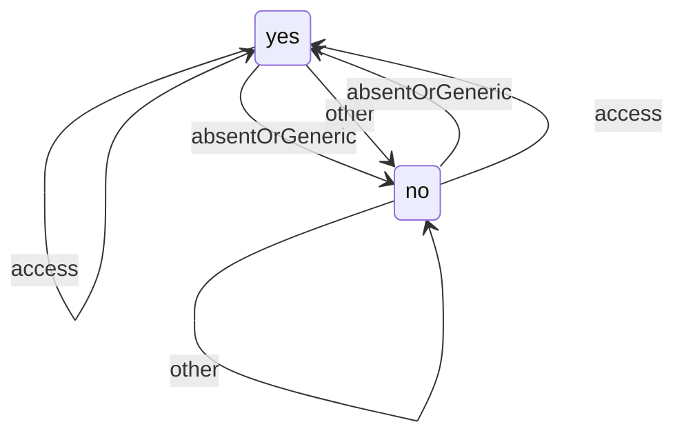
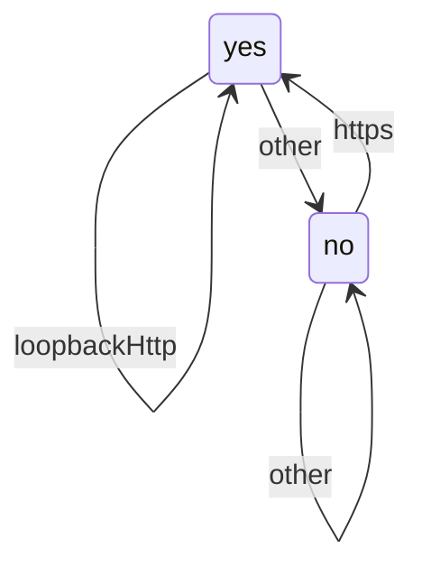
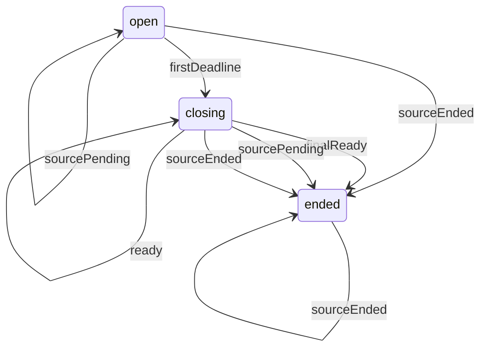
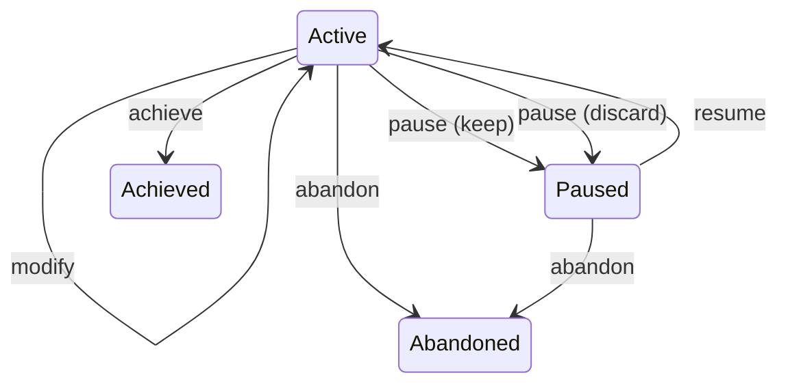
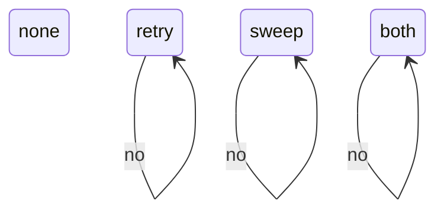
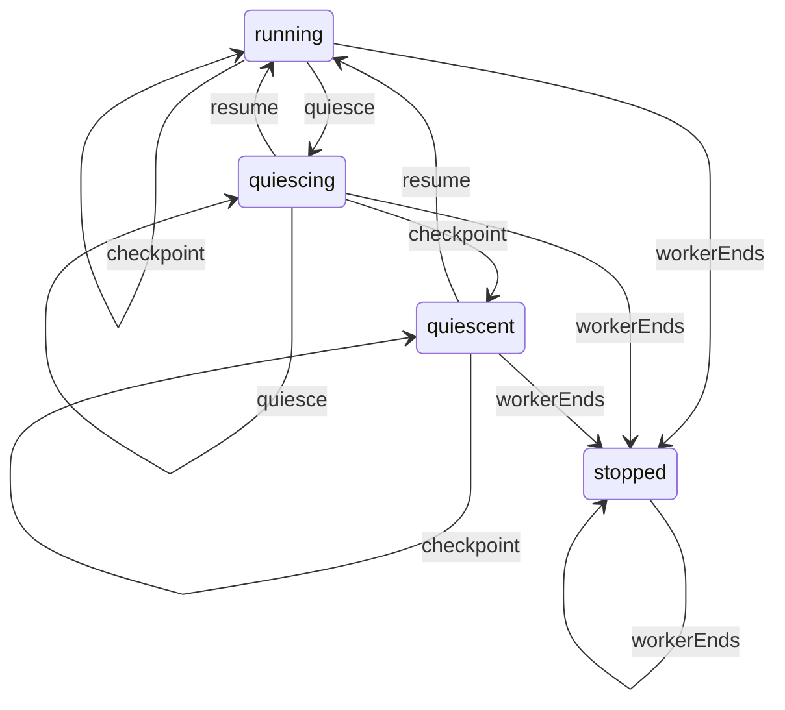
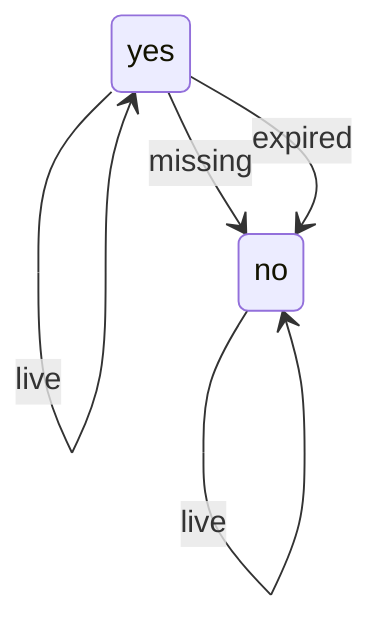

# The ledger

## Admission

**Transaction outcome**: Outcomes considered by the storage transaction retry loop.

- transient
- identityCollision
- other

**Retry action**: The next action after a complete transaction attempt.

- retry
- returnOutcome
- refuseCollision
- retryLater

**Request record**: A retained request record is compared against the incoming fingerprint.

- absent
- sameFingerprint
- differentFingerprint

**Request verdict**: A request either admits, returns the retained identity, or conflicts with that identity.

- admit
- replay
- conflict

**Memory request scope**: The independent request-key namespaces of Memory writes.

- note
- utterance
- abstraction
- perspective
- goalAbstraction
- goalPerspective

**Fingerprint set step**: The normalization applied to unordered request fingerprint fields.

- sort
- deduplicate

**Fingerprint payload part**: The ordered field encoding of a present fingerprint payload.

- schemaIdLength
- schemaId
- schemaVersion
- canonicalJson

**Series selection**: Candidate series identities for a Fact write.

- explicitHandle
- naturalKeyMatch
- mint

**Replay authority**: A claim uses the explicit request ledger, the source receipt, or no replay key.

- requestKey
- sourceReceipt
- none

**Observation status**: The most recent observation's admission status within its series.

- head
- displacedLive
- forgotten

**Episode step**: The order of the episode's writes followed by their shared commit.

- writeAct
- remember
- derive
- stance
- goal
- commit

**Episode slot**: The produced slots an episode may name in its bind list.

- remember
- derive
- stance
- goal

**Sidecar precondition step**: The session steps of a sidecar precondition read.

- takeExclusiveLock
- readOwnerRows

**Cursor operation**: A projector cursor's owner-scoped operation.

- load
- store
- age

**Source cursor key**: The owner and source fields of an opaque projector cursor.

- owner
- source

**Detached step**: Ordered phases of deadline-bound detached ingestion.

- spawnOnFirstPoll
- runWithOriginalAuthority
- settleWithinDeadline

**Unit disposition**: How write-session changes are finalized when the unit terminates.

- commit
- drop
- poisonedCommit

**Typed fact commit member**: Data admitted together by one typed Fact write.

- fact
- registeredSidecars
- admittedCitation

**Fact owner step**: Steps that turn an ownerless Fact request into an owner-stamped write.

- resolveSingleWritableOwner
- authorizeFactWrite
- stampResolvedOwner

**Ingress validation**: The verification performed at a Fact write's typed and external ingress boundaries.

- factSchemaRegistration
- externalCitationContract

**Memory write step**: The phases shared by governed Fact and derived Memory writes.

- prepare
- lock
- claim
- materialize

**Memory lock**: The target locks taken for a prepared Memory admission.

- seriesHandles
- lifecycleVersions

**Ingest key part**: The durable identity of a sourced receipt lookup or replay.

- owner
- source
- ingestKey

**Write destination**: Whether the authoring request named an owner space or a working Goal.

- ownerSpace
- workingGoal

**Destination refusal**: Refusal of more than one destination in an authoring request.

- bothDestinations

**Natural series probe**: Inputs to the decision to preserve or reselect a natural-key series.

- liveMatch
- forgottenMatch
- noMatch

**request key max** = 180: Maximum characters in a trimmed explicit request key.

**episode remember max** = 16: Maximum remembered Facts in one episode.

**episode stance max** = 16: Maximum stances in one episode.

**episode goal max** = 16: Maximum Goals in one episode.

**episode bind max** = 32: Maximum bind keys in one episode.

**sidecar read max** = 512: Default and maximum row limit for a sidecar precondition read.

**request fingerprint domain** = "proxiima-request-v1": The domain prefix of a length-framed request fingerprint.

**transaction attempts** = 3: Total begin-body-commit attempts in the storage retry loop.

**fingerprint set order** = \[sort, deduplicate]: Request fingerprint UUID sets and normalized tags are sorted and deduplicated.

**fingerprint payload** = \[schemaIdLength, schemaId, schemaVersion, canonicalJson]: A payload's schema and version precede its canonical JSON in a fingerprint field.

**episode order** = \[writeAct, remember, derive, stance, goal, commit]: An episode writes the act and all declared items in one owner unit.

**sidecar precondition order** = \[takeExclusiveLock, readOwnerRows]: The sidecar precondition read takes the exclusive lock on its own transaction before reading.

**source cursor key** = \[owner, source]: Cursor reads, writes and erasure key the stored bytes by the resolved owner and exact source.

**detached ingest order** = \[spawnOnFirstPoll, runWithOriginalAuthority, settleWithinDeadline]: The spawned Fact ingest can finish after request cancellation, within its own deadline.

**typed fact commit** = \[fact, registeredSidecars, admittedCitation]: A typed Fact and its supplied sidecars and citation persist in one transaction.

**fact owner order** = \[resolveSingleWritableOwner, authorizeFactWrite, stampResolvedOwner]: Fact authorization resolves one writable owner and storage stamps the permit's owner.

**memory write order** = \[prepare, lock, claim, materialize]: Governed Memory writes prepare the candidate, lock its targets, arbitrate its claim and materialize on one transaction.

**memory lock order** = \[seriesHandles, lifecycleVersions]: A Memory admission locks its series handle before its lifecycle targets.

**ingest key parts** = \[owner, source, ingestKey]: A sourced receipt keys its original admission by owner, source and ingest key.

**request row prefix** = "r:": The index prefix for the request identity digest.

**fingerprint row prefix** = "f:": The index prefix for the digest of the length-framed key and fingerprint.

**request source prefix** = "core/key/": The source prefix of every request ledger scope.

**utterance source** = "core/conversation": The direct observation source family for a recorded conversation turn.

**remembered note source** = "core/agent": The distilled Fact source for remembered notes and episode notes.

| transaction outcome | attempt left | collision retried | retry transaction |
| --- | --- | --- | --- |
| transient | yes | yes | retry |
| transient | yes | no | retry |
| transient | no | yes | returnOutcome |
| transient | no | no | returnOutcome |
| identityCollision | yes | yes | refuseCollision |
| identityCollision | yes | no | retry |
| identityCollision | no | yes | refuseCollision |
| identityCollision | no | no | retryLater |
| other | yes | yes | returnOutcome |
| other | yes | no | returnOutcome |
| other | no | yes | returnOutcome |
| other | no | no | returnOutcome |

- retry transaction: A collision can use one remaining attempt and every retry consumes the total budget.

| request record | request verdict |
| --- | --- |
| absent | admit |
| sameFingerprint | replay |
| differentFingerprint | conflict |

- request verdict: Keyed writes arbitrate by fingerprint under the owner and request namespace.

| memory request scope | request scope uses goal and subject |
| --- | --- |
| note | no |
| utterance | no |
| abstraction | no |
| perspective | no |
| goalAbstraction | yes |
| goalPerspective | yes |

- request scope uses goal and subject: The request ledger uses Goal and subject qualifiers only for Goal-work writes.

| explicit handle | natural match | fact series |
| --- | --- | --- |
| yes | yes | explicitHandle |
| yes | no | explicitHandle |
| no | yes | naturalKeyMatch |
| no | no | mint |

- fact series: Explicit handle wins over a natural-key match, otherwise the write mints.

| keyed | sourced | replay authority |
| --- | --- | --- |
| yes | yes | requestKey |
| yes | no | requestKey |
| no | yes | sourceReceipt |
| no | no | none |

- replay authority: Explicit request claims take priority over the source receipt.

| observation status | enabled | append observation |
| --- | --- | --- |
| head | yes | no |
| head | no | no |
| displacedLive | yes | yes |
| displacedLive | no | no |
| forgotten | yes | no |
| forgotten | no | no |

- append observation: Re-observation can append only a displaced live observation and only when enabled.

| episode slot | written | local memory slot |
| --- | --- | --- |
| remember | yes | yes |
| remember | no | no |
| derive | yes | yes |
| derive | no | no |
| stance | yes | yes |
| stance | no | no |
| goal | yes | no |
| goal | no | no |

- local memory slot: Only an already produced Memory slot can serve as a local Memory reference.

| bound | replayed | accept episode item |
| --- | --- | --- |
| yes | yes | no |
| yes | no | yes |
| no | yes | yes |
| no | no | yes |

- accept episode item: A bound item requires a fresh admission that can reference the episode's write-act.

| cursor operation | cursor requires fact write |
| --- | --- |
| load | yes |
| store | yes |
| age | no |

- cursor requires fact write: Load and store require Fact write authority, while age only requires Fact read authority.

| unit disposition | commits unit |
| --- | --- |
| commit | yes |
| drop | no |
| poisonedCommit | no |

- commits unit: Only an explicit commit of a healthy unit makes its transaction durable.

| inline citation | fact ingress validation |
| --- | --- |
| yes | \[factSchemaRegistration, externalCitationContract] |
| no | \[factSchemaRegistration] |

- fact ingress validation: A typed Fact requires registration and an inline external citation also requires payload validation.

| space | goal | select destination |
| --- | --- | --- |
| yes | yes | refused: bothDestinations |
| yes | no | ownerSpace |
| no | yes | workingGoal |
| no | no | ownerSpace |

- select destination: Default to the owner space and refuse simultaneous space and working-Goal selectors.

| natural series probe | reuse natural series |
| --- | --- |
| liveMatch | yes |
| forgottenMatch | yes |
| noMatch | no |

- reuse natural series: An existing natural-key series can take a new version even if its predecessor is forgotten.

## Authentication

**Token check**: The required checks before returning claims from an OIDC token.

- keyFamilySignature
- exactIssuer
- audienceMembership
- expiry
- subjectString
- presentNotBefore

**Key family**: Verification key families considered by the JWT validator.

- rsa
- p256
- ed25519
- sharedSecret

**Token type**: The token type classified before key resolution.

- absentOrGeneric
- access
- other

**Transport**: URL classes used to validate issuer and key endpoints.

- https
- loopbackHttp
- other

**Bootstrap url**: The URL boundary checked before reading the subject map or opening storage.

- publicUrl
- issuer
- explicitKeyEndpoint

**Issuer companion**: The setting categories an operator may supply with an issuer.

- audience
- publicUrl
- subjectMap
- keyUri
- inlineKeys
- timeout
- subjects
- strictType

**Key source**: The source of the public verification keys.

- discovery
- endpoint
- inlineDocument
- conflict

**Cached key**: A resolver's view of a requested key before a refresh attempt.

- fresh
- aging
- absent

**Cache action**: What a lookup does at the refresh gate.

- returnCached
- tryRefresh
- waitForRefresh

**Subject admission**: The possible admission results for a verified subject.

- allow
- refuse

**Subject allowlist setting**: The configured subject allowlist at settings intake.

- omitted
- empty
- populated

**Party check**: The presented authorized party after reading the validated token's audience and exact nonempty route allowset.

- missingSingleAudience
- missingMultipleAudiences
- listed
- unlisted
- malformed

**Shaper action**: What a policy may do to a credential-bound authorization field.

- preserve
- narrow

**Shaped field**: Fields a host role shaper receives after verification and initial resolution.

- identity
- writer
- path
- runner
- requiredOwner
- roles
- tools
- expiry

**Claims carry**: When optional verified payload context is preserved.

- clone
- narrowToOwner

**Session authority check**: Each transport request verifies its own credential and any session must agree with the current principal and owner.

- authenticateRequest
- agreeWithPrincipal
- agreeWithOwner

**Owner resolver consumer**: The consumers that resolve roles through the runtime's once-bound owner access port.

- mcpEdge
- environmentOidc
- delegation
- platformFactory

**Authenticator forms**: A layer may set neither, either or both authenticator forms.

- neither
- direct
- factory
- both

**Authenticator slot**: Resolution keeps each layer's supplied form, rejects a selected layer with both forms.

- inherit
- useDirect
- buildWithPlatform
- conflict

**Forwarding role**: The non-managing role names admitted by forwarding policy.

- viewer
- ingest
- editor

**Forwarding check**: A forwarded request keeps its subject, verifies owner agreement and resolves only the claim's registered personal or group owner at the configured capped role.

- verifiedIdentityAndWriter
- exactOwner
- liveCredential
- configuredCeiling
- registeredOwner

**Scope source**: The sources that may seal owner authority.

- verifiedCredential
- singleOwnerBoot

**Engine permit**: Only engine gates construct read and write permits from their checked authority.

- entryRead
- write

**Model claim**: The caller's normalized model label relative to any attestation.

- absent
- matching
- supplied

**Model label source**: The effective provenance label or a refusal.

- credential
- caller
- unknown
- conflict

**Stream observation**: Observations of the first deadline and source polls, with a ready item counting toward the closing budget if its poll reaches the deadline.

- firstDeadline
- ready
- finalReady
- sourcePending
- sourceEnded

**Stream state**: Stream states before the first deadline, while draining up to finalReadyFrames, and after termination.

- open
- closing
- ended

**Protected resource**: The OAuth metadata selected by a request path, with the resource URL independent of token audience.

- origin
- mcp

**Facade route**: Requests published only in public-client facade deployments.

- authorizationMetadata
- registration

**Registration check**: Registration takes at least one absolute redirect URL and public token endpoint authentication.

- nonemptyAbsoluteRedirects
- publicAuthentication

**Delegated command**: A registered delegated command is a flat tool or a dispatcher leaf, with serialized scope derived from the typed command.

- flat
- dispatcherLeaf

**Grant issue check**: Issuance checks recorded before minting a grant for a finite verified host bearer.

- finiteVerifiedBearer
- currentMembership
- sourceRole
- nonManagingCeiling
- registeredCommand
- callerScope
- deployment
- sourceExpiry
- attestedWriter

**Grant redemption check**: Admission checks performed anew at each delegated phase.

- exactOwnerAndCommand
- expiry
- revocation
- callerProfile
- currentMembership

**Grant revoker**: Who may revoke a grant after proving current bearer membership in its owner.

- issuer
- ownerManager

**Phase check**: A noncloneable phase is checked at the engine against its originating runtime, finite expiry, exact purpose and target.

- runtime
- expiry
- purpose
- target

**Blob operation**: Admission of a cited-blob maintenance operation under delegation.

- delivery
- verifiedCollection
- ownerReconciliation

**token checks** = \[keyFamilySignature, exactIssuer, audienceMembership, expiry, subjectString, presentNotBefore]: The OIDC checks required before verified claims are returned.

**short access token type** = "at+jwt": The short RFC 9068 access-token media type.

**full access token type** = "application/at+jwt": The full RFC 9068 access-token media type.

**access token types** = \["at+jwt", "application/at+jwt"]: Access-token media types, matched without ASCII case distinctions.

**generic token type** = "JWT": The generic JWT media type, matched without ASCII case distinctions.

**require access token type** = no: Whether strict access-token type checking is enabled by default.

**issuer url excluded delimiters** = \["?", "\#"]: Raw query and fragment delimiters excluded from issuer URLs.

**bootstrap url checks** = \[publicUrl, issuer, explicitKeyEndpoint]: The URL checks performed before subject-map and storage intake.

**required issuer companions** = \[audience, publicUrl, subjectMap]: An environment issuer requires a resource audience, a public URL and an issuer-aware subject map.

**optional issuer companions** = \[keyUri, inlineKeys, timeout, subjects, strictType]: The remaining issuer settings may be omitted.

**refresh cooldown seconds** = 60: Minimum seconds between JWKS fetch attempts, including failed attempts.

**fresh key seconds** = 3600: Age in seconds of a successful JWKS fetch at which cached keys become refreshable.

**trusted key seconds** = 14400: Age in seconds of a successful JWKS fetch beyond which cached keys are no longer trusted.

**default key request seconds** = 10: Default complete-request timeout in seconds for each discovery or JWKS request.

**max key request seconds** = 300: Maximum complete-request timeout in seconds for each discovery or JWKS request.

**max key response bytes** = 1048576: Maximum bytes read from each discovery or JWKS response.

**key coordinate bytes** = 32: Byte width of P-256 coordinates and Ed25519 public keys.

**clock skew seconds** = 60: The stock validator's JWT clock tolerance in seconds.

**verified context** = \[clone, narrowToOwner]: The context operations that preserve the optional verified payload.

**session checks** = \[authenticateRequest, agreeWithPrincipal, agreeWithOwner]: The credential and session agreement checks on each request.

**owner resolver consumers** = \[mcpEdge, environmentOidc, delegation, platformFactory]: The consumers of the owner access port bound during serving.

**forwarding cap** = read: perspective, write: perspective, goals: reads, administers: no, manages: no: Forwarded roles may read Goals and have neither Goal work, owner administration nor group management.

**forwarding checks** = \[verifiedIdentityAndWriter, exactOwner, liveCredential, configuredCeiling, registeredOwner]: The identity, owner, time, role and registry checks for a forwarded request.

**scope sources** = \[verifiedCredential, singleOwnerBoot]: The verified-credential and personal-owner boot paths that seal owner authority.

**engine permits** = \[entryRead, write]: The engine permit families an expired grant does not authorize.

**max trusted model chars** = 120: The Unicode character limit for credential-attested and caller-supplied model labels and for the retained portion of an echoed label.

**max host run extensions** = 8: Maximum validated host run attributes carried with Fact capture.

**default stream lifetime seconds** = 3600: Default seconds before the lifetime limit starts the final drain of an authenticated stream.

**final ready frames** = 16: Maximum frames delivered without waiting after the first authorization deadline.

**scope token byte bounds** = \[33, 126]: Inclusive ASCII byte bounds for each byte of a nonempty OAuth scope token.

**scope token excluded bytes** = \[34, 92]: The quote and backslash bytes excluded from an OAuth scope token.

**default scopes** = \["openid", "offline\_access"]: The built-in sign-in and refresh scopes, in advertisement order.

**public grant types** = \["authorization\_code", "refresh\_token"]: Flows advertised for the stateless public client, which uses the upstream sign-in and token endpoints.

**public client routes** = \[authorizationMetadata, registration]: Facade metadata and registration return the same configured public client; other deployments publish neither.

**registration checks** = \[nonemptyAbsoluteRedirects, publicAuthentication]: The redirect and token endpoint authentication checks on public-client registration.

**public registration auth method** = "none": The public token endpoint authentication method.

**delegated commands** = \[flat, dispatcherLeaf]: The two command kinds admitted for delegation, excluding resources and bare dispatchers.

**max delegated command chars** = 200: Maximum delegated tool identifier length in characters.

**grant issue checks** = \[finiteVerifiedBearer, sourceRole, sourceExpiry, nonManagingCeiling, currentMembership, registeredCommand, callerScope, deployment, attestedWriter]: The credential, membership, command and policy checks before issuing a delegation grant.

**grant redemption checks** = \[exactOwnerAndCommand, revocation, expiry, callerProfile, currentMembership]: The owner, command, validity and membership checks before admitting each delegated phase.

**grant revokers** = \[issuer, ownerManager]: The issuer and current owner managers who may revoke a grant.

**phase checks** = \[runtime, expiry, purpose, target]: Checks on each use of sealed delegated authority before a backend operation.

| key family | signature algorithms |
| --- | --- |
| rsa | \["RS256", "RS384", "RS512"] |
| p256 | \["ES256"] |
| ed25519 | \["EdDSA"] |
| sharedSecret | \[] |

- signature algorithms: The resolved key family determines the accepted signature algorithms.

**admit token type**: Strict mode accepts access-token types alone, while compatibility mode also accepts absent and generic types.

| transport | issuer transport |
| --- | --- |
| https | yes |
| loopbackHttp | yes |
| other | no |

- issuer transport: Issuer transport admits HTTPS and loopback HTTP.

**key transport**: Configured, discovered and redirected key endpoints use HTTPS, or loopback HTTP when their issuer is also loopback.

| uri | document | key source |
| --- | --- | --- |
| yes | yes | conflict |
| yes | no | endpoint |
| no | yes | inlineDocument |
| no | no | discovery |

- key source: A pinned document requires no fetch; explicit endpoints skip discovery, and the two overrides exclude each other.

| cached key | cached key lookup |
| --- | --- |
| fresh | returnCached |
| aging | tryRefresh |
| absent | waitForRefresh |

- cached key lookup: Aging hits may use an incumbent during refresh; absent or untrusted keys wait for the gate.

| allowlist present | subject listed | subject admission |
| --- | --- | --- |
| yes | yes | allow |
| yes | no | refuse |
| no | yes | allow |
| no | no | allow |

- subject admission: Which verified subjects are admitted with or without a configured subject allowlist.

| subject allowlist setting | admit subject allowlist |
| --- | --- |
| omitted | yes |
| empty | no |
| populated | yes |

- admit subject allowlist: An omitted or populated subject allowlist is accepted, while an explicitly empty list is refused.

| party check | admit authorized party |
| --- | --- |
| missingSingleAudience | yes |
| missingMultipleAudiences | no |
| listed | yes |
| unlisted | no |
| malformed | no |

- admit authorized party: A set route policy accepts a listed party or an omitted party with a single distinct audience.

| shaped field | host shape |
| --- | --- |
| identity | preserve |
| writer | preserve |
| path | preserve |
| runner | preserve |
| requiredOwner | preserve |
| roles | narrow |
| tools | narrow |
| expiry | narrow |

- host shape: Host shaping preserves attribution and owner confinement, and can only reduce rights, tool scope and time.

| authenticator forms | authenticator slot |
| --- | --- |
| neither | inherit |
| direct | useDirect |
| factory | buildWithPlatform |
| both | conflict |

- authenticator slot: How the selected layer supplies authentication.

| attested | model claim | model label source |
| --- | --- | --- |
| yes | absent | credential |
| yes | matching | credential |
| yes | supplied | conflict |
| no | absent | unknown |
| no | matching | caller |
| no | supplied | caller |

- model label source: A verified model attestation supplies the label and conflicts with a different explicit label.

**stream lifetime**: The first deadline starts closing, every pulled item is delivered, and closing ends at the budget, a pending poll or source EOF.

| protected resource | metadata path |
| --- | --- |
| origin | "/.well-known/oauth-protected-resource" |
| mcp | "/.well-known/oauth-protected-resource/mcp" |

- metadata path: The resource metadata URL used by an origin or MCP authentication challenge.

| blob operation | delegate blob operation |
| --- | --- |
| delivery | yes |
| verifiedCollection | yes |
| ownerReconciliation | no |

- delegate blob operation: Owner reconciliation requires owner authority.

## Citations

**Citation source**: The two ways a supplied citation resolves an object.

- reference
- inlineObject

**Inline fields**: Completeness of the inline schema, version and payload triple.

- absent
- incomplete
- complete

**Reference resolution**: How a referenced object relates to the owner of the writing version.

- sameOwner
- otherOwner
- missing

**Inline key field**: The fields that identify an inline cited object.

- owner
- schema
- contentHash

**Citing fact sort key**: The descending keyset order of the visible Facts citing an object.

- createdAtDescending
- memoryIdDescending

**Upload status**: Storage status of a transfer row.

- pending
- completed
- aborted
- expired

**Upload lookup**: Whether the content-identity lookup found an upload and its current status.

- found
- missing

**Upload citation outcome**: Outcomes of looking up an upload by the cited content identity.

- supported
- terminalConflict
- missing

**Publication set**: What a transfer finds in the completed source upload set.

- missing
- allExact
- containsInvalid

**Expectation field**: The metadata fixed for a prepared upload.

- contentHash
- byteLength
- mediaType
- filename

**Upload step**: Steps of upload publication from signing to transfer-copy retirement.

- prepareSignedLength
- stageVerifiedCanonicalBytes
- commitCorpusAndUpload
- attemptPendingCleanup

**Changed rows**: Row count returned by a write guarded by exact upload identity.

- none
- one
- many

**Abort outcome**: Outcomes of classifying a guarded abort.

- wonPending
- completed
- alreadyAborted
- alreadyExpired
- invalid

**Completion outcome**: Outcomes of classifying a guarded completion.

- wonPending
- sameObjectReplay
- aborted
- expired
- invalid

**Stage outcome**: Outcomes of classifying a guarded canonical locator write.

- staged
- replay
- repairAborted
- repairExpired
- invalid

**Upload lock**: Locks acquired to settle an upload.

- owner
- canonicalKey
- uploadRow

**Binding outcome**: Delivery binds exactly one registered read operation to its runtime.

- runtimeMismatch
- operationNotRegisteredRead
- bound

**Read route**: The common authority routes of verified collection and host delivery.

- owner
- goalPublication

**Read selection**: The selected upload identity for one authorized read.

- latestCompleted
- exactCaptured

**Completed upload sort key**: Ordering keys for completed uploads on the owner route.

- completionDescendingNullsLast
- uploadIdDescending

**Metadata check**: The integrity checks for stored read and staged metadata.

- nonnegativeLength
- fullDigests
- storedTimestampWhenRequired

**Verified read step**: Byte disclosure steps for an in-process read.

- authorizeAndResolveExactRecord
- checkDeclaredLengthAgainstCeiling
- enforceStreamingBound
- verifyLengthAndDigests
- releaseBytes

**Locator field**: Exact locator checks required before honoring a stored record.

- store
- bucket
- canonicalMintingKey

**inline key** = \[owner, schema, contentHash]: The owner, schema and content hash deduplicate an inline cited object.

**citing fact order** = \[createdAtDescending, memoryIdDescending]: Citing Facts page strictly beyond the last row in this order.

**upload receipt field** = "content\_hash": The upload Fact's receipt payload key, within its owner and schema scope.

**expectation order** = \[contentHash, byteLength, mediaType, filename]: Completion compares these fields to the staged metadata in order before admitting the Fact.

**max filename bytes** = 255: Largest prepared filename in bytes.

**max media type bytes** = 127: Largest prepared media type in bytes.

**max initial stage reserve** = 8388608: Largest initial reservation for a retained upload body in bytes.

**max held digests** = 1000: Largest digest batch for a held-object lookup.

**canonical prefix** = "objects/": Prefix of the canonical key derived from a server-issued upload ID.

**transfer prefix** = "pending/": Prefix of the transfer key a prepared upload signs.

**upload publication order** = \[prepareSignedLength, stageVerifiedCanonicalBytes, commitCorpusAndUpload, attemptPendingCleanup]: Publication stages verified bytes before the atomic corpus commit and treats cleanup as best effort.

**stage source** = \[canonical, transfer]: Staging uses the recorded canonical key when present and otherwise uses the transfer key.

**settlement lock order** = \[owner, canonicalKey, uploadRow]: Upload settlements take the owner fence, canonical key fence and any needed upload row lock in that order.

**completed upload order** = \[completionDescendingNullsLast, uploadIdDescending]: Ordinary reads break completion-time ties by descending upload identity.

**stored metadata checks** = \[nonnegativeLength, fullDigests, storedTimestampWhenRequired]: Reads require stored length, full digests and the timestamp required by the row's state.

**verified read order** = \[authorizeAndResolveExactRecord, checkDeclaredLengthAgainstCeiling, enforceStreamingBound, verifyLengthAndDigests, releaseBytes]: Verified reads admit before provider access and release only complete, digest-verified bytes.

**locator fields** = \[store, bucket, canonicalMintingKey]: Require the configured store and bucket and the canonical key of the upload that minted the bytes.

| kind | citation allowed |
| --- | --- |
| Fact | yes |
| Abstraction | yes |
| Perspective | no |

- citation allowed: Which Memory kinds can carry their one optional cited object.

| has reference | inline fields | citation input |
| --- | --- | --- |
| yes | absent | reference |
| yes | incomplete | — |
| yes | complete | — |
| no | absent | — |
| no | incomplete | — |
| no | complete | inlineObject |

- citation input: Accept an existing object or a complete inline triple, with neither overlap nor incomplete input.

| reference resolution | reference admitted |
| --- | --- |
| sameOwner | yes |
| otherOwner | no |
| missing | no |

- reference admitted: Only the owner's existing cited object satisfies a reference at commit.

| upload lookup | upload supports citation |
| --- | --- |
| found (pending) | supported |
| found (completed) | supported |
| found (aborted) | terminalConflict |
| found (expired) | terminalConflict |
| missing | missing |

- upload supports citation: A live match supports citation, a terminal match conflicts, and an absent match is missing.

| publication set | transferable publication |
| --- | --- |
| missing | no |
| allExact | yes |
| containsInvalid | no |

- transferable publication: Transfer requires at least one completed upload and refuses any mixed invalid set.

| upload status | changed rows | abort outcome |
| --- | --- | --- |
| pending | none | invalid |
| pending | one | wonPending |
| pending | many | invalid |
| completed | none | completed |
| completed | one | wonPending |
| completed | many | invalid |
| aborted | none | alreadyAborted |
| aborted | one | wonPending |
| aborted | many | invalid |
| expired | none | alreadyExpired |
| expired | one | wonPending |
| expired | many | invalid |

- abort outcome: Abort preserves completed bytes and classifies a missed update against the locked status.

| upload status | changed rows | same object | completion outcome |
| --- | --- | --- | --- |
| pending | none | yes | invalid |
| pending | none | no | invalid |
| pending | one | yes | wonPending |
| pending | one | no | wonPending |
| pending | many | yes | invalid |
| pending | many | no | invalid |
| completed | none | yes | sameObjectReplay |
| completed | none | no | invalid |
| completed | one | yes | invalid |
| completed | one | no | invalid |
| completed | many | yes | invalid |
| completed | many | no | invalid |
| aborted | none | yes | aborted |
| aborted | none | no | aborted |
| aborted | one | yes | invalid |
| aborted | one | no | invalid |
| aborted | many | yes | invalid |
| aborted | many | no | invalid |
| expired | none | yes | expired |
| expired | none | no | expired |
| expired | one | yes | invalid |
| expired | one | no | invalid |
| expired | many | yes | invalid |
| expired | many | no | invalid |

- completion outcome: Completion replays the same finished object and refuses terminal failure or a contradictory write.

| upload status | changed rows | has object | stage outcome |
| --- | --- | --- | --- |
| pending | none | yes | invalid |
| pending | none | no | invalid |
| pending | one | yes | staged |
| pending | one | no | staged |
| pending | many | yes | invalid |
| pending | many | no | invalid |
| completed | none | yes | replay |
| completed | none | no | invalid |
| completed | one | yes | invalid |
| completed | one | no | invalid |
| completed | many | yes | invalid |
| completed | many | no | invalid |
| aborted | none | yes | repairAborted |
| aborted | none | no | repairAborted |
| aborted | one | yes | invalid |
| aborted | one | no | invalid |
| aborted | many | yes | invalid |
| aborted | many | no | invalid |
| expired | none | yes | repairExpired |
| expired | none | no | repairExpired |
| expired | one | yes | invalid |
| expired | one | no | invalid |
| expired | many | yes | invalid |
| expired | many | no | invalid |

- stage outcome: A lost stage replays a completed upload with an object or repairs the terminal canonical copy.

| runtime matches | registered read | bind delivery |
| --- | --- | --- |
| yes | yes | bound |
| yes | no | operationNotRegisteredRead |
| no | yes | runtimeMismatch |
| no | no | runtimeMismatch |

- bind delivery: A foreign runtime is refused first; the bound operation must be an exact registered read.

| read route | upload status | select upload |
| --- | --- | --- |
| owner | pending | — |
| owner | completed | latestCompleted |
| owner | aborted | — |
| owner | expired | — |
| goalPublication | pending | — |
| goalPublication | completed | exactCaptured |
| goalPublication | aborted | — |
| goalPublication | expired | — |

- select upload: Owner reads choose the latest completed upload; Goal reads use the captured upload.

## Composition

**Header supplier**: The supplier of a request header service.

- boot
- requestExtension
- allowlistProjection

**Header use**: Operations on the request header service.

- storeName
- lookupName
- debug

**Header name**: Which form of a header name a request header operation uses.

- lowercase
- namesOnly

**Registered name**: The macro registration inputs that name a schema or tool.

- typedSchema
- opaqueCitation
- tool

**Prefix syntax**: What a registration accepts after the spiice prefix.

- slash
- underscore

**Prefix check**: Where registration checks a declared name's prefix.

- compileTime
- registration

**Schema identity part**: Which identity components distinguish registered schemas and persisted Memory selectors.

- id
- version
- kind

**Schema identity use**: Which use of a schema identity freeze checks for uniqueness.

- registration
- persistedMemory

**Contract check**: Contract checks whose relative order determines the first refusal.

- registrationAgreement
- projectionUniformity
- projectionReachability
- bespokeLegAuthority
- surfaceReachability
- lifecycleLegs

**Core declaration refusal**: Refusals for substrate-only declarations.

- resources
- kernelSurfaces

**Tag position**: The two character positions of a capability tag.

- first
- subsequent

**Tag character**: Character classes distinguished by the capability tag grammar.

- asciiLowercase
- asciiDigit
- hyphen
- other

**Agreement check**: The agreement checks between a linked registry and a declared contract.

- declaredSchemaHasRegistration
- registeredSchemaHasDeclaration
- declaredToolHasRegistration

**Natural key check**: Conditions that match a natural key declaration to its registration.

- matchingSchemaIdWhenPresent
- uniqueColumns
- matchesTypedRegistration

**Bundle schema**: Schema declarations the bundle macro may carry.

- entity
- typedCitation
- opaqueCitation

**contract check order** = \[registrationAgreement, projectionUniformity, projectionReachability, bespokeLegAuthority, surfaceReachability, lifecycleLegs]: Check registration before projection and bespoke-leg authority before lifecycle coverage.

**contract agreement** = \[declaredSchemaHasRegistration, registeredSchemaHasDeclaration, declaredToolHasRegistration]: Each contract covers its schema registrations in both directions and every declared tool is registered.

**natural key agreement** = \[matchingSchemaIdWhenPresent, uniqueColumns, matchesTypedRegistration]: Natural key agreement requires unique columns and the registered typed declaration.

| header supplier | may supply request headers |
| --- | --- |
| boot | no |
| requestExtension | no |
| allowlistProjection | yes |

- may supply request headers: Only the transport's per-request allowlist projection may supply request headers.

| header use | request header names |
| --- | --- |
| storeName | lowercase |
| lookupName | lowercase |
| debug | namesOnly |

- request header names: Header storage and lookup normalize names and debug shows only names.

| registered | matching name | host tool eligible |
| --- | --- | --- |
| yes | yes | no |
| yes | no | no |
| no | yes | yes |
| no | no | no |

- host tool eligible: Whether the host declaration can supply the requested tool's behavior.

| registered name | prefix syntax | prefix check |
| --- | --- | --- |
| typedSchema | slash | compileTime |
| opaqueCitation | slash | registration |
| tool | underscore | compileTime |

- prefix syntax: Schema IDs continue the spiice name with a slash, tool names with an underscore.
- prefix check: Typed schemas and tool names are checked at compile time, and opaque IDs at registration.

| schema identity use | schema identity |
| --- | --- |
| registration | \[id, version, kind] |
| persistedMemory | \[kind, id] |

- schema identity: Registrations are unique by full identity and persisted Memory selectors omit version.

| core | resources | kernel surfaces | core declarations |
| --- | --- | --- | --- |
| yes | yes | yes | yes |
| yes | yes | no | yes |
| yes | no | yes | yes |
| yes | no | no | yes |
| no | yes | yes | refused: resources |
| no | yes | no | refused: resources |
| no | no | yes | refused: kernelSurfaces |
| no | no | no | yes |

- core declarations: Only core admits resource and kernel-surface declarations, with resource refusal taking precedence.

| tag position | tag character | capability tag character |
| --- | --- | --- |
| first | asciiLowercase | yes |
| first | asciiDigit | no |
| first | hyphen | no |
| first | other | no |
| subsequent | asciiLowercase | yes |
| subsequent | asciiDigit | yes |
| subsequent | hyphen | yes |
| subsequent | other | no |

- capability tag character: A tag starts with a lowercase ASCII letter and may continue with those letters, digits or hyphens.

| registered | mandatory | profile denial |
| --- | --- | --- |
| yes | yes | no |
| yes | no | yes |
| no | yes | no |
| no | no | no |

- profile denial: The caller may deny a registered command while mandatory reads and unknown keys are refused.

| ingress shape | ingress parser count |
| --- | --- |
| typed | 1 |
| opaqueCitedObject | 0 |

- ingress parser count: A typed schema has one matching protocol parser and an opaque citation has none.

| bundle schema | registers bundle sidecar |
| --- | --- |
| entity (Fact) | yes |
| entity (Abstraction) | yes |
| entity (Perspective) | yes |
| entity (Goal) | yes |
| typedCitation | no |
| opaqueCitation | no |

- registers bundle sidecar: The bundle macro generates sidecar registrations from the entity schema lists.

## Configuration

**Presence**: Whether a configuration layer supplies the slot being resolved.

- omitted
- supplied

**Layer**: Which layer provides a resolved configuration slot.

- builtIn
- application
- environment
- host

**Lookup profile**: The available configuration lookup profiles.

- serving
- storageOnly

**Setting group**: The groups of settings used by the facade's lookup.

- storage
- embeddingRuntime
- serving
- objectStore

**Lookup text**: The lexical outcomes of trimming a setting's lookup result.

- missing
- blank
- nonblank

**Environment name**: Configured names distinguished by the unknown-name diagnostic.

- declared
- unknownProductName
- unrelated

**Pair position**: The two positions of repeated entries in an injected environment.

- earlier
- later

**Setting source**: The registered sources that supply operator documentation and host help.

- facade
- core
- postgres
- objectStore
- host

**Default input**: The inputs compared against each declared default's effective reader.

- omitted
- statedDefault
- differentValue

**true words** = \["1", "true", "yes", "on"]: The case-insensitive boolean words that read as true after trimming.

**false words** = \["0", "false", "no", "off"]: The case-insensitive boolean words that read as false after trimming.

**documentation sources** = \[facade, core, postgres, objectStore, host]: The composition order for settings documentation and help.

| presence | presence | presence | layer precedence |
| --- | --- | --- | --- |
| omitted | omitted | omitted | builtIn |
| omitted | omitted | supplied | application |
| omitted | supplied | omitted | environment |
| omitted | supplied | supplied | environment |
| supplied | omitted | omitted | host |
| supplied | omitted | supplied | host |
| supplied | supplied | omitted | host |
| supplied | supplied | supplied | host |

- layer precedence: In host, environment, application order, the first supplied value wins, then built-in defaults.

| lookup profile | setting group | reads group |
| --- | --- | --- |
| serving | storage | yes |
| serving | embeddingRuntime | yes |
| serving | serving | yes |
| serving | objectStore | yes |
| storageOnly | storage | yes |
| storageOnly | embeddingRuntime | yes |
| storageOnly | serving | no |
| storageOnly | objectStore | no |

- reads group: Storage commands read only storage and its embedding runtime policy.

| lookup text | lookup presence |
| --- | --- |
| missing | omitted |
| blank | omitted |
| nonblank | supplied |

- lookup presence: A missing or blank setting is omitted.

| environment name | warn for name |
| --- | --- |
| declared | no |
| unknownProductName | yes |
| unrelated | no |

- warn for name: Warn for an unknown product name.

| presence | presence | last configured slot |
| --- | --- | --- |
| omitted | omitted | — |
| omitted | supplied | later |
| supplied | omitted | earlier |
| supplied | supplied | later |

- last configured slot: Given the earlier and later values in that order, tuple entries and repeated host configuration calls retain the last supplied slot value.

| default input | matches omission |
| --- | --- |
| omitted | yes |
| statedDefault | yes |
| differentValue | no |

- matches omission: The stated default must behave like omission, and the different value must reach the reader.

## Database authority

**Serving admission**: Serving admission checks the role split and the live relation and definer inventory after schema validation.

- validateSchema
- validatePlatform
- validateRuntime

**Database operation**: The connection chosen by the database operation.

- serve
- operateAsPlatform
- migrate
- validateSchema

**Connection purpose**: The runtime, platform and migration pools use their resolved per-pool settings at startup.

- runtime
- platform
- migration

**Storage overlay**: The storage block being overlaid.

- pool
- tuning

**Overlay input**: The source's contribution after parsing, relative to the shipped defaults.

- unset
- explicitDefault
- nonDefault

**Grant phase step**: The opt-in grant phase starts after schema migration and store-number initialization and applies grants in one locked platform transaction.

- migrateSchema
- initializeStore
- grantInLockedTransaction

**Scoped reader grant step**: Reader grants cover the composed schemas and switch to the function owner only for the grant before restoring the platform role.

- selectComposedReader
- assumeOwnerLocally
- grantExecution
- restorePlatformRole

**Bootstrap ownership step**: Bootstrap transfers table ownership before dependent sequence ownership.

- relations
- sequences

**Storage outcome**: The external storage outcomes whose protocol category differs by operation.

- conflictOrConstraint
- exhaustedTransient

**Storage verb**: A read or write returning a storage failure.

- read
- write

**Protocol failure**: Public categories for the classified storage failures.

- invalidArgument
- internal

**serving admission order** = \[validateSchema, validatePlatform, validateRuntime]: Validation precedes handing out the serving storage.

**max identifier bytes** = 63: The PostgreSQL byte limit for each identifier part.

**min pool connections** = 1: The lowest usable pool size.

**default pool connections** = 5: The default number of connections per pool.

**default statement timeout ms** = 300000: The default statement timeout in milliseconds.

**omit statement timeout ms** = 0: The statement timeout value that omits the pool's startup option.

**default acquire timeout secs** = 5: The default acquisition timeout in seconds.

**default idle timeout secs** = 600: The default idle timeout in seconds.

**default max lifetime secs** = 1800: The default connection lifetime in seconds.

**runtime grant lock key** = 8102661242515254900: The advisory lock key serializing the platform grant phase is ASCII `proxgrnt` interpreted as a big-endian integer.

**default runtime grants** = no: Runtime grants are opt-in on the migration path.

**grant phase order** = \[migrateSchema, initializeStore, grantInLockedTransaction]: The platform applies opt-in grants after both database preparation steps succeed.

**scoped reader grant order** = \[selectComposedReader, assumeOwnerLocally, grantExecution, restorePlatformRole]: The order of one isolated reader grant.

**bootstrap ownership order** = \[relations, sequences]: The PostgreSQL object-ownership replay order.

**rule sqlstate** = "PX001": A SQLSTATE reporting a caller-facing storage refusal with a rule in the constraint field.

**backstop sqlstate** = "PX002": A SQLSTATE reporting an internal storage backstop without a caller-facing rule.

**transient sqlstates** = \["40P01", "40001", "55P03"]: PostgreSQL SQLSTATEs that allow the transaction to be replayed after rollback.

| database operation | connection purpose |
| --- | --- |
| serve | runtime |
| operateAsPlatform | platform |
| migrate | migration |
| validateSchema | migration |

- connection purpose: Migration and schema validation share the direct or session-mode migration connection policy.

| storage overlay | overlay input | overlay supplied |
| --- | --- | --- |
| pool | unset | no |
| pool | explicitDefault | yes |
| pool | nonDefault | yes |
| tuning | unset | no |
| tuning | explicitDefault | no |
| tuning | nonDefault | yes |

- overlay supplied: Pool overrides use setting presence; tuning overrides use a resolved value different from the default.

| storage verb | storage outcome | storage error category |
| --- | --- | --- |
| read | conflictOrConstraint | internal |
| read | exhaustedTransient | internal |
| write | conflictOrConstraint | invalidArgument |
| write | exhaustedTransient | internal |

- storage error category: Reads collapse storage failures to internal; writes distinguish caller-fixable conflicts and constraints from exhausted retries.

## Edges

**Pin kind**: The kinds of pins, in projection order.

- origin
- reference
- read

**Pin field**: The relationship fields of a Memory admission.

- origins
- refs
- goalRefs
- guidedBy
- reads
- forkedFrom

**Pin shape**: How a pin field stores its targets.

- array
- scalar

**Pin field spec**: The role, storage shape and target layers of a pin field.

- column
- kind
- shape
- fact
- abstraction
- perspective

**Target projection**: The precedence of exact target states when a pin's source is readable.

- visible
- forgotten
- erased
- redacted

**Provenance**: The origin or subject declaration a schema contributes to ancestor traversal.

- undeclared
- originEdges
- payloadOnly
- none

**Page key**: The components of a pin-page continuation key.

- sourceTime
- sourceId
- targetId
- kind

**Admission**: How a pin is presented at admission.

- fresh
- forkRevision
- schemaEvolution

**Admission witness**: What witnesses an exact pin during admission.

- liveReadableTarget
- capturedSourcePin

**grounding fields** = \[origins, refs]: Local storage fields that can ground a derived Memory, per `Causa.GroundsInFact`.

**pin order** = \[origin, reference, read]: The order of pin kinds in a projection.

**local descendant kinds** = \[origin, read]: Local descendant traversal follows origins and read context.

**page key** = \[sourceTime, sourceId, targetId, kind]: The pin page key in comparison order.

**external replay kinds** = \[origin, reference]: The pin kinds compared for external-edge replay.

**max read pins** = 1024: The largest host read set, counted in distinct exact versions.

**max derive sources** = 256: The maximum number of raw sources in one derive declaration.

**max think seeds** = 8: The maximum number of seeds in a Think request.

**default walk depth** = 3: The default number of hops in a walk.

**max walk depth** = 8: The maximum number of hops in a walk.

**max remote leaves** = 64: The maximum number of distinct remote leaves read per lineage page.

**max remote sketch chars** = 200: The character ceiling for a remote walk sketch.

**max neighbor pins** = 200: The maximum number of hydrated pins per neighbor read.

**inbound source floor** = 256: The minimum number of candidate source rows in an inbound page read.

**single pin probe rows** = 2: The source limit for an inbound probe requesting just one edge.

**max snapshot edges** = 50000: The edge ceiling of a query snapshot, independent of its node window.

**fine pin lock budget** = 256: Pin target requests attempted before coarse locking is considered.

| pin kind | pin label |
| --- | --- |
| origin | "origin" |
| reference | "reference" |
| read | "read" |

- pin label: The wire and cross-store storage label of a pin kind.

| pin field | pin field |
| --- | --- |
| origins | column: "origins", kind: origin, shape: array, fact: \[], abstraction: \[Fact, Abstraction], perspective: \[Abstraction] |
| refs | column: "refs", kind: reference, shape: array, fact: \[Fact, Abstraction, Perspective], abstraction: \[Fact, Abstraction, Perspective], perspective: \[Fact, Abstraction, Perspective] |
| goalRefs | column: "goal\_refs", kind: reference, shape: array, fact: \[Goal], abstraction: \[Goal], perspective: \[Goal] |
| guidedBy | column: "guided\_by", kind: reference, shape: array, fact: \[], abstraction: \[], perspective: \[Goal] |
| reads | column: "reads", kind: read, shape: array, fact: \[Fact, Abstraction, Perspective], abstraction: \[Fact, Abstraction, Perspective], perspective: \[Fact, Abstraction, Perspective] |
| forkedFrom | column: "forked\_from", kind: reference, shape: scalar, fact: \[Fact, Abstraction, Perspective], abstraction: \[Fact, Abstraction, Perspective], perspective: \[Fact, Abstraction, Perspective] |

- pin field: Each pin field's role, storage shape and admitted target kinds.

| live | forgotten | erased | project target |
| --- | --- | --- | --- |
| yes | yes | yes | visible |
| yes | yes | no | visible |
| yes | no | yes | visible |
| yes | no | no | visible |
| no | yes | yes | forgotten |
| no | yes | no | forgotten |
| no | no | yes | erased |
| no | no | no | redacted |

- project target: Live wins over readable forgotten or erased witnesses, and other targets are redacted.

| provenance | local ancestor kinds |
| --- | --- |
| undeclared | \[origin, read] |
| originEdges | \[origin, read] |
| payloadOnly | \[reference, read] |
| none | \[read] |

- local ancestor kinds: Local ancestor pin kinds by schema provenance.

| origin | reference | fork anchor | keep read pin |
| --- | --- | --- | --- |
| yes | yes | yes | no |
| yes | yes | no | no |
| yes | no | yes | no |
| yes | no | no | no |
| no | yes | yes | no |
| no | yes | no | no |
| no | no | yes | no |
| no | no | no | yes |

- keep read pin: Read pins yield to an origin, reference or fork anchor to the same target.

| admission | pin admission witness |
| --- | --- |
| fresh | liveReadableTarget |
| forkRevision | capturedSourcePin |
| schemaEvolution | capturedSourcePin |

- pin admission witness: Fresh pins require a live readable target, while a retained pin requires an exact captured source pin.

## Embeddings

**Width**: The widths the store indexes.

- d384
- d768
- d1024
- d1536
- d2048
- d3072

**Index encoding**: Types of the HNSW expression over the stored vector.

- vector
- halfvec

**Vector storage part**: Parts of the selected vector storage lane.

- heads
- pgvector
- localVectors

**Query wording**: Instruction source for a search query.

- named
- default
- original

**Route**: An owner route has zero, one or two bindings with different spaces.

- absent
- current
- nextOnly
- moving

**Route position**: A position in the owner route.

- current
- next

**Route use**: Entry points that resolve the data owner's embedding route.

- write
- drain
- search
- reconcile
- purge

**Route failure**: What the engine does when the owner route lookup refuses.

- refuse
- release
- lexical
- skip

**Provider config**: Embedding configuration outcomes for the canonical host.

- disabled
- enabled
- refuse

**Admission phase**: The phases of admitting ordinary embedding work.

- resolveRoute
- enqueueWithWrite
- commit
- drain

**Schema eligibility**: The closed embedding eligibility state of a schema ID.

- unknown
- everyLayerDeclines
- aLayerEmbeds

**Provider call**: Kinds of calls to the embedding provider.

- indexing
- query

**Client state**: The client gate state observed at dispatch.

- ready
- backingOff
- paused

**Provider result**: The final provider outcome that the drain may receive.

- success
- inputRefused
- transient
- configuration

**Drain action**: Actions following a provider result at the drain.

- publish
- rescue
- release

**Vector validation**: Validation result from a managed client response.

- accepted
- widthFault
- invalidComponent

**Claim release**: Outcomes of fenced release after an aborted drain.

- settled
- alreadyFencedOut
- storageFailure

**Claim recovery**: How outstanding claims cease to belong to a returned drain.

- settled
- leaseExpiry

**Job state**: Stored states of a durable job.

- pending
- processing
- failed
- failedPermanent

**Claim availability**: The routing or lock state of a candidate in the claim queue.

- available
- locked
- ownerExcluded
- spaceBlocked

**Backlog group**: The two status groups in an owner's backlog read.

- queued
- failed

**Claim event**: Events on a token-fenced processing claim.

- renew
- finish
- retryableFailure
- permanentFailure
- release
- expire

**Reconcile job**: Whether a reconcile target already has a job.

- absent
- pending
- processing
- failed
- failedPermanent

**Candidate metadata**: Metadata examined by the missing-embedding read and reconcile before text resolution.

- liveHead
- allowedSchema
- requestedSpace

**Chunk write**: The durable write steps for a completed embedding version.

- settleFencedClaim
- lockHead
- appendOrderedChunks
- advanceHead

**Host write**: The order of host-index publication for an embedding key.

- settleDebt
- pushVersion
- commit

**Index repair**: Stages of repairing a host-index key during reconciliation.

- comparePages
- lockKey
- compareCurrentHead
- repair

**Space role**: The presence of a stored space on the current owner route.

- current
- next
- unrouted

**Transfer step**: Transfer drops non-destination coverage before queueing for the destination live head.

- dropOutsideDestination
- queueDestinationHead

**Recall leg**: The two methods compared by the owner-and-space stratified recall canary.

- exact
- approximate

**Worker pass**: Startup passes that precede the idle/poll cycle.

- reconcile
- gatedDrain

**Failure status**: The provider responses that distinguish input and configuration failures.

- http400
- http401
- http403
- http404
- http413
- http422
- other

**request seconds** = 120: Request timeout in seconds when the host leaves it unset.

**request seconds max** = 3600: Longest request timeout in seconds.

**batch size** = 32: Texts per provider batch when the host leaves it unset.

**batch size max** = 1024: Maximum texts per provider batch.

**drain concurrency** = 1: Concurrent provider batches when the host leaves it unset.

**drain concurrency max** = 64: Maximum concurrent provider batches in one drain.

**idle seconds** = 5: First idle poll interval in seconds when the host leaves it unset.

**idle seconds max** = 3600: Largest configured first idle poll interval in seconds.

**idle backoff seconds** = 60: Idle poll backoff ceiling in seconds.

**stale claim seconds** = 900: Stale claim timeout in seconds when the host leaves it unset.

**stale claim seconds max** = 86400: Largest stale claim timeout in seconds.

**heartbeat divisor** = 3: Divide the stale claim interval by this number for heartbeat and reclaim throttling.

**diagnostics max** = 256: Largest number of memory IDs in a diagnostics request.

**reconcile default limit** = 50000: Default candidate budget for startup and engine reconciliation.

**reconcile page size** = 2000: Page cardinality and downstream probes per head relation in one reconcile page.

**reconcile owner page size** = 1000: Number of owners routed per reconcile owner page.

**input cap min** = 4095: Minimum client character cap for chunk rescue.

**input cap default** = 16384: Character cap for the canonical host when the input ceiling is unset.

**default width** = 1024: The vector width when the canonical host leaves it unset.

**default matryoshka** = no: Nested-prefix requests are off by default in the canonical host.

**default slot** = "default": Default embedding slot.

**recall sample cap** = 32: Maximum sampled chunks in an owner and embedding-space canary stratum.

**recall neighbors** = 10: Neighbors compared by the recall canary.

**error body prefix bytes** = 512: Maximum prefix bytes collected for a provider error diagnostic.

**pgvector minimum** = \[0, 8, 0]: Minimum pgvector version accepted by the PostgreSQL vector lane.

**width384** = 384: Component count for the 384-wide lane.

**width768** = 768: Component count for the 768-wide lane.

**width1024** = 1024: Component count for the 1024-wide lane.

**width1536** = 1536: Component count for the 1536-wide lane.

**width2048** = 2048: Component count for the 2048-wide lane.

**width3072** = 3072: Component count for the 3072-wide lane.

**indexed widths** = \[384, 768, 1024, 1536, 2048, 3072]: Widths by component count, in ascending order.

**query placeholder** = "{query}": The placeholder required and substituted by a query instruction.

**query newline escape** = "\\\\n": The environment sequence expanded to a newline in the query template.

**admission order** = \[resolveRoute, enqueueWithWrite, commit, drain]: Admission queues routed work in its transaction, and provider work follows commit.

**candidate metadata** = \[liveHead, allowedSchema, requestedSpace]: Metadata used to select candidate Memory heads.

**publish chunks** = \[settleFencedClaim, lockHead, appendOrderedChunks, advanceHead]: Publish ordered chunks and advance the head in the same transaction as fenced completion.

**host publication** = \[settleDebt, pushVersion, commit]: Old key debt is settled before the new version is pushed and accepted before completion.

**index repair** = \[comparePages, lockKey, compareCurrentHead, repair]: A page difference authorizes repair only after the key lock and a fresh head comparison.

**transfer coverage** = \[dropOutsideDestination, queueDestinationHead]: The in-transaction steps that move embedding coverage with a series.

**recall comparison** = \[exact, approximate]: Compare exact and approximate chunk neighbors.

**worker start** = \[reconcile, gatedDrain]: Startup attempts reconcile once before the first gated claim.

| width | index encoding |
| --- | --- |
| d384 | vector |
| d768 | vector |
| d1024 | vector |
| d1536 | vector |
| d2048 | halfvec |
| d3072 | halfvec |

- index encoding: Wider lanes use half precision for the index, keeping full precision in storage.

| vector lane | vector storage parts |
| --- | --- |
| local | \[heads, pgvector, localVectors] |
| hostIndex | \[heads] |

- vector storage parts: Both lanes keep heads, and the PostgreSQL lane also installs pgvector and stores vectors locally.

| named | has default | query wording |
| --- | --- | --- |
| yes | yes | named |
| yes | no | named |
| no | yes | default |
| no | no | original |

- query wording: A search takes its named instruction, then the default, then the original query.

| route | write spaces | search space |
| --- | --- | --- |
| absent | \[] | — |
| current | \[current] | current |
| nextOnly | \[next] | — |
| moving | \[current, next] | current |

- write spaces: Queue each admission in current-then-next order where those spaces exist.
- search space: Search uses the current owner binding while the next space fills.

| route use | route failure |
| --- | --- |
| write | refuse |
| drain | release |
| search | lexical |
| reconcile | skip |
| purge | refuse |

- route failure: Route failures refuse writes and purge, yield lexical search, and release or skip maintenance work.

| endpoint | model | override set | provider config |
| --- | --- | --- | --- |
| yes | yes | yes | enabled |
| yes | yes | no | enabled |
| yes | no | yes | refuse |
| yes | no | no | refuse |
| no | yes | yes | refuse |
| no | yes | no | refuse |
| no | no | yes | refuse |
| no | no | no | disabled |

- provider config: Both endpoint and model enable embeddings, and a partial configuration refuses startup.

| schema eligibility | schema embeddable |
| --- | --- |
| unknown | yes |
| everyLayerDeclines | no |
| aLayerEmbeds | yes |

- schema embeddable: An ID is excluded only when every registered layer declines embeddings.

| client state | provider call | admit call |
| --- | --- | --- |
| ready | indexing | yes |
| ready | query | yes |
| backingOff | indexing | no |
| backingOff | query | yes |
| paused | indexing | no |
| paused | query | no |

- admit call: Queries bypass transient indexing backoff, while configuration pauses block both call kinds.

| provider result | drain action |
| --- | --- |
| success | publish |
| inputRefused | rescue |
| transient | release |
| configuration | release |

- drain action: Publish successful vectors, rescue input refusals, and release on other failures.

| width matches | finite | validate vector |
| --- | --- | --- |
| yes | yes | accepted |
| yes | no | invalidComponent |
| no | yes | widthFault |
| no | no | widthFault |

- validate vector: A wrong width pauses the managed binding, and nonfinite components at the expected width are retryable.

| claim release | claim recovery |
| --- | --- |
| settled | settled |
| alreadyFencedOut | settled |
| storageFailure | leaseExpiry |

- claim recovery: An aborted drain attempts fenced release and falls back to lease expiry if release fails.

| job state | claim availability | claim eligible |
| --- | --- | --- |
| pending | available | yes |
| pending | locked | no |
| pending | ownerExcluded | no |
| pending | spaceBlocked | no |
| processing | available | no |
| processing | locked | no |
| processing | ownerExcluded | no |
| processing | spaceBlocked | no |
| failed | available | no |
| failed | locked | no |
| failed | ownerExcluded | no |
| failed | spaceBlocked | no |
| failedPermanent | available | no |
| failedPermanent | locked | no |
| failedPermanent | ownerExcluded | no |
| failedPermanent | spaceBlocked | no |

- claim eligible: Claim only pending rows whose locks and owner-space bindings permit work.

| job state | backlog group | diagnostic claim age |
| --- | --- | --- |
| pending | queued | no |
| processing | queued | yes |
| failed | failed | no |
| failedPermanent | failed | no |

- backlog group: The backlog groups pending and processing, and both kinds of failure.
- diagnostic claim age: Only processing diagnostics expose claim age.

| claim event | settle claim |
| --- | --- |
| renew | processing |
| finish | — |
| retryableFailure | failed |
| permanentFailure | failedPermanent |
| release | pending |
| expire | pending |

- settle claim: When its fence matches, a claim can renew, disappear, fail or return to pending.

| reconcile job | reconcile job |
| --- | --- |
| absent | yes |
| pending | no |
| processing | no |
| failed | yes |
| failedPermanent | no |

- reconcile job: Missing coverage can open a job or reopen a retryable failure.

| space role | job state | purge job |
| --- | --- | --- |
| current | pending | no |
| current | processing | no |
| current | failed | no |
| current | failedPermanent | no |
| next | pending | no |
| next | processing | no |
| next | failed | no |
| next | failedPermanent | no |
| unrouted | pending | yes |
| unrouted | processing | no |
| unrouted | failed | yes |
| unrouted | failedPermanent | yes |

- purge job: Purge removes only unrouted residue and leaves processing jobs to settle.

| failure status | provider failure |
| --- | --- |
| http400 | configuration |
| http401 | configuration |
| http403 | configuration |
| http404 | configuration |
| http413 | inputRefused |
| http422 | inputRefused |
| other | transient |

- provider failure: Classify the HTTP status independently of its body.

## Erasure and export

**Owner erase evidence**: The evidence that a target owner may be erased.

- personal
- other

**Owner erase admission**: The preconditions storage distinguishes while holding the membership fence.

- allow
- missingDropProof
- stillLive

**Authority route**: Outcomes of the shared owner-inverse authority route.

- delegated
- system
- host

**Authority action**: The action to take before storage admission.

- refuse
- grant
- askHost

**Operation receipt**: How owner erase outcomes reach the host.

- completed
- notFound
- unauthorized
- refused

**Authority rows**: Which authority rows are selected by an erase.

- exactOwner
- erasedSubject

**Bulk scope**: The scope of a bulk inverse.

- owner
- source

**Selection key**: The fields used to scope explicitly attributable bulk rows.

- owner
- source

**Completion step**: Stages that turn an authorized physical erase into a completed receipt.

- settleHostIndex
- commitDatabaseAndColdDebt
- attemptColdPurge
- reportOutstandingDebt

**Series authority**: The access route of an own-series erase.

- ownerAdmin
- system
- hostState
- goalWork

**Series scope check**: The required parts of scoped erase admission.

- oneOwner
- nonCoreSpiice
- ownMemorySchemas
- invokingActionIsDeclaredDestructive
- noUnerasableReferences

**Series transaction**: How a scoped inverse handles its exclusive transaction.

- refuse
- runAndKeepForCommit
- runAndRollback

**Selection versions**: The version or versions examined by a selector.

- explicit
- newestIncludingForgotten
- oldestMatchingSidecar
- newestWithDeclaredClock

**Selector**: The supported scoped erase selectors.

- ids
- admittedBefore
- occurredBefore
- sidecarEquals
- declaredBefore

**Age clock**: The selected series age clock.

- admission
- occurrenceOrAdmission
- declared

**Age selector**: The age selections and their effective clocks.

- admittedBefore
- occurredBefore
- declaredBefore

**Closure step**: The steps that close and erase a scoped relational footprint.

- expandWholeSeries
- includeKeyedRestrictReferrers
- orderDependantsBeforeTargets
- lockAndRecheck
- deleteInternalReferenceRows
- deleteVersions

**Page unit**: The indivisible units of a scoped erase page.

- series
- mutuallyReferringSeries

**Blocked seed action**: The actions taken when a seed cannot be included in a page.

- refuse
- returnEarlierPage

**Selection lock**: Acquisition order for a Memory erase selection, using sorted distinct identities at each stage.

- seriesHandle
- versionLifecycle
- admissionRow

**Blob liveness check**: Liveness checks before a cited object becomes cold debt.

- noSurvivingAdmission
- noSurvivingUploadAlias

**Retention operation**: The operations on the owner-and-schema retention row.

- set
- clear
- list
- inventory

**Retention authority**: The witness used by each retention operation.

- ownerEraseAdmin
- readableOwners
- system

**Retention key part**: The identity of one retention policy row.

- owner
- schema

**Remote admission**: A remote retention request must establish forwarded authority, a retention vouch and owner binding.

- forwardedOwner
- signedRetentionVouch
- sameRequestOwner
- cutoffNotFuture

**Retention page step**: The loop order for a remotely requested retention erase.

- eraseEligibleSeries
- commitPage
- sumReceipt
- repeatWhileMore

**Fence use**: The two operations sharing the export and erase table fence.

- export
- erase

**Export snapshot step**: The steps that establish an export snapshot.

- takeSharedEraseFence
- readRepeatableReadOnlySnapshot

**Export order part**: The order used for a generated export surface.

- declaredKey
- remainingPrimaryKey

**Publication copy selector**: Publication copies reached by a bulk erase.

- selectedPhysicalFacts
- originalOwnerAndSource

**Erase declaration**: The erase declarations and evidence used to derive a physical leg.

- keyed
- owned
- cascade
- hostState
- retain

**Erase leg**: The one physical leg or deliberate retention for a declared surface.

- keyed
- ownerOnly
- ownerAndSource
- bespoke
- cascade
- hostState
- retained
- unreachable

**Transfer declaration**: The policy and key evidence used to derive a transfer leg.

- follow
- drop
- dedupe
- stayOnKey
- retainAtSource
- refuseTransfer

**Transfer leg**: The one leg selected for a surface during a Memory series transfer.

- follow
- drop
- dedupe
- bespoke
- stayOnKey
- retained
- refused
- unreachable

**Content collection step**: The bulk content inverse begins with selected admissions and checks what survives.

- collectContentIds
- deleteSelectedAdmissions
- collectContentWithoutSurvivingAdmission

**Bulk inverse step**: Stages of applying and accounting for a sealed bulk erase.

- seedDeclaredCounters
- applyDeclaredKeyedAndOwnedLegs
- verifySelectedRowsDeleted
- readDeclaredCounts

**Declared clock candidate**: The row accepted from a declared timestamp selection.

- newestWithTimestamp
- newestWithoutTimestamp
- historicalWithTimestamp

**min keep days** = 1: The shortest configurable retention in days.

**max keep days** = 36500: The longest configurable retention in days.

**max erase series** = 256: The series ceiling for an explicit erase or the seed window of an erase page.

**max erase versions** = 1024: The maximum versions erased in one call.

**fence wait seconds** = 5: The default export and bulk erase fence wait in seconds.

**retention erase path** = "/retention/erase": The route that receives forwarded retention erase requests.

**vouch claim** = "vouch": The signed claim inspected by the receiving retention host.

**retention vouch** = "retention": The vouch value accepted for a verified forwarded retention caller.

**erase receipt outcomes** = \[completed, notFound, unauthorized, refused]: The outcomes carrying the operation ID minted for the attempt.

**completion order** = \[settleHostIndex, commitDatabaseAndColdDebt, attemptColdPurge, reportOutstandingDebt]: The order of index settlement, database commit, cold purge attempt and debt reporting.

**series scope** = \[oneOwner, nonCoreSpiice, ownMemorySchemas, invokingActionIsDeclaredDestructive, noUnerasableReferences]: The scoped inverse checks the owner's footprint and the invoking spiice and action.

**closure order** = \[expandWholeSeries, includeKeyedRestrictReferrers, orderDependantsBeforeTargets, lockAndRecheck, deleteInternalReferenceRows, deleteVersions]: Whole series and keyed restricting referrers form the closure checked before delete.

**page units** = \[series, mutuallyReferringSeries]: A page may split its ordered closure only between these units.

**counted inbound fields** = \[origins, refs]: The surviving Memory pin fields counted in a scoped erase receipt.

**selection lock order** = \[seriesHandle, versionLifecycle, admissionRow]: Handle and lifecycle locks precede row locks on the complete footprint.

**blob liveness** = \[noSurvivingAdmission, noSurvivingUploadAlias]: Blob deletion checks remaining citations and object deletion separately checks remaining aliases.

**retention key** = \[owner, schema]: The retention row key in inventory sort order.

**remote admission** = \[forwardedOwner, signedRetentionVouch, sameRequestOwner, cutoffNotFuture]: The remote retention checks performed before the series selection.

**retention page order** = \[eraseEligibleSeries, commitPage, sumReceipt, repeatWhileMore]: Remote retention commits each page before adding its receipt to the answer.

**export snapshot order** = \[takeSharedEraseFence, readRepeatableReadOnlySnapshot]: Export waits for the shared erase fence before taking its repeatable read snapshot.

**export row order** = \[declaredKey, remainingPrimaryKey]: The declared key followed by the remaining primary key columns produces a total export order.

**publication copy selectors** = \[selectedPhysicalFacts, originalOwnerAndSource]: Both physical identity and original attribution select delivery copies, including copies that followed a transfer.

**content collection order** = \[collectContentIds, deleteSelectedAdmissions, collectContentWithoutSurvivingAdmission]: Shared content is collected after the selected admissions are gone.

**bulk inverse** = \[seedDeclaredCounters, applyDeclaredKeyedAndOwnedLegs, verifySelectedRowsDeleted, readDeclaredCounts]: Bulk erase uses registry-selected inverse legs and returns a complete tally only after the sealed rows are gone.

| owner erase evidence | admit owner erase |
| --- | --- |
| personal (yes) | allow |
| personal (no) | missingDropProof |
| other (yes) | stillLive |
| other (no) | allow |

- admit owner erase: A registered personal owner needs verified drop proof and any other owner must have no members.

| authority route | inverse authority |
| --- | --- |
| delegated | refuse |
| system | grant |
| host (yes) | askHost |
| host (no) | refuse |

- inverse authority: The system route grants directly, the host route consults its provider when present, and delegated or unconfigured requests are refused.

| bulk scope | bulk selection key | grant selection |
| --- | --- | --- |
| owner | \[owner] | \[exactOwner, erasedSubject] |
| source | \[owner, source] | \[] |

- bulk selection key: A source narrows the owner selection to rows attributable to it.
- grant selection: Source erase leaves owner-level grants in place and owner erase removes exact owner and subject grants.

| bulk scope | selected | retained citation | erase blob |
| --- | --- | --- | --- |
| owner | yes | yes | yes |
| owner | yes | no | yes |
| owner | no | yes | no |
| owner | no | no | no |
| source | yes | yes | no |
| source | yes | no | yes |
| source | no | yes | no |
| source | no | no | no |

- erase blob: Whether a blob belongs to the erase scope.

| series authority | series authority |
| --- | --- |
| ownerAdmin | yes |
| system | yes |
| hostState | no |
| goalWork | no |

- series authority: Owner administrators and system authority can issue scoped erasure.

| unused | dry run | series transaction |
| --- | --- | --- |
| yes | yes | runAndRollback |
| yes | no | runAndKeepForCommit |
| no | yes | refuse |
| no | no | refuse |

- series transaction: Scoped erase requires an unused unit, then runs the same inverse for either mode.

| selector | seed versions |
| --- | --- |
| ids | explicit |
| admittedBefore | newestIncludingForgotten |
| occurredBefore | newestIncludingForgotten |
| sidecarEquals | oldestMatchingSidecar |
| declaredBefore | newestWithDeclaredClock |

- seed versions: The seed versions considered by each selector before expansion.

| age selector | age clock |
| --- | --- |
| admittedBefore | admission |
| occurredBefore | occurrenceOrAdmission |
| declaredBefore | declared |

- age clock: The effective clock for each time-based selector.

| paged | has earlier work | blocked seed |
| --- | --- | --- |
| yes | yes | returnEarlierPage |
| yes | no | refuse |
| no | yes | refuse |
| no | no | refuse |

- blocked seed: Explicit selections refuse as a whole, and paged selections stop before a blocked seed if earlier work fits.

| retention operation | retention authority |
| --- | --- |
| set | ownerEraseAdmin |
| clear | ownerEraseAdmin |
| list | readableOwners |
| inventory | system |

- retention authority: Retention edits take erase administration, listing takes scoped read authority, and inventory takes system authority.

| fence use | fence use | compatible fence |
| --- | --- | --- |
| export | export | yes |
| export | erase | no |
| erase | export | no |
| erase | erase | yes |

- compatible fence: The combinations admitted to run concurrently by the fence.

| erase declaration | classify erase |
| --- | --- |
| keyed (yes, yes) | bespoke |
| keyed (yes, no) | keyed |
| keyed (no, yes) | bespoke |
| keyed (no, no) | unreachable |
| owned (yes, yes) | bespoke |
| owned (yes, no) | ownerAndSource |
| owned (no, yes) | bespoke |
| owned (no, no) | ownerOnly |
| cascade | cascade |
| hostState | hostState |
| retain | retained |

- classify erase: A keyed erase needs a single selected home or a bespoke leg, while generated owner erase narrows by source only for source-attributable surfaces.

| transfer declaration | classify transfer |
| --- | --- |
| follow (yes, yes) | bespoke |
| follow (yes, no) | follow |
| follow (no, yes) | bespoke |
| follow (no, no) | unreachable |
| drop (yes, yes) | bespoke |
| drop (yes, no) | drop |
| drop (no, yes) | bespoke |
| drop (no, no) | unreachable |
| dedupe (yes) | dedupe |
| dedupe (no) | unreachable |
| stayOnKey | stayOnKey |
| retainAtSource | retained |
| refuseTransfer | refused |

- classify transfer: Generated follow and drop require a version key, follow also needs an owner column, and dedupe needs a bespoke orchestrator.

| owner surface | store wide | core relation classified |
| --- | --- | --- |
| yes | yes | no |
| yes | no | yes |
| no | yes | yes |
| no | no | no |

- core relation classified: Each live core base relation belongs to exactly one lifecycle partition.

| declared clock candidate | before cutoff | declared clock candidate |
| --- | --- | --- |
| newestWithTimestamp | yes | yes |
| newestWithTimestamp | no | no |
| newestWithoutTimestamp | yes | no |
| newestWithoutTimestamp | no | no |
| historicalWithTimestamp | yes | no |
| historicalWithTimestamp | no | no |

- declared clock candidate: A declared clock admits only the newest version with a timestamp before the cutoff.

## Forget and restore

**Retained part**: The parts retained when a Memory is forgotten.

- admission
- stampedSidecars
- sketch
- requestReceipt
- externalOrigins
- citedObjects

**Restore refusal**: Restore refuses a retired Fact schema.

- retiredSchema

**Restore action**: The effect of restore on an admission that passed the schema check.

- unchanged
- rebuild

**Restore step**: The steps of restoring a forgotten admission after admission checks.

- clearMark
- rebuildStampedProjectionsInStoredLanguage
- enqueueRoutedEmbeddings: Queue embedding work for routed spaces.
- repairHead

**Head choice**: Which surviving version is the head after a lifecycle change.

- newestLive
- newestForgotten

**Footprint step**: The lock footprint stages, shared by forget and restore.

- lockSourceAndNonFactDependerHandles
- lockSourceAndNonFactDependerVersions
- revalidateFootprint

**Derived delete**: The order of derived-state deletes during forget.

- searchProjections
- embeddingJobs
- otherGeneratedLegs

**Surface rule**: Surface declarations as classified by their Memory key and cascade evidence.

- keep
- retain
- retainCascadedDetail
- delete

**Surface leg**: The leg resolved from a declared forget rule.

- kept
- marked
- cascaded
- deleted
- unreachable

**retained on forget** = \[admission, stampedSidecars, sketch, requestReceipt, externalOrigins, citedObjects]: Forget leaves the original admission and the data needed to restore or replay it in place.

**restore steps** = \[clearMark, rebuildStampedProjectionsInStoredLanguage, enqueueRoutedEmbeddings, repairHead]: The mark, projection, embedding and head steps of restoring a forgotten admission.

**footprint order** = \[lockSourceAndNonFactDependerHandles, lockSourceAndNonFactDependerVersions, revalidateFootprint]: The handle locks, version locks and revalidation of the dependent footprint.

**derived delete order** = \[searchProjections, embeddingJobs, otherGeneratedLegs]: Forget deletes linked search projections and takes embedding jobs before the other generated deletes.

| lifecycle | forgotten | visible in scope |
| --- | --- | --- |
| yes | yes | yes |
| yes | no | yes |
| no | yes | no |
| no | no | yes |

- visible in scope: Whether a Memory is visible in the selected owner scope given its forgotten mark.

| retired | forgotten | restore admission |
| --- | --- | --- |
| yes | yes | refused: retiredSchema |
| yes | no | refused: retiredSchema |
| no | yes | rebuild |
| no | no | unchanged |

- restore admission: Schema retirement refuses restore before the live-row no-op or the forgotten-row rebuild.

| has live | has forgotten | repair head |
| --- | --- | --- |
| yes | yes | newestLive |
| yes | no | newestLive |
| no | yes | newestForgotten |
| no | no | — |

- repair head: Prefer the newest live head, keep a forgotten head while only forgotten versions remain, and remove an empty series head.

| surface rule | classify surface |
| --- | --- |
| keep | kept |
| retain (yes) | marked |
| retain (no) | unreachable |
| retainCascadedDetail (yes) | marked |
| retainCascadedDetail (no) | unreachable |
| delete (yes, yes) | cascaded |
| delete (yes, no) | cascaded |
| delete (no, yes) | deleted |
| delete (no, no) | unreachable |

- classify surface: Retained surfaces require a reachable key or matching Memory cascade. A declared delete with cascade evidence is classified as cascaded, with no generated delete.

## Goal collaboration

**Relationship**: A relationship with a Goal, classified by the scope of access it conveys.

- context
- publication
- workBinding

**Audience read target**: The identity at which a Goal audience can read Memory.

- admission
- series

**Grant refusal**: Why an audience grant's role is refused.

- ownerAdministration

**Grant subject kind**: The registered kind of an audience grant's subject.

- person
- group

**Consent change**: A request to add or withdraw exact publication or series binding consent.

- admit
- withdraw

**Bound work access**: Whether the request reads through a work binding or writes into the bound series.

- read
- write

**Publication use**: The source owner's permission recorded on one exact publication.

- Read
- Fork

**Fork destination**: The destination path of a fork.

- sameOwner
- differentOwner
- workingGoal

| relationship | audience read target |
| --- | --- |
| context | — |
| publication | admission |
| workBinding | series |

- audience read target: Context conveys no read; publication selects one admission and a work binding selects a series.

| administers | goal access | stored guest goal access | owner goal access on audience route |
| --- | --- | --- | --- |
| yes | none | refused: ownerAdministration | none |
| yes | reads | refused: ownerAdministration | reads |
| yes | works | refused: ownerAdministration | works |
| no | none | reads | none |
| no | reads | reads | reads |
| no | works | works | reads |

- stored guest goal access: An audience grant raises absent Goal access to read and refuses owner administration.
- owner goal access on audience route: An owner role contributes at most Goal read to the audience route unless it administers.

| grant subject kind | manages | grant subject admitted |
| --- | --- | --- |
| person | yes | yes |
| person | no | yes |
| group | yes | no |
| group | no | yes |

- grant subject admitted: A group audience grant cannot convey Goal management.

| current epoch | unexpired | grant in force |
| --- | --- | --- |
| yes | yes | yes |
| yes | no | no |
| no | yes | no |
| no | no | no |

- grant in force: A grant is in force while it is unexpired and of the current Goal controller epoch.

| newer | independently readable | prefer owner head |
| --- | --- | --- |
| yes | yes | yes |
| yes | no | no |
| no | yes | no |
| no | no | no |

- prefer owner head: A newer independently readable owner head takes precedence over the latest audience-visible version.

| consent change | goal manager | source administrator | sharing consent admitted |
| --- | --- | --- | --- |
| admit | yes | yes | yes |
| admit | yes | no | no |
| admit | no | yes | no |
| admit | no | no | no |
| withdraw | yes | yes | yes |
| withdraw | yes | no | yes |
| withdraw | no | yes | yes |
| withdraw | no | no | no |

- sharing consent admitted: Adding consent requires Goal management and source administration; either may withdraw it.

| goal state | bound work access | bound work state admitted |
| --- | --- | --- |
| Active | read | yes |
| Active | write | yes |
| Paused | read | yes |
| Paused | write | no |
| Achieved | read | yes |
| Achieved | write | no |
| Abandoned | read | yes |
| Abandoned | write | no |

- bound work state admitted: A binding can be read in any Goal state, and the series can be worked while the Goal is active.

| fork destination | source administrator | fork needs publication |
| --- | --- | --- |
| sameOwner | yes | no |
| sameOwner | no | no |
| differentOwner | yes | no |
| differentOwner | no | yes |
| workingGoal | yes | no |
| workingGoal | no | yes |

- fork needs publication: Source administration or a direct same-owner destination suffices without publication consent.

| command permitted | has pins | has citation | companion facts admitted |
| --- | --- | --- | --- |
| yes | yes | yes | no |
| yes | yes | no | no |
| yes | no | yes | no |
| yes | no | no | yes |
| no | yes | yes | no |
| no | yes | no | no |
| no | no | yes | no |
| no | no | no | no |

- companion facts admitted: A permitted Goal work unit command may write its declared Facts without pins or citations.

## Goals

**Goal state**: The lifecycle state of a Goal version.

- Active
- Paused
- Achieved
- Abandoned

**Pending work**: The host's pause disposition for queued work, with running work allowed to finish.

- keep: Hold queued work for resume.
- discard: Drop queued and retryable work.

**Event**: The operation that writes a Goal version.

- set
- decompose
- modify
- pause
- resume
- achieve
- abandon

**Lifecycle refusal**: Why an operation cannot use the named series head.

- wrongState

**Revision field**: Whether a revision retains or replaces a declaration.

- carry
- replace

**Request match**: The durable request comparison made under the owner and request key.

- fresh
- exact
- different
- missingDeclaration

**Replay action**: Whether the replay may be returned, must be refused, or needs fresh admission.

- freshAdmission
- returnOriginal
- conflict

**Decompose replay**: The replay status across a decomposition's complete request set.

- allFresh
- allExact
- mixed
- conflicting

**Replay field**: The durable parts compared for replay, separate from an episode's write-act binding.

- command
- expectedHead
- authorCategory
- sessionSelf
- writeAct

**Head comparison**: The outcomes of comparing the predecessor under the locked Goal head.

- unchanged
- namedStale
- unnamedDrift

**Commit decision**: The commit decision after comparing the predecessor.

- proceed
- conflict
- retry

**Admission step**: The steps of Goal revision persistence, from owner fencing to target revalidation.

- fenceOwners
- reserveFactIdentity
- lockMemoryHandles
- lockLifecycleUnion
- lockGoalHeads
- revalidateTargets

**Change fact admission**: The publication admission for a fresh Goal revision.

- skip
- publish
- missingStamp

**Change fields**: The variant-specific payload fields of a Goal change.

- plain
- parent
- pending

**Trimmed display length**: The title or prompt’s length after trimming surrounding Unicode White_Space.

- blank
- withinBound
- oversized

**birth state** = Active: Set and decomposition start each new series here.

**title max** = 240: The largest trimmed Goal title in characters.

**text max** = 20000: The largest trimmed Goal prompt in characters.

**decompose child max** = 50: The largest number of children in one decompose request.

**decompose root key max** = 162: The root key character ceiling that leaves room for the child prefix, separators and largest index.

**decompose child prefix** = "goal\_decompose": The prefix of each child request key, followed by the root key and zero-based index.

**evidence declaration** = "goal.evidence\_t": Goal evidence is read from the exact declaration whose pins are projected by `Causa.goalDeclaredTargetIds`.

**motivation declaration** = "goal.motivated\_by": The authoritative field behind the reverse index, with targets governed by `Causa.goal_motivations_valid`.

**operator authorship** = "system\_operator": Operators use their authorship category in the durable command and its replay identity.

**admission order** = \[fenceOwners, reserveFactIdentity, lockMemoryHandles, lockLifecycleUnion, lockGoalHeads, revalidateTargets]: Goal revision persistence steps, in order.

| goal state | is open | terminal | state label |
| --- | --- | --- | --- |
| Active | yes | no | "Active" |
| Paused | yes | no | "Paused" |
| Achieved | no | yes | "Achieved" |
| Abandoned | no | yes | "Abandoned" |

- is open: Whether the series can take another version.
- terminal: Whether a Goal version requires a close Fact and ends its series.
- state label: The label projected on Goal reads.

**lifecycle**: Admission by existing head state, returning the new version state or the new child state for decomposition.

| goal state | event | answer |
| --- | --- | --- |
| Active | set | refused: wrongState |
| Active | resume | refused: wrongState |
| Paused | set | refused: wrongState |
| Paused | decompose | refused: wrongState |
| Paused | modify | refused: wrongState |
| Paused | pause (keep) | refused: wrongState |
| Paused | pause (discard) | refused: wrongState |
| Paused | achieve | refused: wrongState |
| Achieved | set | refused: wrongState |
| Achieved | decompose | refused: wrongState |
| Achieved | modify | refused: wrongState |
| Achieved | pause (keep) | refused: wrongState |
| Achieved | pause (discard) | refused: wrongState |
| Achieved | resume | refused: wrongState |
| Achieved | achieve | refused: wrongState |
| Achieved | abandon | refused: wrongState |
| Abandoned | set | refused: wrongState |
| Abandoned | decompose | refused: wrongState |
| Abandoned | modify | refused: wrongState |
| Abandoned | pause (keep) | refused: wrongState |
| Abandoned | pause (discard) | refused: wrongState |
| Abandoned | resume | refused: wrongState |
| Abandoned | achieve | refused: wrongState |
| Abandoned | abandon | refused: wrongState |

| event | prompt revision | parent revision | may declare evidence | change fields |
| --- | --- | --- | --- | --- |
| set | replace | replace | yes | plain |
| decompose | replace | replace | yes | parent |
| modify | replace | carry | yes | plain |
| pause (keep) | carry | carry | no | pending |
| pause (discard) | carry | carry | no | pending |
| resume | carry | carry | no | plain |
| achieve | carry | carry | yes | plain |
| abandon | carry | carry | no | plain |

- prompt revision: Declaring writes supply a prompt and lifecycle changes carry the stored prompt byte for byte.
- parent revision: A child keeps the parent series chosen at birth alongside its exact parent dependency under `Causa.GoalStep`.
- may declare evidence: Which Goal operations can supply an evidence statement, always optional.
- change fields: Decomposition alone carries the parent revision and pause alone carries a pending disposition.

| request match | request replay |
| --- | --- |
| fresh | freshAdmission |
| exact | returnOriginal |
| different | conflict |
| missingDeclaration | conflict |

- request replay: Fresh requests enter admission, exact replays return the original, and differing or undeclared requests conflict.

| decompose replay | decompose replay |
| --- | --- |
| allFresh | freshAdmission |
| allExact | returnOriginal |
| mixed | conflict |
| conflicting | conflict |

- decompose replay: Decomposition admits the whole request set or answers its whole replay.

| replay field | replay identity |
| --- | --- |
| command | yes |
| expectedHead | yes |
| authorCategory | yes |
| sessionSelf | no |
| writeAct | no |

- replay identity: Replay seals the command, including any pause disposition, and excludes attempt attribution.

| head comparison | predecessor arbitration |
| --- | --- |
| unchanged | proceed |
| namedStale | conflict |
| unnamedDrift | retry |

- predecessor arbitration: A stale named predecessor conflicts and unnamed prediction drift retries the complete transaction.

| listenable | stamped | publish change fact |
| --- | --- | --- |
| yes | yes | publish |
| yes | no | missingStamp |
| no | yes | skip |
| no | no | skip |

- publish change fact: A listenable fresh revision emits a change Fact when stamped and is refused without a stamp.

| trimmed display length | display admitted |
| --- | --- |
| blank | no |
| withinBound | yes |
| oversized | no |

- display admitted: The Rust input boundary uses str::trim, counts the remaining Unicode scalar values and admits a title or prompt with length from one through its field limit.

| explicit space | same owner | edit space matches |
| --- | --- | --- |
| yes | yes | yes |
| yes | no | no |
| no | yes | yes |
| no | no | yes |

- edit space matches: An edit uses the named Goal's owner and an explicit space can only narrow that selection.

| filter omitted | in canonical set | state filter |
| --- | --- | --- |
| yes | yes | yes |
| yes | no | yes |
| no | yes | yes |
| no | no | no |

- state filter: Goal queries select every state when the filter is omitted, otherwise the union of the supplied labels.

| has motivation | perspective matches | recall active goal |
| --- | --- | --- |
| yes | yes | yes |
| yes | no | no |
| no | yes | yes |
| no | no | yes |

- recall active goal: Recall includes unmotivated Active Goals and Active Goals motivated by a recalled Perspective head.

✗ **achieve needs an achieved child**, rejected: An abandoned child leaves the parent free to close.

## Host state

**Registration**: Participant registration accumulated across runtime configuration layers.

- absent
- single
- duplicate

**Unit kind**: The unit's authority at the ordinary host-state entry point.

- ordinary
- maintenance
- goalWork
- system

**Admission**: The gate used by the ordinary host-state entry point.

- factWrite
- fixedOwner
- refuse

**Dispatch result**: Results of dispatch after the write session has opened.

- permitted
- alreadyApplied
- refused
- storageFault
- invalidReply
- cancelled

| registration | registration | merge registration |
| --- | --- | --- |
| absent | absent | absent |
| absent | single | single |
| absent | duplicate | duplicate |
| single | absent | single |
| single | single | duplicate |
| single | duplicate | duplicate |
| duplicate | absent | duplicate |
| duplicate | single | duplicate |
| duplicate | duplicate | duplicate |

- merge registration: A participant is optional, and a second registration anywhere is a duplicate.

| unit kind | command admission |
| --- | --- |
| ordinary | factWrite |
| maintenance | fixedOwner |
| goalWork | refuse |
| system | refuse |

- command admission: Ordinary commands require Fact-write authority, maintenance commands require the fixed owner, and other units use their own verbs.

| dispatch result | dispatch leaves unit usable |
| --- | --- |
| permitted | yes |
| alreadyApplied | yes |
| refused | yes |
| storageFault | no |
| invalidReply | no |
| cancelled | no |

- dispatch leaves unit usable: Business outcomes leave the shared unit usable; storage faults, a malformed reply or cancellation poison it.

## Identity

**Series kind**: The kind of series whose versions align with its head.

- memory
- goal

**Head field**: The catalog fields shared by all versions of a series.

- handle
- owner
- kind
- schema

**Schema record**: Records whose stored schema selects the typed shape.

- memoryVersion
- goalVersion
- blob

**Schema authority**: The source of a record's schema tag.

- memoryCatalog
- goalCatalog
- blob

**Writer attribution**: An admission stores the attested writer separately from its owner and credential subject.

- by: The attested principal UUID.
- via: An optional attested caller UUID.

**Writer event**: Events that capture or retain writer attribution.

- admission
- revision
- replay
- transfer
- forget
- restore

**Writer source**: Whether an event takes its writer from the request or the version.

- attested
- stored

**Owner scoped content**: The owner, schema and hash that key Content.

- owner
- schema
- hash

**Content reference**: Which admissions still name a Content row.

- live
- forgottenOnly
- absent

**Receipt field**: The ordered components of a Fact receipt digest.

- source
- owner
- payload

**Mint clock**: The clock relative to the greater of the last mint and the supplied revision floor.

- aheadOrUnbound
- atOrBehind

**Counter space**: Whether another counter fits in the chosen logical millisecond.

- available
- exhausted

**Mint step**: Where the shared generator mints the next admission.

- reseedAtClock
- incrementCounter
- reseedNextMillisecond

**Mint range**: Range of the clock or the logical millisecond selected for admission.

- fits
- overflow

**Mint refusal**: The refusal of a timestamp outside the admission ID range.

- timestampOverflow

**Store number state**: The persisted store number relative to the configured number.

- absent
- matching
- different

**Store number event**: Operations that open a numbered store.

- migrate
- validate

**Store number action**: The result of applying the configured number.

- persist
- useExisting
- requireMigration
- refuseMismatch

**receipt fields** = \[source, owner, payload]: The ordered components of a Fact receipt digest.

**uuid timestamp bits** = 48: Timestamp width in the time-ordered UUIDv8 layout, in milliseconds since the Unix epoch.

**uuid counter bits** = 12: Counter width in the time-ordered UUIDv8 layout.

| memory | goal | erased | admission id available |
| --- | --- | --- | --- |
| yes | yes | yes | no |
| yes | yes | no | no |
| yes | no | yes | no |
| yes | no | no | no |
| no | yes | yes | no |
| no | yes | no | no |
| no | no | yes | no |
| no | no | no | yes |

- admission id available: An admission ID is available only when absent from both spines and the retained erase witnesses.

| series kind | series contract |
| --- | --- |
| memory | \[handle, owner, schema, kind] |
| goal | \[handle, owner, schema] |

- series contract: The fields shared by the versions and head of each series kind.

| schema record | schema authority |
| --- | --- |
| memoryVersion | memoryCatalog |
| goalVersion | goalCatalog |
| blob | blob |

- schema authority: Memory validates its version's schema against the catalog, Goal stamps or validates it there, and Blob carries its own schema.

| writer event | version writer |
| --- | --- |
| admission | attested |
| revision | attested |
| replay | stored |
| transfer | stored |
| forget | stored |
| restore | stored |

- version writer: Each new version captures its own writer, and replay, transfer, forget and restore keep stored authorship.

| content reference | collect content |
| --- | --- |
| live | no |
| forgottenOnly | no |
| absent | yes |

- collect content: Collect Content only once no live or forgotten admission names it.

| mint clock | counter space | mint range | monotonic mint |
| --- | --- | --- | --- |
| aheadOrUnbound | available | fits | reseedAtClock |
| aheadOrUnbound | available | overflow | refused: timestampOverflow |
| aheadOrUnbound | exhausted | fits | reseedAtClock |
| aheadOrUnbound | exhausted | overflow | refused: timestampOverflow |
| atOrBehind | available | fits | incrementCounter |
| atOrBehind | available | overflow | refused: timestampOverflow |
| atOrBehind | exhausted | fits | reseedNextMillisecond |
| atOrBehind | exhausted | overflow | refused: timestampOverflow |

- monotonic mint: A mint advances past the revision floor and the last mint, even when the clock stalls.

| store number state | store number event | store number lifecycle |
| --- | --- | --- |
| absent | migrate | persist |
| absent | validate | requireMigration |
| matching | migrate | useExisting |
| matching | validate | useExisting |
| different | migrate | refuseMismatch |
| different | validate | refuseMismatch |

- store number lifecycle: The first migration persists the number and subsequent migrations, serving and maintenance require agreement.

| same handle | nondecreasing | publication counter update |
| --- | --- | --- |
| yes | yes | yes |
| yes | no | no |
| no | yes | no |
| no | no | no |

- publication counter update: Publication counters retain their series handle and never regress.

## Memory

**Kind**: The three layers of the Memory spine.

- Fact: An admitted observation.
- Abstraction: A typed pattern derived from admitted inputs.
- Perspective: A derived stance or an interpretation.

**Entity kind**: The layers of Memory and the separate Goal spine.

- Fact
- Abstraction
- Perspective
- Goal

**Version change**: The lifecycle surfaces that can change a stored admission or its equivalent storage pointers.

- observationOrRevision
- forgetOrRestore
- ownerTransfer
- capturedSchemaEvolution

**Version action**: How each operation acts on the stored admission.

- appendVersion
- updateLifecycle
- updateOwnerAndEquivalentPointers
- applyCapturedMapping

**Derived head action**: The action for a deterministic derived-series head probe.

- replayStoredVersion
- refuseReferenceDrift
- appendVersion
- probeForgotten

**Occurrence source**: Where an admission's occurrence time comes from when it has one.

- supplied
- admissionTime

**Stateful version**: Version states in the caller's readable view of a series.

- latestReadable
- latestReadableTombstone
- forgotten
- olderReadable

**Interpretation key field**: The ordered components of the deterministic interpretation handle.

- destinationNamespace
- operatorLabel
- claim
- confidence
- localSubjectVersions
- sortedRemoteSubjectHandles

**Operator phase**: Stages that derive a Memory or a Goal from admitted inputs.

- ToA
- AtoP
- AtoGoal

**future occurrence minutes** = 5: The greatest allowed future occurrence offset, in minutes relative to the admission clock.

**occurrence quantum nanoseconds** = 1000: The UTC occurrence precision in nanoseconds per stored tick.

**title max** = 240: The largest trimmed title in characters for remembered notes and core derivations.

**body max** = 20000: The largest trimmed body in characters for remembered notes, core derivations and recorded utterances.

**claim max** = 1000: The largest trimmed interpretation claim in characters.

**subject max** = 64: The largest raw interpretation subject list.

**confidence max** = 100: The highest admitted confidence on the inclusive interpretation scale.

**confidence default** = 80: The interpretation confidence used when the tool receives no score.

**interpretation key** = \[destinationNamespace, operatorLabel, claim, confidence, localSubjectVersions, sortedRemoteSubjectHandles]: The ordered components of the deterministic interpretation handle.

| entity kind | memory kind |
| --- | --- |
| Fact | Fact |
| Abstraction | Abstraction |
| Perspective | Perspective |
| Goal | — |

- memory kind: The Memory layer of an entity, with Goals on their own spine.

| version change | version action |
| --- | --- |
| observationOrRevision | appendVersion |
| forgetOrRestore | updateLifecycle |
| ownerTransfer | updateOwnerAndEquivalentPointers |
| capturedSchemaEvolution | applyCapturedMapping |

- version action: Observations and revisions append, and in-place changes are limited to the lifecycle, transfer and captured-evolution paths.

| origins match | references match | guidance matches | derived head action |
| --- | --- | --- | --- |
| yes | yes | yes | replayStoredVersion |
| yes | yes | no | appendVersion |
| yes | no | yes | refuseReferenceDrift |
| yes | no | no | refuseReferenceDrift |
| no | yes | yes | probeForgotten |
| no | yes | no | probeForgotten |
| no | no | yes | probeForgotten |
| no | no | no | probeForgotten |

- derived head action: Equal origins and references replay the stored version when guidance agrees, while changed origins permit a new revision after the forgotten-version probe.

| kind | supplied | occurrence source |
| --- | --- | --- |
| Fact | yes | supplied |
| Fact | no | admissionTime |
| Abstraction | yes | — |
| Abstraction | no | — |
| Perspective | yes | — |
| Perspective | no | — |

- occurrence source: Facts use the supplied occurrence or the write time encoded by their admission ID, and derived Memory has no occurrence time.

| stateful version | stateful head visible |
| --- | --- |
| latestReadable | yes |
| latestReadableTombstone | yes |
| forgotten | no |
| olderReadable | no |

- stateful head visible: Stateful reads select the latest readable version, including a tombstone.

| operator phase | entity kind | operator admits input |
| --- | --- | --- |
| ToA | Fact | yes |
| ToA | Abstraction | yes |
| ToA | Perspective | no |
| ToA | Goal | no |
| AtoP | Fact | no |
| AtoP | Abstraction | yes |
| AtoP | Perspective | no |
| AtoP | Goal | no |
| AtoGoal | Fact | no |
| AtoGoal | Abstraction | yes |
| AtoGoal | Perspective | no |
| AtoGoal | Goal | no |

- operator admits input: The admissible input layers for an operator invocation.

| operator phase | operator output |
| --- | --- |
| ToA | Abstraction |
| AtoP | Perspective |
| AtoGoal | Goal |

- operator output: The layer or spine of each operator phase's output.

## Migrations

**Schema entry**: Which entry points can apply migration DDL.

- explicitMigrate
- serving
- maintenance
- pendingPlan

**Schema work**: The schema operation performed by each entry point.

- apply
- validate
- plan

**Preflight check**: The checks required before a validating preflight succeeds.

- ledgerIntegrity
- coreBaselineAndDefinitions
- allNonCoreMigrationsApplied
- sidecarOwnerRls
- candidateDefinitions
- schemaEvolutions

**Core history**: The possible identities of the core ledger at admission.

- blankWithoutSchema
- baselineWithoutEarlierRows
- exactPreviousHead
- unreconciled

**Core admission**: How core proceeds after classifying its ledger.

- install
- continueFromBaseline
- adoptInMigrationTransaction
- requireReset

**Missing version policy**: How the host handles a recorded version missing from its composed sources.

- reject
- allow

**Private lane history**: The private lane's relationship to unknown history when work is pending.

- pendingRootBesideUnknown
- laterPendingBeforeUnknown
- compatible

**Lineage conflict**: A private lane conflict that admitting unknown versions cannot waive.

- replaced
- diverged

**Definition record**: The relation of the recorded definitions to the running binary.

- missingOrChangedChecksum
- matchingChecksum
- newerRelease
- malformedRelease

**Definition work**: How the definitions pass treats its recorded state.

- reinstall
- keep
- refuse

**Vector lane**: The two core schema lanes selected by where a store keeps its vectors.

- local
- hostIndex

**Source order**: The order and direction of a composed migration run.

- coreFirst
- linkedSourcesInCompositionOrder
- upMigrationsInMigratorOrder

**Ledger selection**: Placement of migration ledgers.

- coreDefault
- spiiceDefault
- explicitlyConfigured

**Ledger placement**: The table selected by a migration source's configuration.

- publicCoreLedger
- publicIdDerivedLedger
- configuredLedger

**Session disposal**: How migrations dispose of session state on completion or cancellation.

- markCloseOnDropBeforeChangingState
- closeAndReleaseSessionState

**Migration transaction**: The transaction boundaries of source migration and final schema installation.

- requireTransactionalSource
- sourceSqlAndLedger
- finalCandidateDefinitionsAndPolicies

**Ledger protection**: The steps that prepare a private ledger in the migration transaction.

- createFromCoreTrackingShape
- revokeNonOwnerWrites
- refuseResidualWriteGrants

**History check**: What the repository migration check requires of a lane.

- preserveReleasedBlobsInActiveLanes
- retireOnlyEmptySpiiceLanes
- requireVersionedSqlFilenames
- newVersionsAboveReleasedLaneHead
- distinctVersionsWithinLane
- excludeMutableDefinitions
- pendingEpochOnlyForNextRelease

**Inspection step**: What the schema inspection tool does with its temporary database and output.

- createDisposableDatabase
- replayEmbeddedSources
- dumpSeparatedSchemasWithoutLedgers
- normalizeDumpPreamble
- dropDisposableDatabaseOnExit

**Dev database source**: Sources in order for the development CLI's database URL.

- databaseUrlFlag
- databaseUrlSetting

**Reset check**: Required checks for the development database reset.

- exactConfirmation
- localConnection
- unprotectedDatabase
- censusForeignDependents
- deletePermissionForDependentLedgersOnOptIn

**Reset work**: Work committed together by the development database reset.

- dropProxiimaSchemas
- dropCompiledSpiiceLedgers
- deleteUnattributedAndDependentRowsOnOptIn
- deleteAttributableSharedVersions

**Readiness failure**: Decisions on preflight failures requiring operator action.

- unreconciledCoreHistory
- pendingCoreOrLinkedMigration
- missingRequiredSidecarState

**Readiness refusal**: Admission errors that distinguish reset from migration.

- requireReset
- requireMigration

**Catalog failure**: Shared-catalog retry classifications.

- concurrentTupleChange
- uniqueViolationOnRoleCatalog
- other

**preflight checks** = \[ledgerIntegrity, coreBaselineAndDefinitions, allNonCoreMigrationsApplied, sidecarOwnerRls, candidateDefinitions, schemaEvolutions]: Schema readiness checks.

**core version ceiling** = 9999: The largest sequential version attributable to the core lane.

**missing version default** = "reject": The declared environment default for missing recorded versions.

**source order** = \[coreFirst, linkedSourcesInCompositionOrder, upMigrationsInMigratorOrder]: Core precedes linked sources and each source applies only up migrations in migrator order.

**max ledger id bytes** = 40: Maximum byte length of a spiice id in a derived ledger name.

**lock key** = 8102661242615326578: The advisory lock key shared by migration sessions and source transactions.

**lock wait millis** = 5000: The default wait for migration locks in milliseconds.

**session disposal** = \[markCloseOnDropBeforeChangingState, closeAndReleaseSessionState]: Mark the connection for close before it can retain session state.

**migration transactions** = \[requireTransactionalSource, sourceSqlAndLedger, finalCandidateDefinitionsAndPolicies]: Refuse nontransactional source work, and commit the final catalog installation with its policies.

**catalog retry attempts** = 5: The maximum attempts for a source transaction encountering shared-catalog contention.

**catalog retry delay millis** = 100: The per-attempt multiplier of the shared-catalog retry delay, in milliseconds.

**ledger protection** = \[createFromCoreTrackingShape, revokeNonOwnerWrites, refuseResidualWriteGrants]: Private ledgers are prepared with writes confined to their owner.

**history checks** = \[preserveReleasedBlobsInActiveLanes, retireOnlyEmptySpiiceLanes, requireVersionedSqlFilenames, newVersionsAboveReleasedLaneHead, distinctVersionsWithinLane, excludeMutableDefinitions, pendingEpochOnlyForNextRelease]: Released migration history, filenames and numbering are checked per lane.

**inspection steps** = \[createDisposableDatabase, replayEmbeddedSources, dumpSeparatedSchemasWithoutLedgers, normalizeDumpPreamble, dropDisposableDatabaseOnExit]: Inspection replays into an isolated database and drops that database when finished.

**dev database sources** = \[databaseUrlFlag, databaseUrlSetting]: The development migration CLI prefers its URL flag over the environment.

**reset checks** = \[exactConfirmation, localConnection, unprotectedDatabase, censusForeignDependents, deletePermissionForDependentLedgersOnOptIn]: The development reset inspects dependencies and requires opt-in before clearing other lanes.

**reset commit** = \[dropProxiimaSchemas, dropCompiledSpiiceLedgers, deleteUnattributedAndDependentRowsOnOptIn, deleteAttributableSharedVersions]: The reset drops schemas and compiled ledgers, then clears opted-in dependent rows before attributable shared versions.

| schema entry | schema work |
| --- | --- |
| explicitMigrate | apply |
| serving | validate |
| maintenance | validate |
| pendingPlan | plan |

- schema work: Only the explicit migration entry point applies schema changes.

| core history | core admission |
| --- | --- |
| blankWithoutSchema | install |
| baselineWithoutEarlierRows | continueFromBaseline |
| exactPreviousHead | adoptInMigrationTransaction |
| unreconciled | requireReset |

- core admission: Only a blank store, the baseline or the exact previous head can enter core migration.

| missing version policy | shipped | recorded version admitted |
| --- | --- | --- |
| reject | yes | yes |
| reject | no | no |
| allow | yes | yes |
| allow | no | yes |

- recorded version admitted: Whether a recorded version is admitted by the source union's missing-version check.

| private lane history | private lineage |
| --- | --- |
| pendingRootBesideUnknown | replaced |
| laterPendingBeforeUnknown | diverged |
| compatible | — |

- private lineage: A pending root beside unknown history means replacement and later pending work before unknown history means divergence.

| definition record | missing version policy | definition work |
| --- | --- | --- |
| missingOrChangedChecksum | reject | reinstall |
| missingOrChangedChecksum | allow | reinstall |
| matchingChecksum | reject | keep |
| matchingChecksum | allow | keep |
| newerRelease | reject | refuse |
| newerRelease | allow | keep |
| malformedRelease | reject | refuse |
| malformedRelease | allow | refuse |

- definition work: Newer definitions stay in place only under Allow, and an absent or changed checksum calls for reinstallation.

| vector lane | pgvector only | applies core migration |
| --- | --- | --- |
| local | yes | yes |
| local | no | yes |
| hostIndex | yes | no |
| hostIndex | no | yes |

- applies core migration: Whether the lane applies a core migration given its pgvector requirement.

| ledger selection | ledger placement |
| --- | --- |
| coreDefault | publicCoreLedger |
| spiiceDefault | publicIdDerivedLedger |
| explicitlyConfigured | configuredLedger |

- ledger placement: Spiices derive a durable public ledger unless they configure their own.

| readiness failure | readiness refusal |
| --- | --- |
| unreconciledCoreHistory | requireReset |
| pendingCoreOrLinkedMigration | requireMigration |
| missingRequiredSidecarState | requireMigration |

- readiness refusal: Boot preserves typed migration and reset refusals.

| catalog failure | retry catalog |
| --- | --- |
| concurrentTupleChange | yes |
| uniqueViolationOnRoleCatalog | yes |
| other | no |

- retry catalog: Only shared-catalog contention is eligible for the migration retry budget.

## ObjectMaintenance

**Pass step**: Steps of a leased object-maintenance pass.

- sweep
- drain

**Storage actions**: Which maintenance command action flags were selected.

- none
- retry
- sweep
- both

**Action refusal**: Why the selected action flags are refused.

- missingAction
- sweepDryRun

**Upload cadence**: The state of the configured cadence when S3 is wired.

- disabled
- withinTtl
- exceedsTtl

**Purge step**: The ordered boundaries of object debt discharge.

- persistUnclaimedDebt
- commit
- readCurrentVersion
- deleteExactKey
- settleObservedVersion

**Provider result**: The outcome of deleting the exact key and its versions.

- removed
- absent
- failed

**Settlement**: Whether to retire the observed debt or schedule its retry.

- clear
- backOff

**Upload key**: Which provider keys an unstaged upload can imply.

- transfer
- canonical

**Version delete step**: The phases of checking and deleting a provider page.

- checkCursor
- collectExactVersionIds
- deleteVersions
- checkAcknowledgements

**Canonical claim**: Whether a listed key is owed, unclaimed or still claimed by a live upload.

- existingDebt
- endedOnly
- unclaimed
- live

**Canonical finding**: How reconciliation classifies a listed canonical key.

- owed
- recordDebt
- orphan
- retained

**Drain step**: Steps taken by a leased debt drain.

- renewLease
- selectDueForStore
- tryBatch
- reportCounts

**Claim phase**: Whether an upload row claims a listed object of each key class.

- inFlight
- expiredPending
- completed
- ended

**S3 admission**: The outcome of consuming the S3 settings block.

- disabled
- configured
- refuse

**Locator finding**: The finding made when comparing the ordinary read winner with this store.

- foreign
- present
- missing

**Expiry state**: The state of one upload at the expiry decision.

- pendingUnstaged
- pendingStaged
- terminal

**Cited object transfer**: Transfer's disposition of the cited object's metadata.

- reuseDestination
- moveRows
- mountSource

**Worker step**: The boundary at which the purge worker checks for quiesce.

- checkpoint
- pass
- wait

**Persisted store form**: Classification of a stored object identity at the read boundary.

- knownCanonical
- knownMalformed
- externalScheme
- malformedEnvelope

**Missing sample sort key**: Deterministic ordering keys for samples of missing live uploads.

- completionNewestFirst
- uploadIdDescending

**Endpoint transport**: Transport and host classes distinguished by S3 endpoint validation.

- https
- loopbackHttp
- admittedHttp
- otherHttp
- invalidOrUnsupported

**Command completion**: Completion of an operator maintenance command.

- completed
- leaseContended
- foreignDebtLeft
- failed

**store id max bytes** = 512: Maximum bytes in a stored object-store identity.

**operator id max bytes** = 64: Maximum ASCII bytes in an operator-selected object-store name.

**memory store id** = "memory:": The persisted sentinel for the in-process purge store.

**purge error max bytes** = 1024: Maximum UTF-8 bytes in a stored purge diagnostic.

**stuck sample max** = 32: Maximum stuck debts included in a maintenance sample.

**foreign store sample max** = 8: Maximum foreign stores included in a maintenance sample.

**purge batch default** = 100: Default maximum due debts selected by one drain batch.

**purge dry run default** = no: Whether a default drain is a preview.

**purge backoff base seconds** = 30: Default delay in seconds after the first failed delete.

**purge backoff max seconds** = 21600: Default ceiling in seconds on a failed delete's retry delay.

**purge stuck after** = 8: Default failure count at which a debt is reported as stuck.

**purge backoff exponent max** = 40: Maximum exponent applied to the initial delay.

**purge interval seconds** = 60: Default worker cadence in seconds when an object store is configured.

**runtime sweep batch** = 500: Expired uploads one runtime sweep batch can decide.

**runtime sweep batches** = 20: Maximum sweep batches in one runtime maintenance pass.

**runtime purge batches** = 100: Maximum drain batches in one runtime maintenance pass.

**cli batch default** = 1000: Default batch size for the one-shot storage command.

**stages per store** = 8: Maximum concurrent stages for one store instance and its clones.

**force path style default** = no: Default S3 path style setting.

**upload ttl default seconds** = 900: Default upload URL lifetime in seconds.

**upload ttl max seconds** = 604800: Maximum upload URL lifetime in seconds supported by signing.

**blob max bytes default** = 104857600: Default ceiling in bytes for a cited object.

**reconcile sample max** = 100: Maximum examples per reconciliation divergence class.

**reconcile row page** = 1000: Maximum reconciliation rows fetched per page.

**maintenance order** = \[sweep, drain]: When a pass does both, expired uploads are swept before due debt is drained.

**purge order** = \[persistUnclaimedDebt, commit, readCurrentVersion, deleteExactKey, settleObservedVersion]: Liveness and debt commit together before provider I/O, with settlement limited to the observed debt version.

**terminal upload debt** = \[transfer, canonical]: The two implied keys owed when an upload ends.

**exact version deletion** = \[checkCursor, collectExactVersionIds, deleteVersions, checkAcknowledgements]: Check the cursor, collect exact version IDs, delete those versions, then check acknowledgements.

**drain order** = \[renewLease, selectDueForStore, tryBatch, reportCounts]: Renew the lease, select due rows of the wired store, try the batch, then report counts.

**worker cycle** = \[checkpoint, pass, wait]: The worker starts with a checkpoint and pass, then waits between passes.

**missing sample order** = \[completionNewestFirst, uploadIdDescending]: Missing samples are newest first, breaking completion ties by descending upload identity.

**secret debug marker** = "\[REDACTED]": Text substituted for the private S3 secret in debug output.

**storage actions**: The command requires an action and forbids a dry run of the expiry sweep.

| storage actions | dry run | answer |
| --- | --- | --- |
| none | yes | refused: missingAction |
| none | no | refused: missingAction |
| sweep | yes | refused: sweepDryRun |
| both | yes | refused: sweepDryRun |

| upload cadence | cadence admitted |
| --- | --- |
| disabled | yes |
| withinTtl | yes |
| exceedsTtl | no |

- cadence admitted: A configured worker interval at or below the upload TTL is admissible, as is a disabled worker.

| provider result | settle purge |
| --- | --- |
| removed | clear |
| absent | clear |
| failed | backOff |

- settle purge: Absence discharges debt like deletion, and failure retains it with backoff.

| canonical claim | reconcile canonical |
| --- | --- |
| existingDebt | owed |
| endedOnly | recordDebt |
| unclaimed | orphan |
| live | retained |

- reconcile canonical: Only a key implied solely by an ended upload acquires new debt.

| claim phase | upload key | claims key |
| --- | --- | --- |
| inFlight | transfer | yes |
| inFlight | canonical | yes |
| expiredPending | transfer | no |
| expiredPending | canonical | yes |
| completed | transfer | no |
| completed | canonical | yes |
| ended | transfer | no |
| ended | canonical | no |

- claims key: Pending and completed rows claim canonical objects, and only in-flight rows claim transfer objects.

| host policy valid | bucket set | companions valid | optional s3 |
| --- | --- | --- | --- |
| yes | yes | yes | configured |
| yes | yes | no | refuse |
| yes | no | yes | disabled |
| yes | no | no | disabled |
| no | yes | yes | refuse |
| no | yes | no | refuse |
| no | no | yes | refuse |
| no | no | no | refuse |

- optional s3: Plaintext host policy is parsed even without a bucket, which otherwise opts in and requires its companion settings.

| local locator | present | reconcile locator |
| --- | --- | --- |
| yes | yes | present |
| yes | no | missing |
| no | yes | foreign |
| no | no | foreign |

- reconcile locator: A foreign locator is counted separately from a missing local object.

| expiry state | past ttl | may expire |
| --- | --- | --- |
| pendingUnstaged | yes | yes |
| pendingUnstaged | no | no |
| pendingStaged | yes | no |
| pendingStaged | no | no |
| terminal | yes | no |
| terminal | no | no |

- may expire: Only an unstaged pending upload past its TTL may be expired by the sweep.

| destination has bytes | shared | cited object transfer |
| --- | --- | --- |
| yes | yes | reuseDestination |
| yes | no | reuseDestination |
| no | yes | mountSource |
| no | no | moveRows |

- cited object transfer: Reuse identical destination metadata first, move unshared rows in place, or mount shared bytes with independent metadata.

| changed | nonzero | warn stuck |
| --- | --- | --- |
| yes | yes | yes |
| yes | no | no |
| no | yes | no |
| no | no | no |

- warn stuck: Inputs that determine whether a stuck-debt warning is emitted.

| persisted store form | persisted store admitted |
| --- | --- |
| knownCanonical | yes |
| knownMalformed | no |
| externalScheme | yes |
| malformedEnvelope | no |

- persisted store admitted: Built-in scheme bodies must reconstruct canonically and external schemes retain their bounded syntax.

| endpoint transport | endpoint admitted |
| --- | --- |
| https | yes |
| loopbackHttp | yes |
| admittedHttp | yes |
| otherHttp | no |
| invalidOrUnsupported | no |

- endpoint admitted: Allow HTTPS and plaintext HTTP to a loopback or explicitly named host.

| command completion | command succeeded |
| --- | --- |
| completed | yes |
| leaseContended | yes |
| foreignDebtLeft | no |
| failed | no |

- command succeeded: Completion and lease contention exit successfully. Foreign debt left by a drain and command failures exit non-zero.

## Operations

**Commit outcome**: Whether a storage transaction has finished successfully.

- committed
- failed
- pending

**Gate status**: The statuses of a claim gate.

- running
- quiescing
- quiescent
- stopped

**Gate event**: The gate events a host or its sole worker can initiate.

- quiesce
- resume
- checkpoint
- workerEnds

**Pause epoch**: What a pause observes about the epoch it joined.

- closing
- parked
- overtaken
- reopened
- stopped

**Pause action**: What a waiting pause returns or does next.

- wait
- complete
- refuseResumed
- refuseStopped

**Claim boundary**: Whether a worker may proceed at a claim boundary.

- opened
- closed
- cancelled

**Pass**: The outcome of a background pass.

- worked
- idle
- failed

**Pass wait**: How the next worker pass is scheduled.

- immediate
- idleBackoff
- failureBackoff

**Backoff case**: Whether the bounds are reversed or where the doubled interval fits between them.

- reversedBounds
- belowFloor
- withinBounds
- aboveCeiling

**Backoff interval**: Which interval survives the backoff bounds.

- floor
- doubled
- ceiling

**Lease state**: Maintenance lease state at the instant another holder tries to acquire it.

- missing
- expired
- live

**Lease holder**: Who holds the lease a caller is releasing.

- caller
- other
- missing

**Feature**: Runtime features in the vocabulary shared by startup and control.

- mcp
- spiiceWorkers
- embeddingWorker
- outboxPublisher
- publishedRecordPrune
- objectPurge

**Start requirement**: The configuration or contribution needed to start a feature.

- bindAddress
- linkedWorker
- embeddingRouter
- outboxConsumer
- retention
- objectStore
- positivePurgeInterval

**Serve mode**: The listener choice for a runtime with MCP configured.

- build
- run

**Worker exit report**: How an observed worker exit is reported.

- degraded
- joinDiagnostic
- normal

**Ended worker field**: Fields projected for an ended worker in anonymous readiness.

- labelInFirstExitOrder
- multiplicity

**Shutdown step**: Ordered responsibilities when a runtime explicitly shuts down.

- cancel
- drainListener
- joinWorkers

**Meter step**: Stages of the stock host's metric provider lifetime.

- installProvider
- serveRuntime
- shutdownProvider

**Service name source**: The order in which the stock host chooses its service name.

- explicit
- resourceAttributes
- stock

**Sample outcome**: Possible outcomes of an in-flight metric read.

- success
- failure
- shutdown

**Sample action**: The action taken on the in-flight metric read.

- store
- clear
- cancelRead

**Stage event**: The stage events recorded when stage timing is enabled.

- start
- finish
- cancel

**Stage end**: The possible results of dropping a timed future's guard.

- finished
- cancelled

**backoff multiplier** = 2: A worker's backoff multiplies the previous interval by this factor before applying its bounds.

**maintenance lease seconds** = 60: Seconds a maintenance lease lasts since the last database renewal.

**maintenance renew seconds** = 20: Seconds between renewals of a maintenance lease.

**boot report order** = \[mcp, spiiceWorkers, embeddingWorker, outboxPublisher, publishedRecordPrune, objectPurge]: The fixed order of the feature decisions reported per boot.

**ended worker projection** = \[labelInFirstExitOrder, multiplicity]: The fields anonymous readiness projects for ended workers.

**shutdown order** = \[cancel, drainListener, joinWorkers]: Cancellation propagates to child workers and listener before explicit shutdown finishes joining workers.

**worker shutdown grace seconds** = 5: Seconds a contributed worker has to finish after runtime cancellation.

**meter lifecycle** = \[installProvider, serveRuntime, shutdownProvider]: The meter provider wraps the runtime lifetime.

**service name precedence** = \[explicit, resourceAttributes, stock]: An explicit service name takes precedence over resource attributes and then the stock name.

**default service name** = "proxiima-mcp": The stock host's service name when the environment supplies none.

**stage timing target** = "proxiima::stage\_timing": The tracing target for opt-in stage timing.

| commit outcome | wake after commit |
| --- | --- |
| committed | yes |
| failed | no |
| pending | no |

- wake after commit: Wake local drains only once a transaction commits.

**gate transition**: A pause closes the gate, the worker parks at a checkpoint, resume opens it and worker exit stops it.

| pause epoch | pause outcome |
| --- | --- |
| closing | wait |
| parked | complete |
| overtaken | refuseResumed |
| reopened | refuseResumed |
| stopped | refuseStopped |

- pause outcome: A pending pause waits for its own epoch and distinguishes a resumed gate from a stopped one.

| claim boundary | proceed with claim |
| --- | --- |
| opened | yes |
| closed | no |
| cancelled | no |

- proceed with claim: A worker proceeds only through an open gate while it is active.

| pass | pass wait |
| --- | --- |
| worked | immediate |
| idle | idleBackoff |
| failed | failureBackoff |

- pass wait: Progress retries immediately, while idle and failed passes back off.

| pass | subscribed | commit ends wait |
| --- | --- | --- |
| worked | yes | no |
| worked | no | no |
| idle | yes | yes |
| idle | no | no |
| failed | yes | no |
| failed | no | no |

- commit ends wait: A commit interrupts only an idle wait of a worker subscribed to local writes.

| backoff case | backoff bound |
| --- | --- |
| reversedBounds | floor |
| belowFloor | floor |
| withinBounds | doubled |
| aboveCeiling | ceiling |

- backoff bound: The floor takes precedence over the ceiling when the bounds are reversed.

| lease state | acquire lease |
| --- | --- |
| missing | yes |
| expired | yes |
| live | no |

- acquire lease: A maintenance family permits one live lease and can replace an expired lease.

**renew lease**: Renewal requires a live lease owned by the caller.

| lease holder | release lease |
| --- | --- |
| caller | yes |
| other | no |
| missing | no |

- release lease: Release deletes a lease only when it belongs to the caller.

| feature | feature requirements |
| --- | --- |
| mcp | \[bindAddress] |
| spiiceWorkers | \[linkedWorker] |
| embeddingWorker | \[embeddingRouter] |
| outboxPublisher | \[outboxConsumer] |
| publishedRecordPrune | \[outboxConsumer, retention] |
| objectPurge | \[objectStore, positivePurgeInterval] |

- feature requirements: The inputs each runtime feature requires to start.

| feature | started | claim control |
| --- | --- | --- |
| mcp | yes | no |
| mcp | no | no |
| spiiceWorkers | yes | no |
| spiiceWorkers | no | no |
| embeddingWorker | yes | yes |
| embeddingWorker | no | no |
| outboxPublisher | yes | yes |
| outboxPublisher | no | no |
| publishedRecordPrune | yes | no |
| publishedRecordPrune | no | no |
| objectPurge | yes | yes |
| objectPurge | no | no |

- claim control: Only started embedding, outbox and object purge features hand out a pause control.

| gate status | gate status | joint gate status |
| --- | --- | --- |
| running | running | running |
| running | quiescing | quiescing |
| running | quiescent | quiescing |
| running | stopped | stopped |
| quiescing | running | quiescing |
| quiescing | quiescing | quiescing |
| quiescing | quiescent | quiescing |
| quiescing | stopped | stopped |
| quiescent | running | quiescing |
| quiescent | quiescing | quiescing |
| quiescent | quiescent | quiescent |
| quiescent | stopped | stopped |
| stopped | running | stopped |
| stopped | quiescing | stopped |
| stopped | quiescent | stopped |
| stopped | stopped | stopped |

- joint gate status: A stopped drain dominates, uniform running or parked drains agree and other combinations are quiescing.

| serve mode | configured | binds listener |
| --- | --- | --- |
| build | yes | no |
| build | no | no |
| run | yes | yes |
| run | no | no |

- binds listener: Only run binds a listener, and only when MCP is configured.

| shutting down | database available | ready |
| --- | --- | --- |
| yes | yes | no |
| yes | no | no |
| no | yes | yes |
| no | no | no |

- ready: A running listener is ready while its runtime is active and the database answers.

| shutting down | failed join | report worker exit |
| --- | --- | --- |
| yes | yes | joinDiagnostic |
| yes | no | normal |
| no | yes | degraded |
| no | no | degraded |

- report worker exit: Premature exit is degraded and a failed join during shutdown is diagnostic.

| collected | outstanding | request sample |
| --- | --- | --- |
| yes | yes | no |
| yes | no | yes |
| no | yes | no |
| no | no | no |

- request sample: A collection starts a sample only if no read is outstanding.

| sample outcome | finish sample |
| --- | --- |
| success | store |
| failure | clear |
| shutdown | cancelRead |

- finish sample: A successful metrics read stores the new sample, failure clears it and shutdown cancels the read.

| mandatory | selected | served read |
| --- | --- | --- |
| yes | yes | yes |
| yes | no | yes |
| no | yes | yes |
| no | no | no |

- served read: A declared read or a selected key is served.

| stage end | stage timing |
| --- | --- |
| finished | \[start, finish] |
| cancelled | \[start, cancel] |

- stage timing: Dropping the timing guard ends the trace whether the awaited future finished or was cancelled.

## Owner authority

**Access ceiling**: The highest memory kind a role can read or write.

- none
- fact
- abstraction
- perspective

**Goal access**: Goal access is independent of memory access.

- none
- reads
- works

**Role preset**: The role's memory ceilings, Goal access and independent administration and management bits.

- read
- write
- goals
- administers
- manages
- ok

**Relation**: The names accepted for direct membership relations.

- admin
- editor
- viewer
- ingest

**Member add relation**: Whether member-add supplies a relation.

- omitted
- supplied

**Preset**: How a personal role or one of the group presets is acquired.

- personal
- member

**Space key**: A space key labels the actual row owner, with the current key reserved for the session's bound owner.

- current
- ownerUuid

**Space write step**: Write selection resolves the space and narrows to its owner before the concrete verb checks its own authority.

- resolve
- narrow
- authorizeVerb

**Owner kind**: A stored owner reference is classified by the owner registry.

- personal
- group

**Registration**: Ordinary admission registers unknown owners as personal, and groups require explicit registration.

- admit
- createGroup

**Registration state**: The registration state of an owner ID.

- unregistered
- registered

**Group forest invariant**: The invariants checked when an edge is written to the group forest.

- singleParent: A subgroup has at most one parent.
- distinctEndpoints: A group cannot contain itself.
- acyclic: A parent cannot be a descendant of its own child.

**Authority fact**: Authorization facts obtained without changing the caller's transaction or treating the facts as permits.

- currentPersonRole
- directRelations
- registeredOwnerKind
- containment

**Authority fence step**: The steps that protect a declared membership authority footprint in a caller-owned read-committed transaction.

- lockGroupTrees
- verifyRoots: Verify that the captured roots still match after locking the trees.
- lockOwnerKinds
- lockPersonProjections
- verifyDirectGroupRoots: Re-read direct groups and refuse any root outside the locked footprint.

**Membership change**: The closed effects of group membership administration.

- bootstrapFirstAdmin: Host-only bootstrap with an atomic refusal when an Admin already exists.
- add: Insert the requested person relation or attach a subgroup under its cap.
- removeAll: Remove all direct relations for the member.
- removeOne: Remove only the named relation, succeeding on absence.
- replace: Require the old relation and run remove then add vetoes before replacing it atomically.

**Membership consent**: The role gates for a membership change once the member kind is resolved.

- hostBootstrap
- parent
- bothGroups: Administration and management on the parent, and management on the subgroup.
- eitherGroup: Administration and management on the selected endpoint, with the parent tried first.

**Member page key**: The components of a member-page cursor.

- memberId
- relation

**Owner gate step**: A resolved owner gate checks the effect before running ordered host vetoes and observing the decision.

- resolve
- checkEffect
- hostVeto
- observe

**Goal work path**: The request paths with different owner Goal-work requirements.

- hostBearer
- delegated
- system

**Owner list key**: Owner lists put the subject's owner first and then sort by owner ID.

- personalFirst
- ownerId

**Transfer endpoint**: The endpoint whose role gives consent to an owner transfer.

- source
- destination

**Transfer role source**: The source of the role offered for transfer consent.

- personalRole
- groupRole

**Transfer consent**: Consent needed at one endpoint of an owner transfer.

- administer
- administerAndManage
- refuse

**Destination authority**: Request authority considered when a transfer looks up destination consent.

- rolePresent
- eligibleSubjectWithoutRole
- ineligibleSubjectWithoutRole: Delegated and verified forwarded requests cannot use stored destination membership.

**Destination route**: The role route used for destination consent.

- requestRole
- storedMembership
- refuse

**Transfer step**: A memory transfer may reach these admission checks in order.

- checkEntityKind
- refuseOwnPersonalDestination
- findVisibleSource: Find the source among the caller's readable owners, including a selected forgotten version.
- authorizeSource
- authorizeDestination
- checkSchema
- refuseSameOwner
- applyVetoes
- resolveDestinationEmbeddings
- moveSeries: Ensure the destination owner row and move the series in the same transaction.

**Transfer class**: The Memory series eligibility checked by transfer admission.

- schemaRefuses
- linkedToGoal
- eligibleMemory

**Transfer fence**: The storage checks that keep a captured transfer bound to its original series.

- lockBothOwners
- lockSeriesVersions
- requireSelectedVersion
- compareHeadOwner

**current space key** = "current": The key selecting the session's current memory space.

**space write order** = \[resolve, narrow, authorizeVerb]: The admission order of a write into a selected space.

**group forest** = \[singleParent, distinctEndpoints, acyclic]: The invariants of a group containment edge.

**authority facts** = \[currentPersonRole, directRelations, registeredOwnerKind, containment]: An authority session fences the declared targets before returning role, registry and topology facts.

**authority fence order** = \[lockGroupTrees, verifyRoots, lockOwnerKinds, lockPersonProjections, verifyDirectGroupRoots]: Membership authority fence steps, in order.

**member page order** = \[memberId, relation]: The ordered key of a member page.

**owner gate order** = \[resolve, checkEffect, hostVeto, observe]: Owner gate steps, in order.

**owner list order** = \[personalFirst, ownerId]: Ordering across read, write and Goal owner lists.

**transfer order** = \[checkEntityKind, refuseOwnPersonalDestination, findVisibleSource, authorizeSource, authorizeDestination, checkSchema, refuseSameOwner, applyVetoes, resolveDestinationEmbeddings, moveSeries]: Owner transfer admission steps, in order.

**captured transfer** = \[lockBothOwners, lockSeriesVersions, requireSelectedVersion, compareHeadOwner]: A stale capture cannot transfer a replacement series at the same handle.

| access ceiling | rank |
| --- | --- |
| none | 0 |
| fact | 1 |
| abstraction | 2 |
| perspective | 3 |

- rank: The ordinal of a ceiling, with zero covering no memory.

| kind | covering ceiling |
| --- | --- |
| Fact | fact |
| Abstraction | abstraction |
| Perspective | perspective |

- covering ceiling: The lowest ceiling covering each of the three memory kinds.

| access ceiling | kind | covers |
| --- | --- | --- |
| none | Fact | no |
| none | Abstraction | no |
| none | Perspective | no |
| fact | Fact | yes |
| fact | Abstraction | no |
| fact | Perspective | no |
| abstraction | Fact | yes |
| abstraction | Abstraction | yes |
| abstraction | Perspective | no |
| perspective | Fact | yes |
| perspective | Abstraction | yes |
| perspective | Perspective | yes |

- covers: A direction-specific ceiling covers the selected memory kind and every lower kind.

| goal access | rank | can read | can work |
| --- | --- | --- | --- |
| none | 0 | no | no |
| reads | 1 | yes | no |
| works | 2 | yes | yes |

- rank: The ordering used to cap or join Goal access.
- can read: An owner role with Goal access reads the owner's Goals.
- can work: Only the work capability admits owner Goal work.

| read | write | ceiling admitted |
| --- | --- | --- |
| none | none | yes |
| none | fact | no |
| none | abstraction | no |
| none | perspective | no |
| fact | none | yes |
| fact | fact | yes |
| fact | abstraction | no |
| fact | perspective | no |
| abstraction | none | yes |
| abstraction | fact | yes |
| abstraction | abstraction | yes |
| abstraction | perspective | no |
| perspective | none | yes |
| perspective | fact | yes |
| perspective | abstraction | yes |
| perspective | perspective | yes |

- ceiling admitted: An owner role cannot write above its read ceiling.

| relation | relation label |
| --- | --- |
| admin | "admin" |
| editor | "editor" |
| viewer | "viewer" |
| ingest | "ingest" |

- relation label: The lowercase storage label of a membership relation.

| member add relation | member add relation |
| --- | --- |
| omitted | viewer |
| supplied (admin) | admin |
| supplied (editor) | editor |
| supplied (viewer) | viewer |
| supplied (ingest) | ingest |

- member add relation: Member-add uses the supplied relation and defaults an omitted relation to Viewer.

| preset | role presets |
| --- | --- |
| personal | read: perspective, write: perspective, goals: works, administers: yes, manages: no |
| member (admin) | read: perspective, write: perspective, goals: works, administers: yes, manages: yes |
| member (editor) | read: perspective, write: perspective, goals: works, administers: no, manages: no |
| member (viewer) | read: perspective, write: none, goals: works, administers: no, manages: no |
| member (ingest) | read: fact, write: fact, goals: none, administers: no, manages: no |

- role presets: The derived personal role and the available group membership presets.

| registration state | registration | register owner |
| --- | --- | --- |
| unregistered | admit | personal |
| unregistered | createGroup | group |
| registered (personal) | admit | personal |
| registered (personal) | createGroup | — |
| registered (group) | admit | group |
| registered (group) | createGroup | group |

- register owner: The first owner registration fixes the kind. Explicit group creation refuses a personal ID.

| membership change | owner kind | membership consent |
| --- | --- | --- |
| bootstrapFirstAdmin | personal | hostBootstrap |
| bootstrapFirstAdmin | group | hostBootstrap |
| add | personal | parent |
| add | group | bothGroups |
| removeAll | personal | parent |
| removeAll | group | eitherGroup |
| removeOne | personal | parent |
| removeOne | group | eitherGroup |
| replace | personal | parent |
| replace | group | bothGroups |

- membership consent: Adding or changing a group edge needs both groups. Detaching needs either group, and person edits need the parent.

| had manager | has manager | preserves manager |
| --- | --- | --- |
| yes | yes | yes |
| yes | no | no |
| no | yes | yes |
| no | no | yes |

- preserves manager: An engine membership removal or replacement preserves a previously managed group.

| goal work path | works | administers | goal work admitted |
| --- | --- | --- | --- |
| hostBearer | yes | yes | yes |
| hostBearer | yes | no | yes |
| hostBearer | no | yes | no |
| hostBearer | no | no | no |
| delegated | yes | yes | yes |
| delegated | yes | no | no |
| delegated | no | yes | no |
| delegated | no | no | no |
| system | yes | yes | yes |
| system | yes | no | no |
| system | no | yes | no |
| system | no | no | no |

- goal work admitted: Goal work requires its own capability, with administration also required for delegated and system work.

| transfer endpoint | transfer role source | transfer consent |
| --- | --- | --- |
| source | personalRole | administer |
| source | groupRole | administerAndManage |
| destination | personalRole | refuse |
| destination | groupRole | administerAndManage |

- transfer consent: A source administers and group endpoints must also manage. Receiving consent requires the group role.

| destination authority | destination route |
| --- | --- |
| rolePresent | requestRole |
| eligibleSubjectWithoutRole | storedMembership |
| ineligibleSubjectWithoutRole | refuse |

- destination route: Stored membership supplies destination consent only for an eligible subject whose request carries no destination role.

| transfer class | transfer admitted |
| --- | --- |
| schemaRefuses | no |
| linkedToGoal | no |
| eligibleMemory | yes |

- transfer admitted: A Memory series with Goal causality or a refusal in its schema cannot transfer.

## Payloads

**Display source**: The sources for a projected Memory body.

- typedProjection
- readFallback

**Receipt field part**: The parts of a declared receipt field in byte order.

- nameLength
- nameBytes
- tag
- value

**Receipt presence**: An optional receipt field distinguishes omission, explicit absence and each present value.

- omitted
- absent
- present

**Content hash part**: The components of the durable Content hash input.

- domainLabel
- utf8SchemaId
- zeroByte
- durableLengthU64Le
- canonicalDurableBytes

**Content hash frame**: The opening frame and the frame repeated for each durable payload.

- header
- per payload

**Key text**: The text kinds available to a typed natural key.

- text
- paddedText

**Key scalar**: The registered scalar shapes projected into a natural key in field declaration order.

- uuid
- text
- i16
- i32
- i64
- bool

**Ingress shape**: The registered payload ingress shapes.

- typed
- opaqueCitedObject

**Schema name part**: The components of a schema contract's rendered ID.

- spiice
- name
- version

**Inventory filter**: How the schema catalog filters the registered payload inventory.

- allKinds
- selectedKind

**Inventory source**: Payload and resource sources of the schema inventory.

- allPayloadKinds
- selectedPayloadKind
- resourceAnswers

**Surface export**: Whether a surface export carries rows, obtains them from a declared source, or excludes them.

- rows
- allowlist
- derivedFromCarried
- unresolvedDerivation
- excluded

**Surface owner**: How a carried surface reaches its owner.

- ownColumn
- keyHome
- unreachable

**Sidecar owner mode**: The owner relation of a Memory sidecar.

- none
- pinned
- follows

**Pinned traversal**: The inverse scope affecting a pinned Memory sidecar.

- memoryFollowing
- wholeOwner
- sourceErase

**Pinned inverse target**: How an inverse targets a pinned row.

- skip
- stampedOwner
- stampedOwnerAndSource

**Stamp check**: The timing and direction of the inverse check for a stamped sidecar.

- sidecarInsert
- sidecarRepoint
- sidecarDelete
- memoryCommit

**Installation part**: What the installer records for a Memory sidecar.

- memoryForeignKey
- declaredSurface
- integrityTriggers
- ownerPolicy

**Existing reference**: How a reference installation resolves an existing key.

- none
- compatible
- incompatible
- secondCascadingMemoryParent

**Reference installation**: The result of installing a declared reference.

- add
- reuse
- refuse

**Loader primitive**: The ways a sidecar loader can provide a primitive.

- batch
- single
- neither

**Loader dispatch**: The three dispatch outcomes for sidecar loads.

- callBatch
- fanOutSingle
- internalError

**Stored key**: The source of decoded sidecar key values.

- supportedScalar
- paddedText
- null
- unsupported

**Stored key decode**: How a stored sidecar key is decoded.

- preserveType
- trimPadding
- refuse

**Schema spelling**: Text shape checked by the repository schema ID gate.

- lowercaseWithoutWhitespace
- notLowercase
- containsWhitespace

**Head request step**: The checks that resolve a typed sidecar head request before storage.

- positiveLimit
- registeredFact
- declaredNaturalKey
- declaredMemoryKey
- typedPrefixInContractOrder

**Storage schema source**: The sources of schema names in the composed database census.

- core
- activeSurface
- registeredSidecar
- retiredSurface

**Transfer refusal part**: The contract checks required before a pending transfer refusal can be used.

- reason
- enforcementSite

**Registration check**: The identifiers and behavior reconciled against core when binding a storage registration.

- schemaKind
- typedPayload
- naturalKey
- sidecarTable
- memoryKey
- ownerMode
- writeCapabilities

**Sidecar session filter**: A scoped sidecar session derives the owner from its permit and admits only narrower declared-table predicates.

- ownerFromPermit
- additionalPredicate

**Scope admission step**: The held prerequisites of a scoped payload admission.

- canonicalDistinctScopes
- fenceAndProbeEachScope
- lockSeries

**Sidecar write leg**: The writes coordinated by a permitted typed sidecar insertion.

- typedRow
- derivedProjection

**Export projection**: The data a surface contributes to an owner export.

- allFields
- declaredFields
- noRows

**Owned head column**: The columns available from the owned current sidecar head.

- handle
- exactVersion

**Fork copy check**: The checks on a typed fork copy.

- abstractionOrPerspective
- explicitCopyPolicy
- unpinnedSidecar

**display sources** = \[typedProjection, readFallback]: The sources for a Memory display body in priority order.

**receipt marker** = \[80, 75, 69, 89, 49, 0]: The opening marker of a receipt key.

**receipt string tag** = 115: Tag for a UTF-8 string.

**receipt bool tag** = 98: Tag for a one-byte Boolean.

**receipt u8 tag** = 49: Tag for an unsigned byte.

**receipt u32 tag** = 52: Tag for a big-endian unsigned 32-bit integer.

**receipt i32 tag** = 73: Tag for a big-endian signed 32-bit integer.

**receipt i64 tag** = 76: Tag for a big-endian signed 64-bit integer.

**receipt u64 tag** = 56: Tag for a big-endian unsigned 64-bit integer, also used by platform-sized counts.

**receipt uuid tag** = 117: Tag for 16 raw UUID bytes.

**receipt bytes tag** = 66: Tag for a length-framed byte sequence.

**receipt time tag** = 116: Tag for signed, big-endian, 128-bit epoch nanoseconds.

**receipt optional string tag** = 83: Tag for an optional UTF-8 string.

**receipt optional bool tag** = 79: Tag for an optional Boolean.

**receipt optional u8 tag** = 50: Tag for an optional unsigned byte.

**receipt optional u32 tag** = 53: Tag for an optional unsigned 32-bit integer.

**receipt optional i32 tag** = 105: Tag for an optional signed 32-bit integer.

**receipt optional i64 tag** = 108: Tag for an optional signed 64-bit integer.

**receipt optional u64 tag** = 57: Tag for an optional unsigned 64-bit integer or platform-sized count.

**receipt optional uuid tag** = 85: Tag for an optional UUID.

**receipt optional bytes tag** = 67: Tag for an optional byte sequence.

**receipt optional time tag** = 84: Tag for optional epoch nanoseconds.

**receipt list tag** = 91: Tag for a list preceded by its element count.

**receipt field order** = \[nameLength, nameBytes, tag, value]: A receipt field frames its UTF-8 name before its type tag and value.

**content hash bytes** = 32: The byte width of durable and kind-scoped Content digests.

**durable hash domain** = "proxiima-content-v1": The domain label of a durable Content hash input.

**durable hash order** = header: \[domainLabel, zeroByte], per payload: \[utf8SchemaId, zeroByte, durableLengthU64Le, canonicalDurableBytes, zeroByte]: The bytes hashed for the header and for each durable payload, in frame order.

**natural key scalars** = \[uuid, text (text), text (paddedText), i16, i32, i64, bool]: The scalar kinds available to a stateful Fact natural key.

**schema name order** = \[spiice, name, version]: A rendered schema ID places the spiice before the schema name and its version.

**core ordinal** = 0: The ordinal reserved for the core contract.

**projection table** = "projection": Projection relation name.

**projection memory column** = "memory\_id": Projection's Memory key column.

**projection memory foreign key** = "projection\_memory\_id\_fkey": Projection's Memory foreign key name.

**sidecar head page max** = 1000: The largest authorized page of typed sidecar heads.

**install memory sidecar** = \[memoryForeignKey, declaredSurface, integrityTriggers, ownerPolicy]: The Memory sidecar installer installs the key, declaration, integrity and owner policy together.

**resolve head request** = \[positiveLimit, registeredFact, declaredNaturalKey, declaredMemoryKey, typedPrefixInContractOrder]: A head page resolves SQL identifiers and prefix types from the frozen Fact contract.

**storage schema census** = \[core, activeSurface, registeredSidecar, retiredSurface]: The sorted storage schema census includes every schema reached from these sources.

**transfer refusal parts** = \[reason, enforcementSite]: A schema-declared transfer refusal carries its reason and its enforcement site.

**sidecar agreement** = \[schemaKind, typedPayload, naturalKey, sidecarTable, memoryKey, ownerMode, writeCapabilities]: PostgreSQL-side registration must agree with the frozen core registration and contract.

**session read filters** = \[ownerFromPermit, additionalPredicate]: The mandatory leading filter and optional narrowing inputs of a session read.

**scope admission order** = \[canonicalDistinctScopes, fenceAndProbeEachScope, lockSeries]: A scoped admission checks liveness under the shared scope fence before the series locks.

**sidecar write** = \[typedRow, derivedProjection]: The two legs of a sidecar write.

**owned head columns** = \[handle, exactVersion]: The columns read from the owned current sidecar head.

**fork copy checks** = \[abstractionOrPerspective, explicitCopyPolicy, unpinnedSidecar]: The sidecar loader requires an opted-in unpinned Abstraction or Perspective schema.

| declared | has scope id | scope selection |
| --- | --- | --- |
| yes | yes | yes |
| yes | no | no |
| no | yes | no |
| no | no | no |

- scope selection: The scope is present only when its kind is declared and its row ID is supplied.

| receipt presence | receipt presence |
| --- | --- |
| omitted | — |
| absent | 0 |
| present | 1 |

- receipt presence: The presence byte written after a declared optional field's tag.

| inventory filter | list schema inventory |
| --- | --- |
| allKinds | \[allPayloadKinds, resourceAnswers] |
| selectedKind | \[selectedPayloadKind, resourceAnswers] |

- list schema inventory: The kind filter controls payload entries while the resource schema inventory is independent.

| registered | has json schema | versioned schema available |
| --- | --- | --- |
| yes | yes | yes |
| yes | no | no |
| no | yes | no |
| no | no | no |

- versioned schema available: The schema resource replies only for a registered exact version with published JSON Schema.

| surface export | erase exportable | export projection |
| --- | --- | --- |
| rows | yes | allFields |
| allowlist | yes | declaredFields |
| derivedFromCarried | yes | noRows |
| unresolvedDerivation | no | noRows |
| excluded | no | noRows |

- erase exportable: The export policy of an erased surface must end at rows or an allowlist.
- export projection: The direct bundle projection follows the surface's declared export policy.

| surface owner | export owner |
| --- | --- |
| ownColumn | yes |
| keyHome | yes |
| unreachable | no |

- export owner: A carried surface serves an owner through its own column or its key's single home.

| sidecar owner mode | stamps owner |
| --- | --- |
| none | no |
| pinned | yes |
| follows | yes |

- stamps owner: Pinned and Follows sidecars stamp their Memory's owner into their own column at insertion.

| pinned traversal | pinned inverse |
| --- | --- |
| memoryFollowing | skip |
| wholeOwner | stampedOwner |
| sourceErase | stampedOwnerAndSource |

- pinned inverse: Memory-following traversal skips pinned rows; owner inverses select by stamped owner.

| sidecar owner mode | retired retain at source | enforce stamp |
| --- | --- | --- |
| none | yes | \[sidecarInsert, sidecarRepoint] |
| none | no | \[sidecarInsert, sidecarRepoint, sidecarDelete, memoryCommit] |
| pinned | yes | \[sidecarInsert, sidecarRepoint] |
| pinned | no | \[sidecarInsert, sidecarRepoint] |
| follows | yes | \[sidecarInsert, sidecarRepoint] |
| follows | no | \[sidecarInsert, sidecarRepoint, sidecarDelete, memoryCommit] |

- enforce stamp: Inserts and repoints require a declaration; reverse checks exempt pinned and retired retain-at-source sidecars.

| declared field | memory target | payload subjects |
| --- | --- | --- |
| yes | yes | yes |
| yes | no | no |
| no | yes | no |
| no | no | no |

- payload subjects: An emitted reference can ground payload-only provenance when its field and target are eligible.

| existing reference | install reference |
| --- | --- |
| none | add |
| compatible | reuse |
| incompatible | refuse |
| secondCascadingMemoryParent | refuse |

- install reference: Identical keys are reusable; conflicting keys and a second cascading Memory parent are refused.

| loader primitive | dispatch loader |
| --- | --- |
| batch | callBatch |
| single | fanOutSingle |
| neither | internalError |

- dispatch loader: A batch override serves directly; the default calls a single override or reports the missing primitive.

| stored key | decode stored key |
| --- | --- |
| supportedScalar | preserveType |
| paddedText | trimPadding |
| null | refuse |
| unsupported | refuse |

- decode stored key: PostgreSQL type identity drives decoding and null or unsupported keys are refused.

| schema spelling | schema id spelling |
| --- | --- |
| lowercaseWithoutWhitespace | yes |
| notLowercase | no |
| containsWhitespace | no |

- schema id spelling: A declared schema ID must be lowercase without whitespace.

## Publication

**Capture admission**: Whether a Fact is a new admission and carries a publication plan.

- replay
- quiet
- listenable

**Capture stage**: The possible capture stages before a listenable write can commit.

- capacity
- seal
- insert
- commit

**Capture failure**: The failures that prevent a Fact from capturing its event.

- payloadTooLarge
- capacity
- exportFailed
- sourceUnbound
- untypedWrite

**Capture refusal**: The engine's stable capture refusal categories.

- invalidArgument
- backpressure
- internal

**Envelope provenance**: The provenance fields of a captured envelope.

- deploymentSource
- admittedOwner
- authorizedModel
- hostBoundExtensions

**Envelope section**: The sections of a structured envelope.

- substrate
- extensions
- data

**Position attributes**: The spelling or presence of the subject and position attributes.

- neither
- subjectOnly
- sequenceOnly
- bothCanonical
- bothMalformed

**Forget delivery**: The delivery evidence on a record being forgotten.

- noDeliveredLane
- deliveredWithDebt
- deliveredWithoutDebt

**Retirement debt**: The debts on a record when removing a consumer.

- lastDebt
- otherDebt
- noDebtToConsumer

**Retention state**: The state of a retained record relative to the pruning horizon.

- pending
- publishedRecent
- publishedOld

**Lane event**: A lifecycle operation with the record state relevant to its decision.

- forget
- retire
- retain
- hardErase

**Record effect**: The lifecycle effect on the aggregate record.

- keep
- settle
- delete

**Lane effect**: The aggregate record effect and whether its origin survives.

- record
- preserves origin

**Lane state**: A consumer's current lease and delivery status.

- pending
- claimLive
- claimExpired
- published

**Mark result**: The mark result observed after a fenced batch update.

- published
- alreadyPublished
- staleClaim

**Origin evidence**: The storage evidence examined for an exact physical publication origin.

- retained
- erased
- missing

**Intake outcome**: The outcome of attempting intake for one claimed event.

- accepted
- rejected
- malformed
- intakeError
- panic
- timeout

**Http status class**: The relevant classes of HTTP response status.

- success
- badRequest
- unprocessable
- other

**Lane debt**: The remaining delivery debt of a captured record.

- none
- pending
- leased

**Sealed part**: The fixed metadata and bytes after the envelope is sealed.

- physicalFactId
- unversionedSchema
- versionedSchemaUri
- occurrenceTime
- bytes
- blake3Digest

**Queue evidence**: Which path proves full-queue backpressure.

- zeroLimit
- freshBelowLimit
- probedBelowLimit
- probedAtLeastLimit

**Mark timing**: When captured records become due for a mark batch.

- continuing
- leaseDeadline
- passEnds
- handBack

**Outbox capability**: The independent capabilities held by the host runtime.

- delivery
- registration
- retention
- exactOriginCheck

**Outbox operation**: Which publication calls a host-held capability grants.

- claim
- renew
- mark
- release
- register
- list
- retire
- prune
- checkOrigin

**Immutable publication field**: The recorded attribution and bytes reuse frozen at capture.

- physicalFact
- originalOwner
- originalSource
- eventId
- envelope
- digest

**Retention batch result**: The remaining work after a bounded retention delete.

- full
- short
- failed
- cancelled

**Delivery pass evidence**: The visible result of the records attempted in a pass.

- progress
- noProgressWithFailure
- noFailure

**default max pending** = 100000: The default pending-record ceiling.

**default max payload bytes** = 524288: The default serialized envelope ceiling in bytes.

**default retention seconds** = 604800: The default published-body retention in seconds.

**min retention seconds** = 60: The minimum positive published-body retention in seconds.

**retention off seconds** = 0: The configured retention value that disables pruning.

**min lease seconds** = 1: The minimum duration of a publication claim in seconds.

**backlog fresh seconds** = 30: The publication backlog estimate freshness window in seconds.

**backlog refresh seconds** = 10: The shortest interval in seconds between backlog estimate refreshes.

**cloud events spec version** = "1.0": The structured CloudEvents specification version.

**data content type** = "application/json": The media type of the typed payload.

**max extension name chars** = 20: The longest CloudEvents extension name.

**max extension value bytes** = 256: The longest string extension value in bytes.

**first sequence** = 1: The initial positive sequence allocated to a series.

**sequence digits** = 20: Series positions are padded to this many decimal digits.

**default consumer** = "default": The default durable consumer lane seeded by the installation.

**max consumer name bytes** = 63: The longest consumer name in bytes.

**max publisher id bytes** = 128: The longest publisher label in bytes.

**drain batch** = 64: The number of records a drain leases at once.

**drain lease seconds** = 30: The default duration of a drain's claim in seconds.

**poll floor millis** = 500: The first poll wait of an idle or failed drain in milliseconds.

**poll ceiling seconds** = 30: The maximum wait in seconds before polling again.

**intake timeout seconds** = 5: The deadline in seconds for one intake attempt.

**flush lease divisor** = 2: Dispatch a pending mark by this divisor of the renewed claim duration.

**retention batch** = 1000: The maximum records in one retention transaction.

**retention interval seconds** = 60: The interval between complete retention passes in seconds.

**http consumer** = "http": The name of the built-in HTTP consumer lane.

**http request timeout millis** = 4500: The HTTP request deadline in milliseconds.

**http content type** = "application/cloudevents+json": The structured CloudEvents HTTP media type.

**http delivery count header** = "Proxiima-Delivery-Count": The HTTP header carrying the count of delivery claims.

**http reason chars** = 512: The maximum characters retained from a receiver rejection reason.

**capture order** = \[capacity, seal, insert, commit]: The capture pipeline checks capacity, seals the envelope, inserts it before committing.

**stamped provenance** = \[deploymentSource, admittedOwner, authorizedModel, hostBoundExtensions]: The capture plan stamps source, owner and authorized host provenance.

**envelope section order** = \[substrate, extensions, data]: The serialization order of structured event sections.

**sealed event identity** = \[physicalFactId, unversionedSchema, versionedSchemaUri, occurrenceTime, bytes, blake3Digest]: The envelope identity binds the physical Fact, schema, occurrence, bytes and digest.

**immutable publication** = \[physicalFact, originalOwner, originalSource, eventId, envelope, digest]: Publication identity, attribution and envelope bytes survive transfer unchanged.

| capture admission | atomic capture |
| --- | --- |
| replay | no |
| quiet | no |
| listenable | yes |

- atomic capture: Only a fresh listenable admission captures an outbox event in its transaction.

| capture failure | capture refusal |
| --- | --- |
| payloadTooLarge | invalidArgument |
| capacity | backpressure |
| exportFailed | invalidArgument |
| sourceUnbound | internal |
| untypedWrite | invalidArgument |

- capture refusal: Export and payload defects are invalid input, queue exhaustion is backpressure and missing source is internal.

| has listenable | source bound | composition admitted |
| --- | --- | --- |
| yes | yes | yes |
| yes | no | no |
| no | yes | yes |
| no | no | yes |

- composition admitted: A frozen registry needs a producer source exactly when it has at least one listenable schema.

| listenable | has json schema | schema freeze admitted |
| --- | --- | --- |
| yes | yes | yes |
| yes | no | no |
| no | yes | yes |
| no | no | yes |

- schema freeze admitted: A listenable schema must resolve to a typed JSON schema before freeze.

| position attributes | subject position admitted |
| --- | --- |
| neither | no |
| subjectOnly | no |
| sequenceOnly | no |
| bothCanonical | yes |
| bothMalformed | no |

- subject position admitted: A stored event must carry a canonical pair of subject and position attributes.

| lane event | lane lifecycle |
| --- | --- |
| forget (noDeliveredLane) | record: delete, preserves origin: yes |
| forget (deliveredWithDebt) | record: settle, preserves origin: yes |
| forget (deliveredWithoutDebt) | record: keep, preserves origin: yes |
| retire (lastDebt) | record: settle, preserves origin: yes |
| retire (otherDebt) | record: keep, preserves origin: yes |
| retire (noDebtToConsumer) | record: keep, preserves origin: yes |
| retain (pending) | record: keep, preserves origin: yes |
| retain (publishedRecent) | record: keep, preserves origin: yes |
| retain (publishedOld) | record: delete, preserves origin: yes |
| hardErase | record: delete, preserves origin: no |

- lane lifecycle: Decide the aggregate record and origin effects of a lifecycle operation.

| lane state | lane claimable |
| --- | --- |
| pending | yes |
| claimLive | no |
| claimExpired | yes |
| published | no |

- lane claimable: Claim only pending work and expired claims of the selected consumer.

| exact live claim | origin eligible | can mark |
| --- | --- | --- |
| yes | yes | yes |
| yes | no | no |
| no | yes | no |
| no | no | no |

- can mark: A live exact claim may mark only if the retained origin remains eligible.

| changed | published | mark verdict |
| --- | --- | --- |
| yes | yes | published |
| yes | no | published |
| no | yes | alreadyPublished |
| no | no | staleClaim |

- mark verdict: Report a newly updated lane first, then an already published lane, then a stale claim.

| origin evidence | origin eligible |
| --- | --- |
| retained | yes |
| erased | no |
| missing | no |

- origin eligible: Hand over and mark only when the publication origin is retained and eligible.

| intake outcome | owes mark |
| --- | --- |
| accepted | yes |
| rejected | yes |
| malformed | no |
| intakeError | no |
| panic | no |
| timeout | no |

- owes mark: The runtime owes a mark after either durable decision and retries failures.

| claim boundary | hand back |
| --- | --- |
| opened | no |
| closed | no |
| cancelled | yes |

- hand back: Cancellation hands back work in flight.

| http status class | http acknowledgement |
| --- | --- |
| success | accepted |
| badRequest | rejected |
| unprocessable | rejected |
| other | intakeError |

- http acknowledgement: Success and 400 or 422 settle a lane, while other HTTP statuses are retryable.

| lane debt | aggregate settled |
| --- | --- |
| none | yes |
| pending | no |
| leased | no |

- aggregate settled: A record is settled precisely when no delivery debt remains.

| queue evidence | within queue ceiling |
| --- | --- |
| zeroLimit | no |
| freshBelowLimit | yes |
| probedBelowLimit | yes |
| probedAtLeastLimit | no |

- within queue ceiling: A low fresh estimate or low exact probe permits capture; a zero or saturated ceiling refuses it.

| mark timing | flush accepted |
| --- | --- |
| continuing | no |
| leaseDeadline | yes |
| passEnds | yes |
| handBack | yes |

- flush accepted: Send outstanding marks when the lease-relative deadline arrives or the pass hands back or ends.

| outbox capability | host outbox operations |
| --- | --- |
| delivery | \[claim, renew, mark, release] |
| registration | \[register, list, retire] |
| retention | \[prune] |
| exactOriginCheck | \[checkOrigin] |

- host outbox operations: Delivery, administration, retention and origin eligibility use disjoint ports.

| retention batch result | prune again |
| --- | --- |
| full | yes |
| short | no |
| failed | no |
| cancelled | no |

- prune again: Only a full retention batch calls for another transaction in the same pass.

| delivery pass evidence | delivery pass failed |
| --- | --- |
| progress | no |
| noProgressWithFailure | yes |
| noFailure | no |

- delivery pass failed: Only a pass with a failure and no successful mark reports its first failure.

## Query

**Read at**: A point read selects the named admission or the newest readable admission of its series.

- version
- seriesHead

**History**: An ordered query can select only live heads or also live superseded admissions.

- headsOnly
- includeSuperseded

**Read owner**: Which stored owner a Memory projection can name in the current session.

- currentLocal
- otherLocal
- remote
- unknown

**Remote outcome**: The result of looking up a requested version through its issuing store.

- found
- absent
- erased
- unknownStore
- unanswered

**Batch answer**: The three outcomes of a UUID in the wire batch.

- found
- missing
- unanswered

**Remote identity**: How a remote admission compares with the requested admission.

- sameVersion
- otherVersionOfStore
- otherStore

**Implicit route**: The store route for a query without an explicit store selection.

- localOnly
- uniqueRemote
- allReadable

**Remote schema matches**: How many readable remote stores declare the selected schema.

- none
- one
- multiple

**Store selection**: The caller's selection when remote inventory fails to answer.

- implicit
- explicitLocal
- explicitRemote

**Inventory fallback**: How the query proceeds without a remote inventory answer.

- localWithUnanswered
- validateLocalSelection
- retryableRefusal

**Descending page key**: A page's ordered keys are compared newest first.

- seriesHandle
- createdAt
- admissionId

**Cursor encoding**: The two wire encodings of a cursor envelope.

- json
- unpaddedBase64Url

**Cursor input**: Distinguish result shaping, position and presentation when minting a cursor.

- resultFilter
- resultOrder
- resumePosition
- pageSize
- presentation

**Cursor binding**: Where an input to a paged response belongs in the continuation.

- fingerprint
- keyset
- excluded

**Cursor check**: The fields checked before a cursor exposes its continuation.

- formatVersion
- queryFingerprint

**Cursor kind**: The two keysets used by ordered queries.

- memory
- goal

**Stream**: An ordered query over one entity kind or the mixed Memory stream.

- mixed
- fact
- abstraction
- perspective
- goal

**Exact filter**: A nonempty exact filter selects Goal handles, Fact references to Goals, or tags.

- goalHandles
- referencedGoalHandles
- tags

**Tag match**: Nonempty exact tag predicates check overlap or containment on one declared tag column.

- any
- all

**Owner page stage**: The stages of an ordered page assembled from indexed owner streams.

- filterVisibleRows
- limitPerOwner
- mergeAndLimit

**Motivation**: An unrestricted motivation filter, no motivations, or a set of matching Perspectives.

- any
- unmotivated
- matchingPerspectives

**Read surface**: The two authority gates used by row reads and the graph overview.

- rows
- graphOverview

**Entry authorization step**: Steps for authorizing a caller's explicit list of entry reads.

- loadVisibleEntriesTogether
- authorizeInRequestOrder

**Limit input**: A page limit before defaulting or clamping.

- omitted
- zero
- withinBound
- aboveBound

**Limit action**: The action for an ordered page limit.

- useDefault
- refuse
- keep
- clamp

**Trimmed length**: The lengths distinguished after trimming whitespace and counting characters.

- blank
- withinBound
- oversized

**Text admission**: The field can be accepted, refused as blank, or refused with an exceeded bound.

- accept
- blank
- tooLong

**remote timeout seconds** = 2: The default per-store request timeout in seconds.

**remote batch deadline seconds** = 10: The shared deadline in seconds for an origin batch.

**max remote reads per store** = 8: The maximum concurrent origin reads per store in a batch.

**goal page keys** = \[seriesHandle, admissionId]: The Goal keyset puts its stable series handle before the version ID.

**search recency keys** = \[createdAt, admissionId]: A recency search resumes by creation time and then by admission ID.

**cursor encoding** = \[json, unpaddedBase64Url]: Serialize the envelope as JSON and encode its bytes as unpadded base64url.

**cursor checks** = \[formatVersion, queryFingerprint]: Validate a decoded cursor's version and then its query fingerprint.

**cursor version** = 1: Initial version of the fingerprinted cursor envelope.

**cursor fingerprint hex chars** = 16: The query binding fingerprint width in hexadecimal characters.

**owner page stages** = \[filterVisibleRows, limitPerOwner, mergeAndLimit]: Apply visibility and query predicates before each owner limit, then merge and bound the page.

**entry authorization** = \[loadVisibleEntriesTogether, authorizeInRequestOrder]: Fetch visibility in one batch and then authorize each entry in request order.

**default page limit** = 50: Default size of a common ordered page when the caller omits its limit.

**max page limit** = 200: Ceiling for the common ordered-page limit.

**max batch memory ids** = 100: Maximum input UUIDs in one batch read, before deduplication.

**max query chars** = 512: Maximum accepted query length in characters after trimming.

**default recall limit** = 16: Default number of sketches returned by recall.

**max recall limit** = 32: Maximum number of sketches returned by recall.

**max recall subjects** = 16: Maximum number of subjects in a recall cue.

**sketch chars** = 160: Maximum characters in a local recall sketch.

| history | live | visible head | includes version |
| --- | --- | --- | --- |
| headsOnly | yes | yes | yes |
| headsOnly | yes | no | no |
| headsOnly | no | yes | no |
| headsOnly | no | no | no |
| includeSuperseded | yes | yes | yes |
| includeSuperseded | yes | no | yes |
| includeSuperseded | no | yes | no |
| includeSuperseded | no | no | no |

- includes version: Select a live row, and in a head-only window require that it is a visible head.

| local store | explicit space | validate read space |
| --- | --- | --- |
| yes | yes | yes |
| yes | no | yes |
| no | yes | yes |
| no | no | no |

- validate read space: Check the space on the local route or when a space is supplied explicitly.

| read owner | space label |
| --- | --- |
| currentLocal | current |
| otherLocal | ownerUuid |
| remote | ownerUuid |
| unknown | — |

- space label: Label the stored owner with its key, or use null when the owner is unknown.

| remote outcome | batch answer |
| --- | --- |
| found | found |
| absent | missing |
| erased | missing |
| unknownStore | missing |
| unanswered | unanswered |

- batch answer: A batch separates answered absence from an unanswered, retryable read.

| read at | remote identity | accepts remote version |
| --- | --- | --- |
| version | sameVersion | yes |
| version | otherVersionOfStore | no |
| version | otherStore | no |
| seriesHead | sameVersion | yes |
| seriesHead | otherVersionOfStore | yes |
| seriesHead | otherStore | no |

- accepts remote version: Exact replies must echo the requested admission, and head replies must come from the requested store.

| local matches | remote schema matches | implicit route |
| --- | --- | --- |
| yes | none | localOnly |
| yes | one | allReadable |
| yes | multiple | allReadable |
| no | none | allReadable |
| no | one | uniqueRemote |
| no | multiple | allReadable |

- implicit route: A uniquely declared schema routes to its store; otherwise query all readable stores.

| includes local | duplicates | accepts inventory |
| --- | --- | --- |
| yes | yes | no |
| yes | no | no |
| no | yes | no |
| no | no | yes |

- accepts inventory: Reject a remote inventory containing the local number or repeated numbers.

| store selection | inventory fallback |
| --- | --- |
| implicit | localWithUnanswered |
| explicitLocal | validateLocalSelection |
| explicitRemote | retryableRefusal |

- inventory fallback: Preserve explicit local selection, flag implicit fallback, and refuse explicit remote selection.

| selected remote | continuation | asks remote stores |
| --- | --- | --- |
| yes | yes | no |
| yes | no | yes |
| no | yes | no |
| no | no | no |

- asks remote stores: A continuation reuses the local cursor and therefore only the first page asks remote stores for hits.

| cursor input | cursor binding |
| --- | --- |
| resultFilter | fingerprint |
| resultOrder | fingerprint |
| resumePosition | keyset |
| pageSize | excluded |
| presentation | excluded |

- cursor binding: Filters and order bind the fingerprint, the resume position forms the keyset, and page size and presentation are excluded.

| cursor kind | stream | cursor matches stream |
| --- | --- | --- |
| memory | mixed | no |
| memory | fact | yes |
| memory | abstraction | yes |
| memory | perspective | yes |
| memory | goal | no |
| goal | mixed | no |
| goal | fact | no |
| goal | abstraction | no |
| goal | perspective | no |
| goal | goal | yes |

- cursor matches stream: A continuation requires exactly one stream and its matching keyset kind.

| exact filter | stream | accepts exact filter |
| --- | --- | --- |
| goalHandles | mixed | no |
| goalHandles | fact | no |
| goalHandles | abstraction | no |
| goalHandles | perspective | no |
| goalHandles | goal | yes |
| referencedGoalHandles | mixed | no |
| referencedGoalHandles | fact | yes |
| referencedGoalHandles | abstraction | no |
| referencedGoalHandles | perspective | no |
| referencedGoalHandles | goal | no |
| tags | mixed | no |
| tags | fact | yes |
| tags | abstraction | yes |
| tags | perspective | yes |
| tags | goal | no |

- accepts exact filter: Nonempty exact filters are accepted only on a stream that implements them.

| tag match | any match | all match | matches tags |
| --- | --- | --- | --- |
| any | yes | yes | yes |
| any | yes | no | yes |
| any | no | yes | no |
| any | no | no | no |
| all | yes | yes | yes |
| all | yes | no | no |
| all | no | yes | yes |
| all | no | no | no |

- matches tags: Any requires at least one matching tag, and All requires every requested tag on that row.

| stream | memory page extra rows |
| --- | --- |
| mixed | 0 |
| fact | 1 |
| abstraction | 1 |
| perspective | 1 |
| goal | 1 |

- memory page extra rows: Fetch one extra row for an exhaustion witness in single-stream ordered reads.

| motivation | has motivation | intersects | matches motivation |
| --- | --- | --- | --- |
| any | yes | yes | yes |
| any | yes | no | yes |
| any | no | yes | yes |
| any | no | no | yes |
| unmotivated | yes | yes | no |
| unmotivated | yes | no | no |
| unmotivated | no | yes | yes |
| unmotivated | no | no | yes |
| matchingPerspectives | yes | yes | yes |
| matchingPerspectives | yes | no | no |
| matchingPerspectives | no | yes | no |
| matchingPerspectives | no | no | no |

- matches motivation: Match the Goal's motivation against the selected filter and Perspective intersection.

| read surface | rows readable | owner admin | permits read surface |
| --- | --- | --- | --- |
| rows | yes | yes | yes |
| rows | yes | no | yes |
| rows | no | yes | no |
| rows | no | no | no |
| graphOverview | yes | yes | yes |
| graphOverview | yes | no | no |
| graphOverview | no | yes | yes |
| graphOverview | no | no | no |

- permits read surface: Row reads use row visibility and the graph overview requires owner administration.

| readable | lock | writable | permits owner version read |
| --- | --- | --- | --- |
| yes | yes | yes | yes |
| yes | yes | no | no |
| yes | no | yes | yes |
| yes | no | no | yes |
| no | yes | yes | no |
| no | yes | no | no |
| no | no | yes | no |
| no | no | no | no |

- permits owner version read: An ordered owner read needs read authority, and a row-locking read also needs write authority.

| live memory parent | goal parent | readable sketch |
| --- | --- | --- |
| yes | yes | yes |
| yes | no | yes |
| no | yes | yes |
| no | no | no |

- readable sketch: A requested sketch needs either a readable live Memory or a readable Goal parent.

| limit input | page limit |
| --- | --- |
| omitted | useDefault |
| zero | refuse |
| withinBound | keep |
| aboveBound | clamp |

- page limit: Default an omitted limit, refuse zero, keep a positive limit up to the ceiling, and clamp above it.

| trimmed length | admit trimmed text |
| --- | --- |
| blank | blank |
| withinBound | accept |
| oversized | tooLong |

- admit trimmed text: Reject blank or oversized trimmed text with distinct reasons.

| has question | has subjects | recall has cue |
| --- | --- | --- |
| yes | yes | yes |
| yes | no | yes |
| no | yes | yes |
| no | no | no |

- recall has cue: Recall requires a nonblank question or at least one subject.

## Repository

**Changed paths**: Evidence used to decide which validation lanes run.

- relevant
- unrelated
- unknown

**Validation grant**: The validation job's token permissions.

- contentsRead
- pullRequestsRead

**Documentation lane**: The docs jobs and when they run.

- markdownLinks
- mkdocs
- leanLedger

**Postgres fixture client**: What uses the test pooler when it is configured.

- serving
- migration
- admin

**Verified ref**: The references that move together to the tested commit after CI and review pass.

- verifiedFastForward
- nightlyLightweightTag

**Release action**: The numbered-release action after a candidate reaches verified.

- refuseUnverified
- skip
- tagAndPublish

**Version step**: The candidate's stable SemVer relationship to the canonical released tags fetched by CI.

- initial
- unchanged
- nextPatch
- nextMinor
- nextMajor
- invalid

**Dependency input**: Dependency input selected for the repository's allow or refuse decision.

- vulnerability
- yank
- unmaintainedWorkspaceDependency
- disallowedLicense
- unknownLicense
- registryWildcard
- repeatedVersion
- workspacePath
- cratesIo
- undeclaredRegistry
- undeclaredGit

**Dependency disposition**: Cargo-deny rejects forbidden inputs subject to its reviewed exceptions and warns about repeated versions.

- allow
- warn
- deny

**Admin configuration**: What the test database harness does when its only admin URL setting is present or absent.

- connect
- skip
- refuse

**Clone disposition**: The guard's decision on an isolated tracked test clone.

- drop
- keep
- keepWithRedactedDiagnostic

**clone grace seconds** = 300: Minimum age in seconds for stale test clones considered by the sweeper.

**database attempts** = 25: Attempt budget for test database operations retried because of connected clients.

**database retry millis** = 200: Delay in milliseconds between retryable test database attempts.

**template hash digits** = 16: Hex digits in a test template's fingerprint suffix.

**template store** = 0: The store number initialized in a migrated host template.

**example fixture pool size** = 4: Serving connections in the example engine fixture.

**mcp default database url** = "postgres://postgres@localhost/proxiima\_dev": The local development database URL used by the canonical CLI without explicit configuration.

| changed paths | validate lane |
| --- | --- |
| relevant | yes |
| unrelated | no |
| unknown | yes |

- validate lane: Relevant and unknown diffs run the lane.

| detect changes | validation grants |
| --- | --- |
| yes | \[contentsRead, pullRequestsRead] |
| no | \[contentsRead] |

- validation grants: Only change detection needs pull-request reads and every validation token has read-only permissions.

| documentation lane | changed paths | validate docs |
| --- | --- | --- |
| markdownLinks | relevant | yes |
| markdownLinks | unrelated | yes |
| markdownLinks | unknown | yes |
| mkdocs | relevant | yes |
| mkdocs | unrelated | no |
| mkdocs | unknown | yes |
| leanLedger | relevant | yes |
| leanLedger | unrelated | yes |
| leanLedger | unknown | yes |

- validate docs: Every uncancelled validation checks Markdown links and audits the Lean ledger, while MkDocs builds on relevant changes or an unknown diff.

| postgres fixture client | uses test pooler |
| --- | --- |
| serving | yes |
| migration | no |
| admin | no |

- uses test pooler: Only serving clients are retargeted to the transaction pooler, preserving database and role.

| main | extends verified | has merge | verify range |
| --- | --- | --- | --- |
| yes | yes | yes | no |
| yes | yes | no | yes |
| yes | no | yes | no |
| yes | no | no | no |
| no | yes | yes | no |
| no | yes | no | no |
| no | no | yes | no |
| no | no | no | no |

- verify range: Verify accepts a candidate from main only after checking that it extends the previously verified history without merge commits.

| record in suffix | different address | review covers |
| --- | --- | --- |
| yes | yes | yes |
| yes | no | no |
| no | yes | no |
| no | no | no |

- review covers: Each commit since verified needs a reviewer address outside its Git author and co-author addresses, on that commit or a later one in the candidate range.

| ci passed | review covered | advance verified |
| --- | --- | --- |
| yes | yes | \[verifiedFastForward, nightlyLightweightTag] |
| yes | no | \[] |
| no | yes | \[] |
| no | no | \[] |

- advance verified: Failed CI or missing review leaves both references in place.

| verified | tag exists | numbered release |
| --- | --- | --- |
| yes | yes | skip |
| yes | no | tagAndPublish |
| no | yes | refuseUnverified |
| no | no | refuseUnverified |

- numbered release: A new workspace version cuts one immutable matching tag and GitHub Release when Verify reaches that candidate.

| verified | tag matches workspace | recover release |
| --- | --- | --- |
| yes | yes | yes |
| yes | no | no |
| no | yes | no |
| no | no | no |

- recover release: A matching verified tag can publish its notes through the same workflow for backfill or recovery.

| version step | version accepted |
| --- | --- |
| initial | yes |
| unchanged | yes |
| nextPatch | yes |
| nextMinor | yes |
| nextMajor | yes |
| invalid | no |

- version accepted: Stable versions use canonical ASCII components and stay at the latest release or take one valid SemVer step.

| breaking | one nonempty footer | render upgrade |
| --- | --- | --- |
| yes | yes | yes |
| yes | no | no |
| no | yes | no |
| no | no | no |

- render upgrade: Breaking commits in the candidate range require one nonempty Upgrade footer whose continuation is retained in the rendered notes.

| dependency input | dependency policy |
| --- | --- |
| vulnerability | deny |
| yank | deny |
| unmaintainedWorkspaceDependency | deny |
| disallowedLicense | deny |
| unknownLicense | deny |
| registryWildcard | deny |
| repeatedVersion | warn |
| workspacePath | allow |
| cratesIo | allow |
| undeclaredRegistry | deny |
| undeclaredGit | deny |

- dependency policy: Cargo-deny's configured enforcement for dependency inputs.

| configured | skippable | ci | admin configuration |
| --- | --- | --- | --- |
| yes | yes | yes | connect |
| yes | yes | no | connect |
| yes | no | yes | connect |
| yes | no | no | connect |
| no | yes | yes | refuse |
| no | yes | no | skip |
| no | no | yes | refuse |
| no | no | no | refuse |

- admin configuration: A blank or absent admin URL is a visible skip only in a local test that opts into skipping.

| keep | panics | clone guard |
| --- | --- | --- |
| yes | yes | keep |
| yes | no | keep |
| no | yes | keepWithRedactedDiagnostic |
| no | no | drop |

- clone guard: Explicit retention preserves a clone, as does panic, which otherwise reports its redacted URL.

| stale | live client | stale clone collectible |
| --- | --- | --- |
| yes | yes | no |
| yes | no | yes |
| no | yes | no |
| no | no | no |

- stale clone collectible: Only stale clones without live clients are collectible.

| lease available | live client | collect template |
| --- | --- | --- |
| yes | yes | no |
| yes | no | yes |
| no | yes | no |
| no | no | no |

- collect template: Template collection takes an exclusive lease and retains a database that has gained a client.

## Schema evolution

**Schedule input**: The inputs checked before ordering the executable steps.

- owningMigrationAnchors
- explicitDependencies
- crossSchemaProducers
- earlierAnchorsInOwningLane

**Conversion input**: The inputs of an owner-scoped conversion.

- ownedSourceAdmissionsIncludingForgotten
- earlierMappingsForOwner
- earlierForeignMappingsForReferencedTargets

**Mapping check**: The obligations of the declared source-to-target relation.

- everySourceMapped
- everyTargetDeclaredAndMapped
- sameOwner
- sameAdmissionKind
- compatibleRetainedState

**Goal pin role**: Goal fields carrying exact version targets during cutover.

- assignment
- dependency
- evidence
- motivation
- closeFact
- writeAct

**Identity route**: How retained identities are routed after transformation.

- retainAdmissionAndSeries
- primaryForHistoricalReplay
- everySuccessorForCaptureErase

**Collaboration check**: The Goal collaboration obligations of successor admissions.

- sameAuthorityOnEveryMergeContributor
- sameAuthorityOnEachSplitSuccessor
- compatibleGeneration

**Source fence**: The source lock sequence used before transformation.

- admissionTables
- sortedSourceSchemaKeys

**Erase fence**: The fences acquired by erase where it serializes with evolution.

- evolutionTables
- ownerFence

**Cutover stage**: The cutover order from anchored SQL through the remaining lane SQL.

- runSqlThroughAnchor
- transformOwnerInputs
- checkpointStepConstraints
- retireSourcesAndFinishClosure
- runTrailingSql

**Closure stage**: Final actions of the cutover transaction after all conversions.

- rejectUnresolvedIncomingPins
- validateTargetsAndGraph
- enforceDeferredDataConstraints
- removePermits

**Rebuild part**: Which state a payload rewrite rebuilds or replaces.

- projections
- sketches
- embeddingJobsForMappedSpaces
- discardObsoleteVectorsAndClaims

**Retired drain step**: Steps in the boot-time inverse for a retired Fact.

- inventoryRawAdmissionsByAscendingOwnerPages
- commitEachOwnerPage
- resumeFromRemainingAdmissions

**schedule inputs** = \[owningMigrationAnchors, explicitDependencies, crossSchemaProducers, earlierAnchorsInOwningLane]: The inputs that order one composed host's evolution steps.

**conversion inputs** = \[ownedSourceAdmissionsIncludingForgotten, earlierMappingsForOwner, earlierForeignMappingsForReferencedTargets]: The transform receives one owner's historical admissions and only the earlier mappings it may inspect.

**mapping checks** = \[everySourceMapped, everyTargetDeclaredAndMapped, sameOwner, sameAdmissionKind, compatibleRetainedState]: Every source and target participates in an owner-preserving relation, including splits and merges.

**goal pin roles** = \[assignment, dependency, evidence, motivation, closeFact, writeAct]: The exact Goal pins checked at cutover.

**identity routes** = \[retainAdmissionAndSeries, primaryForHistoricalReplay, everySuccessorForCaptureErase]: A target can retain its admission and series identity, replay follows the primary target, and capture erase follows every successor.

**collaboration checks** = \[sameAuthorityOnEveryMergeContributor, sameAuthorityOnEachSplitSuccessor, compatibleGeneration]: A cutover carries exact collaboration authority with its generation.

**source fence order** = \[admissionTables, sortedSourceSchemaKeys]: Evolution locks the admission tables before the ordered source schema keys.

**erase fence order** = \[evolutionTables, ownerFence]: Erase waits on the evolution tables before taking its owner fence.

**cutover order** = \[runSqlThroughAnchor, transformOwnerInputs, checkpointStepConstraints, retireSourcesAndFinishClosure, runTrailingSql]: Trailing SQL follows closure and source retirement.

**closure checks** = \[rejectUnresolvedIncomingPins, validateTargetsAndGraph, enforceDeferredDataConstraints, removePermits]: Final validation holds the conversion permits through deferred constraint checks.

**rebuild parts** = \[projections, sketches, embeddingJobsForMappedSpaces, discardObsoleteVectorsAndClaims]: Generated payload state is rebuilt and embedding spaces follow the mapping without carrying old vectors or claims.

**retired drain** = \[inventoryRawAdmissionsByAscendingOwnerPages, commitEachOwnerPage, resumeFromRemainingAdmissions]: Retired Fact drain uses raw admissions and resumes at committed page boundaries.

## Search

**Candidate bound**: What a candidate source can conclude about the search window.

- complete
- bounded
- unknown

**Rank comparison**: Comparison outcomes for a pair of ranked hits.

- lt
- eq
- gt

**Search mode**: The requested ranking mode and the effective mode on an owner lane.

- lexical
- semantic
- hybrid

**Lane route**: Search proceeds on a ready lane, or degrades or refuses an unavailable semantic leg.

- lexical
- semantic
- hybrid
- degradedLexical
- refuse

**Candidate stage**: The order of choosing candidates and presenting their snippet on a result page.

- restrictToAdmissible
- boundRankedWindow
- admitVisibleMemory
- selectPage
- hydrateSnippet

**Projection requirement**: The fields determining whether a ranked projection participates in the shared search.

- rendererBands
- comparableScale
- matchesRequestedKind
- matchesRequestedSchema
- supportsRequestedTags

**Render property**: The properties a shared lexical statement renders once for its spiice.

- language
- bands
- rankWeights

**Core band**: Rank windows known to the shared projection renderer.

- exact
- rescue
- substring

**Language policy**: Lexical configuration policy for a projected row.

- perRow
- pinned
- pinnedUnion

**Language stamp**: Which configuration a lexical projection stamps.

- rowConfig
- pinnedConfig
- firstPinnedConfig

**Relevance lanes**: The evidence that tells relevance paging how to merge the selected lanes.

- single
- equalScale
- unequalScale

**Relevance order**: The ordering space that also defines the continuation.

- score
- perLaneRank

**Relevance key**: Ordered keys carried by a relevance continuation.

- scoreBits
- admissionId
- consumedDepth

**Vector key field**: The fields used to advance the index's entry scan.

- entityId
- model
- dimension

**Vector operation**: A request that reaches the vector HTTP boundary.

- put
- delete
- owner
- nearest
- entries

**Vector http result**: The branch that prices an index HTTP result.

- refused
- unavailable
- unknownStore

**Tag filter stage**: Search tag processing stages.

- capRawList
- trim
- foldAscii
- discardBlank
- sort
- deduplicate

**Hybrid stage**: The steps that turn admitted hybrid hits into a page.

- floorEachLeg
- rankEachLeg
- sumWeightedReciprocals
- pageFusedResults

**Candidate horizon**: Ranked search can retain a fixed horizon, widen with cursor depth or push the keyset into the candidate scan.

- fixed
- depthPlusPage
- recencyKeyset

**Iterative scan**: The lexical forms of pgvector's iterative index scan.

- off
- strictOrder
- relaxedOrder

**Hnsw setting**: The GUCs that a semantic search sets locally for its transaction.

- searchBreadth
- iterativeScan
- scanTupleCap

**Language declaration**: Shape of a lexical declaration at freeze.

- pinned
- emptyUnion
- nonemptyUnion
- emittedColumn
- otherColumn

**Lexical request**: The request classes at lexical configuration resolution.

- omitted
- reliableDetection
- unreliableDetection
- recognizedLanguage
- plausibleConfig
- malformed

**Lexical resolution**: What the lexical resolver hands to admission.

- deployment
- detectedConfig
- languageConfig
- explicitConfig
- refusal

**text max chars** = 8000: The shared ceiling in characters for tool text and hydrated search bodies.

**default page size** = 8: The default requested search page size.

**page size max** = 50: The maximum number of hits in a Memory search page.

**spaces max** = 16: The maximum number of search space selectors before deduplication.

**relevance depth max** = 5000: The maximum consumed depth of a relevance cursor.

**unit score floor** = 0: The lower endpoint of the search score interval.

**unit score ceiling** = 1: The upper endpoint of the search score interval.

**rank offset** = 60: The denominator offset for hybrid and federated reciprocal ranks.

**hybrid semantic weight tenths** = 5: The default semantic weight on a ten-point scale.

**hybrid window** = 1000: The fixed candidate horizon per hybrid leg.

**core projection cap** = 1000: The core projection candidate limit per statement.

**request overfetch factor** = 20: The non-hybrid budget multiplier before the projection cap.

**semantic scan cap** = 1000: The per-query cap for scanning semantic candidates.

**snippet bytes** = 480: The snippet budget in bytes.

**vector request seconds** = 10: The deadline in seconds on a vector index request.

**vector body bytes** = 33554432: The byte limit on a vector index request body.

**vector token min chars** = 32: The minimum character count for a vector index token.

**lexical auto** = "auto": The explicit automatic lexical configuration request.

**lexical deployment default** = "@deployment": The explicit deployment lexical configuration sentinel.

**weight classes** = \["D", "C", "B", "A"]: PostgreSQL text search weight classes in increasing weight order.

**postgres weight tenths** = \[1, 2, 4, 10]: Default PostgreSQL weights by increasing class on a ten-point scale.

**uniform weight** = 1: The declared relative weight of a uniformly weighted field.

**normalization none** = 0: The flag combination omitting normalization.

**normalization scale** = 32: The PostgreSQL rank scaling flag.

**normalization log length** = 1: The PostgreSQL logarithmic document length flag.

**band decimal places** = 2: The decimal precision of rendered band endpoints.

**exact floor percent** = 50: The exact match band floor as a percentage.

**exact ceiling percent** = 100: The exact match band ceiling as a percentage.

**rescue floor percent** = 25: The rescue band floor as a percentage.

**rescue ceiling percent** = 45: The rescue band ceiling as a percentage.

**substring percent** = 25: The flat substring score as a percentage.

**hnsw ef search min** = 1: The minimum admitted HNSW search breadth.

**hnsw ef search max** = 1000: The maximum admitted HNSW search breadth.

**hnsw scan tuples min** = 1: The minimum admitted HNSW iterative scan tuple cap.

**candidate stages** = \[restrictToAdmissible, boundRankedWindow, admitVisibleMemory, selectPage, hydrateSnippet]: Spend the lexical projection window on admissible candidates, read visible Memories, then hydrate the selected page.

**projection requirements** = \[comparableScale, rendererBands, matchesRequestedKind, matchesRequestedSchema, supportsRequestedTags]: An unscoped search still requires the renderer's comparable bands and narrows only by supplied filters.

**uniform properties** = \[language, bands, rankWeights]: All projected schemas sharing the renderer agree on language, score windows and rank weights.

**required bands** = \[exact, rescue, substring]: The shared renderer resolves exact, rescue and substring windows by name.

**relevance cursor keys** = \[scoreBits, admissionId, consumedDepth]: Preserve the last emitted score exactly with its admission ID and consumed depth.

**vector entry keys** = \[entityId, model, dimension]: Page vector entries strictly after entity ID, model and dimension.

**vector operations** = \[put, delete, owner, nearest, entries]: The typed POST operations exposed by the vector index router.

**default mode** = hybrid: Default ranking mode when the search request omits it.

**tag filter stages** = \[capRawList, trim, foldAscii, discardBlank, sort, deduplicate]: Bound raw filters before normalizing them to distinct nonblank exact tags.

**hybrid stages** = \[floorEachLeg, rankEachLeg, sumWeightedReciprocals, pageFusedResults]: Apply each leg's raw floor before reciprocal ranking and then page the weighted sum.

**hnsw default breadth** = 100: Default HNSW search breadth.

**hnsw default tuple cap** = 20000: Default tuple limit for iterative HNSW scans.

**http candidate bound** = unknown: The HTTP response carries hits without the source's completeness claim.

**authorized candidate max** = 2000: Unique candidate IDs a spiice passes to the Query authority path in one request.

| candidate bound | candidate bound | combine bounds |
| --- | --- | --- |
| complete | complete | complete |
| complete | bounded | bounded |
| complete | unknown | unknown |
| bounded | complete | bounded |
| bounded | bounded | bounded |
| bounded | unknown | bounded |
| unknown | complete | unknown |
| unknown | bounded | bounded |
| unknown | unknown | unknown |

- combine bounds: Any known cap dominates, and exhaustion needs confirmation from every leg.

| rank comparison | rank comparison | rank comparison | store hit order |
| --- | --- | --- | --- |
| lt | lt | lt | lt |
| lt | lt | eq | lt |
| lt | lt | gt | lt |
| lt | eq | lt | lt |
| lt | eq | eq | lt |
| lt | eq | gt | lt |
| lt | gt | lt | lt |
| lt | gt | eq | lt |
| lt | gt | gt | lt |
| eq | lt | lt | lt |
| eq | lt | eq | lt |
| eq | lt | gt | lt |
| eq | eq | lt | lt |
| eq | eq | eq | eq |
| eq | eq | gt | gt |
| eq | gt | lt | gt |
| eq | gt | eq | gt |
| eq | gt | gt | gt |
| gt | lt | lt | gt |
| gt | lt | eq | gt |
| gt | lt | gt | gt |
| gt | eq | lt | gt |
| gt | eq | eq | gt |
| gt | eq | gt | gt |
| gt | gt | lt | gt |
| gt | gt | eq | gt |
| gt | gt | gt | gt |

- store hit order: Compare federated scores first, then list position, then source rank.

| source survives | target survives | duplicate | neighbor edge eligible |
| --- | --- | --- | --- |
| yes | yes | yes | no |
| yes | yes | no | yes |
| yes | no | yes | no |
| yes | no | no | yes |
| no | yes | yes | no |
| no | yes | no | yes |
| no | no | yes | no |
| no | no | no | no |

- neighbor edge eligible: Keep a distinct edge when at least one endpoint survives the merged page.

| search mode | semantic ready | lane route |
| --- | --- | --- |
| lexical | yes | lexical |
| lexical | no | lexical |
| semantic | yes | semantic |
| semantic | no | refuse |
| hybrid | yes | hybrid |
| hybrid | no | degradedLexical |

- lane route: Hybrid falls back to lexical, while explicitly semantic search requires a ready vector leg.

| search mode | supplied | keep semantic weight |
| --- | --- | --- |
| lexical | yes | no |
| lexical | no | no |
| semantic | yes | no |
| semantic | no | no |
| hybrid | yes | yes |
| hybrid | no | no |

- keep semantic weight: A supplied fusion weight follows only an effective hybrid search.

| language policy | language stamp |
| --- | --- |
| perRow | rowConfig |
| pinned | pinnedConfig |
| pinnedUnion | firstPinnedConfig |

- language stamp: Use the row's language, the pinned configuration, or the first member of a pinned union.

| declared | ranked hit | uses substring |
| --- | --- | --- |
| yes | yes | no |
| yes | no | yes |
| no | yes | no |
| no | no | no |

- uses substring: A substring leg is used only when the schema opted in and returned no ranked hits.

| relevance lanes | relevance order |
| --- | --- |
| single | score |
| equalScale | score |
| unequalScale | perLaneRank |

- relevance order: Compare scores on one scale and interleave ranks across unequal scales.

| vector http result | vector error status |
| --- | --- |
| refused | 400 |
| unavailable | 503 |
| unknownStore | 404 |

- vector error status: Dispatch distinguishes input or index refusal, backend unavailability and unknown stores.

| search mode | no rows | has positive semantic score | warns on lexical degradation |
| --- | --- | --- | --- |
| lexical | yes | yes | no |
| lexical | yes | no | no |
| lexical | no | yes | no |
| lexical | no | no | no |
| semantic | yes | yes | no |
| semantic | yes | no | no |
| semantic | no | yes | no |
| semantic | no | no | no |
| hybrid | yes | yes | no |
| hybrid | yes | no | no |
| hybrid | no | yes | no |
| hybrid | no | no | yes |

- warns on lexical degradation: Warn a spiice caller when a nonempty hybrid page has no positive semantic score.

| hybrid fusion | recency | candidate horizon |
| --- | --- | --- |
| yes | yes | fixed |
| yes | no | fixed |
| no | yes | recencyKeyset |
| no | no | depthPlusPage |

- candidate horizon: Hybrid fixes its horizon, pure relevance widens within the cap, and pure recency applies its keyset.

| iterative scan | hnsw settings |
| --- | --- |
| off | \[searchBreadth, iterativeScan] |
| strictOrder | \[searchBreadth, iterativeScan, scanTupleCap] |
| relaxedOrder | \[searchBreadth, iterativeScan, scanTupleCap] |

- hnsw settings: Enabled iterative scans set the tuple cap in addition to the scan mode and breadth.

| empty | reached cap | chunk candidate bound |
| --- | --- | --- |
| yes | yes | complete |
| yes | no | complete |
| no | yes | bounded |
| no | no | unknown |

- chunk candidate bound: Index bounds distinguish a capped chunk scan from a proof of Memory exhaustion.

| floor in range | ceiling in range | ordered | admit comparable band |
| --- | --- | --- | --- |
| yes | yes | yes | yes |
| yes | yes | no | no |
| yes | no | yes | no |
| yes | no | no | no |
| no | yes | yes | no |
| no | yes | no | no |
| no | no | yes | no |
| no | no | no | no |

- admit comparable band: Accept a comparable band with ordered endpoints both inside the score interval.

| language declaration | admit language policy |
| --- | --- |
| pinned | yes |
| emptyUnion | no |
| nonemptyUnion | yes |
| emittedColumn | yes |
| otherColumn | no |

- admit language policy: A pinned union needs a first member and a per-row policy needs the emitted column.

| lexical request | lexical resolution |
| --- | --- |
| omitted | deployment |
| reliableDetection | detectedConfig |
| unreliableDetection | deployment |
| recognizedLanguage | languageConfig |
| plausibleConfig | explicitConfig |
| malformed | refusal |

- lexical resolution: Resolve detection and language codes, defer a plausible explicit name to the catalog and refuse malformed input.

| is default | referenced | retire configuration |
| --- | --- | --- |
| yes | yes | no |
| yes | no | no |
| no | yes | no |
| no | no | yes |

- retire configuration: The retirement routine may remove a non-default configuration without references.

## Tool surface

**Dispatch**: The vocabulary a registered tool uses to select an effect and scope key.

- flat
- taggedAction
- argv

**Effect source**: Whether an effect belongs to the tool itself or to its selected action.

- tool
- selectedAction

**Flat argument step**: Operations on flat arguments and their successful result.

- coerceSpaceAliases
- applyUnknownFieldPolicy
- deserialize
- reportDroppedKeys

**Tagged check**: The contract check on a registered tagged action.

- actionDiscriminator
- uniqueExactActionSet
- matchingAllowedFields
- matchingRequiredFields

**Title check**: Checks on the presentation title of a tool or action.

- nonempty
- trimmed
- noControlCharacters
- withinCharacterLimit

**Key form**: The three canonical key forms that enter a tool scope.

- tool
- actionLeaf
- resource

**Key part check**: Distinct checks on a canonical key part.

- nonempty
- noSeparator
- providerSafe

**Title key**: Tool title lookup outcomes by key relation.

- ownTool
- declaredAction
- unknownAction
- foreignTool
- resource

**Call check**: Checks a request passes before entering the registered terminal.

- rejectNul
- deriveKey
- recordKey
- admitCapabilities
- admitSelectedOwner

**Listing check**: Independent checks for including a key in the caller's listed surface.

- callerScope
- servedSurface
- ownerAccess
- requestBehaviors

**Access requirement**: Whether a call reads or may write and whether its write is Goal work.

- read
- goalWork
- memoryWrite

**Owner need**: The owner work a tool declares.

- memory
- goalWork

**Replay**: Replay behavior of an action that may write.

- idempotent
- nonIdempotent

**Effect**: Kinds of tool effect with replay behavior for writes.

- readOnly
- additive
- destructive

**Effect hints**: The MCP read, destructive and idempotent hints carried for an effect.

- read only
- destructive
- idempotent

**Reply**: The typed reply forms an entered tool can produce.

- structured
- structuredWithLinks
- content
- failure
- structuredFailure

**Resource scheme**: Whether a resource URI scheme is reserved by the substrate, host-defined, or invalid.

- reserved
- hostDefined
- invalid

**Instruction source**: Text sources composing MCP instructions, in rendering order.

- visibleSurface
- boundedHostContribution

**List change listener**: The listener types for tool-list changes.

- initializedSession
- selectedSubscription

**List change step**: Owner-channel delivery steps for a tool-list change.

- selectOwner
- discardClosed
- send
- discardFailed

**Catalog source**: The sources used when composing a host tools listing.

- frozenRegistry
- hostSource

**Schema preparation**: The stages of preparing a derived registered tool schema.

- deriveInput
- inlineReferences
- normalizeInputRoot
- deriveOutputAsSerialized
- validateOutputRoot

**Action argument source**: The registered vocabulary entries an authorization leaf can resolve.

- selectedTaggedFields
- argvEnvelope
- flatEnvelope

**max title chars** = 60: The shared character limit on tool and action titles.

**max host tool name chars** = 128: The longest host tool name in characters.

**max host instructions chars** = 4096: The longest host instructions contribution in characters.

**unknown operator** = "unknown": The recorded label when neither the authenticated caller nor the call names a model.

**memory profile** = "memory": The wire spelling of the memory tool profile.

**full profile** = "full": The wire spelling of the full tool profile.

**resource key prefix** = "resource": The reserved head of a resource scope key.

**guide scope key** = "resource:how-to": Canonical scope key for the synthesized usage guide.

**open api version** = "3.2.0": OpenAPI version with a fixed QUERY operation field.

**open api schema dialect** = "https://json-schema.org/draft/2020-12/schema": JSON Schema dialect embedded in the REST projection.

**private cache control** = "private, no-store": Cache policy on caller-scoped REST responses and problem documents.

**problem type prefix** = "https://proxiima.dev/errors/": Canonical prefix of a problem type URI.

**flat arguments** = \[coerceSpaceAliases, applyUnknownFieldPolicy, deserialize, reportDroppedKeys]: Normalize aliases before judging fields; report dropped keys on a successful result.

**tagged agreement** = \[actionDiscriminator, uniqueExactActionSet, matchingAllowedFields, matchingRequiredFields]: Freeze requires a unique, exact action set with matching allowed and required fields.

**title checks** = \[nonempty, trimmed, noControlCharacters, withinCharacterLimit]: A title must be nonempty, trimmed, control-free and within the character limit.

**key part checks** = \[nonempty, noSeparator, providerSafe]: Key parts must be nonempty and preserve their provider-safe spelling without the key separator.

**call checks** = \[rejectNul, deriveKey, recordKey, admitCapabilities, admitSelectedOwner]: The shared request path rejects NUL before the gate and records the judged key before deciding.

**listing checks** = \[callerScope, servedSurface, ownerAccess, requestBehaviors]: Listings intersect caller scope, deployment policy, owner access and behavior visibility.

**reserved resource scheme** = "proxiima": The URI scheme reserved for core substrate resources.

**instruction order** = \[visibleSurface, boundedHostContribution]: Generated instructions precede a bounded host contribution.

**list change listeners** = \[initializedSession, selectedSubscription]: Sessions and selected subscriptions listen for tool-list changes.

**list change delivery** = \[selectOwner, discardClosed, send, discardFailed]: A tool-list change addresses only its owner's live listeners and discards failed deliveries.

**mcp catalog sources** = \[frozenRegistry, hostSource]: A tools listing draws from the frozen registry and the host tool source.

**schema preparation** = \[deriveInput, inlineReferences, normalizeInputRoot, deriveOutputAsSerialized, validateOutputRoot]: Registration inlines input schemas, normalizes the MCP root and derives output for serialization.

| dispatch | effect source | tool key form | action argument source |
| --- | --- | --- | --- |
| flat | tool | tool | flatEnvelope |
| taggedAction | selectedAction | actionLeaf | selectedTaggedFields |
| argv | selectedAction | actionLeaf | argvEnvelope |

- effect source: Flat tools declare their own effect and dispatchers declare effects per action.
- tool key form: A flat tool contributes its tool key and either dispatcher contributes action leaves.
- action argument source: Registered argument validation selects fields from the action or the tool envelope.

| dispatch | read only | tolerant fields allowed |
| --- | --- | --- |
| flat | yes | yes |
| flat | no | no |
| taggedAction | yes | no |
| taggedAction | no | no |
| argv | yes | no |
| argv | no | no |

- tolerant fields allowed: Only a flat tool that declares a read may opt into dropping unknown keys.

| title key | title key admitted |
| --- | --- |
| ownTool | yes |
| declaredAction | yes |
| unknownAction | no |
| foreignTool | no |
| resource | no |

- title key admitted: A title is available only for the tool's own key and its declared actions.

| read only | owner need | owner requirement |
| --- | --- | --- |
| yes | memory | read |
| yes | goalWork | read |
| no | memory | memoryWrite |
| no | goalWork | goalWork |

- owner requirement: A read needs read access; other calls require the declared kind of owner work.

| effect | replay of | effect hints |
| --- | --- | --- |
| readOnly | idempotent | read only: yes, destructive: —, idempotent: — |
| additive (idempotent) | idempotent | read only: no, destructive: no, idempotent: yes |
| additive (nonIdempotent) | nonIdempotent | read only: no, destructive: no, idempotent: no |
| destructive (idempotent) | idempotent | read only: no, destructive: yes, idempotent: yes |
| destructive (nonIdempotent) | nonIdempotent | read only: no, destructive: yes, idempotent: no |

- replay of: Reads replay idempotently; writes use their declared replay behavior.
- effect hints: Read annotations omit both write hints; write annotations carry destructive and replay hints.

| reply | json reply | reply with output schema |
| --- | --- | --- |
| structured | yes | yes |
| structuredWithLinks | yes | yes |
| content | no | no |
| failure | no | yes |
| structuredFailure | no | no |

- json reply: Structured success variants can become a JSON-only answer.
- reply with output schema: Which reply form a tool with an output schema may return successfully.

| resource scheme | host resource scheme admitted |
| --- | --- |
| reserved | no |
| hostDefined | yes |
| invalid | no |

- host resource scheme admitted: Host resource listings and reads admit only valid non-reserved schemes.

## Transport

**Listener requirement**: Requirements for a configured serving address.

- hostAuthenticator
- noInsecureSingleOwnerMode
- loopbackWithoutExposure
- resolvedHostsWithExposure
- concreteOriginWithExposure
- noWildcardHosts
- noWildcardOriginsWithExposure

**Authority source**: The inbound authority sources in order of precedence.

- host
- requestAuthority

**Public host source**: Inputs used to choose public hosts.

- explicit
- publicUrl
- allowedOrigins

**Origin part**: Parts of a browser origin matched against a pattern.

- concreteScheme
- concreteHost
- exactOrAnyPort

**Origin scheme**: Schemes distinguished when a request Origin omits its port.

- http
- https
- other

**Guard**: Listener layers, in request execution order.

- bodyLimit
- host
- origin
- routeAuthentication

**Declared length**: What the request reveals about its body size before the body is read.

- aboveLimit
- withinLimit
- unavailable

**Body action**: The action of the outer body guard.

- refuseEarly
- limitReads

**Browser request**: Browser request classes distinguished by the Origin guard.

- noOrigin
- invalidOrigin: An Origin outside the allowlist, malformed or repeated.
- actual
- validPreflight
- malformedPreflight

**Origin action**: Whether to continue to the route or answer at the Origin guard.

- continueToRoute
- originForbidden
- preflightNoContent
- preflightBadRequest

**Route group**: Listener routes grouped by their guard placement.

- probe
- publicRoute
- protectedRoute

**Rest exposure**: What the compile feature and runtime setting can expose.

- disabled
- unavailable
- served

**Action method**: HTTP methods recognized for actions on the REST tool surface.

- post
- query
- other

**Narrowed action check**: Where an action key can be supplied on a narrowed REST route.

- pathSuppliesAction
- bodyMustOmitAction

**Owner source**: The sources of an ordinary request's owner, in selection order.

- session
- header
- trustedDefault

**Credential failure**: Transport refusal classes following credential and owner resolution.

- invalidBearer
- unavailableSession
- ownerSelectionRefused

**Binding operation**: Session binding operations at admission and observation.

- pruneIdle
- evictOldestOfPrincipal
- refuseRatherThanEvictAnotherPrincipal
- closeRemovedOrRefusedTransport
- refreshLiveBinding

**Mcp entry**: Protocol entry modes that distinguish session support.

- initialize
- perRequest

**Header requirement**: Admission requirements at request-header projection.

- allowlistedNameOrPrefix
- singleValue
- visibleAscii

**Outbound endpoint**: Transport categories distinguished by outbound endpoint validation.

- https
- plaintextEligibleHost
- plaintextOtherHost
- unsupportedScheme

**Plaintext host exclusion**: Components excluded from an exact plaintext host name.

- wildcards
- addresses
- ranges
- ports
- schemes

**canonical bind** = "127.0.0.1:31415": The loopback address supplied by the canonical MCP host.

**default expose network** = no: Network exposure is opt-in.

**default rest enabled** = no: The REST runtime switch starts off.

**default health endpoints** = no: The health route switch starts off.

**listener requirements** = \[hostAuthenticator, noInsecureSingleOwnerMode, loopbackWithoutExposure, resolvedHostsWithExposure, concreteOriginWithExposure, noWildcardHosts, noWildcardOriginsWithExposure]: The requirements for serving on the configured listener.

**authority source** = \[host, requestAuthority]: The listener checks Host when present and otherwise checks the request URI authority.

**loopback hosts** = \["localhost", "127.0.0.1", "::1"]: Hosts present in every listener's authority allowlist.

**loopback origins** = \["http://localhost", "http://127.0.0.1", "http://\[::1]"]: Loopback browser origins used when none are configured for the listener.

**webview origins** = \["tauri://localhost", "https://tauri.localhost"]: Desktop webview origins used when none are configured for the listener.

**public host sources** = \[explicit, publicUrl, allowedOrigins]: Public hosts come from the explicit list when present, or are derived from both the public URL and the allowed origins.

**origin match** = \[concreteScheme, concreteHost, exactOrAnyPort]: Match a concrete scheme, a concrete host and either an exact port or any port.

**http port** = 80: Default port of an HTTP request Origin.

**https port** = 443: Default port of an HTTPS request Origin.

**guard order** = \[bodyLimit, host, origin, routeAuthentication]: The composed router checks the body, Host and Origin before route authentication.

**default body bytes** = 4194304: The default listener and MCP request body budget in bytes.

**min body bytes** = 1: Smallest configured listener request body budget in bytes.

**readiness database seconds** = 2: The database check's readiness timeout in seconds.

**narrowed action** = \[pathSuppliesAction, bodyMustOmitAction]: A narrowed REST route injects the path action and refuses any action field in the body.

**owner header** = "X-Proxiima-Owner": The owner selector's HTTP header name.

**owner selection** = \[session, header, trustedDefault]: A live binding selects the owner and a supplied header must name the same owner. Without a binding the header takes precedence over a trusted default.

**session binding operations** = \[pruneIdle, evictOldestOfPrincipal, refuseRatherThanEvictAnotherPrincipal, closeRemovedOrRefusedTransport, refreshLiveBinding]: Binding admission prunes idle entries and evicts only its principal's oldest entries; observation refreshes a live binding.

**binding idle seconds** = 3600: Idle lifetime in seconds of an in-process owner binding.

**max bindings** = 4096: Largest number of local owner bindings.

**max principal bindings** = 64: Largest number of local owner bindings for one principal.

**default legacy sessions** = yes: Legacy MCP sessions are enabled by default.

**default json response** = no: Stateless MCP calls do not prefer JSON by default.

**default sse ping seconds** = 15: The default SSE ping interval in seconds.

**default session idle seconds** = 300: The default transport session idle timeout in seconds.

**default sse retry seconds** = 3: The default SSE retry hint in seconds.

**disable timer seconds** = 0: A zero in any of the three transport duration settings disables its timer.

**default heartbeat seconds** = 30: The normal progress notification interval in seconds.

**min heartbeat milliseconds** = 100: Minimum progress notification interval in milliseconds.

**max mcp revision** = "2026-07-28": Newest MCP revision the handler implements.

**list ttl milliseconds** = 0: Freshness of MCP list results in milliseconds.

**credential headers** = \["authorization", "proxy-authorization", "cookie"]: Headers excluded from forwarding by exact name and by prefix.

**projected header** = \[allowlistedNameOrPrefix, singleValue, visibleAscii]: A projected header must match the allowlist, have one value and be visible ASCII.

**plaintext host exclusions** = \[wildcards, addresses, ranges, ports, schemes]: The exclusions for exact plaintext host names.

| origin scheme | origin default port |
| --- | --- |
| http | 80 |
| https | 443 |
| other | — |

- origin default port: The implicit port of a request Origin for schemes with an HTTP port convention.

| declared length | body budget |
| --- | --- |
| aboveLimit | refuseEarly |
| withinLimit | limitReads |
| unavailable | limitReads |

- body budget: Refuse an over-cap declared length immediately and limit streaming reads for every other body.

| browser request | browser admission |
| --- | --- |
| noOrigin | continueToRoute |
| invalidOrigin | originForbidden |
| actual | continueToRoute |
| validPreflight | preflightNoContent |
| malformedPreflight | preflightBadRequest |

- browser admission: The Origin guard refuses invalid origins, answers preflight, and continues for native and allowed actual requests.

| route group | route guards |
| --- | --- |
| probe | \[] |
| publicRoute | \[bodyLimit, host, origin] |
| protectedRoute | \[bodyLimit, host, origin, routeAuthentication] |

- route guards: Guard placement for probes, public routes and protected routes.

| compiled | enabled | rest exposure |
| --- | --- | --- |
| yes | yes | served |
| yes | no | disabled |
| no | yes | unavailable |
| no | no | disabled |

- rest exposure: REST serves only with both switches on, and an enabled setting without REST support is reported as unavailable.

| action method | read only | rest action method |
| --- | --- | --- |
| post | yes | yes |
| post | no | yes |
| query | yes | yes |
| query | no | no |
| other | yes | no |
| other | no | no |

- rest action method: Actions accept POST, and QUERY is available for read-only actions.

| credential failure | credential failure status |
| --- | --- |
| invalidBearer | 401 |
| unavailableSession | 404 |
| ownerSelectionRefused | 403 |

- credential failure status: Invalid bearer is 401, unavailable session is opaque 404, and refused owner selection is 403.

| mcp entry | legacy enabled | mcp sessions |
| --- | --- | --- |
| initialize | yes | yes |
| initialize | no | no |
| perRequest | yes | no |
| perRequest | no | no |

- mcp sessions: Only legacy initialize can use a server-side session, and only when enabled.

| outbound endpoint | plaintext enabled | outbound transport |
| --- | --- | --- |
| https | yes | yes |
| https | no | yes |
| plaintextEligibleHost | yes | yes |
| plaintextEligibleHost | no | no |
| plaintextOtherHost | yes | no |
| plaintextOtherHost | no | no |
| unsupportedScheme | yes | no |
| unsupportedScheme | no | no |

- outbound transport: HTTPS is admitted; HTTP requires both a permissive policy and a loopback or explicitly named host.

## Causa

Causa — Audience

- Definition **has**: A role's capability predicate.

✓ **has meet** (axioms: `propext`, `Classical.choice`, `Quot.sound`): Capability intersection for a role cap.

✓ **has join** (axioms: `propext`, `Classical.choice`, `Quot.sound`): Capability union across roles.

✓ **has write read** (axioms: none): Read access follows from write access at the same memory kind.

✓ **admin has** (axioms: none): The capabilities of the unrestricted group role.

- Definition **gives**: A capability inherited through group membership.

✓ **gives mono** (axioms: none): Lifting capability implication from roles to groups.

✓ **gives mount** (axioms: `propext`, `Classical.choice`, `Quot.sound`): Capability resolution under a subgroup cap.

✓ **gives union** (axioms: `propext`, `Classical.choice`, `Quot.sound`): Capability resolution across group memberships.

- Definition **only**: The synthetic group used to resolve an individual grant subject.

- Definition **subject**: The current membership of a grant subject.

- Definition **gives**: The capability conveyed by a grant under current membership.

✓ **gives iff** (axioms: `propext`, `Classical.choice`, `Quot.sound`): The two conditions for a grant to convey a capability.

- Definition **flattened**: The resolved group used for audience lookup.

✓ **flattened gives** (axioms: `propext`, `Classical.choice`, `Quot.sound`): Equivalence of flattened lookup and per-grant authorization.

✓ **mount mount** (axioms: `propext`, `Quot.sound`): Composition of nested subgroup caps.

✓ **mount union** (axioms: `propext`, `Quot.sound`): Distribution of a subgroup cap over a group union.

✓ **grant to person** (axioms: `propext`, `Classical.choice`, `Quot.sound`): Capability resolution for a grant addressed directly to a person.

✓ **drop gives self** (axioms: `propext`): Revocation of the removed member's group capabilities.

✓ **drop gives other** (axioms: `propext`, `Quot.sound`): Preservation of other members' capabilities on removal.

✓ **drop ends grant** (axioms: `propext`, `Classical.choice`, `Quot.sound`): Revocation through a group grant after membership removal.

✓ **drop keeps others** (axioms: `propext`, `Classical.choice`, `Quot.sound`): Preservation of other recipients' grant capabilities after membership removal.

✓ **may manage iff gives** (axioms: `propext`): Group management expressed as a resolved capability.

Causa — Authorization

- Definition **may read**: Owner-scoped memory read authorization.

- Definition **may write**: Owner-scoped memory write authorization.

- Definition **may read goals**: Owner-scoped Goal read authorization.

- Definition **may administer**: Authorization to administer an owner.

- Definition **may manage**: Authorization to change a group's membership and roles.

✓ **may write implies read** (axioms: none): Owner-scoped writes imply reads at the same memory kind.

- Definition **forwarding role**: Roles available to verified forwarders.

- Definition **forwarding cap**: The upper bound on a forwarded role.

- Definition **preset**: `Causa.ForwardingRole → Causa.Role`

- Definition **to role**: The effective role of a verified forwarder.

- Definition **request has role**: Role resolution for a request at one owner.

- Definition **request may read**: `Causa.OwnerState → Causa.ForwardingPolicy → Causa.User → Causa.RequestAuthority → Causa.OwnerRef → Causa.AccessKind → Prop`

✓ **forwarding role capped** (axioms: `propext`, `Quot.sound`): A forwarded role is bounded by `Causa.Role.forwardingCap`.

✓ **forwarding role no management** (axioms: `propext`, `Quot.sound`)

✓ **forwarding role no administration** (axioms: `propext`, `Quot.sound`)

✓ **forwarding role no goal work** (axioms: `propext`, `Quot.sound`)

- Definition **request may work goals**: Owner-scoped Goal work authorization.

- Definition **request may write goal work**: Authorization for Fact effects declared by a host-state Goal work command.

Causa — Citations

- Definition **blob id**: `Causa.Blob → Causa.BlobId`

- Definition **blob owner**: `Causa.Blob → Causa.Owner`

- Definition **memory cites**: The blob citation declared by a Memory admission.

✓ **citation owner match** (axioms: none)

Causa — Compliance

- Definition **abandoned**: `Causa.Owner → Prop`

- Definition **unreferenced**: Absence of incoming pins from surviving Memories and Goals.

- Definition **forgotten**: Whether a stored Memory is flagged as forgotten.

- Definition **admits**: Authorization to issue a spiice-scoped erase for an owner.

**Spiice scoped erase**: An authorized selection of series for spiice-scoped erasure.

- Premise **authorized**: authority.admits owner
- Premise **own schema**: ∀ (h : Causa.Handle), h ∈ handles → ownSchemas (seriesSchema h)
- Premise **in owner**: Ownership of every stored version in the erase selection.

- Definition **selects**: Whether the erase selection covers a stored version.

- Definition **wipeable**: Eligibility for hard erasure.

- Definition **pin render live**: Whether a pin resolves to a live Memory for rendering.

- Definition **pin render forgotten**: `Causa.Set Causa.Memory → Causa.MemoryId → Prop`

✓ **pin render live not forgotten** (axioms: `propext`)

- Definition **hard erase memory rows**: The committed Memory set after a hard erase.

- Definition **hard erase memory witnesses**: The pin-witness set after a Memory hard erase.

**Hard erase memory transition**: The committed-state relation for erasing one Memory admission.

- Premise **target in memories**: target ∈ memories
- Premise **memory ids unique**: Causa.MemoryIdUnique memories
- Premise **witness ids unique**: Causa.ErasedPinTargetIdUnique targets
- Premise **witness memory disjoint**: Causa.ErasedTargetsDisjointMemories targets (Causa.hardEraseMemoryRows memories target)
- Premise **witness goal disjoint**: Causa.ErasedTargetsDisjointGoals targets goals
- Premise **target witness compatible**: Causa.ErasedPinTargetKindCompatible targets (Causa.memory\_t target) (Causa.memory\_kind target).pinTargetKind
- Premise **target not goal**: ∀ (g : Causa.Goal), g ∈ goals → Causa.memory\_t target ≠ Causa.goal\_t g
- Premise **memories eq**: memories' = Causa.hardEraseMemoryRows memories target
- Premise **targets eq**: targets' = Causa.hardEraseMemoryWitnesses targets target

✓ **hard erase memory records kind** (axioms: `propext`)

✓ **hard erase memory result well formed** (axioms: `propext`)

- Definition **hard erase goal rows**: The committed Goal set after a hard erase.

- Definition **hard erase goal witnesses**: `Causa.Set Causa.ErasedPinTarget → Causa.Goal → Causa.Set Causa.ErasedPinTarget`

**Hard erase goal transition**

- Premise **target in goals**: target ∈ goals
- Premise **witness ids unique**: Causa.ErasedPinTargetIdUnique targets
- Premise **witness memory disjoint**: Causa.ErasedTargetsDisjointMemories targets memories
- Premise **witness goal disjoint**: Causa.ErasedTargetsDisjointGoals targets (Causa.hardEraseGoalRows goals target)
- Premise **target witness compatible**: Causa.ErasedPinTargetKindCompatible targets (Causa.goal\_t target) Proxiima.Memory.EntityKind.Goal
- Premise **target not memory**: ∀ (m : Causa.Memory), m ∈ memories → Causa.goal\_t target ≠ Causa.memory\_t m
- Premise **memories eq**: memories' = memories
- Premise **goals eq**: goals' = Causa.hardEraseGoalRows goals target
- Premise **targets eq**: targets' = Causa.hardEraseGoalWitnesses targets target

✓ **hard erase goal records kind** (axioms: `propext`)

✓ **hard erase goal result well formed** (axioms: `propext`)

Causa — Goal collaboration authority

**Goal audience grant**: An audience grant scoped to a Goal controller epoch.

- Premise **no owner administration**: toGrant.role.administer = false
- Premise **subject admitted**: Proxiima.GoalCollaboration.grantSubjectAdmitted (match toGrant.subject with \| Causa.Subject.person u =\> Proxiima.GoalCollaboration.GrantSubjectKind.person \| Causa.Subject.group o =\> Proxiima.GoalCollaboration.GrantSubjectKind.group) toGrant.role.manage = true

- Definition **in force**: The epoch and expiry premises of `Proxiima.GoalCollaboration.grantInForce`.

- Definition **goal route**: Capability resolution through the owner or a Goal's audience.

- Definition **goal publication read admitted**: Audience authorization to read a published Memory version.

- Definition **goal publication fork admitted**: Source consent to fork through a live publication for the exact readable admission.

- Definition **goal read admitted**: Authorization to read the Goal itself.

- Definition **goal edit admitted**: Authorization to edit a Goal under its current controller.

✓ **goal edit implies read** (axioms: `propext`, `Classical.choice`, `Quot.sound`): Goal read authorization follows from edit authorization.

- Definition **goal achieve admitted**: Authorization to achieve a Goal.

- Definition **goal work write admitted**: Authorization to write Memory through a Goal work binding.

- Definition **goal work read admitted**: Authorization to read Memory through a Goal work binding.

✓ **goal route is flattened** (axioms: `propext`, `Classical.choice`, `Quot.sound`): Goal audience resolution agrees with `Causa.flattened` for grants in force.

✓ **goal work write implies read** (axioms: `propext`, `Classical.choice`, `Quot.sound`)

- Definition **fork admitted**: Authorization for an independent fork of a Memory version.

- Definition **fork source ancestor read admitted**: `Causa.User → Causa.Memory → Prop`

Causa — Pins

- Definition **derive pins**: Memory pin projection under `Proxiima.Edges.pinField`.

- Definition **goal reference target exists**: `Causa.Set Causa.Goal → Causa.GoalId → Prop`

- Definition **retained memory reference target exists**: `Causa.Set Causa.Memory → Causa.Set Causa.ErasedPinTarget → Causa.MemoryId → Prop`

- Definition **retained goal reference target exists**: `Causa.Set Causa.Goal → Causa.Set Causa.ErasedPinTarget → Causa.GoalId → Prop`

- Definition **retained origin target exists**: `Causa.Set Causa.Memory → Causa.Set Causa.ErasedPinTarget → Causa.MemoryId → Prop`

- Definition **resolve visible goal refs**: Read projection of Goal references under the requester's visibility.

✓ **unreadable goal reference resolves like a memory reference** (axioms: `propext`): Indistinguishability of unreadable Goal and Memory references after projection.

Causa — Goals

- Definition **goal text blank char**: Whitespace trimmed by the stored Goal text constraint.

- Definition **goal text nonblank**: Admissibility of a present Goal prompt.

**Goal**

- Premise **terminal close fact**: `Proxiima.Goals.GoalState.terminal`.
- Premise **text nonblank**: ∀ (s : Causa.Text), text = some s → Causa.GoalTextNonblank s

- Definition **goal handle**: `Causa.Goal → Causa.Handle`

- Definition **goal t**: `Causa.Goal → Causa.GoalId`

- Definition **goal id**: `Causa.Goal → Causa.GoalId`

- Definition **goal owner**: `Causa.Goal → Causa.Owner`

- Definition **goal state**: `Causa.Goal → Proxiima.Goals.GoalState`

- Definition **goal close fact t**: `Causa.Goal → Option Causa.MemoryId`

- Definition **goal assignment**: `Causa.Goal → Option Causa.MemoryId`

- Definition **goal dependencies**: `Causa.Goal → List Causa.GoalId`

- Definition **goal evidence**: `Causa.Goal → List Causa.MemoryId`

- Definition **goal motivated by**: `Causa.Goal → List Causa.MemoryId`

- Definition **goal write act t**: `Causa.Goal → Option Causa.MemoryId`

- Definition **goal motivations valid**: `Causa.Set Causa.Memory → Causa.Goal → Prop`

- Definition **perspective guidance valid**: `Causa.Set Causa.Memory → Causa.Set Causa.Goal → Causa.Memory → Prop`

- Definition **goal motivations retained valid**: `Causa.Set Causa.Memory → Causa.Set Causa.Goal → Causa.Set Causa.ErasedPinTarget → Causa.Goal → Prop`

- Definition **perspective guidance retained valid**: `Causa.Set Causa.Memory → Causa.Set Causa.Goal → Causa.Set Causa.ErasedPinTarget → Causa.Memory → Prop`

- Definition **erased targets disjoint goals**: `Causa.Set Causa.ErasedPinTarget → Causa.Set Causa.Goal → Prop`

- Definition **goal declared target ids**: The version identities contained in the Goal's declared pins, one list per field of `Causa.GoalPins`.

- Definition **goal id unique**: `Causa.Set Causa.Goal → Prop`

- Definition **forest child of**: `Causa.GoalForest → Causa.Handle → Causa.Handle → Prop`

- Definition **no open under closed**: The open ancestry invariant of a Goal forest.

- Definition **parents exist**: The parent existence invariant of a Goal forest.

- Definition **parent older**: The creation order invariant for parent and child series.

- Definition **born below clock**: The birth clock invariant of a Goal forest.

**Goal forest inv**

- Premise **no open under closed**: Causa.NoOpenUnderClosed F
- Premise **parents exist**: Causa.ParentsExist F
- Premise **parent older**: Causa.ParentOlder F
- Premise **born below clock**: Causa.BornBelowClock F

- Definition **no open child**: No sub-goal of the series blocks its close: `Proxiima.Goals.GoalState.isOpen`.

**Forest birth**: Creation of a Goal series.

- Premise **fresh**: F.state x = none
- Premise **state x**: F'.state x = some Proxiima.Goals.GoalState.Active
- Premise **parent x**: F'.parent x = parent
- Premise **born x**: F'.born x = F.clock
- Premise **clock**: F'.clock = F.clock + 1
- Premise **state eq**: ∀ (h : Causa.Handle), h ≠ x → F'.state h = F.state h
- Premise **parent eq**: ∀ (h : Causa.Handle), h ≠ x → F'.parent h = F.parent h
- Premise **born eq**: ∀ (h : Causa.Handle), h ≠ x → F'.born h = F.born h

**Forest relabel**: A state change on an existing Goal series.

- Premise **state old**: F.state x = some old
- Premise **state x**: F'.state x = some new
- Premise **state eq**: ∀ (h : Causa.Handle), h ≠ x → F'.state h = F.state h
- Premise **parent**: F'.parent = F.parent
- Premise **born**: F'.born = F.born
- Premise **clock**: F'.clock = F.clock

✓ **relabel is some** (axioms: `propext`, `Classical.choice`, `Quot.sound`)

✓ **relabel keeps shape** (axioms: `propext`, `Classical.choice`, `Quot.sound`): The forest shape conditions preserved by relabeling.

✓ **open relabel preserves** (axioms: `propext`, `Classical.choice`, `Quot.sound`): Preservation of forest validity by relabeling to an open state from an open state.

✓ **closing relabel preserves** (axioms: `propext`, `Classical.choice`, `Quot.sound`): Preservation of forest validity by closing a series with no open child.

✓ **birth preserves** (axioms: `propext`, `Classical.choice`, `Quot.sound`): Preservation of forest validity by creating a root or a child of an Active series.

✓ **set preserves** (axioms: `propext`, `Classical.choice`, `Quot.sound`)

✓ **decompose preserves** (axioms: `propext`, `Classical.choice`, `Quot.sound`)

✓ **pause preserves** (axioms: `propext`, `Classical.choice`, `Quot.sound`)

✓ **resume preserves** (axioms: `propext`, `Classical.choice`, `Quot.sound`)

✓ **modify preserves** (axioms: `propext`, `Classical.choice`, `Quot.sound`)

✓ **achieve preserves** (axioms: `propext`, `Classical.choice`, `Quot.sound`)

✓ **abandon preserves** (axioms: `propext`, `Classical.choice`, `Quot.sound`)

✓ **goal step preserves inv** (axioms: `propext`, `Classical.choice`, `Quot.sound`)

- Definition **empty forest**: `Causa.GoalForest`

✓ **empty forest inv** (axioms: none)

✓ **reachable inv** (axioms: `propext`, `Classical.choice`, `Quot.sound`)

✓ **closed ancestor closes descendant** (axioms: none): Closure of all descendants of a closed Goal.

✓ **descends born lt** (axioms: none)

✓ **goal tree acyclic** (axioms: none): Acyclicity of the Goal tree.

- Definition **owner perspectives**: The candidate pool for situated Self.

- Definition **cue touches**: The cue names the admission or one of its Memory pins, including read influence and fork lineage.

- Definition **situated self**: The owner's live, readable Perspective heads touched by the cue or matched by the question.

- Definition **retained goal assignment valid**: `Causa.Set Causa.Goal → Causa.Set Causa.Memory → Causa.Set Causa.ErasedPinTarget → Prop`

- Definition **retained goal evidence valid**: `Causa.Set Causa.Goal → Causa.Set Causa.Memory → Causa.Set Causa.ErasedPinTarget → Prop`

- Definition **retained goal terminal close fact valid**: `Causa.Set Causa.Goal → Causa.Set Causa.Memory → Causa.Set Causa.ErasedPinTarget → Prop`

Causa — Identity

- Definition **memory id**: Identifier of one Memory version.

- Definition **goal id**: `Type`

- Definition **handle**: Identifier of one series.

- Definition **blob id**: `Type`

- Definition **content id**: Identifier of a typed sidecar payload.

- Definition **cue**: The version identities admitted to a retrieval cue.

- Definition **writer attribution**: Proof representation of `Proxiima.Identity.WriterAttribution`.

- Definition **resolved owner**: The owner membership view used by authorization.

**Owner state**: Trusted owner resolution supplied by the host.

- Premise **personal resolves**: Resolution of the singleton under `Causa.Owner.ofUser`.

Causa — Memory

- Definition **memory kind**: The ledger vocabulary used by Memory proofs.

- Definition **pin target kind**: The entity kinds a pin target carries.

- Definition **pin target kind**: `Causa.MemoryKind → Causa.PinTargetKind`

- Definition **erased pin target t**: `Causa.ErasedPinTarget → Causa.MemoryId`

- Definition **erased pin target kind**: `Causa.ErasedPinTarget → Causa.PinTargetKind`

✓ **erased pin target ext** (axioms: none)

- Definition **erased pin target id unique**: `Causa.Set Causa.ErasedPinTarget → Prop`

- Definition **erased pin target kind compatible**: `Causa.Set Causa.ErasedPinTarget → Causa.MemoryId → Causa.PinTargetKind → Prop`

- Definition **recorded memory target kind**: `Causa.Set Causa.ErasedPinTarget → Causa.MemoryId → Causa.MemoryKind → Prop`

- Definition **recorded memory target exists**: `Causa.Set Causa.ErasedPinTarget → Causa.MemoryId → Prop`

- Definition **recorded goal target exists**: `Causa.Set Causa.ErasedPinTarget → Causa.GoalId → Prop`

- Definition **content id**: `Causa.Content → Causa.ContentId`

**Memory**: One admission in a Memory series.

- Premise **guided by only perspective**: Restriction of Goal guidance to Perspectives.
- Premise **fact origins empty**: Exclusion of grounding origins from Facts.
- Premise **blob kind admitted**: A cited version satisfies `Proxiima.Citations.citationAllowed`.

- Definition **memory handle**: `Causa.Memory → Causa.Handle`

- Definition **memory t**: `Causa.Memory → Causa.MemoryId`

- Definition **memory kind**: `Causa.Memory → Causa.MemoryKind`

- Definition **memory owner**: `Causa.Memory → Causa.Owner`

- Definition **memory origins**: `Causa.Memory → List Causa.MemoryId`

- Definition **memory refs**: `Causa.Memory → List Causa.MemoryId`

- Definition **memory goal refs**: `Causa.Memory → List Causa.GoalId`

- Definition **memory guided by**: `Causa.Memory → List Causa.GoalId`

- Definition **memory forked from**: `Causa.Memory → Option Causa.MemoryId`

- Definition **memory reads**: `Causa.Memory → List Causa.MemoryId`

- Definition **memory reference ids**: Memory references including the fork anchor.

- Definition **memory blob id**: `Causa.Memory → Option Causa.BlobId`

- Definition **memory tick**: `Causa.Memory → Causa.Instant`

- Definition **memory forgotten**: `Causa.Memory → Bool`

- Definition **memory id unique**: Uniqueness of Memory version identities in a store.

- Definition **fork anchor aligned**: `Causa.Set Causa.Memory → Prop`

- Definition **fact**: `Type`

- Definition **memory head handle**: `Causa.MemoryHead → Causa.Handle`

- Definition **memory head kind**: `Causa.MemoryHead → Causa.MemoryKind`

- Definition **memory head owner**: `Causa.MemoryHead → Causa.Owner`

- Definition **memory head t**: `Causa.MemoryHead → Causa.MemoryId`

- Definition **memory head aligned**: Agreement of Memory versions with their series catalog.

- Definition **memory is head**: Whether the series catalog names this admission as its head.

- Definition **selects readable memory**: An exact read keeps its readable admission; a head read selects the newest readable admission of its series.

- Definition **forget**: Setting the forgotten mark on the Memory row.

- Definition **restore**: Clearing the mark of an admitted restore.

✓ **restore forget** (axioms: `propext`): Forget followed by an admitted restore recovers the original live Memory row.

- Definition **forget in**: The Memory store after forgetting one admission.

✓ **forget in keeps row** (axioms: `propext`, `Classical.choice`, `Quot.sound`): Preservation of the admission's identity, kind and owner through forgetting.

- Definition **pin exists**: Existence of a stored Memory pin target.

- Definition **pin kind is**: Kind lookup for a stored Memory pin target.

- Definition **pin kind fact or abstraction**: Admissible origin target kinds for an Abstraction.

✓ **pin kind is forget in** (axioms: `propext`, `Classical.choice`, `Quot.sound`): Preservation of target kind across forgetting.

- Definition **erased targets disjoint memories**: `Causa.Set Causa.ErasedPinTarget → Causa.Set Causa.Memory → Prop`

- Definition **recorded pin kind is**: `Causa.Set Causa.Memory → Causa.Set Causa.ErasedPinTarget → Causa.MemoryId → Causa.MemoryKind → Prop`

- Definition **recorded pin kind fact or abstraction**: `Causa.Set Causa.Memory → Causa.Set Causa.ErasedPinTarget → Causa.MemoryId → Prop`

**Retained origin kind valid**

- Premise **fact empty**: Causa.memory\_kind m = Proxiima.Memory.Kind.Fact → Causa.memory\_origins m = \[]
- Premise **abs fact or abs**: Causa.memory\_kind m = Proxiima.Memory.Kind.Abstraction → ∀ (id : Causa.MemoryId), id ∈ Causa.memory\_origins m → Causa.recordedPinKindFactOrAbstraction memories targets id
- Premise **persp abs or empty**: Causa.memory\_kind m = Proxiima.Memory.Kind.Perspective → Causa.memory\_origins m = \[] ∨ ∀ (id : Causa.MemoryId), id ∈ Causa.memory\_origins m → Causa.recordedPinKindIs memories targets id Proxiima.Memory.Kind.Abstraction

**Origin kind valid**

- Premise **fact empty**: Causa.memory\_kind m = Proxiima.Memory.Kind.Fact → Causa.memory\_origins m = \[]
- Premise **abs fact or abs**: Causa.memory\_kind m = Proxiima.Memory.Kind.Abstraction → ∀ (id : Causa.MemoryId), id ∈ Causa.memory\_origins m → Causa.pinKindFactOrAbstraction memories id
- Premise **persp abs or empty**: Causa.memory\_kind m = Proxiima.Memory.Kind.Perspective → Causa.memory\_origins m = \[] ∨ ∀ (id : Causa.MemoryId), id ∈ Causa.memory\_origins m → Causa.pinKindIs memories id Proxiima.Memory.Kind.Abstraction

## Object maintenance retry arithmetic

- Definition **purge retry delay**: Retry delay in whole units with a capped exponent and a configured ceiling.

✓ **purge retry delay saturates** (axioms: `propext`, `Quot.sound`): Additional failures past the exponent cap do not increase the delay.

Causa — Operators

✓ **operator inputs are origin targets** (axioms: `propext`): Memory operators admit exactly the origin target kinds of their output layer.

- Definition **input kind**: `Proxiima.Memory.OperatorPhase → Causa.MemoryKind → Prop`

- Definition **output memory kind**: `Proxiima.Memory.OperatorPhase → Causa.MemoryKind → Prop`

- Definition **output goal allowed**: `Proxiima.Memory.OperatorPhase → Prop`

**Invocation shape valid**

- Premise **inputs shape**: ∀ (m : Causa.Memory), m ∈ inv.inputs → Causa.OperatorPhase.inputKind inv.phase (Causa.memory\_kind m)
- Premise **output memories shape**: ∀ (m : Causa.Memory), m ∈ inv.outputMemories → Causa.OperatorPhase.outputMemoryKind inv.phase (Causa.memory\_kind m)
- Premise **output goals shape**: ∀ (g : Causa.Goal), g ∈ inv.outputGoals → Causa.OperatorPhase.outputGoalAllowed inv.phase

**Invocation provenance complete**: Input coverage by the provenance pins of an operator's outputs.

- Premise **memory inputs**: ∀ (out : Causa.Memory), out ∈ inv.outputMemories → ∀ (inp : Causa.Memory), inp ∈ inv.inputs → Causa.memory\_t inp ∈ Causa.memory\_origins out
- Premise **goal inputs**: ∀ (g : Causa.Goal), g ∈ inv.outputGoals → ∀ (inp : Causa.Memory), inp ∈ inv.inputs → Causa.memory\_t inp ∈ Causa.goal\_evidence g

✓ **operator memory output not fact** (axioms: `propext`)

Causa — Owner

- Definition **access kind**: The memory kinds ranked by `Proxiima.OwnerAuthority.coveringCeiling`.

- Definition **goal access**: The Goal capability used by the proof lattice.

- Definition **meet**: The lower Goal capability.

- Definition **join**: The higher Goal capability.

**Role**: The capabilities supplied by a resolved membership.

- Premise **write le read**: write ≤ read

- Definition **may read**: `Causa.Role → Causa.AccessKind → Prop`

- Definition **may write**: `Causa.Role → Causa.AccessKind → Prop`

- Definition **reads goals**: The capability to read the owner's Goals.

- Definition **works goals**: The capability to work on the owner's Goals.

- Definition **administers**: The capability to administer an owner.

- Definition **manages**: The capability to change membership and roles.

✓ **works goals reads goals** (axioms: `propext`): Goal work includes Goal read access.

- Definition **of preset**: The numerical proof projection of a ledger role preset.

- Definition **personal**: The role derived from personal ownership.

- Definition **viewer**: The memory viewer role.

- Definition **ingest**: The Fact ingest role.

- Definition **editor**: The memory editor role.

- Definition **admin**: The unrestricted group role.

- Definition **meet**: The intersection of capabilities used to cap inherited authority.

- Definition **join**: The union of capabilities used to combine membership paths.

✓ **meet capped** (axioms: `propext`, `Quot.sound`): Preservation of capability bounds under a role cap.

✓ **meet comm** (axioms: none): Commutativity of the Goal capability meet.

✓ **meet assoc** (axioms: none)

✓ **meet join distrib** (axioms: none)

✓ **ext** (axioms: none): Role equality determined by capability fields.

✓ **meet comm** (axioms: `propext`, `Quot.sound`)

✓ **meet assoc** (axioms: `propext`, `Quot.sound`)

✓ **meet join distrib** (axioms: `propext`, `Quot.sound`): Distributivity of a role cap over a membership join.

- Definition **group**: The resolved group membership view.

- Definition **owner**: The group whose roles govern owner-scoped authorization.

- Definition **of user**: The group derived from a personal identity.

- Definition **is personal**: Recognition of a personal group.

- Definition **visible**: Visibility through owner membership.

- Definition **mount**: The membership of a subgroup under a role cap.

- Definition **union**: The combined membership of two groups.

- Definition **drop**: Membership removal for a single user.

Causa — Prelude

- Definition **set**: `Type → Type`

- Definition **instant**: The logical insertion-time coordinate.

- Definition **text**: Text carried by Memory and Goal admissions.

Causa — Principles

✓ **principle 1 fact has no origins** (axioms: none): Principle 1 — Facts are primitive observations.

✓ **principle 2 derivation goes up and grounds in facts** (axioms: `propext`): Principle 2 — The layering and grounding of derived Memory.

✓ **principle access is one resolved role** (axioms: `propext`, `Classical.choice`, `Quot.sound`): Principle 3 — Owner and audience access through one resolved role.

✓ **principle 4 the field fixes the kind** (axioms: `propext`): Each relationship field fixes its target kind (`Proxiima.Edges.pinField`).

✓ **principle 5 no transition retargets a pin** (axioms: `propext`): Principle 5 — Stability of pin targets through forgetting and erasure.

✓ **principle 6 erasure leaves no dangling pin** (axioms: `propext`, `Classical.choice`, `Quot.sound`): Principle 6 — Preservation of pin resolution through hard erasure.

✓ **principle 7 a read pin never grounds** (axioms: none): Principle 7 — Read context is independent of grounding.

✓ **principle 8 a goal never grounds** (axioms: `propext`): Principle 8 — Goal intent is outside Memory grounding.

Causa — Provenance grounding

- Definition **grounding from**: The origins and references that contribute to `Proxiima.Edges.groundingFields`.

- Definition **pin from**: The stored pins subject to the graph's insertion order, including fork lineage.

- Definition **pin from in table**: `Causa.Set Causa.Memory → Causa.Memory → Causa.Memory → Prop`

**Memory graph valid**: Validity of the admitted Memory graph.

- Premise **memory id unique**: Causa.MemoryIdUnique memories
- Premise **goal id unique**: Causa.GoalIdUnique goals
- Premise **head aligned**: Causa.MemoryHeadAligned memories heads
- Premise **fork anchor aligned**: Causa.ForkAnchorAligned memories
- Premise **pin targets exist**: Target existence for the graph's typed pins.
- Premise **motivations valid**: ∀ (g : Causa.Goal), g ∈ goals → Causa.goal\_motivations\_valid memories g
- Premise **guidance valid**: ∀ (m : Causa.Memory), m ∈ memories → Causa.perspective\_guidance\_valid memories goals m
- Premise **origin kind**: ∀ (m : Causa.Memory), m ∈ memories → Causa.OriginKindValid memories m
- Premise **memory goal ids disjoint**: Memory and Goal version IDs are disjoint, per `Proxiima.Identity.admissionIdAvailable`.
- Premise **abstraction has origins**: The origin requirement for an Abstraction.
- Premise **derived provenance**: The provenance requirement for derived Memory.
- Premise **grounding support**: Stored support under `Proxiima.Edges.groundingFields`.
- Premise **pin time strict**: The insertion order of stored pin targets.

**Retained memory graph valid**: Validity of the retained Memory graph after hard erasure.

- Premise **memory id unique**: Causa.MemoryIdUnique memories
- Premise **goal id unique**: Causa.GoalIdUnique goals
- Premise **erased pin id unique**: Causa.ErasedPinTargetIdUnique targets
- Premise **head aligned**: Causa.MemoryHeadAligned memories heads
- Premise **fork anchor aligned**: Causa.ForkAnchorAligned memories
- Premise **pin targets exist**: ∀ (m : Causa.Memory), m ∈ memories → (∀ (id : Causa.MemoryId), id ∈ Causa.memory\_origins m → Causa.retainedOriginTargetExists memories targets id) ∧ (∀ (id : Causa.MemoryId), id ∈ Causa.memory\_refs m → Causa.retainedMemoryReferenceTargetExists memories targets id) ∧ (∀ (id : Causa.MemoryId), Causa.memory\_forked\_from m = some id → Causa.retainedMemoryReferenceTargetExists memories targets id) ∧ ∀ (id : Causa.GoalId), id ∈ Causa.memory\_goal\_refs m → Causa.retainedGoalReferenceTargetExists goals targets id
- Premise **motivations valid**: ∀ (g : Causa.Goal), g ∈ goals → Causa.goal\_motivations\_retained\_valid memories goals targets g
- Premise **guidance valid**: ∀ (m : Causa.Memory), m ∈ memories → Causa.perspective\_guidance\_retained\_valid memories goals targets m
- Premise **origin kind**: ∀ (m : Causa.Memory), m ∈ memories → Causa.RetainedOriginKindValid memories targets m
- Premise **memory goal ids disjoint**: Retained Memory and Goal version IDs are disjoint, per `Proxiima.Identity.admissionIdAvailable`.
- Premise **erased memory disjoint**: Causa.ErasedTargetsDisjointMemories targets memories
- Premise **erased goal disjoint**: Causa.ErasedTargetsDisjointGoals targets goals
- Premise **abstraction has origins**: The origin requirement for a retained Abstraction.
- Premise **derived provenance**: The provenance requirement for retained derived Memory.
- Premise **pin time strict**: The insertion order of retained stored pin targets.

**Retained committed store valid**: Validity of the retained Memory graph and its Goal pins.

- Premise **graph**: Causa.RetainedMemoryGraphValid memories goals heads targets
- Premise **assignments**: Causa.RetainedGoalAssignmentValid goals memories targets
- Premise **evidence**: Causa.RetainedGoalEvidenceValid goals memories targets
- Premise **terminal close**: Causa.RetainedGoalTerminalCloseFactValid goals memories targets

✓ **grounding wf** (axioms: `propext`)

✓ **memory grounds in facts** (axioms: `propext`)

✓ **perspective has provenance** (axioms: `propext`)

✓ **guidance does not ground** (axioms: `propext`)

Causa — Schema evolution

- Definition **memory migration pins**: Exact targets of each Memory pin field, including context-only fields.

- Definition **goal migration pins**: Exact targets of each Goal pin field.

**Schema migration witness**: A declared conversion and the premises for validity of its retained graph.

- Premise **source memory coverage**: Every source Memory has a mapped target admission, independently of the erase witnesses.
- Premise **source goal coverage**: ∀ (old : Causa.Goal), old ∈ oldGoals → ∃ new, new ∈ newGoals ∧ goalMap old new
- Premise **target memory declaration**: ∀ (new : Causa.Memory), new ∈ newMemories → ∃ old, old ∈ oldMemories ∧ memoryMap old new
- Premise **target goal declaration**: ∀ (new : Causa.Goal), new ∈ newGoals → ∃ old, old ∈ oldGoals ∧ goalMap old new
- Premise **mapped memory owner**: ∀ (old new : Causa.Memory), memoryMap old new → Causa.memory\_owner old = Causa.memory\_owner new
- Premise **mapped goal owner**: ∀ (old new : Causa.Goal), goalMap old new → Causa.goal\_owner old = Causa.goal\_owner new
- Premise **memory pins avoid removed**: Surviving Memory pins avoid the identities removed at cutover.
- Premise **goal pins avoid removed**: Surviving Goal pins avoid the identities removed at cutover.
- Premise **retained read targets exist**: Read context resolves to a retained Memory target without adding grounding.
- Premise **new memory id unique**: Causa.MemoryIdUnique newMemories
- Premise **new goal id unique**: Causa.GoalIdUnique newGoals
- Premise **retained target id unique**: Causa.ErasedPinTargetIdUnique retainedTargets
- Premise **new head aligned**: Causa.MemoryHeadAligned newMemories newHeads
- Premise **new fork anchor aligned**: Causa.ForkAnchorAligned newMemories
- Premise **retained pin targets exist**: ∀ (m : Causa.Memory), m ∈ newMemories → (∀ (id : Causa.MemoryId), id ∈ Causa.memory\_origins m → Causa.retainedOriginTargetExists newMemories retainedTargets id) ∧ (∀ (id : Causa.MemoryId), id ∈ Causa.memory\_refs m → Causa.retainedMemoryReferenceTargetExists newMemories retainedTargets id) ∧ (∀ (id : Causa.MemoryId), Causa.memory\_forked\_from m = some id → Causa.retainedMemoryReferenceTargetExists newMemories retainedTargets id) ∧ ∀ (id : Causa.GoalId), id ∈ Causa.memory\_goal\_refs m → Causa.retainedGoalReferenceTargetExists newGoals retainedTargets id
- Premise **retained motivations valid**: ∀ (g : Causa.Goal), g ∈ newGoals → Causa.goal\_motivations\_retained\_valid newMemories newGoals retainedTargets g
- Premise **retained guidance valid**: ∀ (m : Causa.Memory), m ∈ newMemories → Causa.perspective\_guidance\_retained\_valid newMemories newGoals retainedTargets m
- Premise **retained origin kind**: ∀ (m : Causa.Memory), m ∈ newMemories → Causa.RetainedOriginKindValid newMemories retainedTargets m
- Premise **memory goal ids disjoint**: ∀ (m : Causa.Memory) (g : Causa.Goal), m ∈ newMemories → g ∈ newGoals → Causa.memory\_t m ≠ Causa.goal\_t g
- Premise **erased memory disjoint**: Causa.ErasedTargetsDisjointMemories retainedTargets newMemories
- Premise **erased goal disjoint**: Causa.ErasedTargetsDisjointGoals retainedTargets newGoals
- Premise **abstraction has origins**: ∀ (m : Causa.Memory), m ∈ newMemories → Causa.memory\_kind m = Proxiima.Memory.Kind.Abstraction → Causa.memory\_origins m ≠ \[]
- Premise **derived provenance**: ∀ (m : Causa.Memory), m ∈ newMemories → Causa.memory\_kind m ≠ Proxiima.Memory.Kind.Fact → Causa.memory\_origins m ≠ \[] ∨ Causa.memory\_refs m ≠ \[]
- Premise **pin time strict**: ∀ (m target : Causa.Memory), m ∈ newMemories → target ∈ newMemories → Causa.pinFrom m target → Causa.memory\_tick target \< Causa.memory\_tick m
- Premise **assignments valid**: Causa.RetainedGoalAssignmentValid newGoals newMemories retainedTargets
- Premise **evidence valid**: Evidence in the retained graph resolves locally.
- Premise **terminal close valid**: Causa.RetainedGoalTerminalCloseFactValid newGoals newMemories retainedTargets
- Premise **retained dependency targets exist**: Dependencies resolve to retained Goal identities.
- Premise **retained write act targets exist**: Write acts resolve to retained Memory identities.

- Definition **pin target exists**: A pin resolves to an admission or erase witness in its own identity space.

✓ **schema migration pins resolve** (axioms: `propext`): Every Memory and Goal pin in the retained migration graph resolves in its identity space and avoids removed identities.

✓ **schema migration validates retained store** (axioms: `propext`)

## Transport timing

✓ **heartbeat before idle** (axioms: `propext`, `Quot.sound`): A positive idle timeout strictly above the progress floor admits a heartbeat before the deadline.
