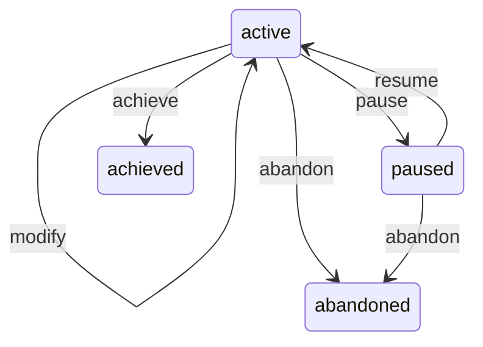

# The ledger

## Goals

**Goal state**: The lifecycle state of a Goal version.

- active
- paused
- achieved
- abandoned

**Pending work**: The host's pause disposition for queued work, with running work allowed to finish.

- keep: Hold queued work for resume.
- discard: Drop queued and retryable work.

**Event**: The operation that writes a Goal version.

- set
- decompose
- modify
- pause
- resume
- achieve
- abandon

**Lifecycle refusal**: Why an operation cannot use the named series head.

- wrong state

**Execution**: Who owns execution and the interpretation of a pause disposition.

- host
- core

**Child heads**: The inputs that decide closure after locking the child series heads.

- empty
- open
- all abandoned
- closed with achieved

**Close**: Closing operations and their child-outcome rules.

- achieve
- abandon

**Close refusal**: Closure refusals, listing open heads by child handle before considering all-abandoned children.

- children open
- all abandoned

**Pin edit**: Whether an edit omits its pin list or supplies its replacement, including an empty list.

- omitted
- supplied

**Revision field**: Whether a revision retains or replaces a declaration.

- carry
- replace

**Evidence source**: Source classes considered when admitting Goal evidence.

- local
- other store

**Evidence check**: Where a Goal evidence target's live kind is checked.

- owner transaction
- caller read at source

**Read goal**: Which Goal identity a read surface selects.

- read
- list
- declared reference

**Read revision**: The revision selected by an authorized read.

- readable head
- exact

**Request match**: The durable request comparison made under the owner and request key.

- fresh
- exact
- different
- missing declaration

**Replay action**: Whether the replay may be returned, must be refused, or needs fresh admission.

- fresh admission
- return original
- conflict

**Decompose replay**: The replay status across a decomposition's complete request set.

- all fresh
- all exact
- mixed
- conflicting

**Replay field**: The durable parts compared for replay, separate from an episode's write-act binding.

- command
- expected head
- author category
- session self
- write act

**Head comparison**: The outcomes of comparing the predecessor under the locked Goal head.

- unchanged
- named stale
- unnamed drift

**Commit decision**: The commit decision after comparing the predecessor.

- proceed
- conflict
- retry

**Transaction refusal**: Transient transaction refusals on the pool-scoped idempotent write path.

- serialization
- deadlock
- other

**Admission step**: The steps of Goal revision persistence, from owner fencing to target revalidation.

- fence owners
- reserve fact identity
- lock memory handles
- lock lifecycle union
- lock goal heads
- revalidate targets

**Fact admission**: The only Fact admission path allowed to use a reserved Goal-change identity.

- goal transaction
- ordinary fact

**Change fact admission**: The publication admission for a fresh Goal revision.

- skip
- publish
- missing stamp

**Change fields**: The variant-specific payload fields of a Goal change.

- plain
- parent
- pending

**Goal clock**: The two clocks projected by a Goal version read.

- set at
- changed at

**Goal version time**: Which revision identity supplies a projected time.

- first version
- selected version

**birth state** = active: Set and decomposition start each new series here.

**execution** = host: Execution belongs to the host.

**title max** = 240: The largest trimmed Goal title in characters.

**text max** = 20000: The largest trimmed Goal prompt in characters.

**decompose child max** = 50: The largest number of children in one decompose request.

**decompose root key max** = 162: The root key character ceiling that leaves room for the child prefix, separators and largest index.

**decompose child prefix** = "goal_decompose": The prefix of each child request key, followed by the root key and zero-based index.

**evidence declaration** = "goal.evidence_t": Goal evidence is read from the exact declaration whose pins are projected by `Causa.goalDeclaredTargetIds`.

**motivation declaration** = "goal.motivated_by": The authoritative field behind the reverse index, with targets governed by `Causa.goal_motivations_valid`.

**operator authorship** = "system_operator": Operators use their authorship category in the durable command and its replay identity.

**admission order** = [fence owners, reserve fact identity, lock memory handles, lock lifecycle union, lock goal heads, revalidate targets]: Goal revision persistence reserves lifecycle Facts before locking the sorted Memory and lifecycle sets and comparing the prepared head.

**transfer goal** = no: A Goal remains owned by its original owner throughout its series.

| goal state | is open | terminal | state label |
| --- | --- | --- | --- |
| active | yes | no | "Active" |
| paused | yes | no | "Paused" |
| achieved | no | yes | "Achieved" |
| abandoned | no | yes | "Abandoned" |

- is open: Whether the series can take another version.
- terminal: Whether a Goal version requires a close Fact and ends its series.
- state label: The label projected on Goal reads.

**lifecycle**: Admission by existing head state, returning the new version state or the new child state for decomposition.

| goal state | event | answer |
| --- | --- | --- |
| active | set | refused: wrong state |
| active | resume | refused: wrong state |
| paused | set | refused: wrong state |
| paused | decompose | refused: wrong state |
| paused | modify | refused: wrong state |
| paused | pause | refused: wrong state |
| paused | achieve | refused: wrong state |
| achieved | set | refused: wrong state |
| achieved | decompose | refused: wrong state |
| achieved | modify | refused: wrong state |
| achieved | pause | refused: wrong state |
| achieved | resume | refused: wrong state |
| achieved | achieve | refused: wrong state |
| achieved | abandon | refused: wrong state |
| abandoned | set | refused: wrong state |
| abandoned | decompose | refused: wrong state |
| abandoned | modify | refused: wrong state |
| abandoned | pause | refused: wrong state |
| abandoned | resume | refused: wrong state |
| abandoned | achieve | refused: wrong state |
| abandoned | abandon | refused: wrong state |

| goal state | goal state | may transition to |
| --- | --- | --- |
| active | active | yes |
| active | paused | yes |
| active | achieved | no |
| active | abandoned | yes |
| paused | active | yes |
| paused | paused | no |
| paused | achieved | no |
| paused | abandoned | yes |
| achieved | active | no |
| achieved | paused | no |
| achieved | achieved | no |
| achieved | abandoned | no |
| abandoned | active | no |
| abandoned | paused | no |
| abandoned | achieved | no |
| abandoned | abandoned | no |

- may transition to: Allowed predecessors and successors on the plain write path.

| close | child heads | close guard |
| --- | --- | --- |
| achieve | empty | yes |
| achieve | open | refused: children open |
| achieve | all abandoned | refused: all abandoned |
| achieve | closed with achieved | yes |
| abandon | empty | yes |
| abandon | open | refused: children open |
| abandon | all abandoned | yes |
| abandon | closed with achieved | yes |

- close guard: Closing leaves no open child and achievement of a nonempty decomposition requires an achieved child.

| goal state | bool | close fact presence |
| --- | --- | --- |
| active | yes | no |
| active | no | yes |
| paused | yes | no |
| paused | no | yes |
| achieved | yes | yes |
| achieved | no | no |
| abandoned | yes | yes |
| abandoned | no | no |

- close fact presence: Whether close-Fact presence agrees exactly with terminal state.

| pin edit | edit pins |
| --- | --- |
| omitted | carry |
| supplied | replace |

- edit pins: Omitted motivation and evidence carry forward and supplied lists replace them.

| event | prompt revision | parent revision | may declare evidence | change fields | reuses assignment |
| --- | --- | --- | --- | --- | --- |
| set | replace | replace | yes | plain | no |
| decompose | replace | replace | yes | parent | no |
| modify | replace | carry | yes | plain | no |
| pause | carry | carry | no | pending | no |
| resume | carry | carry | no | plain | no |
| achieve | carry | carry | yes | plain | no |
| abandon | carry | carry | no | plain | no |

- prompt revision: Declaring writes supply a prompt and lifecycle changes carry the stored prompt byte for byte.
- parent revision: A child keeps the parent series chosen at birth alongside its exact parent dependency under `Causa.GoalStep`.
- may declare evidence: Which Goal operations can supply an evidence statement, always optional.
- change fields: Decomposition alone carries the parent revision and pause alone carries a pending disposition.
- reuses assignment: Earlier assignment belongs only to the historical version that declared it.

| evidence source | evidence admission |
| --- | --- |
| local | owner transaction |
| other store | caller read at source |

- evidence admission: Exact live Facts and Abstractions are eligible as Goal evidence under `Causa.RetainedGoalEvidenceValid`.

| read goal | read revision |
| --- | --- |
| read | readable head |
| list | readable head |
| declared reference | exact |

- read revision: Goal reads and lists select readable heads while declared references keep their exact revision.

| request match | request replay |
| --- | --- |
| fresh | fresh admission |
| exact | return original |
| different | conflict |
| missing declaration | conflict |

- request replay: After authority, exact replay returns the original before mutable targets and creates no second write.

| decompose replay | decompose replay |
| --- | --- |
| all fresh | fresh admission |
| all exact | return original |
| mixed | conflict |
| conflicting | conflict |

- decompose replay: Decomposition admits the whole request set or answers its whole replay.

| replay field | replay identity |
| --- | --- |
| command | yes |
| expected head | yes |
| author category | yes |
| session self | no |
| write act | no |

- replay identity: Replay seals the command, including any pause disposition, and excludes attempt attribution.

| head comparison | predecessor arbitration |
| --- | --- |
| unchanged | proceed |
| named stale | conflict |
| unnamed drift | retry |

- predecessor arbitration: A stale named predecessor conflicts and unnamed prediction drift retries the complete transaction.

| transaction refusal | retry transaction |
| --- | --- |
| serialization | yes |
| deadlock | yes |
| other | no |

- retry transaction: Whether to retry the complete pool-scoped Goal transaction.

| bool | bool | source admission | publish change fact | display admitted | edit space matches | state filter | fact goal filter | recall active goal |
| --- | --- | --- | --- | --- | --- | --- | --- | --- |
| yes | yes | yes | publish | yes | yes | yes | yes | yes |
| yes | no | no | missing stamp | no | no | yes | no | no |
| no | yes | no | skip | no | yes | yes | no | yes |
| no | no | no | skip | no | yes | no | no | yes |

- source admission: A Goal write requires each discovered source to pass a read revalidated under the writing transaction's owner and Goal route locks.
- publish change fact: A listenable fresh revision requires a stamp and emits its change Fact after the Goal in the same transaction.
- display admitted: The Goal's prompt and title are trimmed, nonblank and within their character bounds at admission.
- edit space matches: An edit uses the named Goal's owner and an explicit space can only narrow that selection.
- state filter: A state filter is a union of case-insensitive labels, and binds its canonical set into the cursor.
- fact goal filter: Fact Goal filters match references to any readable revision of a selected series before page limiting.
- recall active goal: Recall includes unmotivated Active Goals and Active Goals motivated by a recalled Perspective head.

| fact admission | reserve change fact |
| --- | --- |
| goal transaction | yes |
| ordinary fact | no |

- reserve change fact: A Goal-change Fact uses its reserved identity under the pre-held lock union, with no declared scope or read set.

| bool | read evidence |
| --- | --- |
| yes | yes |
| no | no |

- read evidence: The Goal evidence vector is returned as declared when its exact version is visible.

| goal clock | clock source |
| --- | --- |
| set at | first version |
| changed at | selected version |

- clock source: A Goal reports its series birth and the selected version's own write time.

✗ **core execution**, rejected: Core scheduling would assign Goal effects to the persistence layer.

Causa — Audience

✓ **has meet**: Capability intersection for a role cap.

✓ **has join**: Capability union across roles.

✓ **has write read**: Read access follows from write access at the same memory kind.

✓ **admin has**: The capabilities of the unrestricted group role.

✓ **gives mono**: Lifting capability implication from roles to groups.

✓ **gives mount**: Capability resolution under a subgroup cap.

✓ **gives union**: Capability resolution across group memberships.

✓ **gives iff**: The two conditions for a grant to convey a capability.

✓ **flattened gives**: Equivalence of flattened lookup and per-grant authorization.

✓ **mount mount**: Composition of nested subgroup caps.

✓ **mount union**: Distribution of a subgroup cap over a group union.

✓ **grant to person**: Capability resolution for a grant addressed directly to a person.

✓ **drop gives self**: Revocation of the removed member's group capabilities.

✓ **drop gives other**: Preservation of other members' capabilities on removal.

✓ **drop ends grant**: Revocation through a group grant after membership removal.

✓ **drop keeps others**: Preservation of other recipients' grant capabilities after membership removal.

✓ **may manage iff gives**: Group management expressed as a resolved capability.

Causa — Authorization

✓ **may write implies read**: Owner-scoped writes imply reads at the same memory kind.

✓ **forwarding role capped**: A forwarded role is bounded by `Causa.Role.forwardingCap`.

✓ **forwarding role no management**: 

✓ **forwarding role no administration**: 

✓ **forwarding role no goal work**: 

Causa — Citations

✓ **inst immutable blob**: 

✓ **inst append only blob**: 

✓ **citation owner match**: 

Causa — Compliance

✓ **authorized**: 

✓ **own schema**: 

✓ **in owner**: Ownership of every stored version in the erase selection.

✓ **pin render live not forgotten**: 

✓ **target in memories**: 

✓ **memory ids unique**: 

✓ **witness ids unique**: 

✓ **witness memory disjoint**: 

✓ **witness goal disjoint**: 

✓ **target witness compatible**: 

✓ **target not goal**: 

✓ **memories eq**: 

✓ **targets eq**: 

✓ **hard erase memory records kind**: 

✓ **hard erase memory result well formed**: 

✓ **target in goals**: 

✓ **witness ids unique**: 

✓ **witness memory disjoint**: 

✓ **witness goal disjoint**: 

✓ **target witness compatible**: 

✓ **target not memory**: 

✓ **memories eq**: 

✓ **goals eq**: 

✓ **targets eq**: 

✓ **hard erase goal records kind**: 

✓ **hard erase goal result well formed**: 

Causa — Goal collaboration authority

✓ **goal edit implies read**: Goal read authorization follows from edit authorization.

✓ **goal route is flattened**: Goal audience resolution agrees with `Causa.flattened` for grants in force.

✓ **goal work write implies read**: 

Causa — Pins

✓ **unreadable goal reference resolves like a memory reference**: Indistinguishability of unreadable Goal and Memory references after projection.

Causa — Goals

✓ **terminal close fact**: 

✓ **text nonblank**: 

✓ **inst append only goal**: 

✓ **no open under closed**: 

✓ **parents exist**: 

✓ **parent older**: 

✓ **born below clock**: 

✓ **fresh**: 

✓ **state x**: 

✓ **parent x**: 

✓ **born x**: 

✓ **clock**: 

✓ **state eq**: 

✓ **parent eq**: 

✓ **born eq**: 

✓ **state old**: 

✓ **state x**: 

✓ **state eq**: 

✓ **parent**: 

✓ **born**: 

✓ **clock**: 

✓ **relabel is some**: 

✓ **relabel keeps shape**: The forest shape conditions preserved by relabeling.

✓ **open relabel preserves**: Preservation of forest validity by relabeling to an open state from an open state.

✓ **closing relabel preserves**: Preservation of forest validity by closing a series with no open child.

✓ **birth preserves**: Preservation of forest validity by creating a root or a child of an Active series.

✓ **set preserves**: 

✓ **decompose preserves**: 

✓ **pause preserves**: 

✓ **resume preserves**: 

✓ **modify preserves**: 

✓ **achieve preserves**: 

✓ **abandon preserves**: 

✓ **goal step preserves inv**: 

✓ **empty forest inv**: 

✓ **reachable inv**: 

✓ **closed ancestor closes descendant**: Closure of all descendants of a closed Goal.

✓ **descends born lt**: 

✓ **goal tree acyclic**: Acyclicity of the Goal tree.

Causa — Identity

✓ **personal resolves**: The personal-owner resolution law.

Causa — Memory

✓ **erased pin target ext**: 

✓ **inst append only content**: 

✓ **inst immutable content**: 

✓ **guided by only perspective**: Restriction of Goal guidance to Perspectives.

✓ **fact origins empty**: Exclusion of grounding origins from Facts.

✓ **perspective never cites**: Exclusion of blob citations from Perspectives.

✓ **blob fa only**: The kinds eligible to cite a blob.

✓ **inst append only memory**: 

✓ **forget in keeps row**: Preservation of the admission's identity, kind and owner through forgetting.

✓ **pin kind is forget in**: Preservation of target kind across forgetting.

✓ **fact empty**: 

✓ **abs fact or abs**: 

✓ **persp abs or empty**: 

✓ **fact empty**: 

✓ **abs fact or abs**: 

✓ **persp abs or empty**: 

Causa — Operators

✓ **inputs shape**: 

✓ **output memories shape**: 

✓ **output goals shape**: 

✓ **memory inputs**: 

✓ **goal inputs**: 

✓ **operator memory output not fact**: 

Causa — Owner

✓ **write le read**: 

✓ **works goals reads goals**: Goal work includes Goal read access.

✓ **meet capped**: Preservation of capability bounds under a role cap.

✓ **meet comm**: Commutativity of the Goal capability meet.

✓ **meet assoc**: 

✓ **meet join distrib**: 

✓ **ext**: Role equality determined by capability fields.

✓ **meet comm**: 

✓ **meet assoc**: 

✓ **meet join distrib**: Distributivity of a role cap over a membership join.

Causa — Prelude

Causa — Principles

✓ **principle 1 fact has no origins**: Principle 1 — Facts are primitive observations.

✓ **principle 2 derivation goes up and grounds in facts**: Principle 2 — The layering and grounding of derived Memory.

✓ **principle access is one resolved role**: Principle 3 — Owner and audience access through one resolved role.

✓ **principle 4 the field fixes the kind**: Principle 4 — Relationship typing by the declaring field.

✓ **principle 5 no transition retargets a pin**: Principle 5 — Stability of pin targets through forgetting and erasure.

✓ **principle 6 erasure leaves no dangling pin**: Principle 6 — Preservation of pin resolution through hard erasure.

✓ **principle 7 a read pin never grounds**: Principle 7 — Read context is independent of grounding.

✓ **principle 8 a goal never grounds**: Principle 8 — Goal intent is outside Memory grounding.

Causa — Provenance grounding

✓ **memory id unique**: 

✓ **goal id unique**: 

✓ **head aligned**: 

✓ **fork anchor aligned**: 

✓ **pin targets exist**: Target existence for the graph's typed pins.

✓ **motivations valid**: 

✓ **guidance valid**: 

✓ **origin kind**: 

✓ **memory goal ids disjoint**: Disjointness of Memory and Goal version identities.

✓ **abstraction has origins**: The origin requirement for an Abstraction.

✓ **derived provenance**: The provenance requirement for derived Memory.

✓ **grounding support**: Stored support for grounding derived Memory.

✓ **pin time strict**: The insertion order of stored pin targets.

✓ **memory id unique**: 

✓ **goal id unique**: 

✓ **erased pin id unique**: 

✓ **head aligned**: 

✓ **fork anchor aligned**: 

✓ **pin targets exist**: 

✓ **motivations valid**: 

✓ **guidance valid**: 

✓ **origin kind**: 

✓ **memory goal ids disjoint**: Disjointness of retained Memory and Goal version identities.

✓ **erased memory disjoint**: 

✓ **erased goal disjoint**: 

✓ **abstraction has origins**: The origin requirement for a retained Abstraction.

✓ **derived provenance**: The provenance requirement for retained derived Memory.

✓ **pin time strict**: The insertion order of retained stored pin targets.

✓ **graph**: 

✓ **assignments**: 

✓ **evidence**: 

✓ **terminal close**: 

✓ **grounding wf**: 

✓ **memory grounds in facts**: 

✓ **perspective has provenance**: 

✓ **guidance does not ground**: 

Causa — Schema evolution

✓ **source memory coverage**: Coverage of source Memory admissions by the migration relation.

✓ **source goal coverage**: 

✓ **target memory declaration**: 

✓ **target goal declaration**: 

✓ **mapped memory owner**: 

✓ **mapped goal owner**: 

✓ **mapped memory pins**: 

✓ **mapped goal pins**: 

✓ **new memory id unique**: 

✓ **new goal id unique**: 

✓ **retained target id unique**: 

✓ **new head aligned**: 

✓ **new fork anchor aligned**: 

✓ **retained pin targets exist**: 

✓ **retained motivations valid**: 

✓ **retained guidance valid**: 

✓ **retained origin kind**: 

✓ **memory goal ids disjoint**: 

✓ **erased memory disjoint**: 

✓ **erased goal disjoint**: 

✓ **abstraction has origins**: 

✓ **derived provenance**: 

✓ **pin time strict**: 

✓ **assignments valid**: 

✓ **evidence valid**: 

✓ **terminal close valid**: 

✓ **schema migration validates retained store**: 
